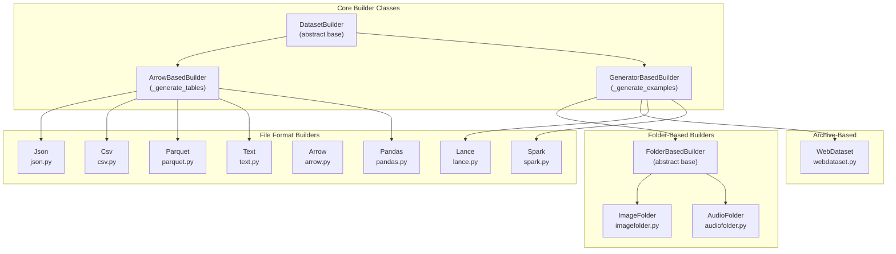
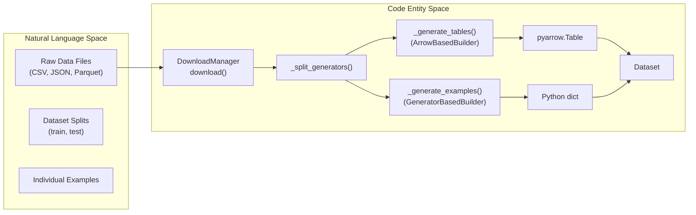
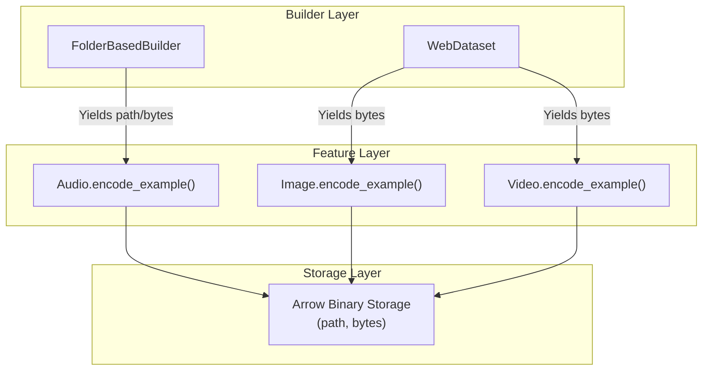

<!-- source: DeepWiki mcp.deepwiki.com · repo huggingface/datasets · page 3.3 Packaged Modules · fetched 2026-10-26 -->

# Packaged Modules

Relevant source files

The following files were used as context for generating this wiki page:

- [docs/source/about_dataset_load.mdx](docs/source/about_dataset_load.mdx)
- [docs/source/tsfile_load.mdx](docs/source/tsfile_load.mdx)
- [docs/source/use_with_spark.mdx](docs/source/use_with_spark.mdx)
- [src/datasets/download/download_config.py](src/datasets/download/download_config.py)
- [src/datasets/io/spark.py](src/datasets/io/spark.py)
- [src/datasets/packaged_modules/arrow/__init__.py](src/datasets/packaged_modules/arrow/__init__.py)
- [src/datasets/packaged_modules/arrow/arrow.py](src/datasets/packaged_modules/arrow/arrow.py)
- [src/datasets/packaged_modules/audiofolder/audiofolder.py](src/datasets/packaged_modules/audiofolder/audiofolder.py)
- [src/datasets/packaged_modules/conll/__init__.py](src/datasets/packaged_modules/conll/__init__.py)
- [src/datasets/packaged_modules/conll/conll.py](src/datasets/packaged_modules/conll/conll.py)
- [src/datasets/packaged_modules/csv/csv.py](src/datasets/packaged_modules/csv/csv.py)
- [src/datasets/packaged_modules/folder_based_builder/folder_based_builder.py](src/datasets/packaged_modules/folder_based_builder/folder_based_builder.py)
- [src/datasets/packaged_modules/hdf5/__init__.py](src/datasets/packaged_modules/hdf5/__init__.py)
- [src/datasets/packaged_modules/hdf5/hdf5.py](src/datasets/packaged_modules/hdf5/hdf5.py)
- [src/datasets/packaged_modules/iceberg/__init__.py](src/datasets/packaged_modules/iceberg/__init__.py)
- [src/datasets/packaged_modules/iceberg/iceberg.py](src/datasets/packaged_modules/iceberg/iceberg.py)
- [src/datasets/packaged_modules/json/json.py](src/datasets/packaged_modules/json/json.py)
- [src/datasets/packaged_modules/lance/__init__.py](src/datasets/packaged_modules/lance/__init__.py)
- [src/datasets/packaged_modules/lance/lance.py](src/datasets/packaged_modules/lance/lance.py)
- [src/datasets/packaged_modules/pandas/pandas.py](src/datasets/packaged_modules/pandas/pandas.py)
- [src/datasets/packaged_modules/parquet/parquet.py](src/datasets/packaged_modules/parquet/parquet.py)
- [src/datasets/packaged_modules/spark/spark.py](src/datasets/packaged_modules/spark/spark.py)
- [src/datasets/packaged_modules/text/text.py](src/datasets/packaged_modules/text/text.py)
- [src/datasets/packaged_modules/tsfile/__init__.py](src/datasets/packaged_modules/tsfile/__init__.py)
- [src/datasets/packaged_modules/tsfile/tsfile.py](src/datasets/packaged_modules/tsfile/tsfile.py)
- [src/datasets/packaged_modules/webdataset/webdataset.py](src/datasets/packaged_modules/webdataset/webdataset.py)
- [src/datasets/packaged_modules/xml/__init__.py](src/datasets/packaged_modules/xml/__init__.py)
- [src/datasets/packaged_modules/xml/xml.py](src/datasets/packaged_modules/xml/xml.py)
- [src/datasets/utils/json.py](src/datasets/utils/json.py)
- [tests/fixtures/files.py](tests/fixtures/files.py)
- [tests/io/test_parquet.py](tests/io/test_parquet.py)
- [tests/io/test_sql.py](tests/io/test_sql.py)
- [tests/packaged_modules/test_arrow.py](tests/packaged_modules/test_arrow.py)
- [tests/packaged_modules/test_conll.py](tests/packaged_modules/test_conll.py)
- [tests/packaged_modules/test_csv.py](tests/packaged_modules/test_csv.py)
- [tests/packaged_modules/test_folder_based_builder.py](tests/packaged_modules/test_folder_based_builder.py)
- [tests/packaged_modules/test_hdf5.py](tests/packaged_modules/test_hdf5.py)
- [tests/packaged_modules/test_iceberg.py](tests/packaged_modules/test_iceberg.py)
- [tests/packaged_modules/test_json.py](tests/packaged_modules/test_json.py)
- [tests/packaged_modules/test_lance.py](tests/packaged_modules/test_lance.py)
- [tests/packaged_modules/test_parquet.py](tests/packaged_modules/test_parquet.py)
- [tests/packaged_modules/test_spark.py](tests/packaged_modules/test_spark.py)
- [tests/packaged_modules/test_text.py](tests/packaged_modules/test_text.py)
- [tests/packaged_modules/test_tsfile.py](tests/packaged_modules/test_tsfile.py)
- [tests/packaged_modules/test_webdataset.py](tests/packaged_modules/test_webdataset.py)

Packaged modules are built-in dataset builders located in `src/datasets/packaged_modules/` that provide no-code solutions for loading datasets from common file formats and directory structures. These builders are automatically selected by `load_dataset` based on file extensions or directory patterns, eliminating the need for custom loading scripts in most cases.

The packaged modules include:

**File Format Builders**:
- `json` - JSON and JSON Lines files
- `csv` - CSV and TSV files  
- `parquet` - Apache Parquet files
- `text` - Plain text files
- `arrow` - Arrow IPC files
- `pandas` - Pickle files from pandas
- `sql` - SQL databases (SQLite, etc.)
- `lance` - Lance columnar format
- `spark` - Spark DataFrames
- `hdf5` - HDF5 files
- `xml` - XML files

**Folder-Based Builders**:
- `imagefolder` - Image files organized in directories
- `audiofolder` - Audio files organized in directories
- `videofolder` - Video files organized in directories
- `pdffolder` - PDF files organized in directories

**Archive-Based Builders**:
- `webdataset` - TAR archives following WebDataset format

For information about the general dataset loading system and how these builders are selected, see [load_dataset API]() and [DatasetBuilder Framework](). For media feature types these builders produce, see [Media Features]().

---

## Builder Hierarchy

Packaged modules inherit from the core `DatasetBuilder` infrastructure, with two main architectural patterns: `ArrowBasedBuilder` for file formats and `GeneratorBasedBuilder` for more complex data sources.

**Packaged Module Hierarchy**

**Key Distinctions**:
- **ArrowBasedBuilder**: Implements `_generate_tables()` to yield PyArrow tables directly. Used for structured file formats.
- **GeneratorBasedBuilder**: Implements `_generate_examples()` to yield individual examples. Used for folder structures and archives.

**Sources**: [src/datasets/packaged_modules/json/json.py:64-65](), [src/datasets/packaged_modules/csv/csv.py:145-146](), [src/datasets/packaged_modules/parquet/parquet.py:93-94](), [src/datasets/packaged_modules/folder_based_builder/folder_based_builder.py:42-53](), [src/datasets/packaged_modules/webdataset/webdataset.py:20-21](), [src/datasets/packaged_modules/lance/lance.py:92-93](), [src/datasets/packaged_modules/spark/spark.py:16-17]()

## File Format Builders

File format builders inherit from `ArrowBasedBuilder` and provide automatic loading for common structured data formats. They all follow a similar pattern: accept file paths via `data_files`, yield PyArrow tables in chunks, and support features specification.

### JSON Builder

The `Json` builder loads JSON and JSON Lines (`.jsonl`) files. It supports both:
- **JSON Lines format**: One JSON object per line (most common)
- **Single JSON object**: The entire file is one JSON object, with optional field extraction

**Configuration Class**: `JsonConfig` at [src/datasets/packaged_modules/json/json.py:46-59]()

| Parameter | Type | Default | Description |
|-----------|------|---------|-------------|
| `features` | `Features` | `None` | Schema to cast data to |
| `encoding` | `str` | `"utf-8"` | File encoding |
| `field` | `str` | `None` | Extract data from this field in a JSON object |
| `chunksize` | `int` | `10 << 20` | Chunk size in bytes (10MB default) |

**Loading Process**:
1. For single JSON objects with a specific `field`, it reads the whole file and extracts the field at [src/datasets/packaged_modules/json/json.py:158-165]().
2. For JSON Lines, it reads in chunks using `chunksize` at [src/datasets/packaged_modules/json/json.py:171-178]().
3. It uses `pyarrow.json.read_json` for efficient parsing of batches at [src/datasets/packaged_modules/json/json.py:178-185]().
4. It performs a table cast to the target features via `_cast_table` at [src/datasets/packaged_modules/json/json.py:109-137]().

**Sources**: [src/datasets/packaged_modules/json/json.py:1-200]()

### CSV Builder

The `Csv` builder loads CSV and TSV files using pandas under the hood, with extensive configuration options matching `pandas.read_csv()`.

**Configuration Class**: `CsvConfig` at [src/datasets/packaged_modules/csv/csv.py:25-69]()

**Processing Pipeline**:
1. Builds `pd_read_csv_kwargs` dict from config at [src/datasets/packaged_modules/csv/csv.py:78-142]().
2. Uses `pd.read_csv` with the specified `chunksize` (default 10,000) at [src/datasets/packaged_modules/csv/csv.py:189-190]().
3. Iterates through pandas chunks and converts them to `pa.Table` at [src/datasets/packaged_modules/csv/csv.py:191-196]().
4. Applies `table_cast` to align with `features` if provided at [src/datasets/packaged_modules/csv/csv.py:169-175]().

**Sources**: [src/datasets/packaged_modules/csv/csv.py:1-200]()

### Parquet Builder

The `Parquet` builder loads Apache Parquet files using PyArrow's dataset API, supporting advanced features like column selection and predicate pushdown.

**Configuration Class**: `ParquetConfig` at [src/datasets/packaged_modules/parquet/parquet.py:20-88]()

**Loading Process**:
1. Infers features from the Parquet schema at [src/datasets/packaged_modules/parquet/parquet.py:123-128]().
2. Uses `pyarrow.dataset.ParquetFileFormat` to handle fragments at [src/datasets/packaged_modules/parquet/parquet.py:180-182]().
3. Supports `filters` for predicate pushdown (e.g., skipping row groups based on statistics) at [src/datasets/packaged_modules/parquet/parquet.py:85]().
4. Yields tables in `_generate_tables` using the dataset scanner at [src/datasets/packaged_modules/parquet/parquet.py:184-191]().

**Sources**: [src/datasets/packaged_modules/parquet/parquet.py:1-191]()

---

## Folder-Based Builders

Folder-based builders (`ImageFolder`, `AudioFolder`, etc.) automatically load media datasets organized in directory structures. They share a common base class `FolderBasedBuilder` and support automatic label inference and metadata integration.

### FolderBasedBuilder Logic

The `FolderBasedBuilder` implements the core logic for scanning directories and archives.

**Implementation Flow**:
1. `_split_generators` scans the data files to identify labels and metadata files at [src/datasets/packaged_modules/folder_based_builder/folder_based_builder.py:71-122]().
2. If `drop_labels` is False, it treats subdirectory names as `ClassLabel` values at [src/datasets/packaged_modules/folder_based_builder/folder_based_builder.py:144-150]().
3. It identifies metadata files (e.g., `metadata.csv`, `metadata.jsonl`) to augment features at [src/datasets/packaged_modules/folder_based_builder/folder_based_builder.py:60]().
4. `_generate_examples` iterates through files, yielding the media object (Image/Audio) along with its metadata and label at [src/datasets/packaged_modules/folder_based_builder/folder_based_builder.py:355-456]().

**Sources**: [src/datasets/packaged_modules/folder_based_builder/folder_based_builder.py:1-456]()

---

## WebDataset Builder

`WebDataset` loads datasets stored in TAR archives where examples are grouped by a shared prefix (the "key").

**Processing Pipeline**:
1. `_get_pipeline_from_tar` iterates through a TAR archive, grouping files with the same base name into a single example at [src/datasets/packaged_modules/webdataset/webdataset.py:30-56]().
2. It automatically decodes common extensions (e.g., `.jpg` to `Image`, `.json` to dict) using the `DECODERS` map at [src/datasets/packaged_modules/webdataset/webdataset.py:53-54]().
3. It handles nested compression (e.g., `.txt.gz` inside a TAR) at [src/datasets/packaged_modules/webdataset/webdataset.py:45-52]().
4. `_split_generators` performs feature inference by looking at the first few examples at [src/datasets/packaged_modules/webdataset/webdataset.py:75-105]().

**Sources**: [src/datasets/packaged_modules/webdataset/webdataset.py:1-150]()

---

## Special Purpose Builders

### Spark and Lance Builders

These builders facilitate integration with modern data engineering stacks.

- **Spark**: Loads from a Spark DataFrame by iterating through partitions at [src/datasets/packaged_modules/spark/spark.py:40-47]().
- **Lance**: Loads from Lance datasets using the `lance` library, supporting efficient random access and vector search formats. It can resolve dataset URIs from a list of files at [src/datasets/packaged_modules/lance/lance.py:62-69]().

**Sources**: [src/datasets/packaged_modules/spark/spark.py:1-47](), [src/datasets/packaged_modules/lance/lance.py:1-120]()

### HDF5 Builder

The `HDF5` builder reads data from HDF5 files. It maps HDF5 datasets to Arrow columns. It can read entire datasets into memory or stream them.

**Sources**: [src/datasets/packaged_modules/hdf5/hdf5.py:1-74]()

---

## Entity Mapping: Builder Data Flow

This diagram maps the logical flow of data from raw files to Arrow tables, associating them with specific class methods.

**Sources**: [src/datasets/packaged_modules/json/json.py:79-107](), [src/datasets/packaged_modules/csv/csv.py:151-167](), [src/datasets/packaged_modules/parquet/parquet.py:114-150]()

## Media Feature Interaction

The interaction between builders and media features during the loading process.

**Sources**: [src/datasets/packaged_modules/webdataset/webdataset.py:112-137](), [src/datasets/packaged_modules/folder_based_builder/folder_based_builder.py:355-456]()

---

