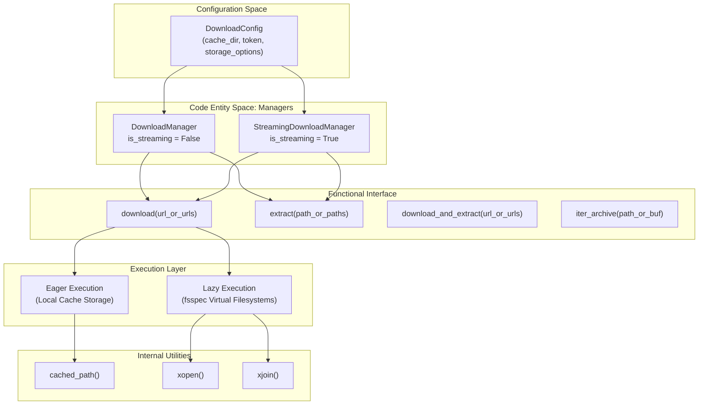
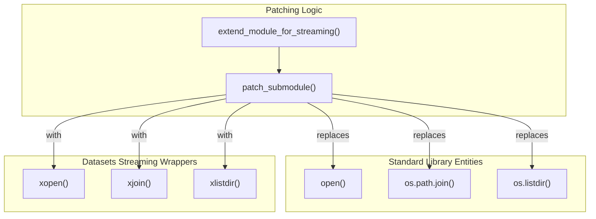

<!-- source: DeepWiki mcp.deepwiki.com · repo huggingface/datasets · page 3.4 Download Managers · fetched 2026-10-26 -->

# Download Managers

Relevant source files

The following files were used as context for generating this wiki page:

- [src/datasets/arrow_reader.py](src/datasets/arrow_reader.py)
- [src/datasets/download/download_manager.py](src/datasets/download/download_manager.py)
- [src/datasets/download/streaming_download_manager.py](src/datasets/download/streaming_download_manager.py)
- [src/datasets/naming.py](src/datasets/naming.py)
- [src/datasets/splits.py](src/datasets/splits.py)
- [src/datasets/streaming.py](src/datasets/streaming.py)
- [src/datasets/utils/extract.py](src/datasets/utils/extract.py)
- [src/datasets/utils/file_utils.py](src/datasets/utils/file_utils.py)
- [src/datasets/utils/patching.py](src/datasets/utils/patching.py)
- [tests/test_arrow_reader.py](tests/test_arrow_reader.py)
- [tests/test_extract.py](tests/test_extract.py)
- [tests/test_file_utils.py](tests/test_file_utils.py)
- [tests/test_patching.py](tests/test_patching.py)
- [tests/test_streaming_download_manager.py](tests/test_streaming_download_manager.py)

## Purpose and Scope

Download managers are responsible for data acquisition in the `datasets` library, handling the retrieval and extraction of dataset files. The library provides two primary implementations tailored for different execution models:

- **`DownloadManager`**: Implements an eager approach. It downloads files to a local disk cache and extracts archives to local directories. This is the default manager for standard dataset loading where data fits on disk. [src/datasets/download/download_manager.py:71-72]()
- **`StreamingDownloadManager`**: Implements a lazy approach. Instead of downloading, it returns URLs or paths decorated with protocol prefixes (e.g., `gzip://`) that allow `fsspec` to stream data on-the-fly. This is used for `IterableDataset` and large-scale data processing. [src/datasets/download/streaming_download_manager.py:47-55]()

This page details the implementation, data flow, and configuration of these managers, as well as their integration with the underlying filesystem layer.

---

## Download Manager Architecture

### Class Hierarchy and Execution Models

The architecture bridges high-level data requests from a `DatasetBuilder` to low-level filesystem operations.

**Diagram: Mapping of Manager Classes to Execution Models**

Sources: [src/datasets/download/download_manager.py:71-108](), [src/datasets/download/streaming_download_manager.py:47-67](), [src/datasets/streaming.py:42-59]()

---

## DownloadManager (Eager Mode)

### Implementation Detail

`DownloadManager` handles the physical movement of data. When `download()` is invoked, it uses `cached_path()` to fetch remote resources, verifying integrity via ETags and recording metadata. [src/datasets/download/download_manager.py:131-179]()

**Key Features:**
- **Parallelism**: Uses `thread_map` for batch downloads if `num_proc` is configured in `DownloadConfig`. [src/datasets/download/download_manager.py:158-167]()
- **Checksums**: Automatically computes file sizes and SHA256 checksums, storing them in `_recorded_sizes_checksums` for dataset verification. [src/datasets/download/download_manager.py:118-130]()
- **Tracking**: Returns `tracked_str` objects that carry origin URL metadata throughout the pipeline. [src/datasets/download/download_manager.py:43-43](), [src/datasets/download/download_manager.py:224-232]()

### Download and Extract Flow

**Diagram: Eager Data Flow in DownloadManager**

Sources: [src/datasets/download/download_manager.py:131-180](), [src/datasets/download/download_manager.py:278-308](), [src/datasets/utils/extract.py:27-54]()

---

## StreamingDownloadManager (Lazy Mode)

### Implementation Detail

`StreamingDownloadManager` performs path transformation rather than data transfer. It prepares "chained URLs" that leverage `fsspec`'s ability to pipe protocols. For example, extracting a GZIP file returns a path like `gzip://inner_file::https://domain.com/file.gz`. [src/datasets/download/streaming_download_manager.py:143-149]()

### Protocol Transformation Logic

The `_extract` method determines the correct `fsspec` protocol based on file extensions using `_get_extraction_protocol`. [src/datasets/download/streaming_download_manager.py:124-149]()

| Extension | Protocol | Logic |
|-----------|----------|-------|
| `.gz`, `.gzip` | `gzip://` | Prepends protocol and strips extension for inner name. [src/datasets/download/streaming_download_manager.py:143-147]() |
| `.zip` | `zip://` | Uses `zip://::url` syntax for archive navigation. [src/datasets/download/streaming_download_manager.py:149-149]() |
| `.tar*` | N/A | Raises `NotImplementedError`; requires `iter_archive`. [src/datasets/download/streaming_download_manager.py:130-139]() |

**Note on TAR Archives**: Streaming mode does not support standard extraction for TAR files because they are not seekable in a way that allows a flat filesystem view. Users must use `iter_archive()` to yield file objects sequentially. [src/datasets/download/streaming_download_manager.py:130-139]()

### Module Patching

To enable streaming within user-defined `DatasetBuilder` scripts, the library patches standard Python I/O functions. The `extend_module_for_streaming` function replaces `open`, `os.path.join`, and others with "X-versions" (e.g., `xopen`, `xjoin`) defined in `src/datasets/utils/file_utils.py` that understand the `::` separator and remote protocols. [src/datasets/streaming.py:42-107]()

**Diagram: Patching Mechanism for Streaming Support**

Sources: [src/datasets/streaming.py:79-103](), [src/datasets/download/streaming_download_manager.py:6-38](), [src/datasets/utils/patching.py:21-36]()

---

## DownloadConfig

The `DownloadConfig` dataclass encapsulates all parameters governing the download process. [src/datasets/download/download_config.py:10-52]()

| Attribute | Type | Purpose |
|-----------|------|---------|
| `cache_dir` | `str/Path` | Location for downloaded/extracted files. |
| `force_download` | `bool` | Bypass cache and re-fetch. |
| `num_proc` | `int` | Processes for parallel downloads. |
| `token` | `str/bool` | Authentication for Hugging Face Hub. |
| `storage_options` | `dict` | Parameters passed to `fsspec` filesystems (e.g., S3 credentials). |

Sources: [src/datasets/download/download_config.py:54-71]()

---

## Extraction Layer

The library uses an `ExtractManager` and a hierarchy of `BaseExtractor` classes to handle various archive formats during eager downloading. [src/datasets/utils/extract.py:27-54]()

### Extractor Hierarchy

| Extractor Class | Supported Format / Magic Numbers |
| :--- | :--- |
| `TarExtractor` | TAR archives (with CVE-2007-4559 safety checks). [src/datasets/utils/extract.py:86-132]() |
| `GzipExtractor` | `b"\x1f\x8b"` (GZIP). [src/datasets/utils/extract.py:135-143]() |
| `ZipExtractor` | `b"PK\x03\x04"`, `b"PK\x05\x06"`, `b"PK\x07\x08"`. [src/datasets/utils/extract.py:145-150]() |
| `XzExtractor` | `b"\xfd7zXZ\x00"` (XZ). [src/datasets/utils/extract.py:195-201]() |

Sources: [src/datasets/utils/extract.py:57-210]()

---

## Summary of Key Functions

### Archive Iteration
Both managers support `iter_archive(urlpath_or_buf)`, which returns an `ArchiveIterable`. This allows processing archives (ZIP, TAR) without full extraction to disk, yielding `(path_within_archive, file_obj)` tuples. [src/datasets/download/download_manager.py:234-257](), [src/datasets/download/streaming_download_manager.py:171-194]()

### File Discovery
`iter_files(urlpaths)` provides a recursive iterator over file paths in a directory, filtering out hidden files and handling both local and remote storage via `FilesIterable`. [src/datasets/download/download_manager.py:259-276](), [src/datasets/download/streaming_download_manager.py:196-213]()

### Comparison Table

| Feature | `DownloadManager` | `StreamingDownloadManager` |
| :--- | :--- | :--- |
| **Storage** | Local Disk Cache | Memory/Network Stream |
| **I/O Function** | Standard `open()` | Patched `xopen()` |
| **Path Format** | Local absolute paths | URLs with protocols (`zip://...`) |
| **Parallelism** | Multi-process downloads | N/A (Sequential stream) |
| **Verification** | Checksum/Size recorded | None |

Sources: [src/datasets/download/download_manager.py:71-72](), [src/datasets/download/streaming_download_manager.py:47-55]()

---

