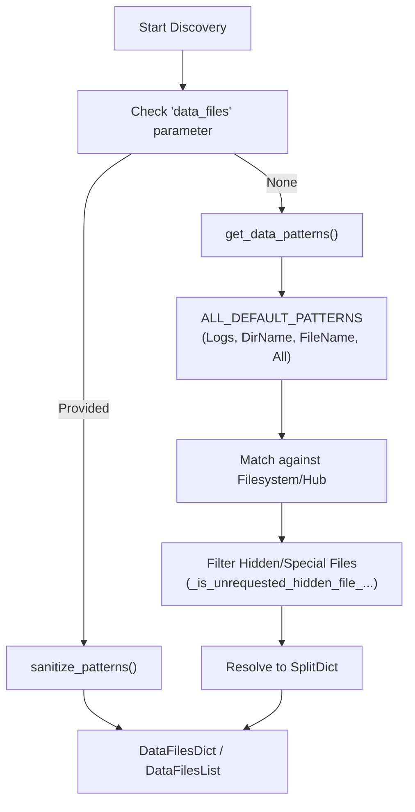
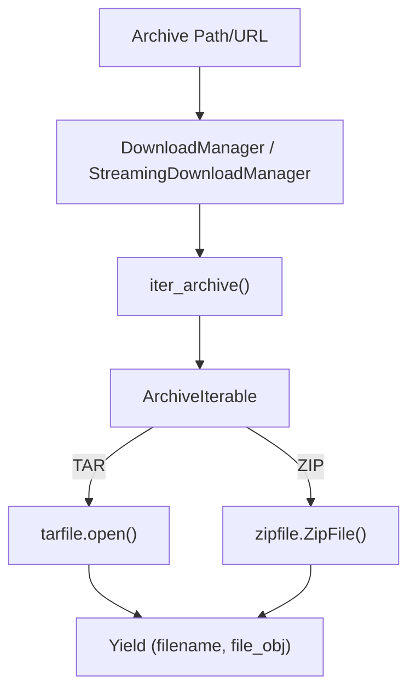
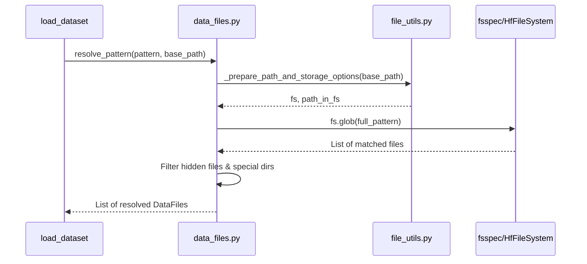

<!-- source: DeepWiki mcp.deepwiki.com · repo huggingface/datasets · page 3.5 Data Files and Pattern Matching · fetched 2026-10-26 -->

# Data Files and Pattern Matching

Relevant source files

The following files were used as context for generating this wiki page:

- [src/datasets/data_files.py](src/datasets/data_files.py)
- [src/datasets/utils/file_utils.py](src/datasets/utils/file_utils.py)
- [tests/test_data_files.py](tests/test_data_files.py)
- [tests/test_file_utils.py](tests/test_file_utils.py)

The Hugging Face Datasets library provides a robust system for discovering, filtering, and iterating over data files. This system abstracts file operations to work seamlessly across local filesystems, remote URLs (HTTP/S3/GCS), and compressed archives (ZIP/TAR/GZ). It underpins both standard cached loading and high-performance streaming.

## Data File Discovery and Patterns

When a dataset is loaded without an explicit file list, the library uses a hierarchical pattern matching system to identify splits (train, test, validation).

### Discovery Logic Flow

Sources: [src/datasets/data_files.py:121-159](), [src/datasets/data_files.py:93-105]()

### Key Pattern Constants
The library defines several default patterns to automatically detect splits based on file or directory names:
- **Sharded Patterns**: `data/{split}-[0-9][0-9][0-9][0-9][0-9]-of-[0-9][0-9][0-9][0-9][0-9]*.*` [src/datasets/data_files.py:41-41]()
- **Split Keywords**: Supports variations like `train`, `training`, `valid`, `dev`, `test`, `eval`. [src/datasets/data_files.py:43-47]()
- **Ignored Files**: Automatically skips metadata files like `README.md`, `dataset_info.json`, and `config.json`. [src/datasets/data_files.py:107-114]()

### Pattern Sanitization
The `sanitize_patterns` function standardizes user input into a mapping of split names to file patterns. If a string or list is provided without keys, it defaults to the `train` split. [src/datasets/data_files.py:121-159]()

## Archive and File Iteration

To support streaming large datasets without full extraction, the library provides specialized iterables that wrap archives and directory structures.

### Archive Iteration Architecture

Sources: [src/datasets/utils/file_utils.py:16-19](), [src/datasets/utils/file_utils.py:134-195]()

### Filesystem Abstraction
The library extends standard filesystem operations to handle the various protocols and local/remote paths consistently.

- **`xglob`**: Performs glob matching across local and remote filesystems. [src/datasets/utils/file_utils.py:23-23]()
- **`xwalk`**: Recursively traverses directories while respecting the library's filtering rules for hidden files and special directories (like `__pycache__`). [src/datasets/utils/file_utils.py:34-34](), [src/datasets/data_files.py:162-192]()
- **`_is_inside_unrequested_special_dir`**: Checks if a path is inside a directory starting with `__` that wasn't explicitly requested in the glob pattern. [src/datasets/data_files.py:162-192]()

## Code Entity Mapping: Natural Language to Code

| Concept | Code Entity | File Reference |
| :--- | :--- | :--- |
| **Local Path Check** | `is_local_path` | [src/datasets/utils/file_utils.py:79-83]() |
| **Remote URL Check** | `is_remote_url` | [src/datasets/utils/file_utils.py:75-76]() |
| **Path Joining** | `url_or_path_join` | [src/datasets/utils/file_utils.py:96-100]() |
| **Pattern Resolution** | `resolve_pattern` | [src/datasets/data_files.py:21-21]() |
| **Cached Path Retrieval** | `cached_path` | [src/datasets/utils/file_utils.py:134-195]() |

### File Discovery Mechanism

Sources: [src/datasets/data_files.py:195-210](), [src/datasets/utils/file_utils.py:171-180]()

## Path Manipulation Utilities

Specialized path utilities handle the complex strings generated by remote storage and local file resolution.

| Function | Logic |
| :--- | :--- |
| `url_or_path_parent` | Returns the parent directory, handling both `/` for URLs and `os.path.sep` for local paths. [src/datasets/utils/file_utils.py:103-107]() |
| `url_or_path_join` | Joins base names with pathnames, handling both remote URLs (posix-style) and local paths. [src/datasets/utils/file_utils.py:96-100]() |
| `hash_url_to_filename` | Converts a URL and optional ETag into a repeatable hashed filename for caching. [src/datasets/utils/file_utils.py:110-131]() |
| `contains_wildcards` | Checks if a string contains glob characters (`*`, `[`, `]`). [src/datasets/data_files.py:117-118]() |

Sources: [src/datasets/utils/file_utils.py:96-131](), [src/datasets/data_files.py:117-118]()

## Repository Structure Detection

For datasets hosted on the Hugging Face Hub, the library attempts to detect data files automatically if no `data_files` are specified. It looks for files matching split patterns in the repository.

### Resolution Priority
1. **Split Keywords in Filenames**: Files containing `train`, `valid`, `test`, etc., matched via `DEFAULT_PATTERNS_SPLIT_IN_FILENAME`. [src/datasets/data_files.py:75-82]()
2. **Split Keywords in Directory Names**: Folders named `train/`, `test/`, etc., matched via `DEFAULT_PATTERNS_SPLIT_IN_DIR_NAME`. [src/datasets/data_files.py:83-90]()
3. **Catch-all Pattern**: If no specific splits are found, all files are assigned to the `train` split via `DEFAULT_PATTERNS_ALL`. [src/datasets/data_files.py:93-95]()

Sources: [src/datasets/data_files.py:74-105]()

---

