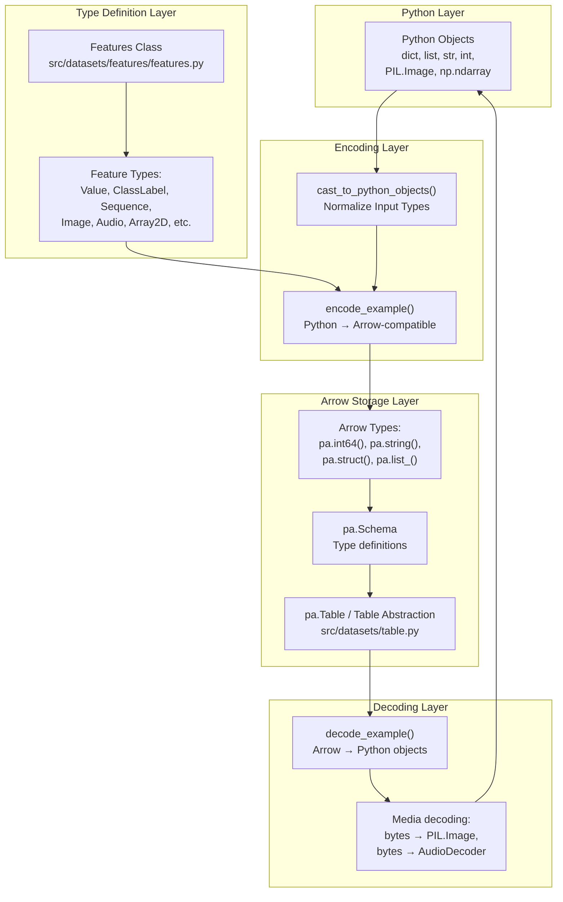
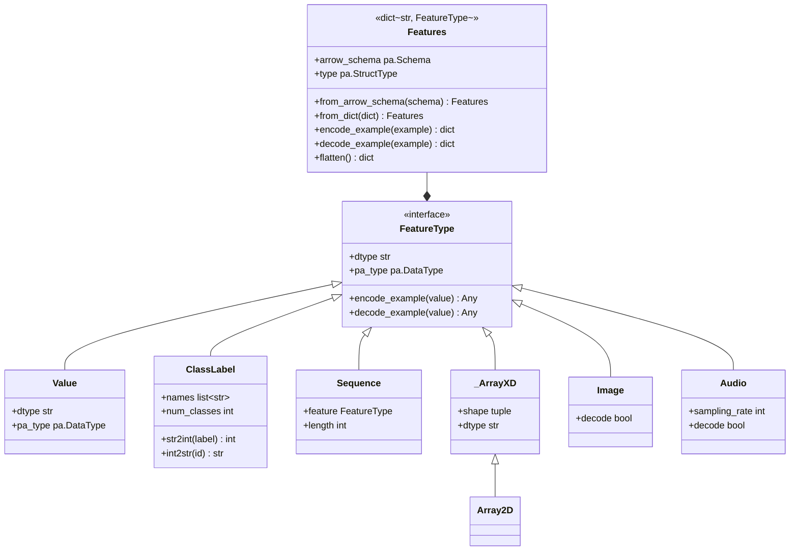
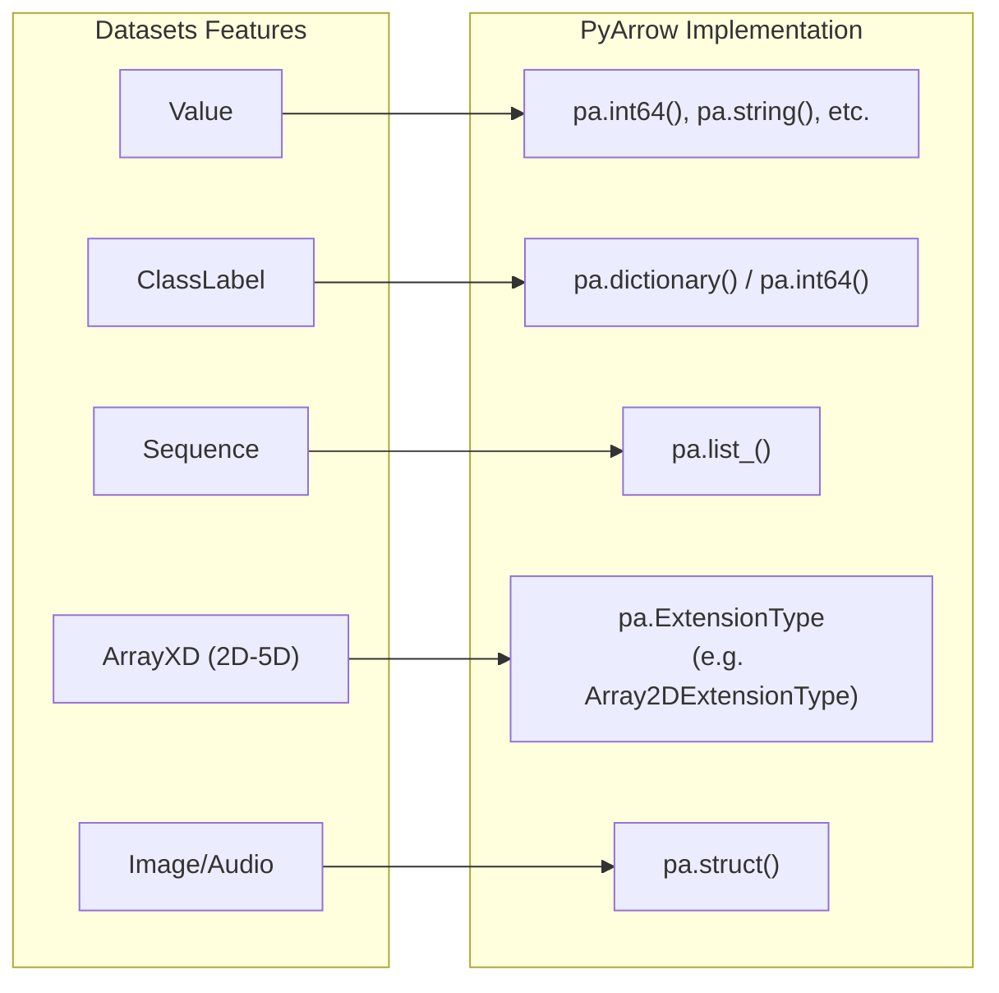

<!-- source: DeepWiki mcp.deepwiki.com · repo huggingface/datasets · page 4 Feature Types and Data Representation · fetched 2026-10-26 -->

# Feature Types and Data Representation

Relevant source files

The following files were used as context for generating this wiki page:

- [src/datasets/features/__init__.py](src/datasets/features/__init__.py)
- [src/datasets/features/features.py](src/datasets/features/features.py)
- [tests/features/test_array_xd.py](tests/features/test_array_xd.py)
- [tests/features/test_features.py](tests/features/test_features.py)

This page provides an overview of the type system in the Hugging Face Datasets library. The feature system defines schemas for datasets, specifying the data types of each column and how data should be stored in Apache Arrow format.

The type system serves three main purposes:
1. **Schema Definition**: Declare the structure and types of dataset columns [src/datasets/features/features.py:16-17]().
2. **Type Safety**: Ensure data consistency through encoding/decoding [src/datasets/features/features.py:1850-2185]().
3. **Storage Mapping**: Define how Python objects map to Arrow columnar storage [src/datasets/features/features.py:125-138]().

**Navigation**:
- [Feature Type System](#4.1) — Documentation of `Features` class, `Value` types, `ClassLabel`, and structured types (`Sequence`, `Array2D`, `Translation`).
- [Media Features](#4.2) — Documentation of `Image`, `Audio`, `Video`, `Pdf`, and `NIfTI` feature types with encoding/decoding.
- [Type Encoding and Decoding](#4.3) — Explanation of the encode/decode pipeline, cast operations, and storage format conversions.

## 1. Type System Architecture

The datasets library uses a layered type system to transform Python objects into Arrow columnar storage. It relies on a mapping between dataset-specific types and `pyarrow.DataType` [src/datasets/features/features.py:56-123]().

**Type System Data Flow**

Sources: [src/datasets/features/features.py:464-486](), [src/datasets/features/features.py:968-1211](), [src/datasets/features/features.py:1850-1921](), [src/datasets/features/features.py:2054-2115]()

## 2. Features Class and Schema Definition

The `Features` class ([src/datasets/features/features.py:968-1211]()) is the core schema definition object. It acts as a specialized mapping between column names and feature types, providing the logic to generate a `pyarrow.Schema` [src/datasets/features/features.py:1162-1165]().

**Features Class Architecture**

**Key Capabilities**:
- **Type Conversion**: Converts between string representations and Arrow types using `string_to_arrow` [src/datasets/features/features.py:126-180]().
- **Alignment**: Ensures features from different sources can be aligned or cast [src/datasets/features/features.py:1481-1555]().
- **Serialization**: Can be serialized to/from dictionaries for storage in `DatasetInfo` [src/datasets/features/features.py:1044-1081]().

Sources: [src/datasets/features/features.py:968-1211](), [src/datasets/features/features.py:126-180](), [src/datasets/features/features.py:1850-2185]()

## 3. Feature Type Categories

Feature types are organized into categories based on their data structure and decoding requirements. For details, see the child pages.

### Basic and Structured Types (see [Feature Type System](#4.1))

| Feature Type | Purpose | File Pointer |
|--------------|---------|--------------|
| `Value` | Primitive types (int, float, string, etc.) | [src/datasets/features/features.py:489-572]() |
| `ClassLabel` | Categorical labels with mapping | [src/datasets/features/features.py:1214-1461]() |
| `Sequence` | Variable or fixed-length lists | [src/datasets/features/features.py:1603-1722]() |
| `Array2D` to `Array5D` | Multi-dimensional arrays (tensors) | [src/datasets/features/features.py:586-646]() |
| `Translation` | Language translation pairs | [src/datasets/features/translation.py:11-46]() |

### Media Types (see [Media Features](#4.2))

Media features often involve a `decode` step where raw bytes are converted into specialized objects (like `PIL.Image` or `numpy` arrays).

| Feature Type | Storage Format (Arrow) | File Pointer |
|--------------|------------------------|--------------|
| `Image` | `struct<bytes: binary, path: string>` | [src/datasets/features/image.py:46-96]() |
| `Audio` | `struct<bytes: binary, path: string, ...>` | [src/datasets/features/audio.py:23-87]() |
| `Video` | `struct<bytes: binary, path: string>` | [src/datasets/features/video.py:28-102]() |
| `Pdf` | `struct<bytes: binary, path: string>` | [src/datasets/features/pdf.py:16-55]() |
| `Nifti` | `struct<bytes: binary, path: string>` | [src/datasets/features/nifti.py:17-57]() |

## 4. Arrow Storage Representation

Feature types map to PyArrow types for efficient columnar storage. The library implements several Arrow Extension Types to handle complex structures like multi-dimensional arrays [src/datasets/features/features.py:734-897]().

**Feature to Arrow Mapping**

Sources: [src/datasets/features/features.py:56-123](), [src/datasets/features/features.py:734-897](), [src/datasets/features/image.py:92]()

## 5. Type Encoding and Decoding

Features provide bidirectional conversion between Python objects and Arrow storage. For details, see [Type Encoding and Decoding](#4.3).

- **Encoding**: `encode_example()` converts Python types (like a PIL Image or a list of strings) into a format that can be written to an Arrow table [src/datasets/features/features.py:1850-1921]().
- **Decoding**: `decode_example()` converts the stored Arrow data back into usable Python objects (like opening an image file or converting bytes to a waveform) [src/datasets/features/features.py:2054-2115]().

### Utility Functions
- `cast_to_python_objects()`: Normalizes various input types (e.g., NumPy arrays, PyTorch tensors) into standard Python/NumPy types before encoding [src/datasets/features/features.py:464-486]().
- `get_nested_type()`: Resolves the underlying Arrow type for any nested feature structure [src/datasets/features/features.py:182-251]().

Sources: [src/datasets/features/features.py:464-486](), [src/datasets/features/features.py:1850-2185]()

---

