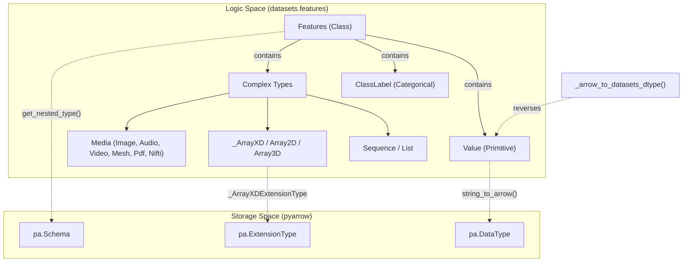
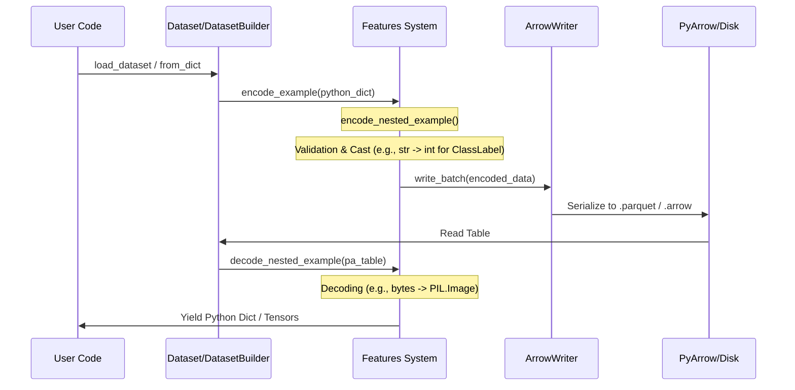

<!-- source: DeepWiki mcp.deepwiki.com · repo huggingface/datasets · page 4.1 Feature Type System · fetched 2026-10-26 -->

# Feature Type System

Relevant source files

The following files were used as context for generating this wiki page:

- [src/datasets/features/__init__.py](src/datasets/features/__init__.py)
- [src/datasets/features/features.py](src/datasets/features/features.py)
- [src/datasets/features/translation.py](src/datasets/features/translation.py)
- [tests/features/test_array_xd.py](tests/features/test_array_xd.py)
- [tests/features/test_features.py](tests/features/test_features.py)

The feature types system in the Hugging Face Datasets library provides a structured way to define, validate, and manipulate dataset schemas. Feature types define how data is represented, stored, and processed, acting as a high-level abstraction over the underlying **Apache Arrow** storage.

## Overview of the Feature System

The feature system manages the lifecycle of data from raw Python objects to serialized Arrow buffers and back to framework-specific tensors (PyTorch, TensorFlow, JAX).

### Bridge: Natural Language Space to Code Entity Space

The following diagram maps high-level data concepts to the specific classes and functions in the `datasets.features` module.

Sources: [src/datasets/features/features.py:56-123](), [src/datasets/features/features.py:126-139](), [src/datasets/features/features.py:608-647](), [src/datasets/features/features.py:1550-1683]()

## Core Feature Classes

### Features
The `Features` class is a dictionary subclass that holds the configuration of all columns in a dataset. It is responsible for converting between Python dictionaries and Arrow schemas.

- **Key Method**: `Features.from_arrow_schema(pa_schema)` reconstructs the feature hierarchy from Arrow metadata [src/datasets/features/features.py:1045-1052]().
- **Key Method**: `Features.encode_batch(batch)` prepares Python data for the `ArrowWriter` [src/datasets/features/features.py:1435-1440]().
- **Alignment**: `_align_features` ensures that data matches the expected schema during processing [src/datasets/features/features.py:1770-1785]().

### Value
The `Value` feature handles primitive types. It stores a `dtype` string which is mapped to `pyarrow` types via `string_to_arrow`.

| Category | Example dtypes | Arrow Mapping |
| :--- | :--- | :--- |
| **Numeric** | `int64`, `float32`, `uint8` | `pa.int64()`, `pa.float32()`, etc. |
| **String** | `string`, `large_string`, `string_view` | `pa.string()`, `pa.large_string()`, `pa.string_view()` |
| **Temporal** | `timestamp[ns]`, `date32`, `time64[us]` | `pa.timestamp()`, `pa.date32()`, `pa.time64()` |
| **Binary** | `binary`, `large_binary`, `binary_view` | `pa.binary()`, `pa.large_binary()`, `pa.binary_view()` |
| **Other** | `bool`, `null`, `decimal128(p,s)` | `pa.bool_()`, `pa.null()`, `pa.decimal128()` |

Sources: [src/datasets/features/features.py:56-123](), [src/datasets/features/features.py:126-170](), [src/datasets/features/features.py:284-335]()

### ClassLabel
`ClassLabel` provides an integer-to-string mapping for categorical labels. It supports internal lookup tables and can be initialized with `names` or `num_classes`.

- **Internal Storage**: Always stored as `pa.int64()` in Arrow [src/datasets/features/features.py:1200-1210]().
- **Transformation**: The `str2int` and `int2str` methods allow manual conversion [src/datasets/features/features.py:1165-1175]().
- **Validation**: If initialized with `names=[]`, it can still be reloaded and validated [tests/features/test_features.py:133-138]().

Sources: [src/datasets/features/features.py:1119-1231]()

## Structured and Nested Types

### Sequence
The `Sequence` type represents a list of features. It can wrap any other feature, including nested `Sequence` or `Struct` types.

- **Storage**: Maps to `pa.list_(...)` or `pa.large_list_(...)` [src/datasets/features/features.py:1373-1430]().
- **Special Case**: If a `Sequence` wraps a dictionary of features, it is often represented as a "list of structs" in Arrow but can be flattened/unflattened by the library [src/datasets/features/features.py:1385-1395]().

### ArrayXD (Array2D, Array3D, Array4D, Array5D)
These types are used for fixed-shape numerical data (e.g., embeddings or tensors). They are implemented using **Arrow Extension Types** (e.g., `Array2DExtensionType`) to preserve multidimensional shape information that standard Arrow lists lose.

- **Base Class**: `_ArrayXD` provides the common logic for shape validation and conversion to `numpy` [src/datasets/features/features.py:1550-1600]().
- **Indexing**: When indexed, these features return `np.ndarray` objects [tests/features/test_array_xd.py:113-126]().

Sources: [src/datasets/features/features.py:1550-1683](), [tests/features/test_array_xd.py:143-152]()

### Translation & TranslationVariableLanguages
Specialized types for parallel corpora, primarily for compatibility with TFDS.
- `Translation`: A struct with fixed keys for language codes [src/datasets/features/translation.py:12-42]().
- `TranslationVariableLanguages`: A struct containing two lists: `language` and `translation`, allowing variable language pairs per row [src/datasets/features/translation.py:52-97]().

Sources: [src/datasets/features/translation.py:12-130]()

## Data Flow: Encoding and Decoding

The feature system governs the transition between "Natural Language/Python Space" and "Storage/Arrow Space".

Sources: [src/datasets/features/features.py:1924-1950](), [src/datasets/features/features.py:2050-2070](), [tests/features/test_features.py:44-53]()

## Implementation Details

### Type Mapping Functions
- `_arrow_to_datasets_dtype`: Converts a `pa.DataType` back to a string representation used by `Value` [src/datasets/features/features.py:56-122]().
- `string_to_arrow`: Converts a string dtype (e.g., `"int32"`) into a `pa.DataType` [src/datasets/features/features.py:126-180]().
- `get_nested_type`: Recursively resolves a feature hierarchy into a `pa.DataType` or `pa.Schema` [src/datasets/features/features.py:608-647]().

### Serialization and Metadata
Features are often serialized to JSON for storage in dataset metadata.
- `Features.to_dict()`: Converts the feature hierarchy into a JSON-serializable dictionary [src/datasets/features/features.py:1010-1020]().
- `Features.from_dict()`: Reconstructs the `Features` object from a dictionary [src/datasets/features/features.py:945-960]().

Sources: [src/datasets/features/features.py:945-1020](), [tests/features/test_features.py:121-124]()

---

