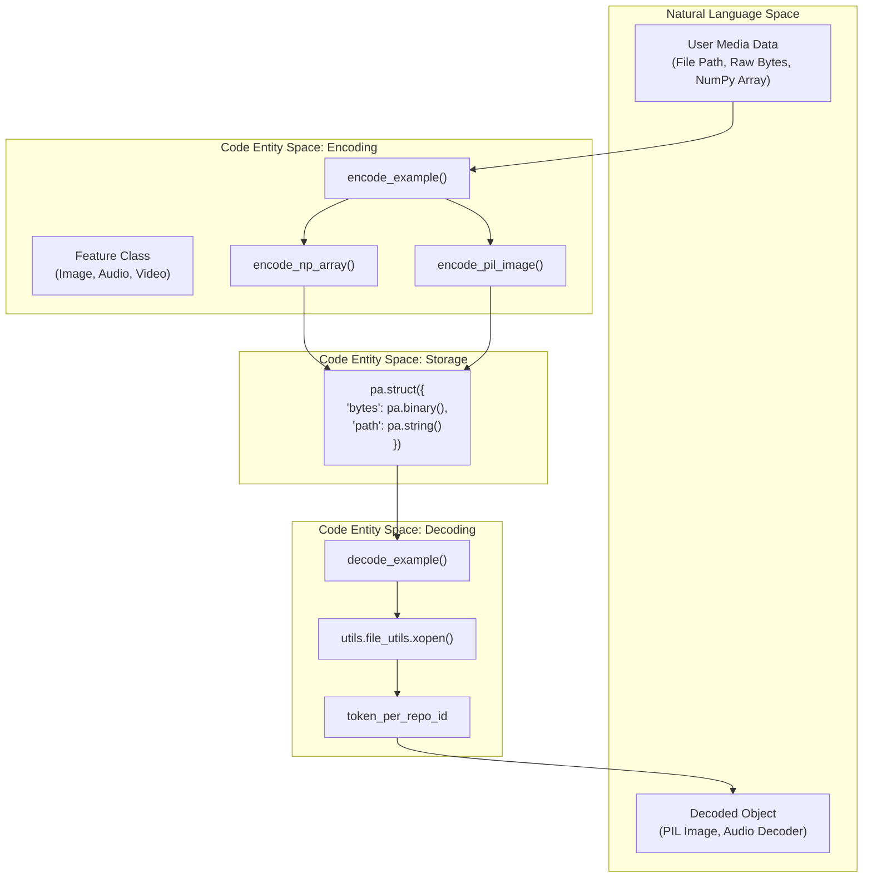
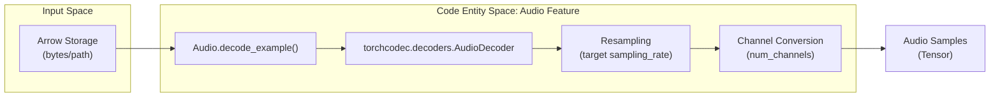

<!-- source: DeepWiki mcp.deepwiki.com · repo huggingface/datasets · page 4.2 Media Features · fetched 2026-10-26 -->

# Media Features

<details>
<summary>Relevant source files</summary>

The following files were used as context for generating this wiki page:

- [docs/source/about_dataset_features.mdx](docs/source/about_dataset_features.mdx)
- [docs/source/create_dataset.mdx](docs/source/create_dataset.mdx)
- [docs/source/installation.md](docs/source/installation.md)
- [docs/source/mesh_dataset.mdx](docs/source/mesh_dataset.mdx)
- [docs/source/mesh_load.mdx](docs/source/mesh_load.mdx)
- [src/datasets/features/audio.py](src/datasets/features/audio.py)
- [src/datasets/features/image.py](src/datasets/features/image.py)
- [src/datasets/features/mesh.py](src/datasets/features/mesh.py)
- [src/datasets/features/nifti.py](src/datasets/features/nifti.py)
- [src/datasets/features/pdf.py](src/datasets/features/pdf.py)
- [src/datasets/features/video.py](src/datasets/features/video.py)
- [tests/features/test_audio.py](tests/features/test_audio.py)
- [tests/features/test_image.py](tests/features/test_image.py)
- [tests/features/test_mesh.py](tests/features/test_mesh.py)
- [tests/features/test_nifti.py](tests/features/test_nifti.py)
- [tests/test_download_manager.py](tests/test_download_manager.py)

</details>


Media features provide specialized handling for multimedia data types (images, audio, video, PDF documents, and NIfTI files) in the `datasets` library. They enable efficient storage, lazy loading, and automatic decoding of media files while supporting various input formats and on-the-fly transformations.

## Overview

The `datasets` library provides five primary media feature types:

| Feature Type | Storage Format | Decoded Output | Dependencies |
|-------------|----------------|----------------|--------------|
| `Image` | bytes + path | `PIL.Image.Image` | Pillow |
| `Audio` | bytes + path | `torchcodec.decoders.AudioDecoder` | torchcodec |
| `Video` | bytes + path | `torchcodec.decoders.VideoDecoder` | torchcodec |
| `Pdf` | bytes + path | `pdfplumber.pdf.PDF` | pdfplumber |
| `Nifti` | bytes + path | `nibabel.nifti1.Nifti1Image` | nibabel |

All media features share a common architecture:
- Store data as Arrow structs containing `bytes` (binary data) and `path` (string) [src/datasets/features/image.py:92]().
- Support lazy decoding via the `decode` parameter [src/datasets/features/audio.py:84]().
- Accept multiple input formats (paths, bytes, native objects) [src/datasets/features/video.py:33-43]().
- Provide `encode_example` and `decode_example` methods for bidirectional conversion [src/datasets/features/image.py:98-139]().

**Sources:** [src/datasets/features/image.py:46-93](), [src/datasets/features/audio.py:23-86](), [src/datasets/features/video.py:28-102](), [src/datasets/features/pdf.py:30-77](), [src/datasets/features/nifti.py:64-106]()

## Storage Architecture

### Arrow Storage Format

All media features use a consistent PyArrow storage schema:

```python
pa_type = pa.struct({"bytes": pa.binary(), "path": pa.string()})
```

This dual representation allows for:
- **Path-only storage**: `{"bytes": None, "path": "/path/to/file.jpg"}` - avoids data duplication for local files [src/datasets/features/image.py:117]().
- **Bytes-only storage**: `{"bytes": <binary_data>, "path": None}` - embeds data for archives or Parquet files [src/datasets/features/audio.py:126]().
- **Both fields**: `{"bytes": <binary_data>, "path": "image.jpg"}` - the path is used to infer the file extension and format [src/datasets/features/video.py:144]().

**Sources:** [src/datasets/features/image.py:92](), [src/datasets/features/audio.py:90](), [src/datasets/features/video.py:99](), [src/datasets/features/pdf.py:72]()

### Media Feature Data Flow

The following diagram illustrates how raw data is transformed into Arrow storage and then decoded back into Python objects.



**Sources:** [src/datasets/features/image.py:98-139](), [src/datasets/features/audio.py:96-162](), [src/datasets/features/video.py:105-151](), [src/datasets/features/image.py:323-381]()

## Image Feature

The `Image` feature handles image data with support for various formats and lazy transformations.

### Class Definition

```python
@dataclass
class Image:
    mode: Optional[str] = None  # Target PIL mode (e.g., "RGB", "L")
    decode: bool = True          # Whether to decode on access
    id: Optional[str] = None
```

**Sources:** [src/datasets/features/image.py:46-93]()

### Encoding Process

The `encode_example` method normalizes various inputs into the standard `{"bytes": ..., "path": ...}` dictionary:
- **Paths**: Stores the absolute path [src/datasets/features/image.py:117-119]().
- **NumPy Arrays**: Converts the array to PNG or TIFF bytes using `encode_np_array` [src/datasets/features/image.py:122-124]().
- **PIL Images**: Converts the PIL object to bytes using `encode_pil_image` [src/datasets/features/image.py:125-127]().

### Decoding and Transformations

When `decode=True`, `decode_example` performs the following:
1. **Source Selection**: Prefers `bytes` if available; otherwise, opens the file at `path` [src/datasets/features/image.py:170-175]().
2. **Remote Access**: Uses `xopen` to handle remote URLs and Hub authentication [src/datasets/features/image.py:183-195]().
3. **EXIF Correction**: Automatically applies `PIL.ImageOps.exif_transpose` to fix image orientation [src/datasets/features/image.py:202-203]().
4. **Mode Conversion**: Converts the image to the specified `mode` (e.g., "RGB") if provided [src/datasets/features/image.py:205-207]().

**Sources:** [src/datasets/features/image.py:139-211]()

## Audio Feature

The `Audio` feature manages audio data, supporting resampling and channel conversion via `torchcodec`.

### Parameters

- `sampling_rate`: Target sampling rate for resampling [src/datasets/features/audio.py:83]().
- `num_channels`: Desired number of channels (1 for mono, 2 for stereo) [src/datasets/features/audio.py:85]().
- `decode`: If `False`, returns raw bytes and path [src/datasets/features/audio.py:84]().

### PCM Encoding

Raw PCM files lack headers. If a `.pcm` file is provided, `Audio` requires a `sampling_rate` to convert the raw bytes into a valid WAV-formatted byte stream using `AudioEncoder` [src/datasets/features/audio.py:138-153]().

### Audio Decoding Flow



**Sources:** [src/datasets/features/audio.py:164-221](), [src/datasets/features/audio.py:23-81]()

## Video Feature

The `Video` feature handles video decoding with configurable performance settings.

### Configuration

- `dimension_order`: Supports "NCHW" or "NHWC" [src/datasets/features/video.py:92]().
- `seek_mode`: "exact" (guarantees frame accuracy) or "approximate" (faster) [src/datasets/features/video.py:95]().
- `num_ffmpeg_threads`: Controls decoding parallelism [src/datasets/features/video.py:93]().

### Video Decoding

The decoded output is a `torchcodec.decoders.VideoDecoder` object [src/datasets/features/video.py:98](). Users can access frames using `get_frames_in_range` or `get_frame_at` [src/datasets/features/video.py:77-83]().

**Sources:** [src/datasets/features/video.py:28-102](), [src/datasets/features/video.py:153-224]()

## PDF Feature

The `Pdf` feature provides experimental support for document processing.

- **Storage**: Uses the standard `bytes`/`path` struct [src/datasets/features/pdf.py:72]().
- **Decoding**: Returns a `pdfplumber.pdf.PDF` object [src/datasets/features/pdf.py:71]().
- **Encoding**: Converts `pdfplumber` objects back to bytes using `pdf_to_bytes` [src/datasets/features/pdf.py:22-27]().

**Sources:** [src/datasets/features/pdf.py:30-77](), [src/datasets/features/pdf.py:113-171]()

## NIfTI Feature

The `Nifti` feature provides experimental support for neuroimaging data.

- **Storage**: Uses the standard `bytes`/`path` struct [src/datasets/features/nifti.py:104]().
- **Decoding**: Returns a `nibabel.nifti1.Nifti1Image` object (wrapped in `Nifti1ImageWrapper` for enhanced visualization in notebooks) [src/datasets/features/nifti.py:103, 150]().
- **Lazy Loading**: When decoding from a local path, it utilizes `nibabel`'s lazy loading (ArrayProxy) to avoid loading the entire volume into memory until accessed [src/datasets/features/nifti.py:183-186]().

**Sources:** [src/datasets/features/nifti.py:64-106](), [src/datasets/features/nifti.py:150-195]()

## Summary of Media Feature Classes

| Class | Key Method | Role |
|-------|------------|------|
| `Image` | `decode_example` | Converts bytes/path to PIL Image; handles EXIF and mode conversion. |
| `Audio` | `encode_example` | Converts arrays or PCM files to WAV bytes; handles resampling. |
| `Video` | `decode_example` | Initializes `VideoDecoder` with specific seek modes and dimension orders. |
| `Pdf` | `cast_storage` | Casts Arrow string/binary arrays into the PDF storage struct. |
| `Nifti` | `encode_example` | Manages neuroimaging data using `nibabel`. |

**Sources:** [src/datasets/features/image.py:47](), [src/datasets/features/audio.py:24](), [src/datasets/features/video.py:29](), [src/datasets/features/pdf.py:31](), [src/datasets/features/nifti.py:64]()

---

