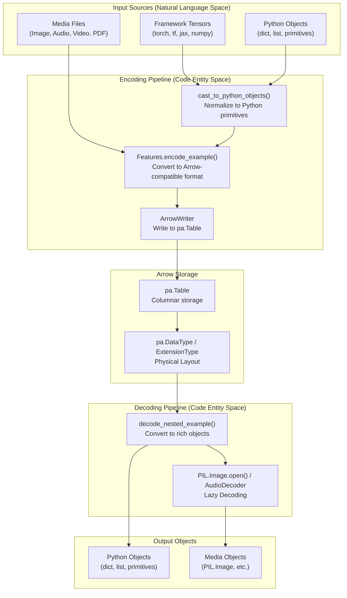
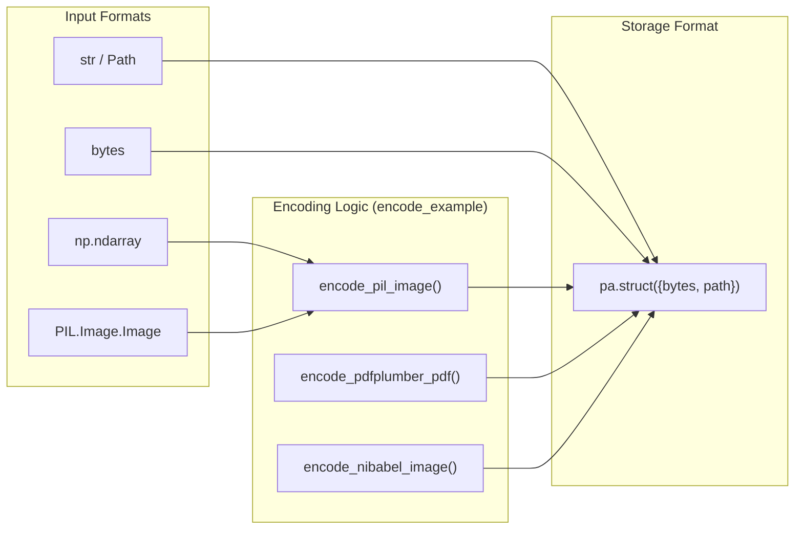
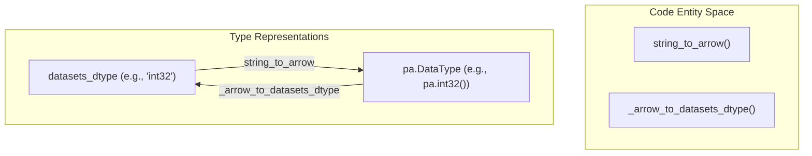

<!-- source: DeepWiki mcp.deepwiki.com · repo huggingface/datasets · page 4.3 Type Encoding and Decoding · fetched 2026-10-26 -->

# Type Encoding and Decoding

Relevant source files

The following files were used as context for generating this wiki page:

- [src/datasets/arrow_writer.py](src/datasets/arrow_writer.py)
- [src/datasets/features/__init__.py](src/datasets/features/__init__.py)
- [src/datasets/features/features.py](src/datasets/features/features.py)
- [src/datasets/utils/py_utils.py](src/datasets/utils/py_utils.py)
- [tests/features/test_array_xd.py](tests/features/test_array_xd.py)
- [tests/features/test_features.py](tests/features/test_features.py)
- [tests/test_arrow_writer.py](tests/test_arrow_writer.py)
- [tests/test_py_utils.py](tests/test_py_utils.py)

This page explains the mechanisms for converting data between Python objects and Apache Arrow storage format in the `datasets` library. It covers the encoding pipeline (Python → Arrow), the decoding pipeline (Arrow → Python), type casting operations, and storage format conversions.

## Overview

The `datasets` library manages bidirectional conversion between Python objects and Apache Arrow columnar storage. This conversion is essential because:

- **Arrow storage** provides efficient columnar representation for disk caching and memory mapping. [src/datasets/features/features.py:136-138]()
- **Python objects** provide the natural interface for data manipulation and framework integration. [src/datasets/features/features.py:36-37]()
- **Type safety** ensures data integrity through explicit schemas defined by `Features`. [src/datasets/features/features.py:16-17]()

The conversion process involves multiple stages depending on the data type and source format.

**Sources:** [src/datasets/features/features.py:16-138]()

## Encoding and Decoding Pipeline

The data flow bridges the gap between high-level Python/Framework objects and the low-level Arrow storage layer.

### Pipeline Data Flow

**Sources:** [src/datasets/features/features.py:36-37](), [src/datasets/arrow_writer.py:31-43](), [src/datasets/features/features.py:126-138]()

## Encoding Pipeline: Python to Arrow

### The encode_example Method

Every feature type implements logic to convert Python objects into a format suitable for Arrow storage. This is typically orchestrated via `Features.encode_example`.

**For media types (Image, Audio, Video):**
Media features often use a unified struct storage format with fields like `bytes` and `path`.

- **Image**: Can encode from `PIL.Image` or `np.ndarray` using `encode_pil_image`. [src/datasets/features/features.py:45]()
- **PDF**: Uses `encode_pdfplumber_pdf` for serialization. [src/datasets/features/features.py:48]()
- **NIfTI**: Uses `encode_nibabel_image` for medical imaging data. [src/datasets/features/features.py:47]()

**Sources:** [src/datasets/features/features.py:44-50](), [src/datasets/arrow_writer.py:30-43]()

## Decoding Pipeline: Arrow to Python

### Nested Example Decoding

The decoding process is handled by `decode_nested_example`, which traverses the schema and converts Arrow-compatible structures back into rich Python objects. [tests/features/test_features.py:22-23]()

- **Lazy Decoding**: For media features, the library supports lazy decoding. The data is only loaded from disk or bytes when accessed. [tests/features/test_features.py:27]()
- **Casting to Python**: `cast_to_python_objects` is used to ensure that the output of the decoding pipeline matches the expected Python types (e.g., converting Arrow scalars to Python ints/floats). [src/datasets/features/features.py:36]()

**Sources:** [src/datasets/features/features.py:36](), [tests/features/test_features.py:13-31]()

## Type Casting Operations

Type casting converts Arrow arrays or tables between schemas. This is critical when aligning data loaded from generic formats (like JSON or CSV) with a specific `Features` definition.

### Table and Array Casting

| Function | Purpose | Location |
| :--- | :--- | :--- |
| `table_cast` | Casts a `pa.Table` to a target schema defined by `Features`. | [src/datasets/arrow_writer.py:46]() |
| `array_cast` | Casts a `pa.Array` to a specific Arrow `DataType`. | [src/datasets/features/features.py:40]() |
| `cast_array_to_feature` | Aligns an Arrow array with a specific `Feature` type (e.g., `Audio`, `Image`). | [src/datasets/arrow_writer.py:46]() |

**Sources:** [src/datasets/features/features.py:40](), [src/datasets/arrow_writer.py:46]()

### Storage Conversions

The library handles conversion between Arrow's native types and `datasets` string representations.

- **String to Arrow**: `string_to_arrow` converts a string like `"timestamp[ns, tz=UTC]"` into its corresponding `pa.DataType`. [src/datasets/features/features.py:126-167]()
- **Arrow to String**: `_arrow_to_datasets_dtype` performs the inverse, mapping Arrow types back to the library's internal string identifiers. [src/datasets/features/features.py:56-123]()

**Sources:** [src/datasets/features/features.py:56-167]()

## Implementation Details: ArrowWriter

The `ArrowWriter` class is the primary interface for serializing Python data to Arrow/Parquet format. [src/datasets/arrow_writer.py:102]()

### Batch Size Management
The writer batch size is dynamically determined based on the features to avoid memory overflows, especially for heavy media data.
- **Image/Audio**: Default batch sizes are optimized (e.g., 100). [src/datasets/arrow_writer.py:66-90]()
- **Video**: Default batch size is smaller (e.g., 10). [src/datasets/arrow_writer.py:91-92]()
- **Data Size Based**: `get_writer_batch_size_from_data_size` calculates batch size to aim for ~100MB row groups in Parquet. [src/datasets/arrow_writer.py:145-166]()

### Typed Sequences
`TypedSequence` and `OptimizedTypedSequence` are used to wrap Python sequences with explicit type information before passing them to PyArrow. This ensures that extension types (like `Array2D`) are correctly preserved during serialization. [src/datasets/arrow_writer.py:173-180]()

**Sources:** [src/datasets/arrow_writer.py:66-180]()

---

