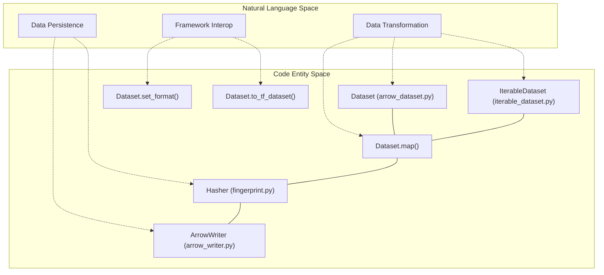
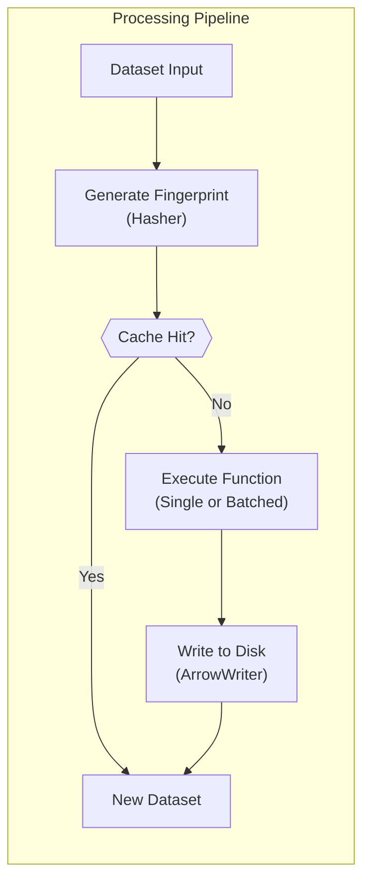
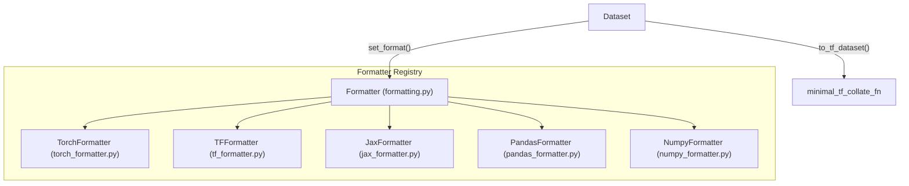

<!-- source: DeepWiki mcp.deepwiki.com · repo huggingface/datasets · page 5 Data Processing and Transformation · fetched 2026-10-26 -->

# Data Processing and Transformation

Relevant source files

The following files were used as context for generating this wiki page:

- [docs/source/about_mapstyle_vs_iterable.mdx](docs/source/about_mapstyle_vs_iterable.mdx)
- [docs/source/package_reference/main_classes.mdx](docs/source/package_reference/main_classes.mdx)
- [docs/source/process.mdx](docs/source/process.mdx)
- [docs/source/stream.mdx](docs/source/stream.mdx)
- [src/datasets/arrow_dataset.py](src/datasets/arrow_dataset.py)
- [src/datasets/combine.py](src/datasets/combine.py)
- [src/datasets/dataset_dict.py](src/datasets/dataset_dict.py)
- [src/datasets/iterable_dataset.py](src/datasets/iterable_dataset.py)
- [tests/test_arrow_dataset.py](tests/test_arrow_dataset.py)
- [tests/test_dataset_dict.py](tests/test_dataset_dict.py)
- [tests/test_iterable_dataset.py](tests/test_iterable_dataset.py)

## Purpose and Scope

This document provides an overview of the data processing and transformation capabilities in the `datasets` library. It covers the mechanisms for applying functions to datasets, formatting data for different machine learning frameworks, and serializing processed data.

**Related documentation:**
- For detailed information on `map`, `filter`, and `select` operations, see [Map, Filter, and Select Operations](#5.1)
- For framework-specific formatters (PyTorch, TensorFlow, JAX, etc.), see [Formatters and Framework Integration](#5.2)
- For writing transformed data to disk, see [ArrowWriter and Data Serialization](#5.3)
- For dataset loading, see [Data Loading System](#3)
- For the underlying storage architecture, see [Arrow-based Storage System](#2.3)

---

## System Architecture Overview

The data processing system is built around the `Dataset` class in [src/datasets/arrow_dataset.py:777-1643]() and the `IterableDataset` class in [src/datasets/iterable_dataset.py:1145-1216](). It consists of three primary subsystems:

### Data Transformation Space Mapping

The following diagram bridges the natural language concepts of data transformation to the specific code entities that implement them.

**Sources:** [src/datasets/arrow_dataset.py:777-1643](), [src/datasets/iterable_dataset.py:1145-1216](), [src/datasets/arrow_writer.py:161-180](), [src/datasets/fingerprint.py:1-105]()

---

## Core Transformation Operations

The library provides several methods for transforming data. These operations behave differently depending on whether the dataset is a map-style `Dataset` or a streaming `IterableDataset`.

### Row-wise and Column-wise Transformations

| Method | `Dataset` (Map-style) | `IterableDataset` (Streaming) |
|--------|-----------------------|-------------------------------|
| `map()` | Eagerly processed and cached [src/datasets/arrow_dataset.py:1779-1800]() | Lazily applied on-the-fly [src/datasets/iterable_dataset.py:1636-1662]() |
| `filter()` | Predicate-based row removal [src/datasets/arrow_dataset.py:2567-2590]() | Wrapped in `FilteredExamplesIterable` [src/datasets/iterable_dataset.py:1722-1740]() |
| `shuffle()` | Indices-based exact shuffling [src/datasets/arrow_dataset.py:2791-2820]() | Buffer-based approximate shuffling [src/datasets/iterable_dataset.py:1754-1778]() |
| `rename_column()` | Metadata-level column renaming [src/datasets/arrow_dataset.py:2415-2435]() | Functional renaming via `MappedExamplesIterable` [src/datasets/iterable_dataset.py:1615-1634]() |
| `cast()` | Feature type conversion [src/datasets/arrow_dataset.py:2491-2515]() | On-the-fly casting during iteration [src/datasets/iterable_dataset.py:1578-1600]() |

### Dataset Structure and Combining
Methods like `concatenate_datasets` and `interleave_datasets` allow merging multiple sources. `interleave_datasets` supports both map-style and streaming datasets, construction being stopped based on a `stopping_strategy` (e.g., `first_exhausted`) [src/datasets/combine.py:18-65]().

**Sources:** [src/datasets/arrow_dataset.py:1779-2820](), [src/datasets/iterable_dataset.py:1578-1778](), [src/datasets/combine.py:18-65]()

---

## Transformation Execution Model

### Map Operation Architecture

The `map()` method is the primary transformation tool. For `Dataset`, it generates a unique fingerprint to manage caching.

**Key implementation details:**
1. **Batched processing**: Enabled via `batched=True`, allowing functions to receive a dictionary of lists [src/datasets/arrow_dataset.py:1800-1812]().
2. **Parallelism**: Uses `multiprocess` to shard the dataset and run `map` across multiple CPU cores via `num_proc` [src/datasets/arrow_dataset.py:1886-1935]().
3. **Lazy Execution**: For `IterableDataset`, `map` returns a new instance wrapping the original with a `MappedExamplesIterable` [src/datasets/iterable_dataset.py:1636-1662]().

For details, see [Map, Filter, and Select Operations](#5.1).

**Sources:** [src/datasets/arrow_dataset.py:1779-2160](), [src/datasets/iterable_dataset.py:1636-1662](), [src/datasets/fingerprint.py:92-162]()

---

## Data Formatting System

The formatting system abstracts the underlying Arrow storage to present data in formats compatible with ML frameworks.

### Formatter Class Architecture

The following diagram maps the logical framework formatters to their implementation classes.

### Persistence vs. On-the-fly
- **`set_format()`**: Sets a persistent format (e.g., "torch", "numpy") for the dataset instance [src/datasets/arrow_dataset.py:2891-3083]().
- **`set_transform()`**: Registers a custom function to be applied every time an item is retrieved, useful for dynamic preprocessing like tokenization [src/datasets/arrow_dataset.py:3085-3141]().

For details, see [Formatters and Framework Integration](#5.2).

**Sources:** [src/datasets/arrow_dataset.py:2891-3141](), [src/datasets/formatting/formatting.py:102-193](), [src/datasets/utils/tf_utils.py:141-160]()

---

## Data Serialization and Writing

Transformed datasets often need to be saved to disk. The `ArrowWriter` class is the core engine for this process.

- **`ArrowWriter`**: Handles the conversion of Python objects/batches into Arrow `RecordBatch` and writes them to a file [src/datasets/arrow_writer.py:161-180]().
- **Caching**: Results of `map` and `filter` are written to a cache directory (usually `~/.cache/huggingface/datasets`) using the generated fingerprint as part of the filename [src/datasets/fingerprint.py:100-105]().
- **Exporting**: High-level methods like `to_parquet()`, `to_json()`, and `to_csv()` wrap the writer logic to export data to common formats [src/datasets/arrow_dataset.py:1465-1540]().

For details, see [ArrowWriter and Data Serialization](#5.3).

**Sources:** [src/datasets/arrow_writer.py:161-180](), [src/datasets/arrow_dataset.py:1465-1540](), [src/datasets/fingerprint.py:100-105]()

---

