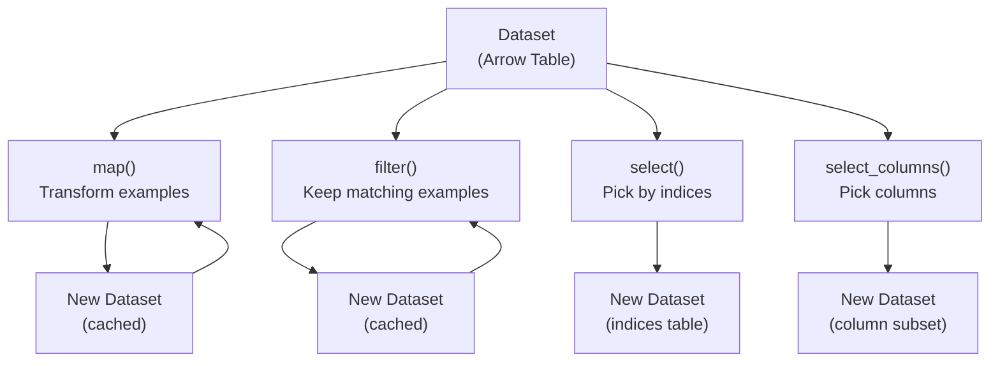
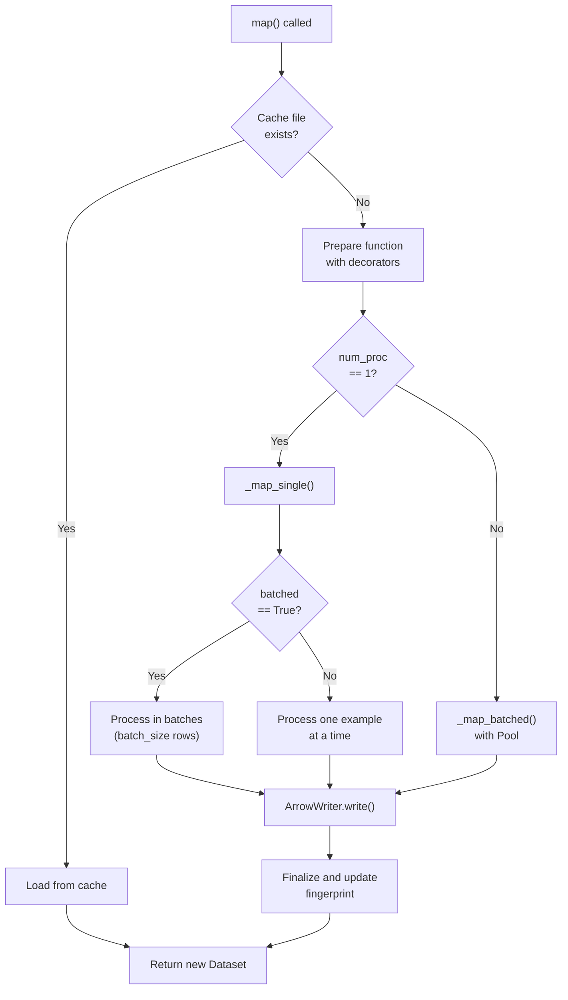
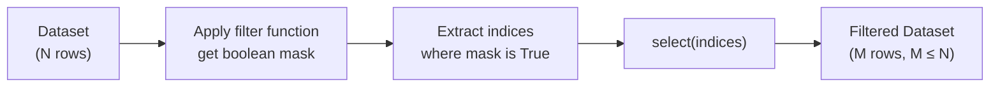
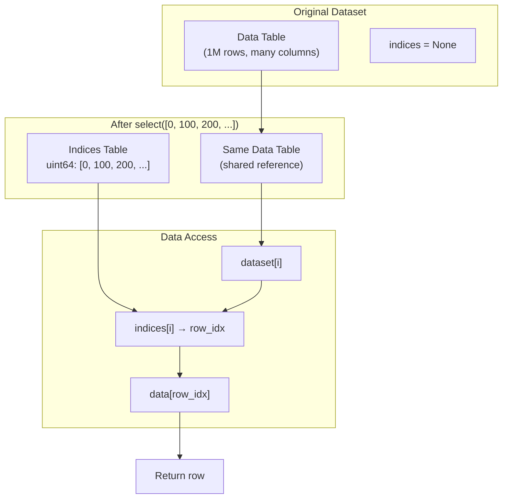
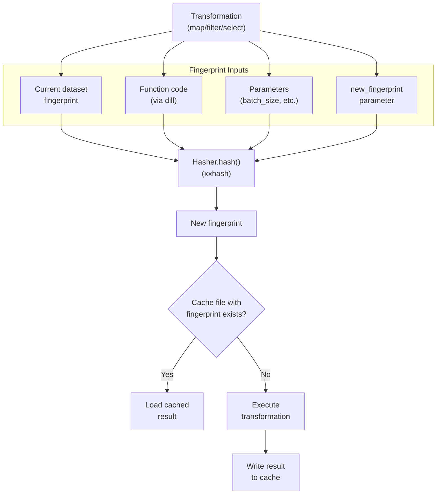

<!-- source: DeepWiki mcp.deepwiki.com · repo huggingface/datasets · page 5.1 Map, Filter, and Select Operations · fetched 2026-10-26 -->

# Map, Filter, and Select Operations

Relevant source files

The following files were used as context for generating this wiki page:

- [docs/source/about_map_batch.mdx](docs/source/about_map_batch.mdx)
- [src/datasets/arrow_dataset.py](src/datasets/arrow_dataset.py)
- [src/datasets/dataset_dict.py](src/datasets/dataset_dict.py)
- [tests/test_arrow_dataset.py](tests/test_arrow_dataset.py)
- [tests/test_dataset_dict.py](tests/test_dataset_dict.py)

This page documents the core data transformation operations available on the `Dataset` class: `map()`, `filter()`, and `select()`. These operations enable efficient data processing, cleaning, and subsetting of datasets while leveraging Apache Arrow's columnar storage and the library's fingerprint-based caching system.

For information about formatting operations that change how data is returned (e.g., PyTorch tensors, NumPy arrays), see [Formatters and Framework Integration](#5.2). For operations on streaming datasets, see [IterableDataset and Streaming](#2.2).

## Overview

The transformation operations follow a consistent design pattern:

- **Immutable**: All operations return new `Dataset` instances rather than modifying in place [src/datasets/arrow_dataset.py:1884-2183]().
- **Cached**: Results are cached on disk based on deterministic fingerprints [src/datasets/fingerprint.py:360-429]().
- **Eager**: Operations execute immediately (unlike `IterableDataset` which is lazy) [src/datasets/arrow_dataset.py:1884-2183]().
- **Chainable**: Operations can be combined in sequence.

### Transformation Architecture

**Core Operations Summary**

| Operation | Purpose | Returns | Modifies Rows | Modifies Columns |
|-----------|---------|---------|---------------|------------------|
| `map()` | Transform examples | New Dataset | Can add/remove | Can add/remove |
| `filter()` | Keep matching rows | New Dataset | Yes (removes) | No |
| `select()` | Select by indices | New Dataset | Yes (subsets) | No |
| `select_columns()` | Select columns | New Dataset | No | Yes (subsets) |
| `shuffle()` | Randomize order | New Dataset | Yes (reorders) | No |
| `sort()` | Sort by column | New Dataset | Yes (reorders) | No |

Sources: [src/datasets/arrow_dataset.py:1884-2929](), [src/datasets/arrow_dataset.py:2473-2637](), [src/datasets/arrow_dataset.py:2675-2733](), [src/datasets/arrow_dataset.py:2859-2929]()

## Map Operation

The `map()` method applies a function to every example or batch of examples in the dataset. It is the most versatile transformation operation, enabling data cleaning, feature engineering, tokenization, and complex transformations.

### Method Signature and Parameters

The `map()` method is defined at [src/datasets/arrow_dataset.py:1884-2183]() with the following key parameters:

| Parameter | Type | Description |
|-----------|------|-------------|
| `function` | `Callable` | Function to apply to each example or batch |
| `with_indices` | `bool` | Pass example indices to the function |
| `with_rank` | `bool` | Pass process rank (for multiprocessing) |
| `input_columns` | `list[str]` | Columns to pass to function (None = all) |
| `batched` | `bool` | Process in batches instead of single examples |
| `batch_size` | `int` | Batch size when `batched=True` (default: 1000) |
| `remove_columns` | `list[str]` | Columns to remove from output |
| `keep_in_memory` | `bool` | Keep result in memory vs. cache to disk |
| `load_from_cache_file` | `bool` | Use cached result if available |
| `cache_file_name` | `str` | Custom cache file path |
| `num_proc` | `int` | Number of processes for parallel execution |
| `features` | `Features` | Explicit output features schema |
| `fn_kwargs` | `dict` | Additional keyword arguments for function |

### Map Execution Flow

The internal logic branches based on whether multiprocessing (`num_proc > 1`) or batching is requested.

Sources: [src/datasets/arrow_dataset.py:1884-2183](), [src/datasets/arrow_dataset.py:2184-2330]()

### Processing Modes

- **Single Example**: Processes one dictionary at a time.
- **Batched**: Receives a dictionary of lists (columnar format). This is implemented at [src/datasets/arrow_dataset.py:2048-2144]() and uses `query_table()` from the formatting module to extract batches efficiently.
- **Input size != output size**: In batched mode, the function can return a batch of a different size `M` than the input size `N`. This allows for data augmentation or chunking [docs/source/about_map_batch.mdx:9-18](). However, all columns in the output batch must have the same length `M` [docs/source/about_map_batch.mdx:20-22]().
- **Multiprocessing**: Uses `multiprocess.Pool` at [src/datasets/arrow_dataset.py:2334-2471](). The dataset is sharded across workers, each processing a portion independently and writing to separate cache files before concatenation via `concat_tables` [src/datasets/table.py:118]().

Sources: [src/datasets/arrow_dataset.py:1884-2183](), [src/datasets/arrow_dataset.py:2334-2471](), [src/datasets/table.py:118](), [docs/source/about_map_batch.mdx:9-22]()

## Filter Operation

The `filter()` method keeps only examples that match a condition. It returns a new dataset containing the subset of rows for which the filter function returns `True`.

### Filter Implementation Details

The filter operation internally uses `map()` with special handling:

1. Applies the filter function to get a boolean mask.
2. Uses `select()` with filtered indices to create the new dataset.
3. Caches the result based on a fingerprint.

The implementation at [src/datasets/arrow_dataset.py:2473-2637]() delegates to `_map_single()` with `format_type="arrow"` to avoid decoding overhead, then selects rows where the filter function returned `True`.

Sources: [src/datasets/arrow_dataset.py:2473-2637](), [tests/test_arrow_dataset.py:121-123]()

## Select Operations

### Row Selection by Indices

The `select()` method [src/datasets/arrow_dataset.py:2675-2733]() creates a new dataset containing only specified rows. 

### Indices Table Mechanism

Select operations use an **indices table** for efficient row selection without copying the underlying data. The indices table is a small Arrow table containing unsigned integers that point to rows in the main data table. This is checked during data access at [src/datasets/arrow_dataset.py:1658-1675]().

Sources: [src/datasets/arrow_dataset.py:2675-2733](), [src/datasets/arrow_dataset.py:1658-1675]()

### Column Selection

The `select_columns()` method [src/datasets/arrow_dataset.py:2859-2929]() creates a new dataset with only the specified columns. It is a zero-copy operation using PyArrow's `table.select()`.

Complementary operations:
- `remove_columns()` [src/datasets/arrow_dataset.py:2931-3021]()
- `rename_column()` [src/datasets/arrow_dataset.py:3023-3088]()

Sources: [src/datasets/arrow_dataset.py:2859-2929](), [src/datasets/arrow_dataset.py:2931-3021]()

## Caching and Fingerprinting

All transformation operations use a deterministic fingerprinting system to enable caching.

### Fingerprint Generation

The `@fingerprint_transform` decorator at [src/datasets/fingerprint.py:360-429]() wraps transformation methods. The fingerprint is a hash of the dataset's current state, the function's code (serialized via `dill`), and the parameters.

Sources: [src/datasets/fingerprint.py:360-429](), [src/datasets/fingerprint.py:133-139](), [src/datasets/fingerprint.py:94-105]()

## Related Operations

- **Shuffle**: Creates a random permutation of indices and uses `select()` internally [src/datasets/arrow_dataset.py:2735-2793](). It can also perform stratified shuffling if `stratify_by_column` is provided [src/datasets/arrow_dataset.py:2743-2751]().
- **Sort**: Uses PyArrow's `pc.sort_indices()` to compute the sorted order, then applies it via `select()` [src/datasets/arrow_dataset.py:2795-2858]().
- **Flatten**: Flattens nested structures in the dataset schema, such as `Struct` types [src/datasets/arrow_dataset.py:3133-3174]().

Sources: [src/datasets/arrow_dataset.py:2735-2793](), [src/datasets/arrow_dataset.py:2795-2858](), [src/datasets/arrow_dataset.py:3133-3174]()

---

