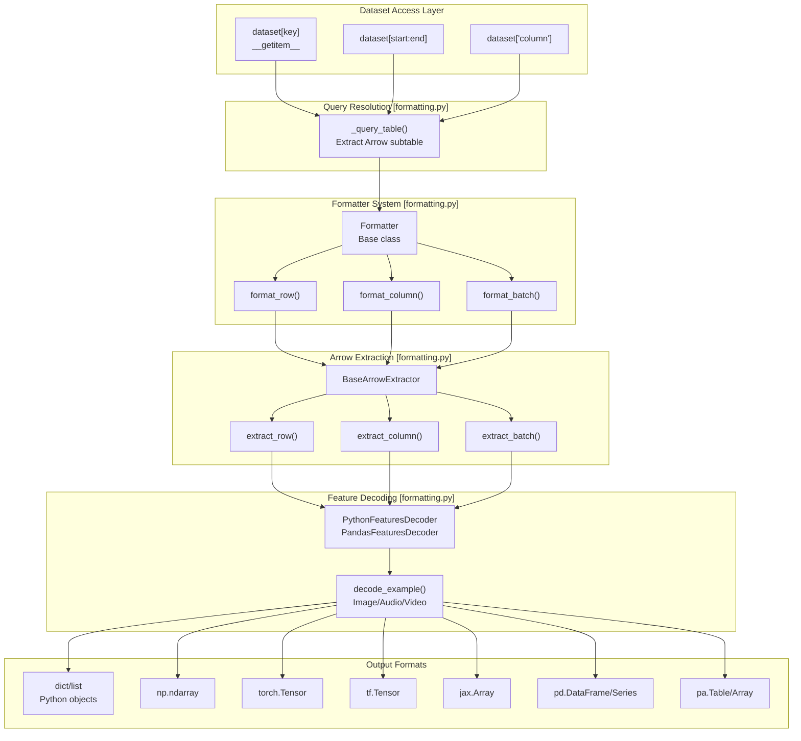
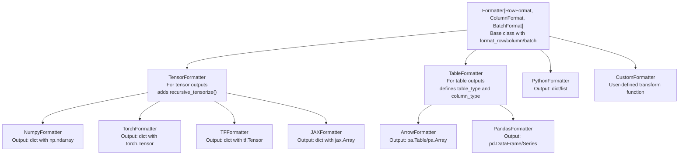
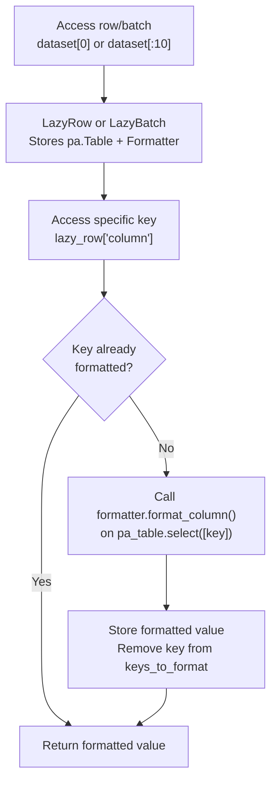

<!-- source: DeepWiki mcp.deepwiki.com · repo huggingface/datasets · page 5.2 Formatters and Framework Integration · fetched 2026-10-26 -->

# Formatters and Framework Integration

Relevant source files

The following files were used as context for generating this wiki page:

- [docs/source/use_with_jax.mdx](docs/source/use_with_jax.mdx)
- [docs/source/use_with_numpy.mdx](docs/source/use_with_numpy.mdx)
- [docs/source/use_with_pytorch.mdx](docs/source/use_with_pytorch.mdx)
- [docs/source/use_with_tensorflow.mdx](docs/source/use_with_tensorflow.mdx)
- [src/datasets/distributed.py](src/datasets/distributed.py)
- [src/datasets/formatting/__init__.py](src/datasets/formatting/__init__.py)
- [src/datasets/formatting/formatting.py](src/datasets/formatting/formatting.py)
- [src/datasets/formatting/jax_formatter.py](src/datasets/formatting/jax_formatter.py)
- [src/datasets/formatting/np_formatter.py](src/datasets/formatting/np_formatter.py)
- [src/datasets/formatting/tf_formatter.py](src/datasets/formatting/tf_formatter.py)
- [src/datasets/formatting/torch_formatter.py](src/datasets/formatting/torch_formatter.py)
- [src/datasets/utils/tf_utils.py](src/datasets/utils/tf_utils.py)
- [tests/test_distributed.py](tests/test_distributed.py)
- [tests/test_formatting.py](tests/test_formatting.py)

## Purpose and Scope

This document describes the formatter system in the `datasets` library, which controls how data is extracted from Apache Arrow storage and transformed into different output formats like Python dictionaries, NumPy arrays, PyTorch tensors, TensorFlow tensors, JAX arrays, and Pandas DataFrames. Formatters enable seamless integration with machine learning frameworks while maintaining efficient Arrow-based storage.

For information about the underlying Feature types that formatters decode, see **Section 4.1: Feature Type System**. For information about media-specific features (Image, Audio, Video, Pdf), see **Section 4.2: Media Features**.

## System Overview

The formatter system provides a unified interface for converting Arrow table data into framework-specific formats. When a user accesses dataset items through indexing (e.g., `dataset[0]` or `dataset[:10]`), the active formatter intercepts the Arrow data and transforms it according to the requested output format.

### High-Level Architecture

The diagram below maps the conceptual data flow to the code entities responsible for extraction and transformation.

**Figure 1: Data Flow from Arrow Storage to Framework Tensors**

Sources: [src/datasets/formatting/formatting.py:50-102](), [src/datasets/formatting/formatting.py:109-124](), [src/datasets/formatting/formatting.py:388-425]()

## Base Formatter Architecture

### The Formatter Class Hierarchy

The formatter system is built around a class hierarchy that separates concerns between extraction and transformation.

**Figure 2: Formatter Class Specialization**

Sources: [src/datasets/formatting/formatting.py:388-425](), [src/datasets/formatting/formatting.py:427-434](), [src/datasets/formatting/__init__.py:76-112]()

### Generic Type Parameters

Each formatter class uses three generic type parameters to specify its output types:

| Type Parameter | Description | Example (`PythonFormatter`) | Example (`NumpyFormatter`) |
|----------------|-------------|---------------------------|--------------------------|
| `RowFormat` | Type returned by `format_row()` | `Mapping` (dict) | `dict` |
| `ColumnFormat` | Type returned by `format_column()` | `list` | `np.ndarray` |
| `BatchFormat` | Type returned by `format_batch()` | `Mapping` (dict) | `dict` |

Sources: [src/datasets/formatting/formatting.py:33-37](), [src/datasets/formatting/formatting.py:388-425]()

## Arrow Extractors

Extractors are responsible for converting PyArrow tables into intermediate representations before feature decoding.

### Extractor Implementations

#### `SimpleArrowExtractor`
Returns Arrow objects directly without conversion.
- **`extract_row`**: Returns single-row `pa.Table`.
- **`extract_column`**: Returns `pa.Array`.
- **`extract_batch`**: Returns multi-row `pa.Table`.

#### `PythonArrowExtractor`
Converts Arrow data to Python native types using `.to_pydict()` and `.to_pylist()`.
- **`extract_row`**: Uses `_unnest(pa_table.to_pydict())`.
- **`extract_column`**: Uses `pa_table.column(0).to_pylist()`.
- **`extract_batch`**: Uses `pa_table.to_pydict()`.

#### `NumpyArrowExtractor`
Converts Arrow data to NumPy arrays with special handling for:
- **Zero-copy optimization**: Uses `zero_copy_only` parameter in `to_numpy()` based on dtype [src/datasets/formatting/formatting.py:170-180]().
- **Extension types**: Handles `_ArrayXDExtensionType` for multi-dimensional arrays [src/datasets/formatting/formatting.py:168-174]().
- **Null handling**: Detects arrays with nulls via `_is_array_with_nulls` to disable zero-copy [src/datasets/formatting/formatting.py:105-106]().

Sources: [src/datasets/formatting/formatting.py:131-202]()

## Framework Integrations

### PyTorch Integration (`TorchFormatter`)
Returns data as dictionaries with PyTorch tensors for values.

**Key Features**:
- **Consolidation**: The `_consolidate()` method stacks tensors into a single batch if shapes and dtypes match [src/datasets/formatting/torch_formatter.py:38-47]().
- **Dtype Handling**: Defaults to `torch.int64` for integers and `torch.float32` for floats [src/datasets/formatting/torch_formatter.py:60-68]().
- **Image Support**: Automatically converts `PIL.Image` to CHW format (Channels, Height, Width) [src/datasets/formatting/torch_formatter.py:70-78]().
- **Media Pass-through**: Passes through `AudioDecoder` and `VideoDecoder` objects from `torchcodec` [src/datasets/formatting/torch_formatter.py:87-91]().

Sources: [src/datasets/formatting/torch_formatter.py:32-130](), [docs/source/use_with_pytorch.mdx:11-36]()

### TensorFlow Integration (`TFFormatter`)
Returns data as TensorFlow tensors or `RaggedTensor` objects.

**Key Features**:
- **Ragged Tensors**: Automatically stacks variable-length 1-D tensors into a `tf.RaggedTensor` [src/datasets/formatting/tf_formatter.py:46-51]().
- **Dtype Mapping**: Maps NumPy integers to `tf.int64` and floats to `tf.float32` [src/datasets/formatting/tf_formatter.py:63-66]().
- **Keras Support**: Provides `to_tf_dataset()` for streaming to `model.fit()` [docs/source/use_with_tensorflow.mdx:172-186]().

Sources: [src/datasets/formatting/tf_formatter.py:32-130](), [src/datasets/utils/tf_utils.py:118-185]()

### JAX Integration (`JaxFormatter`)
Returns JAX arrays (`jax.Array`).

**Key Features**:
- **Device Management**: Allows specifying the execution device via string identifier [src/datasets/formatting/jax_formatter.py:51-63]().
- **Precision Handling**: Respects `jax_enable_x64` configuration for integer precision [src/datasets/formatting/jax_formatter.py:97-100]().
- **Zero-copy Warning**: Notes that `jnp.array` on `np.ndarray` performs a copy [src/datasets/formatting/jax_formatter.py:130-132]().

Sources: [src/datasets/formatting/jax_formatter.py:38-168](), [docs/source/use_with_jax.mdx:15-69]()

### Pandas Integration (`PandasFormatter`)
Returns data as Pandas DataFrames and Series.
- Uses `pandas_types_mapper` to preserve Arrow extension types [src/datasets/formatting/formatting.py:28]().
- Uses `PandasFeaturesDecoder` to apply nested decoding via `df.transform()` [src/datasets/formatting/formatting.py:237-267]().

Sources: [src/datasets/formatting/formatting.py:476-494]()

## Lazy Evaluation

The `PythonFormatter` supports lazy evaluation through `LazyRow` and `LazyBatch` classes, which defer formatting until individual columns are accessed.

**Figure 3: Lazy Evaluation Sequence**

Sources: [src/datasets/formatting/formatting.py:269-386]()

### `LazyDict` Base Class
Both `LazyRow` and `LazyBatch` inherit from `LazyDict`, which implements the `MutableMapping` interface. It maintains a set of `keys_to_format` and a `data` cache for already formatted values [src/datasets/formatting/formatting.py:269-285]().

## Distributed Training Support

The library provides utilities for distributed training, ensuring that datasets are correctly sharded across multiple processes and nodes.

### Distributed Utilities
- **`split_dataset_by_node`**: Shards a dataset based on `rank` and `world_size`. It handles both map-style `Dataset` and `IterableDataset` [src/datasets/distributed.py]().
- **Iterable Sharding**: For `IterableDataset`, it can split by node and further split by worker when using a `DataLoader` with `num_workers > 0` [tests/test_distributed.py:58-76]().

Sources: [src/datasets/distributed.py](), [tests/test_distributed.py:13-56]()

## Summary of Framework Integration

| Framework | Formatter Class | Primary Output Type | Batched Output |
|-----------|-----------------|---------------------|----------------|
| PyTorch | `TorchFormatter` | `torch.Tensor` | `torch.Tensor` (stacked) |
| TensorFlow | `TFFormatter` | `tf.Tensor` | `tf.Tensor` or `tf.RaggedTensor` |
| JAX | `JaxFormatter` | `jax.Array` | `jax.Array` (stacked) |
| NumPy | `NumpyFormatter` | `np.ndarray` | `np.ndarray` |
| Pandas | `PandasFormatter` | `pd.Series` | `pd.DataFrame` |

Sources: [src/datasets/formatting/torch_formatter.py:32](), [src/datasets/formatting/tf_formatter.py:32](), [src/datasets/formatting/jax_formatter.py:38](), [src/datasets/formatting/np_formatter.py:26](), [src/datasets/formatting/formatting.py:476]()

---

