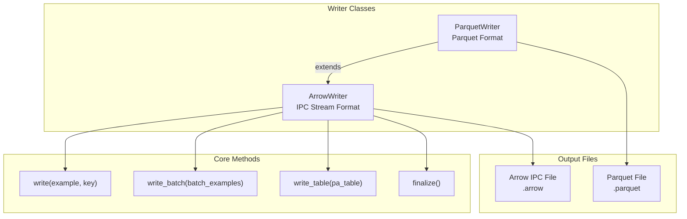
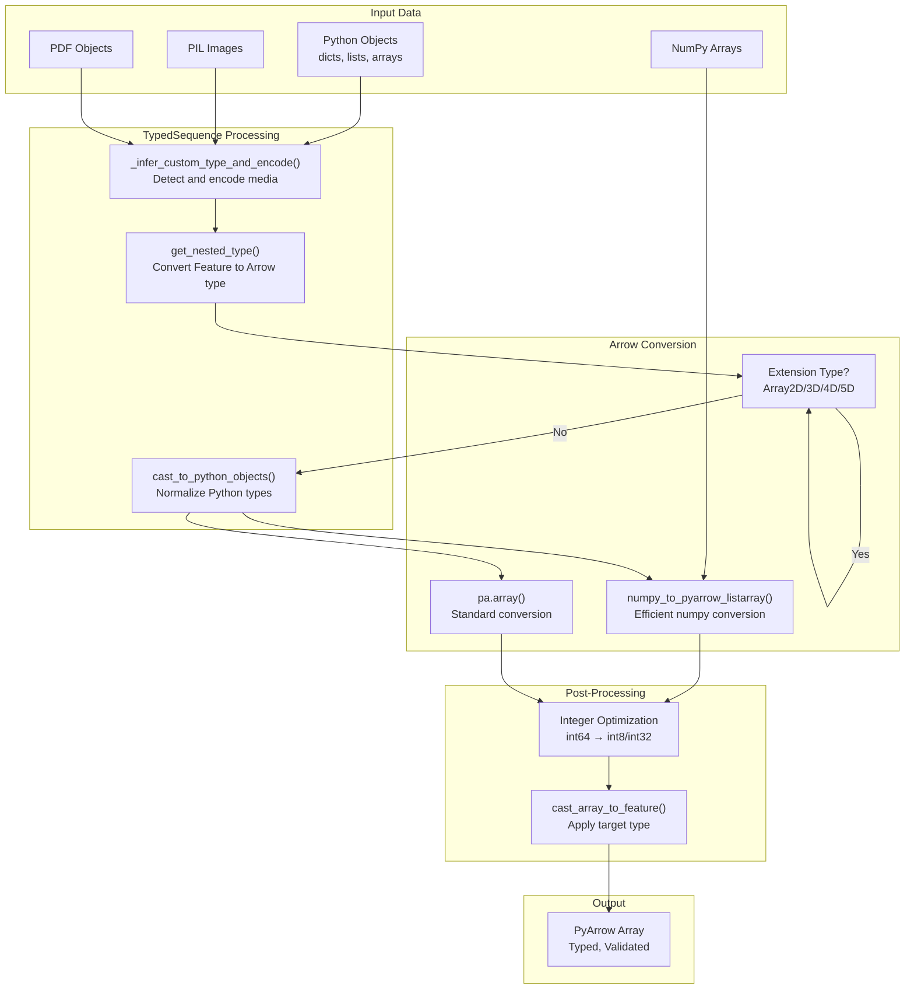
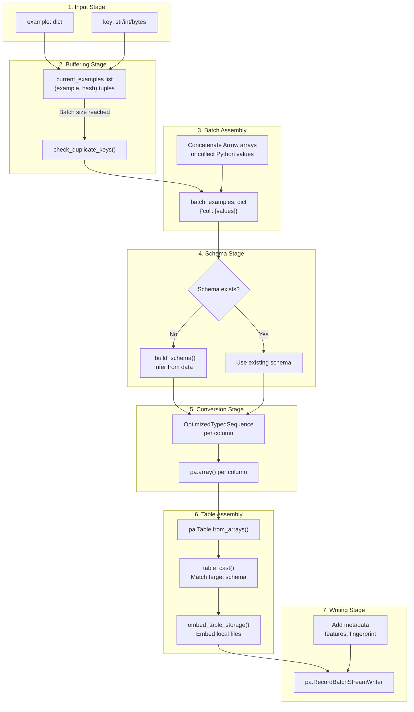
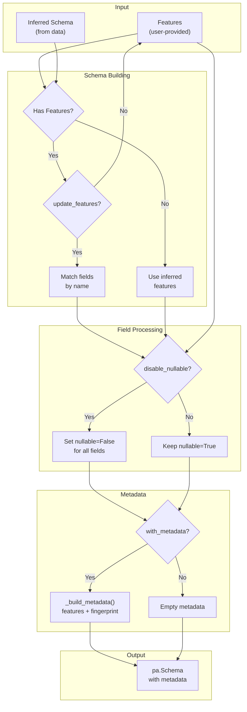
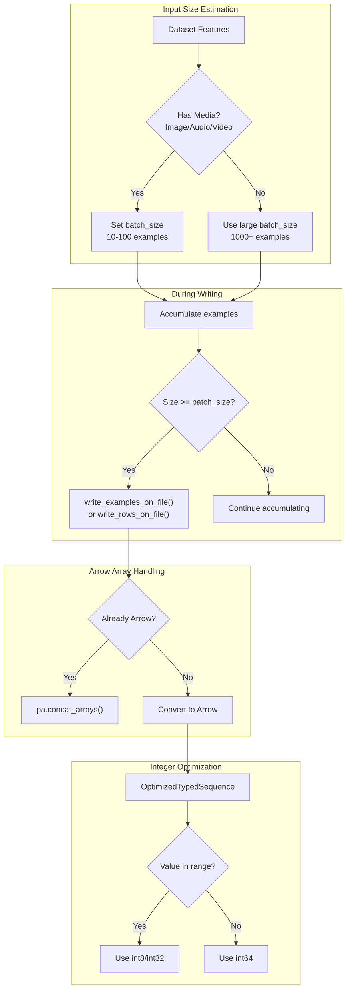

<!-- source: DeepWiki mcp.deepwiki.com · repo huggingface/datasets · page 5.3 ArrowWriter and Data Serialization · fetched 2026-10-26 -->

# ArrowWriter and Data Serialization

Relevant source files

The following files were used as context for generating this wiki page:

- [src/datasets/arrow_writer.py](src/datasets/arrow_writer.py)
- [src/datasets/io/csv.py](src/datasets/io/csv.py)
- [src/datasets/io/generator.py](src/datasets/io/generator.py)
- [src/datasets/io/json.py](src/datasets/io/json.py)
- [src/datasets/io/parquet.py](src/datasets/io/parquet.py)
- [src/datasets/io/sql.py](src/datasets/io/sql.py)
- [src/datasets/io/text.py](src/datasets/io/text.py)
- [src/datasets/utils/py_utils.py](src/datasets/utils/py_utils.py)
- [tests/io/test_csv.py](tests/io/test_csv.py)
- [tests/io/test_json.py](tests/io/test_json.py)
- [tests/io/test_text.py](tests/io/test_text.py)
- [tests/test_arrow_writer.py](tests/test_arrow_writer.py)
- [tests/test_py_utils.py](tests/test_py_utils.py)

## Purpose and Scope

This page documents the data writing and serialization system in the `datasets` library, which handles the conversion of Python objects into Apache Arrow format and their persistence to disk. This system is responsible for:

- Converting Python data structures (dicts, lists, numpy arrays, PIL images) into Arrow arrays [src/datasets/arrow_writer.py:173-180]().
- Type inference and schema generation from raw data [src/datasets/arrow_writer.py:498-510]().
- Writing data to Arrow IPC files and Parquet files [src/datasets/arrow_writer.py:14-15]().
- Batch processing and memory-efficient serialization [src/datasets/arrow_writer.py:654-665]().
- Encoding special feature types such as Image, Audio, Video, and PDF [src/datasets/arrow_writer.py:30-31]().

The core of this system is the `ArrowWriter` class, which abstracts the complexities of the Apache Arrow IPC format and provides a high-level API for dataset creation.

Sources: [src/datasets/arrow_writer.py:1-40](), [src/datasets/arrow_writer.py:406-415]()

---

## Core Writer Classes

The library provides two primary writer classes for persisting datasets to disk in Apache Arrow-based formats.

### ArrowWriter

The `ArrowWriter` class writes data to Arrow IPC (Inter-Process Communication) stream format. It supports streaming writes with configurable batch sizes and automatic schema inference [src/datasets/arrow_writer.py:406-430]().

**Key responsibilities:**
- Write examples or batches to Arrow IPC files [src/datasets/arrow_writer.py:550-560]().
- Infer schema from data if not provided [src/datasets/arrow_writer.py:498-505]().
- Handle duplicate key detection (optional) [src/datasets/arrow_writer.py:604-615]().
- Manage write batching for memory efficiency [src/datasets/arrow_writer.py:66-79]().
- Embed metadata (features, fingerprint) in Arrow schema [src/datasets/arrow_writer.py:470-485]().

**Main methods:**
- `write(example, key)` - Write a single example [src/datasets/arrow_writer.py:550-575]().
- `write_batch(batch_examples)` - Write a batch of examples [src/datasets/arrow_writer.py:654-680]().
- `write_table(pa_table)` - Write a PyArrow table directly [src/datasets/arrow_writer.py:581-595]().
- `finalize()` - Flush remaining data and close the writer [src/datasets/arrow_writer.py:722-741]().

Sources: [src/datasets/arrow_writer.py:406-741]()

### ParquetWriter

The `ParquetWriter` class extends `ArrowWriter` to write data in Parquet format [src/datasets/arrow_writer.py:744-750](). Parquet is used for persistent storage, providing better compression and optimized analytics queries [src/datasets/arrow_writer.py:14-15]().

**Additional features:**
- Content-defined chunking for better compression [src/datasets/arrow_writer.py:755-770]().
- Page index writing for optimized random access [src/datasets/arrow_writer.py:775-785]().
- Configurable row group sizes [src/datasets/arrow_writer.py:105-120]().
- Integration with `pyarrow.parquet.ParquetWriter` [src/datasets/arrow_writer.py:810-830]().

Sources: [src/datasets/arrow_writer.py:744-851](), [src/datasets/arrow_writer.py:14-15]()

### Writer Class Hierarchy

Sources: [src/datasets/arrow_writer.py:406-851]()

---

## Type Inference and Conversion System

The library uses specialized sequence classes to handle type inference and conversion from Python objects to Arrow arrays.

### TypedSequence

`TypedSequence` is the core class for type-aware conversion of Python iterables to Arrow arrays [src/datasets/arrow_writer.py:173-180](). It provides three modes of operation:

1. **Explicit Type Mode** (`type` parameter): Force data to a specific feature type [src/datasets/arrow_writer.py:182-185]().
2. **Try Type Mode** (`try_type` parameter): Attempt to use a type, fall back if incompatible [src/datasets/arrow_writer.py:186-189]().
3. **Auto-Inference Mode**: Automatically infer the appropriate type from data [src/datasets/arrow_writer.py:190-195]().

**Key features:**
- Automatic type inference for custom objects (PIL images, PDF objects) [src/datasets/arrow_writer.py:237-250]().
- Support for Arrow extension types (Array2D, Array3D, etc.) [src/datasets/arrow_writer.py:177-180]().
- Efficient conversion from numpy arrays [src/datasets/arrow_writer.py:334-345]().
- Overflow protection and error handling [src/datasets/arrow_writer.py:367-370]().

Sources: [src/datasets/arrow_writer.py:161-382]()

### OptimizedTypedSequence

`OptimizedTypedSequence` extends `TypedSequence` with column-specific integer type optimization [src/datasets/arrow_writer.py:384-390](). It automatically uses smaller integer types for common dataset columns to reduce memory usage [src/datasets/arrow_writer.py:395-404]().

**Optimizations:**
- `attention_mask` → `int8` [src/datasets/arrow_writer.py:396-397]().
- `special_tokens_mask` → `int8` [src/datasets/arrow_writer.py:398-399]().
- `token_type_ids` → `int8` [src/datasets/arrow_writer.py:400-401]().
- `input_ids` → `int32` [src/datasets/arrow_writer.py:402-404]().

Sources: [src/datasets/arrow_writer.py:384-404]()

### Type Conversion Pipeline

Sources: [src/datasets/arrow_writer.py:161-404](), [src/datasets/features/features.py:31-43]()

---

## Data Writing Pipeline

The complete pipeline from Python data to persisted Arrow files involves multiple stages of transformation and validation.

### Single Example Writing

Sources: [src/datasets/arrow_writer.py:550-720]()

### Batch Writing Workflow

The `write_batch()` method processes multiple examples efficiently [src/datasets/arrow_writer.py:654-660]():

| Step | Method | Purpose |
|------|--------|---------|
| 1 | `write_batch()` | Entry point with batch dict [src/datasets/arrow_writer.py:654]() |
| 2 | Column iteration | Process each column independently [src/datasets/arrow_writer.py:670]() |
| 3 | `OptimizedTypedSequence()` | Create typed sequence per column [src/datasets/arrow_writer.py:685]() |
| 4 | `pa.array()` | Convert to Arrow array [src/datasets/arrow_writer.py:690]() |
| 5 | `pa.Table.from_arrays()` | Assemble table from columns [src/datasets/arrow_writer.py:695]() |
| 6 | `write_table()` | Write table to file [src/datasets/arrow_writer.py:702]() |

Sources: [src/datasets/arrow_writer.py:654-702]()

---

## Schema Management

Schema management ensures that data written to Arrow files maintains consistent types and structure.

### Schema Inference Process

Sources: [src/datasets/arrow_writer.py:498-523]()

### Schema Features

The schema building process (`_build_schema()`) handles several key scenarios [src/datasets/arrow_writer.py:498-500]():

1. **No Features Provided**: Infer entirely from data [src/datasets/arrow_writer.py:502-505]().
2. **Features with Update Mode**: Keep matching features, infer new ones [src/datasets/arrow_writer.py:510-515]().
3. **Strict Features**: Cast data to match provided schema exactly [src/datasets/arrow_writer.py:518-520]().
4. **Nullable Control**: Optionally force all fields to be non-nullable [src/datasets/arrow_writer.py:530-535]().
5. **Metadata Embedding**: Include features definition and fingerprint in Arrow metadata [src/datasets/arrow_writer.py:470-485]().

Sources: [src/datasets/arrow_writer.py:498-548]()

---

## Batch Writing and Memory Optimization

Efficient batch writing is critical for handling large datasets without exhausting memory.

### Writer Batch Size Configuration

The `writer_batch_size` parameter controls how many examples are accumulated before writing to disk [src/datasets/arrow_writer.py:66-70]().

| Function | Purpose | Default Behavior |
|----------|---------|------------------|
| `get_arrow_writer_batch_size_from_features()` | Batch size for Arrow IPC | 100 for images/audio, 10 for video [src/datasets/arrow_writer.py:66-102]() |
| `get_writer_batch_size_from_features()` | Row group size for Parquet | Configuration based [src/datasets/arrow_writer.py:105-142]() |
| `get_writer_batch_size_from_data_size()` | Dynamic calculation | Target 100MB row groups [src/datasets/arrow_writer.py:145-166]() |

Sources: [src/datasets/arrow_writer.py:54-166]()

### Memory Optimization Strategies

Sources: [src/datasets/arrow_writer.py:54-155](), [src/datasets/arrow_writer.py:384-404]()

---

## Format-Specific Writers

The library provides writer implementations for various file formats through specialized classes in the `io` module.

### Format Writer Overview

| Format | Writer Class | Output Format | Key Features |
|--------|--------------|---------------|--------------|
| **JSON** | `JsonDatasetWriter` | JSONL/JSON | Streaming, multiprocessing support [src/datasets/io/json.py:72-100]() |
| **CSV** | `CsvDatasetWriter` | CSV | Pandas-based, header control [src/datasets/io/csv.py:69-90]() |
| **Parquet** | `ParquetDatasetWriter` | Parquet | CDC support, page indexing [src/datasets/io/parquet.py:74-110]() |
| **SQL** | `SqlDatasetWriter` | SQL Database | SQLAlchemy/SQLite integration [src/datasets/io/sql.py:54-73]() |

Sources: [src/datasets/io/json.py:72-174](), [src/datasets/io/csv.py:69-146](), [src/datasets/io/parquet.py:74-151](), [src/datasets/io/sql.py:54-123]()

### Parquet Writer Features

The `ParquetDatasetWriter` includes advanced Parquet-specific optimizations [src/datasets/io/parquet.py:74-85]():

**Content-Defined Chunking (CDC)**:
- Analyzes data content to determine chunk boundaries [src/datasets/io/parquet.py:93-95]().
- Uses `config.DEFAULT_CDC_OPTIONS` for chunking logic [src/datasets/io/parquet.py:94]().

**Page Index Writing**:
- Enables efficient row-level filtering by writing page indexes [src/datasets/io/parquet.py:81]().

Sources: [src/datasets/io/parquet.py:74-151](), [src/datasets/arrow_writer.py:744-851]()

---

## Key Implementation Details

### Duplicate Key Detection

When `check_duplicates=True`, the writer verifies key uniqueness [src/datasets/arrow_writer.py:604-610]():

1. Keys are hashed using `KeyHasher` [src/datasets/arrow_writer.py:612-615]().
2. `check_duplicate_keys()` verifies uniqueness before flushing [src/datasets/arrow_writer.py:630-635]().
3. Raises `DuplicatedKeysError` if duplicates are found [src/datasets/arrow_writer.py:638-639]().

Sources: [src/datasets/arrow_writer.py:604-639]()

### Overflow Protection

`TypedSequence.__arrow_array__()` includes overflow protection [src/datasets/arrow_writer.py:367]():
- Catches `pa.lib.ArrowInvalid` with "overflow" message [src/datasets/arrow_writer.py:368]().
- Suggests reducing `writer_batch_size` to stay under the 2GB Arrow limit per array chunk [src/datasets/arrow_writer.py:369-370]().

Sources: [src/datasets/arrow_writer.py:367-370]()

---

