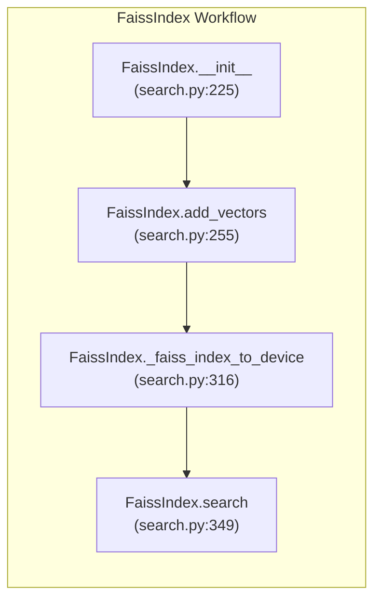

<!-- source: DeepWiki mcp.deepwiki.com · repo huggingface/datasets · page 6 Search and Indexing · fetched 2026-10-26 -->

# Search and Indexing

<details>
<summary>Relevant source files</summary>

The following files were used as context for generating this wiki page:

- [src/datasets/fingerprint.py](src/datasets/fingerprint.py)
- [src/datasets/search.py](src/datasets/search.py)
- [src/datasets/utils/_dill.py](src/datasets/utils/_dill.py)
- [tests/test_fingerprint.py](tests/test_fingerprint.py)
- [tests/test_fingerprint_tokenizer_stability.py](tests/test_fingerprint_tokenizer_stability.py)
- [tests/test_search.py](tests/test_search.py)

</details>


## Purpose and Scope

This document describes the search and indexing capabilities of the `datasets` library, which enable efficient nearest-neighbor search and retrieval operations on datasets. The search system supports two primary paradigms: **dense vector indexes** using Faiss for similarity search on embeddings, and **sparse text indexes** using Elasticsearch for keyword-based retrieval.

This is a **parent page** providing a high-level overview. For deep technical details on specific components, see the following child pages:
- [Indexing System Architecture](#6.1) — Detailed documentation of `BaseIndex`, `IndexableMixin`, and index management logic.
- [Faiss and Elasticsearch Integration](#6.2) — Implementation details for `FaissIndex` and `ElasticSearchIndex`.

For information about the core `Dataset` class that consumes these search capabilities, see [Dataset and DatasetDict Classes](#2.1).

---

## Architecture Overview

The search system is implemented as a modular framework that separates index implementations from the `Dataset` integration layer. The core design uses an abstract base class pattern with concrete implementations for different retrieval backends.

### System Component Architecture

The following diagram illustrates how the search components relate to the core `Dataset` class and external libraries.

```mermaid
graph TB
    subgraph "Dataset Integration (arrow_dataset.py / search.py)"
        Dataset["Dataset Class"]
        IndexableMixin["IndexableMixin<br/>(search.py:417-786)"]
    end
    
    subgraph "Index Interface (search.py)"
        BaseIndex["BaseIndex<br/>(search.py:60-96)"]
    end
    
    subgraph "Dense Vector Indexing"
        FaissIndex["FaissIndex<br/>(search.py:215-414)"]
        FaissLib["faiss library<br/>(external)"]
    end
    
    subgraph "Sparse Text Indexing"
        ESIndex["ElasticSearchIndex<br/>(search.py:98-213)"]
        ESClient["elasticsearch-py<br/>(external)"]
    end
    
    subgraph "Result Structures"
        SearchResults["SearchResults<br/>(search.py:40-43)"]
        NearestExamplesResults["NearestExamplesResults<br/>(search.py:50-53)"]
    end
    
    Dataset -.mixes in.-> IndexableMixin
    IndexableMixin -->|"_indexes: dict[str, BaseIndex]"| BaseIndex
    
    BaseIndex <|-- FaissIndex
    BaseIndex <|-- ESIndex
    
    FaissIndex --> FaissLib
    ESIndex --> ESClient
    
    FaissIndex -->|returns| SearchResults
    ESIndex -->|returns| SearchResults
    IndexableMixin -->|returns| NearestExamplesResults
```

**Sources:** [src/datasets/search.py:1-786]()

The architecture consists of three main layers:
1.  **Index Interface Layer**: The `BaseIndex` class [src/datasets/search.py:60-96]() defines the contract (search, save, load) for all backends.
2.  **Index Implementations**: `FaissIndex` [src/datasets/search.py:215-414]() for vector similarity and `ElasticSearchIndex` [src/datasets/search.py:98-213]() for BM25 retrieval.
3.  **Dataset Integration**: The `IndexableMixin` [src/datasets/search.py:417-786]() provides the `Dataset` class with methods like `add_faiss_index` [src/datasets/search.py:454-493]() and `get_nearest_examples` [src/datasets/search.py:735-757]().

---

## Base Index Interface

The `BaseIndex` class defines the core interface that all index implementations must follow. It ensures a consistent API regardless of whether the underlying technology is a local vector store or a remote search engine.

| Method | Purpose | Code Reference |
| :--- | :--- | :--- |
| `search` | Find $k$ nearest examples to a single query. | [src/datasets/search.py:63-68]() |
| `search_batch` | Find $k$ nearest examples for multiple queries. | [src/datasets/search.py:70-86]() |
| `save` | Serialize the index to disk. | [src/datasets/search.py:88-90]() |
| `load` | Deserialize the index from disk. | [src/datasets/search.py:92-95]() |

For details on the base class and mixin logic, see [Indexing System Architecture](#6.1).

---

## FaissIndex: Dense Vector Search

The `FaissIndex` class wraps the Faiss library to provide efficient similarity search over dense vector embeddings. It supports various index types (e.g., Flat, IVF, LSH) and can leverage GPU acceleration.



**Key Features:**
*   **Flexible Factory**: Supports Faiss string factories like `"Flat"` or `"IVF100,Flat"` [src/datasets/search.py:225-253]().
*   **GPU Support**: The `device` parameter allows running searches on one or more GPUs [src/datasets/search.py:316-347]().
*   **External Arrays**: Can be initialized from arrays not currently in the dataset via `add_faiss_index_from_external_arrays` [src/datasets/search.py:495-533]().

For implementation details and GPU configuration, see [Faiss and Elasticsearch Integration](#6.2).

---

## ElasticSearchIndex: Text Search

The `ElasticSearchIndex` class provides sparse text retrieval using the BM25 similarity algorithm. It requires an active Elasticsearch cluster.

**Key Components:**
*   **Client Management**: Connects via `elasticsearch-py` using host/port or a pre-configured client [src/datasets/search.py:108-128]().
*   **Bulk Indexing**: Uses `streaming_bulk` to efficiently upload dataset columns to the ES cluster [src/datasets/search.py:169-173]().
*   **Concurrent Search**: Implements `search_batch` using a `ThreadPoolExecutor` to perform multiple queries in parallel [src/datasets/search.py:201-212]().

For details on configuration and index mappings, see [Faiss and Elasticsearch Integration](#6.2).

---

## IndexableMixin: Dataset Integration

`IndexableMixin` is the bridge between the raw `BaseIndex` objects and the `Dataset` user API. It maintains a dictionary of initialized indexes in `_indexes` [src/datasets/search.py:418]() and provides high-level retrieval methods.

### Retrieval API

When a user calls `get_nearest_examples`, the following internal flow occurs:

1.  **Index Lookup**: The mixin retrieves the `BaseIndex` associated with the requested `index_name` [src/datasets/search.py:741]().
2.  **Search Execution**: It calls `index.search()` to get integer indices and similarity scores [src/datasets/search.py:742]().
3.  **Data Hydration**: It uses the returned indices to slice the `Dataset` (Arrow table) and return the actual row data [src/datasets/search.py:743-744]().

**Sources:** [src/datasets/search.py:735-757]()

---

## Persistence and Serialization

Indexes can be saved and loaded independently of the dataset files. This is particularly useful for large Faiss indexes that take significant time to build.

*   **Faiss**: Uses `faiss.write_index` and `faiss.read_index` [src/datasets/search.py:387-414]().
*   **Remote Filesystems**: Supports `fsspec` for saving/loading indexes to S3, GCS, etc. [src/datasets/search.py:390-395]().
*   **Integration**: `Dataset` provides helper methods like `save_faiss_index` [src/datasets/search.py:535-557]() and `load_faiss_index` [src/datasets/search.py:559-583]() to manage these files alongside the dataset.

For details on index management and persistence, see [Indexing System Architecture](#6.1).

---

## Summary of Search Methods

| Method | Input | Output | Description |
| :--- | :--- | :--- | :--- |
| `search` | Query (str/array) | `SearchResults` | Returns raw row pointers and scores. [src/datasets/search.py:693-711]() |
| `search_batch` | List of Queries | `BatchedSearchResults` | Batched version of `search`. [src/datasets/search.py:713-733]() |
| `get_nearest_examples` | Query (str/array) | `NearestExamplesResults` | Returns scores and the actual row content. [src/datasets/search.py:735-757]() |
| `get_nearest_examples_batch` | List of Queries | `BatchedNearestExamplesResults` | Batched version of `get_nearest_examples`. [src/datasets/search.py:759-785]() |

**Sources:** [src/datasets/search.py:693-785]()

---

