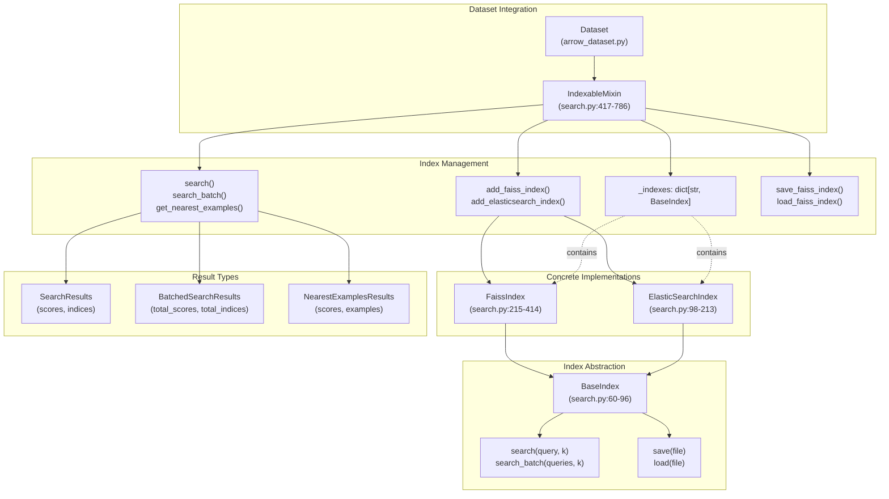
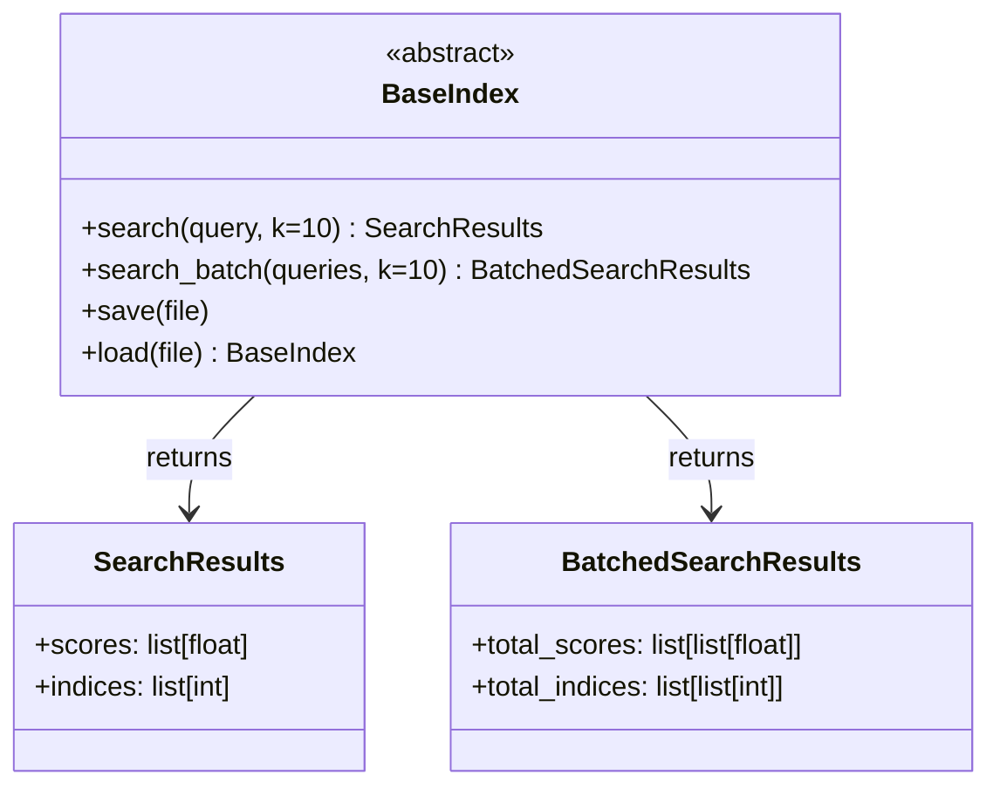
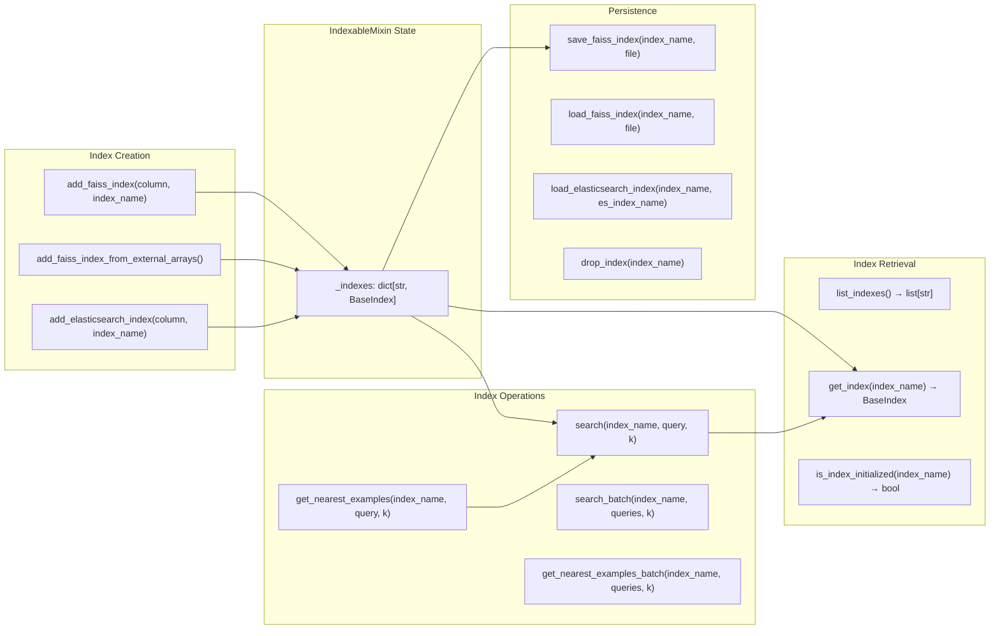
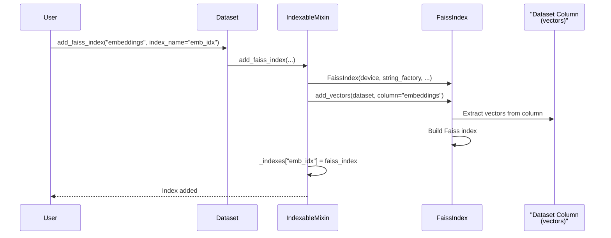
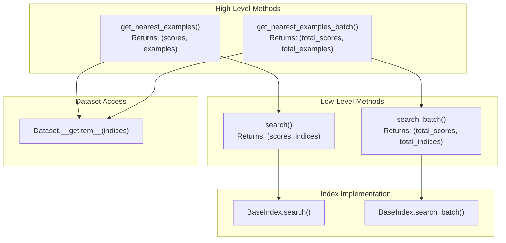

<!-- source: DeepWiki mcp.deepwiki.com · repo huggingface/datasets · page 6.1 Indexing System Architecture · fetched 2026-10-26 -->

# Indexing System Architecture

Relevant source files

The following files were used as context for generating this wiki page:

- [src/datasets/fingerprint.py](src/datasets/fingerprint.py)
- [src/datasets/search.py](src/datasets/search.py)
- [src/datasets/utils/_dill.py](src/datasets/utils/_dill.py)
- [tests/test_fingerprint.py](tests/test_fingerprint.py)
- [tests/test_fingerprint_tokenizer_stability.py](tests/test_fingerprint_tokenizer_stability.py)
- [tests/test_search.py](tests/test_search.py)

## Purpose and Scope

This document describes the architecture of the indexing system in the `datasets` library, which enables fast similarity search over dataset contents. The indexing system provides an abstraction layer (`BaseIndex`) and a mixin pattern (`IndexableMixin`) that allows `Dataset` objects to maintain multiple named indexes for efficient retrieval operations.

The system is designed to be extensible, supporting both dense vector search (via Faiss) and sparse text search (via Elasticsearch).

---

## Core Architecture

The indexing system is built around three fundamental components:

1.  **BaseIndex**: Abstract base class defining the index interface [src/datasets/search.py:60-96]().
2.  **IndexableMixin**: Mixin class that adds indexing capabilities to datasets [src/datasets/search.py:417-786]().
3.  **Index Implementations**: Concrete implementations such as `FaissIndex` [src/datasets/search.py:215-414]() and `ElasticSearchIndex` [src/datasets/search.py:98-213]().

### System Component Diagram

**Sources**: [src/datasets/search.py:1-786](), [src/datasets/arrow_dataset.py:15-17]()

---

## BaseIndex Abstract Class

The `BaseIndex` class defines the interface that all index implementations must follow. It is an abstract base class with methods for searching and persistence [src/datasets/search.py:60-96]().

### BaseIndex Interface

**Sources**: [src/datasets/search.py:60-96](), [src/datasets/search.py:40-48]()

### Key Methods

| Method | Purpose | Return Type |
|--------|---------|-------------|
| `search(query, k)` | Find k nearest examples to a single query | `SearchResults` [src/datasets/search.py:63-68]() |
| `search_batch(queries, k)` | Find k nearest examples for multiple queries | `BatchedSearchResults` [src/datasets/search.py:70-86]() |
| `save(file)` | Serialize index to disk | None [src/datasets/search.py:88-90]() |
| `load(file)` | Deserialize index from disk | `BaseIndex` [src/datasets/search.py:92-95]() |

The default implementation of `search_batch()` iterates over queries and calls `search()` for each [src/datasets/search.py:81-86](), but implementations can override this for better performance (e.g., `ElasticSearchIndex` uses a thread pool [src/datasets/search.py:201-213]()).

**Sources**: [src/datasets/search.py:60-96](), [src/datasets/search.py:201-213]()

### Result Named Tuples

The indexing system uses strongly-typed named tuples for return values:

*   `SearchResults`: Contains `scores` and `indices` [src/datasets/search.py:40-43]().
*   `BatchedSearchResults`: Contains `total_scores` and `total_indices` [src/datasets/search.py:45-48]().
*   `NearestExamplesResults`: Contains `scores` and actual dataset `examples` [src/datasets/search.py:50-53]().
*   `BatchedNearestExamplesResults`: Contains `total_scores` and `total_examples` [src/datasets/search.py:55-58]().

**Sources**: [src/datasets/search.py:40-58]()

---

## IndexableMixin Pattern

The `IndexableMixin` class adds indexing capabilities to `Dataset` objects through composition. It maintains a dictionary of named indexes and provides methods to create, manage, and query them [src/datasets/search.py:417-786]().

### Index Management Architecture

**Sources**: [src/datasets/search.py:417-786]()

### Index Naming and Storage

Indexes are stored in the `_indexes` dictionary [src/datasets/search.py:421]().

*   **Default naming**: If no `index_name` is provided, the column name is used [src/datasets/search.py:475]().
*   **Custom naming**: Users can specify any name for an index [src/datasets/search.py:456]().
*   **Multiple indexes**: A dataset can have multiple indexes with different names.
*   **Index lookup**: All operations reference indexes by name [src/datasets/search.py:444-447]().

**Sources**: [src/datasets/search.py:421](), [src/datasets/search.py:429-441]()

### Index Creation Flow

**Sources**: [src/datasets/search.py:454-493]()

---

## Index Creation Methods

The `IndexableMixin` provides multiple methods for creating indexes:

### Faiss Index Methods

| Method | Purpose |
|--------|---------|
| `add_faiss_index(column, index_name, ...)` | Create index from dataset column containing vectors [src/datasets/search.py:454-493]() |
| `add_faiss_index_from_external_arrays(external_arrays, index_name, ...)` | Create index from external numpy arrays [src/datasets/search.py:495-533]() |

Both methods accept parameters for `device`, `string_factory`, `metric_type`, and `custom_index` [src/datasets/search.py:455-465]().

**Sources**: [src/datasets/search.py:454-533]()

### Elasticsearch Index Methods

| Method | Purpose |
|--------|---------|
| `add_elasticsearch_index(column, index_name, ...)` | Create text index from dataset column [src/datasets/search.py:585-635]() |
| `load_elasticsearch_index(index_name, es_index_name, ...)` | Load existing Elasticsearch index [src/datasets/search.py:637-683]() |

**Sources**: [src/datasets/search.py:585-683]()

### Column Requirements

For Faiss indexes, the column must contain vectors. If a column has an incompatible feature type, a `ValueError` is raised [tests/test_search.py:41-42]().

**Sources**: [tests/test_search.py:37-42]()

---

## Search Operations

The `IndexableMixin` provides four main search methods that delegate to the underlying index implementations:

### Search Method Hierarchy

**Sources**: [src/datasets/search.py:693-785]()

### Method Comparison

| Method | Input | Returns | Use Case |
|--------|-------|---------|----------|
| `search(index_name, query, k)` | Single query | `SearchResults` | Get indices only [src/datasets/search.py:693-709]() |
| `search_batch(index_name, queries, k)` | Multiple queries | `BatchedSearchResults` | Batch indices only [src/datasets/search.py:711-727]() |
| `get_nearest_examples(index_name, query, k)` | Single query | `NearestExamplesResults` | Get full examples [src/datasets/search.py:735-757]() |
| `get_nearest_examples_batch(index_name, queries, k)` | Multiple queries | `BatchedNearestExamplesResults` | Batch full examples [src/datasets/search.py:759-785]() |

**Sources**: [src/datasets/search.py:693-785]()

### Negative Index Filtering

The search methods filter out negative indices returned by the index (which indicate missing results in Faiss) before retrieving examples from the dataset [src/datasets/search.py:754-757]().

**Sources**: [src/datasets/search.py:754-757]()

---

## Index Persistence

### Faiss Index Persistence

Faiss indexes can be saved to and loaded from disk using `fsspec` for remote URI support [src/datasets/search.py:387-414](). `IndexableMixin` provides convenience methods `save_faiss_index` [src/datasets/search.py:535-555]() and `load_faiss_index` [src/datasets/search.py:557-583]().

**Sources**: [src/datasets/search.py:535-583]()

### GPU Index Handling

When saving a Faiss index that is on GPU, it is automatically transferred to CPU first using `faiss.index_gpu_to_cpu` [src/datasets/search.py:387-391]().

**Sources**: [src/datasets/search.py:387-397]()

### Validation on Load

When loading an index, the system validates that the index size matches the dataset size to ensure consistency [src/datasets/search.py:577-582]().

**Sources**: [src/datasets/search.py:577-582]()

---

## Index Management Operations

### Checking Index Status

| Method | Purpose | Behavior |
|--------|---------|----------|
| `is_index_initialized(index_name)` | Check if index exists | Returns boolean [src/datasets/search.py:429-430]() |
| `list_indexes()` | Get all index names | Returns list of strings [src/datasets/search.py:441-442]() |
| `get_index(index_name)` | Retrieve index object | Raises `MissingIndex` if not found [src/datasets/search.py:444-447]() |
| `drop_index(index_name)` | Remove index from dataset | Deletes from `_indexes` dict [src/datasets/search.py:449-452]() |

**Sources**: [src/datasets/search.py:429-452]()

### MissingIndex Exception

All search operations check that the index is initialized before use via `_check_index_is_initialized` [src/datasets/search.py:432-436](). If not found, a `MissingIndex` exception is raised [src/datasets/search.py:36-37]().

**Sources**: [src/datasets/search.py:36-37](), [src/datasets/search.py:432-436]()

---

## Error Handling

The indexing system includes several validation mechanisms:

*   **Import Checks**: Faiss and Elasticsearch are optional dependencies; the system checks availability before use [src/datasets/search.py:29-30]().
*   **Parameter Validation**: `FaissIndex` validates that `string_factory` and `custom_index` are not both provided [src/datasets/search.py:237-238]().
*   **Index Type Validation**: `save_faiss_index` verifies the index is actually a `FaissIndex` [src/datasets/search.py:547-550]().

**Sources**: [src/datasets/search.py:29-30](), [src/datasets/search.py:237-243](), [src/datasets/search.py:547-550]()

---

