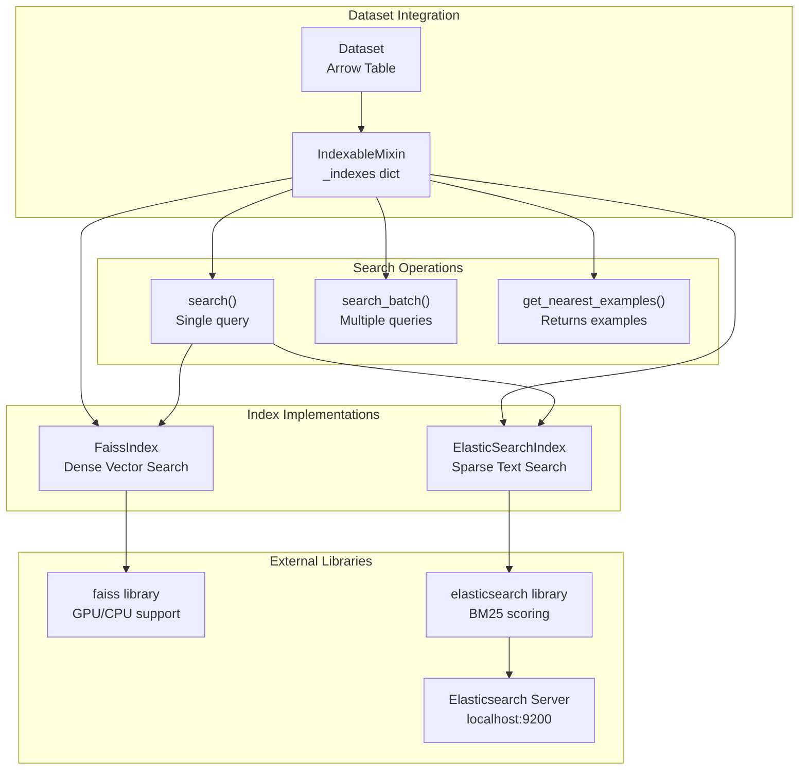
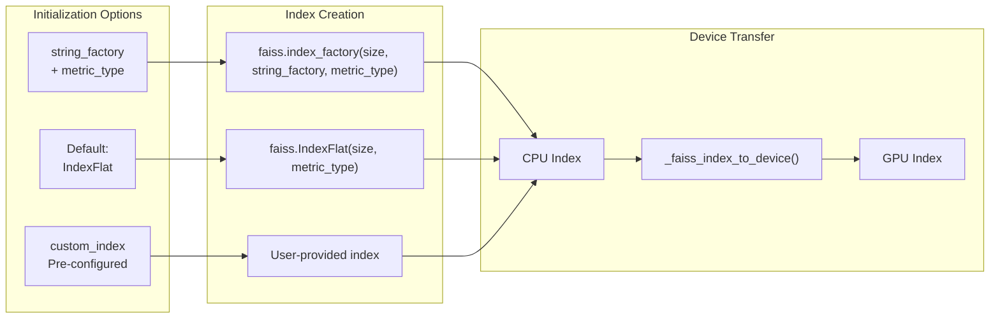
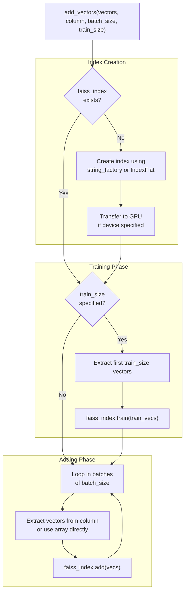
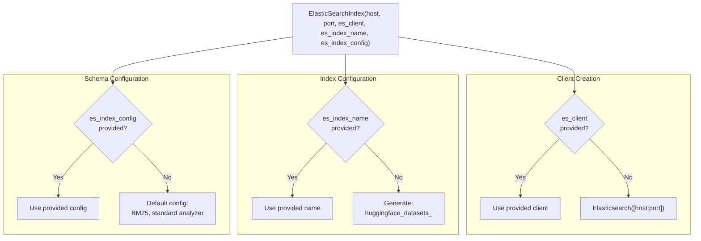
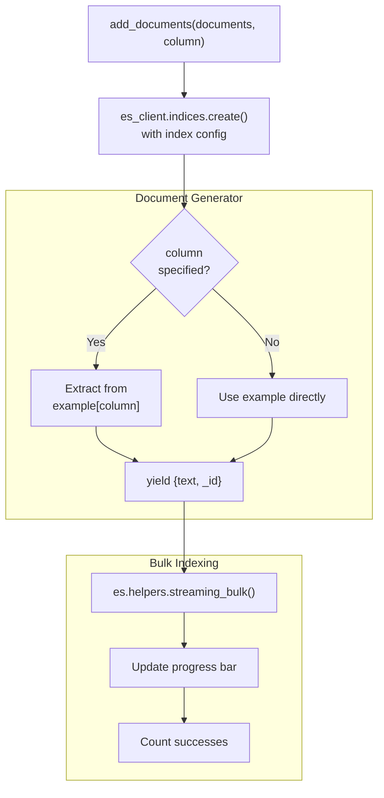
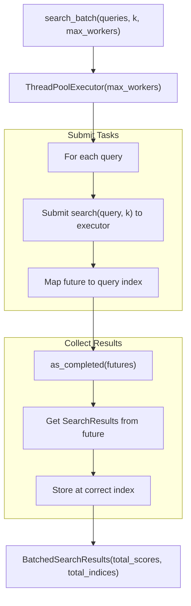
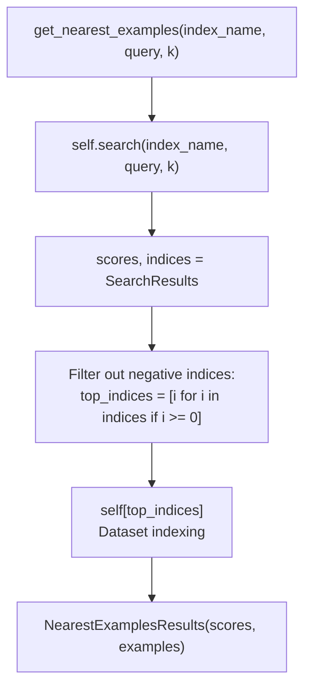

<!-- source: DeepWiki mcp.deepwiki.com · repo huggingface/datasets · page 6.2 Faiss and Elasticsearch Integration · fetched 2026-10-26 -->

# Faiss and Elasticsearch Integration

Relevant source files

The following files were used as context for generating this wiki page:

- [.zenodo.json](.zenodo.json)
- [CONTRIBUTING.md](CONTRIBUTING.md)
- [README.md](README.md)
- [docs/source/dataset_card.mdx](docs/source/dataset_card.mdx)
- [docs/source/faiss_es.mdx](docs/source/faiss_es.mdx)
- [src/datasets/fingerprint.py](src/datasets/fingerprint.py)
- [src/datasets/search.py](src/datasets/search.py)
- [src/datasets/utils/_dill.py](src/datasets/utils/_dill.py)
- [tests/test_fingerprint.py](tests/test_fingerprint.py)
- [tests/test_fingerprint_tokenizer_stability.py](tests/test_fingerprint_tokenizer_stability.py)
- [tests/test_search.py](tests/test_search.py)

## Purpose and Scope

This document describes the implementation of the `FaissIndex` and `ElasticSearchIndex` classes, which provide dense vector search and sparse text search capabilities for datasets. These classes implement the `BaseIndex` interface and enable efficient nearest neighbor retrieval for embedding-based search (Faiss) and keyword-based search (Elasticsearch).

For information about the base indexing architecture and the `IndexableMixin` that integrates these indexes with Dataset objects, see [Indexing System Architecture](#6.1).

---

## System Architecture

The search integration system consists of specialized index implementations that plug into the `BaseIndex` interface. These indexes are attached to `Dataset` objects through the `IndexableMixin` mixin class.

### Component Overview

**Sources:** [src/datasets/search.py:60-96](), [src/datasets/search.py:98-213](), [src/datasets/search.py:215-415]()

---

## FaissIndex Implementation

The `FaissIndex` class provides dense vector similarity search using the Faiss library. It supports multiple index types, GPU acceleration, and custom metric types.

### Class Structure and Initialization

The `FaissIndex` constructor accepts several mutually exclusive configuration options for index creation [src/datasets/search.py:225-254]().

| Parameter | Type | Description |
|-----------|------|-------------|
| `device` | `Optional[Union[int, List[int]]]` | GPU device(s) to use. Positive int = GPU id, negative int = all GPUs, list = specific GPUs, `None` = CPU [src/datasets/search.py:227-230]() |
| `string_factory` | `Optional[str]` | Faiss index factory string (e.g., `"Flat"`, `"IVF100,Flat"`) [src/datasets/search.py:231]() |
| `metric_type` | `Optional[int]` | Metric type constant (e.g., `faiss.METRIC_INNER_PRODUCT`) [src/datasets/search.py:232]() |
| `custom_index` | `Optional[faiss.Index]` | Pre-configured Faiss index instance [src/datasets/search.py:233]() |

**Sources:** [src/datasets/search.py:225-254](), [src/datasets/search.py:275-289](), [src/datasets/search.py:316-347]()

### Adding Vectors to the Index

The `add_vectors()` method populates the index with embeddings from a dataset or numpy array [src/datasets/search.py:255-314]().

The method validates that the column contains the correct feature type and handles both `Dataset` objects and raw numpy arrays [src/datasets/search.py:269-272]().

**Sources:** [src/datasets/search.py:255-314]()

### Search Operations

The `FaissIndex` provides search methods for single and batched queries.

#### Single Query Search

**Sources:** [src/datasets/search.py:349-367]()

### Serialization

The `FaissIndex` supports saving and loading using `fsspec` for local and remote storage compatibility [src/datasets/search.py:387-414]().

**Sources:** [src/datasets/search.py:387-414]()

---

## ElasticSearchIndex Implementation

The `ElasticSearchIndex` class provides sparse text search using Elasticsearch with BM25 scoring [src/datasets/search.py:98-213]().

### Initialization and Configuration

The default index configuration uses BM25 similarity and a standard analyzer with English stopwords [src/datasets/search.py:134-143]().

**Sources:** [src/datasets/search.py:108-144]()

### Adding Documents

The `add_documents()` method indexes text documents using Elasticsearch's bulk API [src/datasets/search.py:146-180]().

**Sources:** [src/datasets/search.py:146-180]()

### Batch Search with Threading

The `search_batch()` method uses `ThreadPoolExecutor` to process multiple queries in parallel, which is essential for network-bound Elasticsearch requests [src/datasets/search.py:201-212]().

**Sources:** [src/datasets/search.py:201-212]()

---

## Integration with Dataset via IndexableMixin

The `IndexableMixin` class provides methods that integrate `FaissIndex` and `ElasticSearchIndex` with `Dataset` objects [src/datasets/search.py:417-786]().

### Search to Examples Flow

The `get_nearest_examples()` method combines index search with dataset indexing to return actual data rows [src/datasets/search.py:693-757]().

**Sources:** [src/datasets/search.py:693-757](), [src/datasets/search.py:759-785]()

---

## Return Types

The search system uses `NamedTuple` types for structured return values [src/datasets/search.py:40-58]().

| Type | Fields | Usage |
|------|--------|-------|
| `SearchResults` | `scores: List[float]`, `indices: List[int]` | Single query search |
| `BatchedSearchResults` | `total_scores: List[List[float]]`, `total_indices: List[List[int]]` | Batch query search |
| `NearestExamplesResults` | `scores: List[float]`, `examples: dict` | Single query with examples |
| `BatchedNearestExamplesResults` | `total_scores: List[List[float]]`, `total_examples: List[dict]` | Batch query with examples |

**Sources:** [src/datasets/search.py:40-58]()

---

## Error Handling

### Missing Index Error

The `MissingIndex` exception is raised when attempting to use an index that hasn't been initialized [src/datasets/search.py:36-37]().

**Sources:** [src/datasets/search.py:36-37](), [src/datasets/search.py:432-436]()

### Import Errors

Both index implementations check for the availability of their respective libraries and raise informative `ImportError` messages [src/datasets/search.py:29-30]().

- **Faiss**: Checks for `faiss` library [src/datasets/search.py:248-253]().
- **Elasticsearch**: Checks for `elasticsearch` library [src/datasets/search.py:116-119]().

**Sources:** [src/datasets/search.py:29-30](), [src/datasets/search.py:116-119](), [src/datasets/search.py:248-253]()

---

