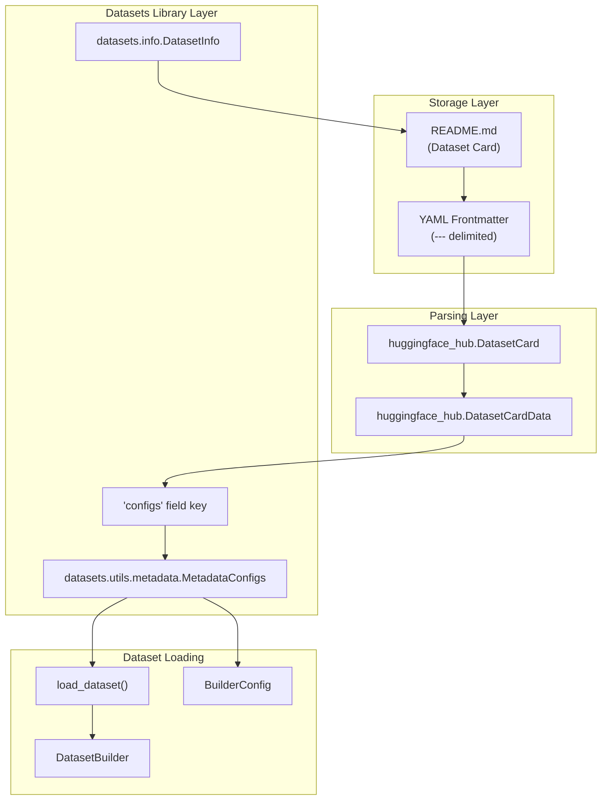
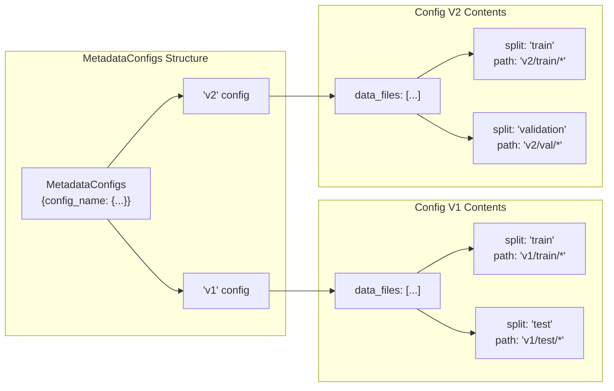
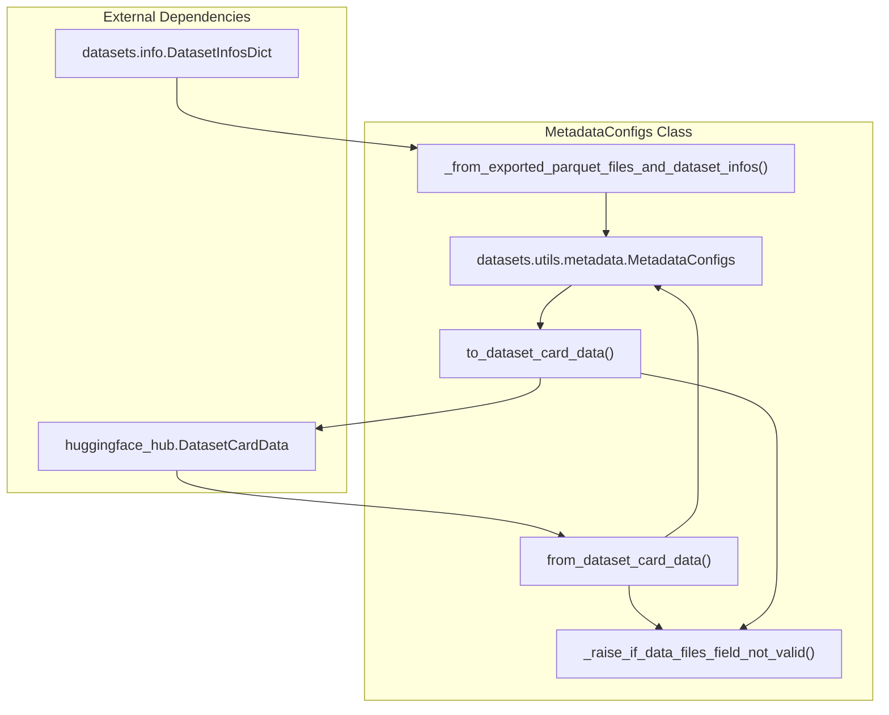

<!-- source: DeepWiki mcp.deepwiki.com · repo huggingface/datasets · page 7 Metadata and Splits · fetched 2026-10-26 -->

# Metadata and Splits

<details>
<summary>Relevant source files</summary>

The following files were used as context for generating this wiki page:

- [src/datasets/builder.py](src/datasets/builder.py)
- [src/datasets/commands/test.py](src/datasets/commands/test.py)
- [src/datasets/info.py](src/datasets/info.py)
- [src/datasets/utils/metadata.py](src/datasets/utils/metadata.py)
- [tests/commands/test_test.py](tests/commands/test_test.py)
- [tests/test_builder.py](tests/test_builder.py)
- [tests/test_metadata_util.py](tests/test_metadata_util.py)

</details>


## Purpose and Scope

This document provides an overview of how the `datasets` library manages dataset metadata and split definitions. Metadata describes dataset configurations, schemas, and data file locations, while splits define logical partitions of data (e.g., train, validation, test). Together, these systems enable flexible dataset organization and loading from various sources, particularly the Hugging Face Hub.

For detailed information about specific subsystems:
- For the `MetadataConfigs` class and structured metadata storage, see [Metadata System](#7.1)
- For dataset card structure and README requirements, see [Dataset Cards and Documentation](#7.2)  
- For split definitions and read instructions, see [Splits and ReadInstructions](#7.3)

## Metadata System Overview

Metadata in the datasets library serves as a declarative configuration system that describes dataset properties, structure, and content. The primary metadata container is the `MetadataConfigs` class, which stores configuration-specific parameters in a dictionary format where keys are configuration names and values are parameter dictionaries.

### Core Components



**Diagram: Metadata Flow from README to Dataset Loading**

The metadata system follows a clear pipeline:

1. **README.md files** contain YAML frontmatter delimited by `---` markers [src/datasets/utils/metadata.py:36-43]().
2. **huggingface_hub** parses the YAML into `DatasetCardData` objects [src/datasets/utils/metadata.py:9]().
3. **MetadataConfigs** extracts the `configs` field (defined by `METADATA_CONFIGS_FIELD`) [src/datasets/utils/metadata.py:49-50]().
4. **load_dataset** uses this metadata to configure dataset builders.

Sources: [src/datasets/utils/metadata.py:1-164](), [src/datasets/info.py:92-165](), [src/datasets/config.py]()

### Metadata Configuration Structure

Each configuration in `MetadataConfigs` can contain parameters such as:

| Parameter | Type | Purpose |
|-----------|------|---------|
| `data_files` | str, list, or list of dicts | Specifies data file locations or split-to-file mappings [src/datasets/utils/metadata.py:52-101]() |
| `data_dir` | str | Base directory for data files [src/datasets/builder.py:122]() |
| `features` | `Features` | Schema definition for the dataset [src/datasets/utils/metadata.py:157]() |
| `version` | str | Configuration version string [src/datasets/utils/metadata.py:121]() |

Sources: [src/datasets/utils/metadata.py:52-101](), [src/datasets/builder.py:101-125](), [tests/test_metadata_util.py:112-127]()

## Splits Overview

Splits are logical partitions of a dataset that separate data for different purposes (training, validation, testing). In the metadata system, splits are defined within the `data_files` parameter using a structured format.

### Split Definition Formats

The `data_files` field supports multiple formats for defining splits:

**Format 1: Simple string (single file, auto-detected split)**
```yaml
configs:
  - config_name: default
    data_files: data.csv
```

**Format 2: List of paths (multiple files, single split)**
```yaml
configs:
  - config_name: default
    data_files:
      - part0/*
      - part1/*
```

**Format 3: Split-to-path mappings (explicit splits)**
```yaml
configs:
  - config_name: default
    data_files:
      - split: train
        path: train/*
      - split: test
        path: test/*
```

Sources: [src/datasets/utils/metadata.py:55-84](), [tests/test_metadata_util.py:60-109]()

### Split Naming Constraints

Split names must match the regular expression defined in `_split_re` from the naming module. This ensures compatibility with file system constraints [src/datasets/utils/metadata.py:96]().

Sources: [src/datasets/utils/metadata.py:14](), [src/datasets/naming.py]()

## Metadata and Split Integration

The integration between metadata and splits occurs primarily through the `data_files` parameter within `MetadataConfigs`. This design allows each configuration to define its own split structure and data file locations.



**Diagram: Multiple Configurations with Different Split Structures**

Sources: [src/datasets/utils/metadata.py:103-139](), [tests/test_metadata_util.py:70-95]()

## MetadataConfigs Class Architecture

The `MetadataConfigs` class is a dictionary subclass that provides specialized methods for metadata management. It serves as the primary interface between dataset cards and the loading system.



**Diagram: MetadataConfigs Class Structure and Methods**

Sources: [src/datasets/utils/metadata.py:46-172]()

### Key Methods

**`from_dataset_card_data(cls, dataset_card_data: DatasetCardData) -> MetadataConfigs`**
Extracts configuration metadata from a `DatasetCardData` object, validating structure and converting features from YAML to `Features` objects [src/datasets/utils/metadata.py:142-164]().

**`to_dataset_card_data(self, dataset_card_data: DatasetCardData) -> None`**
Writes configuration metadata back to a `DatasetCardData` object, merging with existing configs and sorting them alphabetically [src/datasets/utils/metadata.py:166-172]().

**`_from_exported_parquet_files_and_dataset_infos(...)`**
Creates metadata configurations from exported Parquet files on the Hub, preserving split order from `DatasetInfosDict` [src/datasets/utils/metadata.py:103-139]().

## Dataset Information Storage (`DatasetInfo`)

The `DatasetInfo` class stores static information about a dataset that is either known before loading or computed during processing.

### Core Attributes
- **`description`**, **`citation`**, **`homepage`**, **`license`**: Basic metadata [src/datasets/info.py:138-141]().
- **`features`**: Column types defined as a `Features` object [src/datasets/info.py:142]().
- **`splits`**: A `SplitDict` mapping split names to metadata like example counts [src/datasets/info.py:152]().
- **`dataset_size`**: Combined size of Arrow tables [src/datasets/info.py:156]().

### Serialization
`DatasetInfo` supports YAML conversion for embedding in README files, focusing on specific fields defined in `_INCLUDED_INFO_IN_YAML` [src/datasets/info.py:159-165](). It is used by the `test` CLI command to save dataset statistics into the dataset card [src/datasets/commands/test.py:164-168]().

Sources: [src/datasets/info.py:92-180](), [src/datasets/commands/test.py:150-168]()

## YAML Format and Validation

The metadata system uses YAML frontmatter in README.md files with strict validation rules.

### Validation Rules
The `_raise_if_data_files_field_not_valid` method enforces:
1. **Type constraints**: `data_files` must be string, list of strings, or list of dicts [src/datasets/utils/metadata.py:86-87]().
2. **Dict structure**: Split dicts must have `split` and `path` keys [src/datasets/utils/metadata.py:94-95]().
3. **Split naming**: Split names must match the `_split_re` pattern [src/datasets/utils/metadata.py:96]().

### Duplicate Key Prevention
The `_NoDuplicateSafeLoader` class ensures that YAML files do not contain duplicate keys, raising a `TypeError` if found during parsing [src/datasets/utils/metadata.py:21-33]().

Sources: [src/datasets/utils/metadata.py:21-101](), [tests/test_metadata_util.py:170-245]()

## Summary

The metadata and splits system provides a robust framework for:
1. **Self-describing datasets**: All configuration lives in the README.
2. **Schema persistence**: `Features` and `DatasetInfo` ensure data consistency.
3. **Split flexibility**: Support for complex file patterns and logical partitioning.
4. **Validation**: Automated checks for YAML structure and split naming.

Sources: [src/datasets/utils/metadata.py:1-172](), [src/datasets/info.py:1-180](), [tests/test_metadata_util.py:1-127]()

---

