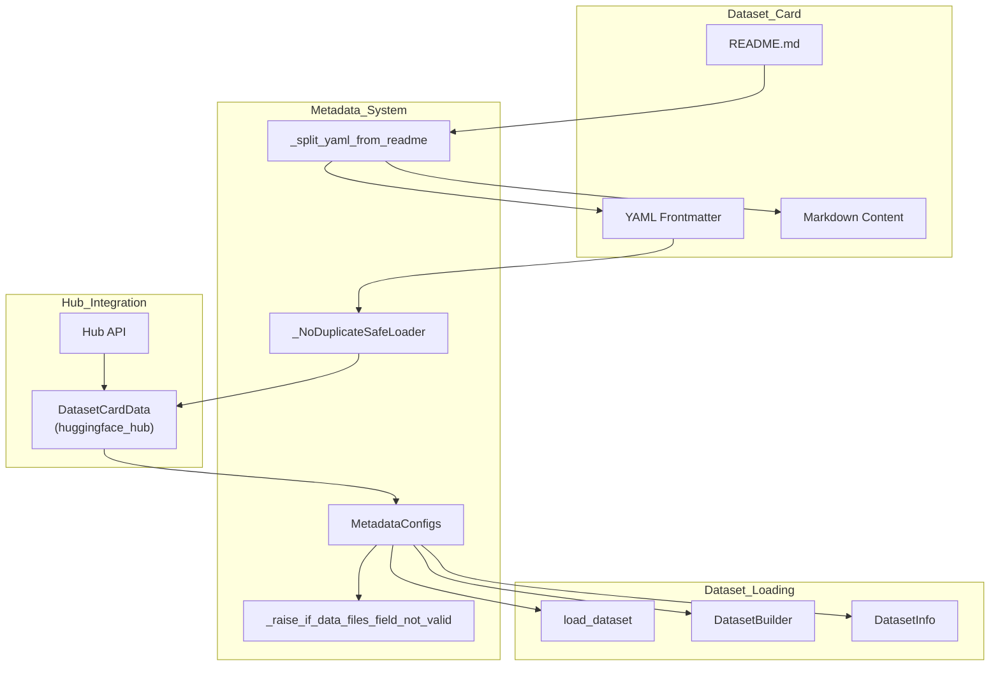
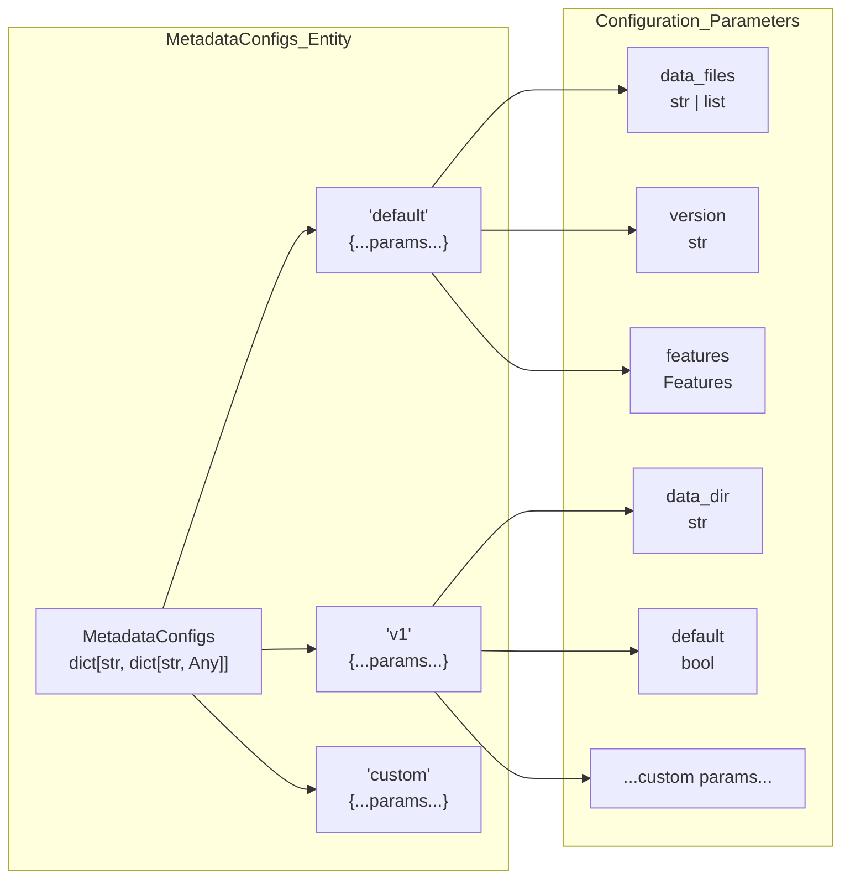
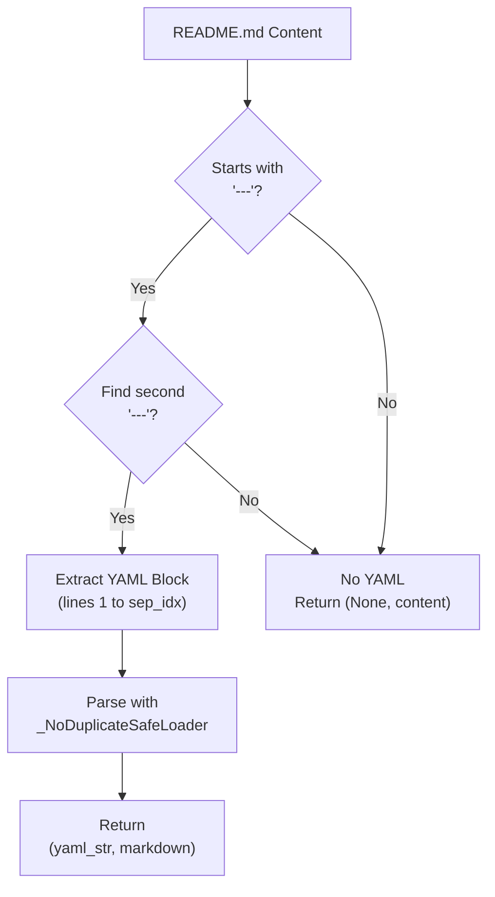
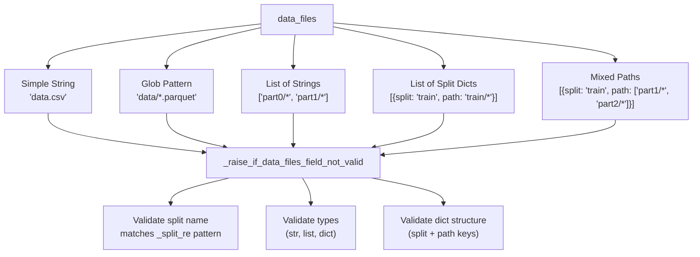
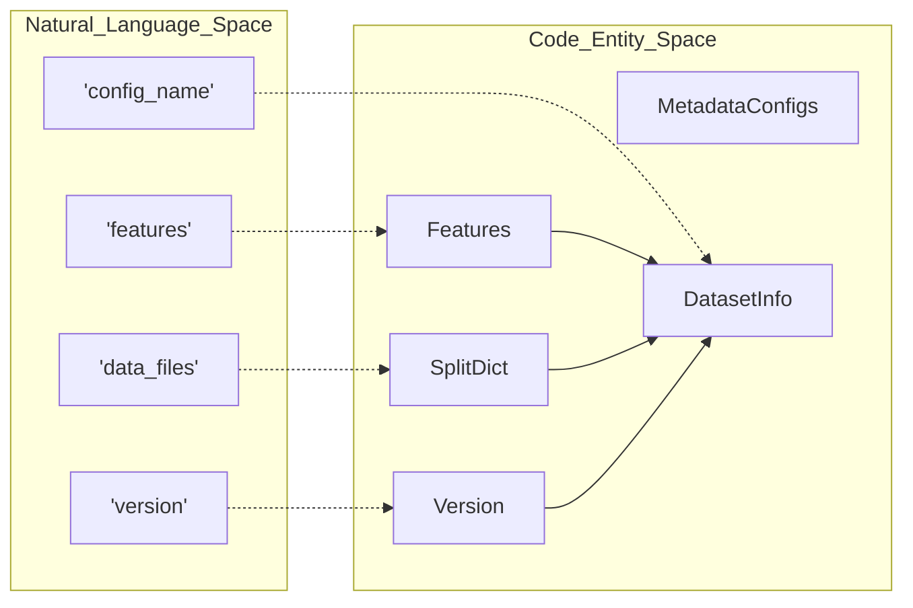

<!-- source: DeepWiki mcp.deepwiki.com · repo huggingface/datasets · page 7.1 Metadata System · fetched 2026-10-26 -->

# Metadata System

Relevant source files

The following files were used as context for generating this wiki page:

- [src/datasets/builder.py](src/datasets/builder.py)
- [src/datasets/commands/test.py](src/datasets/commands/test.py)
- [src/datasets/info.py](src/datasets/info.py)
- [src/datasets/utils/metadata.py](src/datasets/utils/metadata.py)
- [tests/commands/test_test.py](tests/commands/test_test.py)
- [tests/test_builder.py](tests/test_builder.py)
- [tests/test_info.py](tests/test_info.py)
- [tests/test_metadata_util.py](tests/test_metadata_util.py)

## Purpose and Scope

The Metadata System manages structured configuration information for datasets stored in `README.md` dataset cards. It provides mechanisms for parsing, validating, and manipulating metadata that describes dataset configurations, data file locations, features schemas, and other parameters. This system enables dataset discovery, configuration selection, and automated dataset loading from the Hugging Face Hub.

The core of the system resides in the `MetadataConfigs` class, which bridges the gap between YAML frontmatter in dataset cards and the internal `DatasetInfo` and `DatasetBuilder` entities.

**Sources:** [src/datasets/utils/metadata.py:1-234](), [src/datasets/info.py:16-29]()

## System Architecture

The Metadata System operates at the intersection of dataset cards (README.md files), YAML parsing, and the dataset loading pipeline. It extracts configuration metadata from YAML frontmatter and provides it to the dataset loading system.

### Data Flow Diagram
Title: Metadata Extraction and Validation Flow

**Sources:** [src/datasets/utils/metadata.py:36-43](), [src/datasets/utils/metadata.py:21-33](), [src/datasets/utils/metadata.py:46-190](), [src/datasets/info.py:92-135]()

## MetadataConfigs Class

The `MetadataConfigs` class is a specialized dictionary subclass that manages configuration metadata. It stores configuration parameters indexed by configuration name.

### Class Definition and Structure
`MetadataConfigs` extends Python's `dict` class with the type signature `dict[str, dict[str, Any]]`, where each key is a configuration name and each value is a dictionary of configuration parameters [src/datasets/utils/metadata.py:46-49]().

Title: MetadataConfigs Internal Structure

**Sources:** [src/datasets/utils/metadata.py:46-49](), [src/datasets/info.py:159-165]()

### Key Methods

| Method | Purpose | Input | Output |
|--------|---------|-------|--------|
| `from_dataset_card_data` | Parse metadata from DatasetCardData | `DatasetCardData` | `MetadataConfigs` |
| `to_dataset_card_data` | Write metadata back to DatasetCardData | `DatasetCardData` | None (modifies in-place) |
| `get_default_config_name` | Determine default configuration | None | `Optional[str]` |
| `_from_exported_parquet_files_and_dataset_infos` | Create from Parquet export info | parquet files, dataset infos | `MetadataConfigs` |
| `_raise_if_data_files_field_not_valid` | Validate data_files structure | config dict | None (raises on error) |

**Sources:** [src/datasets/utils/metadata.py:52-190]()

## YAML Parsing and Structure

The system parses YAML frontmatter from README.md files using a custom YAML loader that prevents duplicate keys.

### YAML Frontmatter Extraction
The function `_split_yaml_from_readme` identifies the YAML block between `---` separators at the start of the file [src/datasets/utils/metadata.py:36-43]().

Title: README.md YAML Extraction Logic

**Sources:** [src/datasets/utils/metadata.py:36-43]()

### Custom SafeLoader
The `_NoDuplicateSafeLoader` class extends `yaml.SafeLoader` to detect and reject duplicate keys in YAML mappings [src/datasets/utils/metadata.py:21-33]().

**Sources:** [src/datasets/utils/metadata.py:21-33]()

## data_files Field Validation

The `data_files` field supports multiple formats and undergoes strict validation to ensure correct structure for the `DownloadManager`.

### Supported Formats
Validation is performed by `_raise_if_data_files_field_not_valid`, which checks for string paths, glob patterns, or structured split dictionaries [src/datasets/utils/metadata.py:52-101]().

Title: data_files Validation and Pattern Logic

**Sources:** [src/datasets/utils/metadata.py:52-101](), [src/datasets/naming.py:14]()

## DatasetInfo Integration

Metadata extracted via `MetadataConfigs` eventually populates `DatasetInfo` objects. `DatasetInfo` acts as the runtime container for this metadata [src/datasets/info.py:92-135]().

### Runtime Entity Mapping
Title: Metadata to DatasetInfo Runtime Mapping

**Sources:** [src/datasets/info.py:92-135](), [src/datasets/utils/metadata.py:155-163]()

### Included YAML Fields
Only a subset of `DatasetInfo` attributes are serialized into the YAML metadata in dataset cards, defined by `_INCLUDED_INFO_IN_YAML` [src/datasets/info.py:159-165]().

| Attribute | Type | Serialization Key |
|-----------|------|-------------------|
| `config_name` | `str` | `config_name` |
| `download_size` | `int` | `download_size` |
| `dataset_size` | `int` | `dataset_size` |
| `features` | `Features` | `features` |
| `splits` | `SplitDict` | `splits` |

**Sources:** [src/datasets/info.py:159-165]()

## Parquet Export Integration

The `_from_exported_parquet_files_and_dataset_infos` method creates metadata from Hub-side Parquet conversions. It transforms Hub URLs and preserves split/config ordering from existing `DatasetInfo` [src/datasets/utils/metadata.py:103-139]().

### URL Transformation Logic
Exported Parquet files initially reference a temporary location (`refs%2Fconvert%2Fparquet`). This method replaces that with the actual `parquet_commit_hash` to create stable URLs [src/datasets/utils/metadata.py:115]().

**Sources:** [src/datasets/utils/metadata.py:103-139]()

## Default Configuration Selection

The `get_default_config_name` method implements priority rules to resolve which configuration to load if the user does not specify one [src/datasets/utils/metadata.py:179-189]().

1. **Uniqueness**: If only one configuration exists, it is the default.
2. **Explicit Name**: If a configuration is named `"default"`, it is selected.
3. **Explicit Flag**: If a configuration has the parameter `default: true`, it is selected.
4. **Conflict Resolution**: If multiple configurations match rules 2 or 3, a `ValueError` is raised.

**Sources:** [src/datasets/utils/metadata.py:179-189]()

## Error Handling and Validation

The system implements strict validation to prevent corrupted metadata from entering the loading pipeline.

| Scenario | Logic Site | Error Type |
|----------|------------|------------|
| Duplicate YAML Keys | `_NoDuplicateSafeLoader._check_no_duplicates_on_constructed_node` | `TypeError` |
| Invalid `data_files` Structure | `MetadataConfigs._raise_if_data_files_field_not_valid` | `ValueError` |
| Invalid Split Name | `MetadataConfigs._raise_if_data_files_field_not_valid` (regex match) | `ValueError` |
| Missing `config_name` | `MetadataConfigs.from_dataset_card_data` | `ValueError` |

**Sources:** [src/datasets/utils/metadata.py:22-28](), [src/datasets/utils/metadata.py:52-101](), [src/datasets/utils/metadata.py:148-152]()

---

