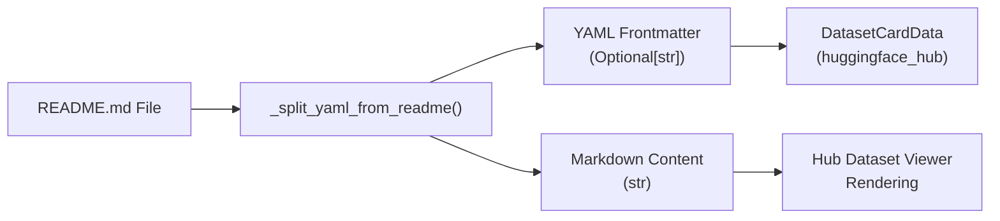
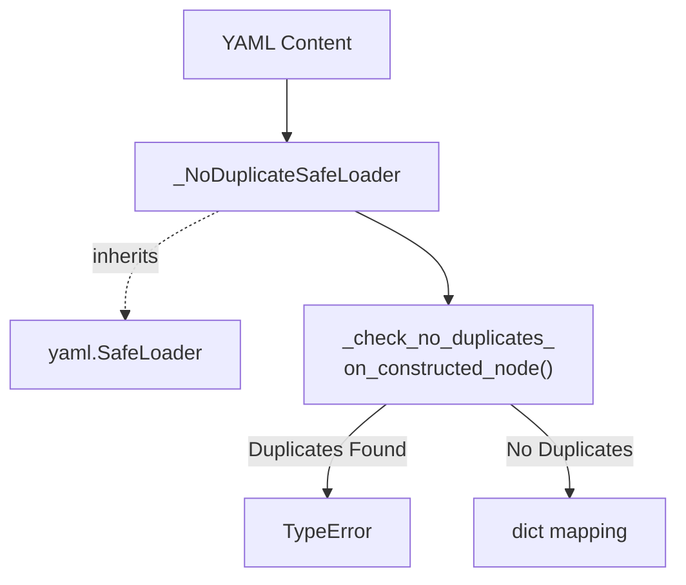
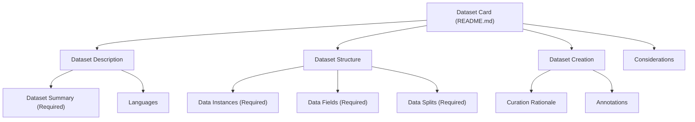

<!-- source: DeepWiki mcp.deepwiki.com · repo huggingface/datasets · page 7.2 Dataset Cards and Documentation · fetched 2026-10-26 -->

# Dataset Cards and Documentation

<details>
<summary>Relevant source files</summary>

The following files were used as context for generating this wiki page:

- [.zenodo.json](.zenodo.json)
- [CONTRIBUTING.md](CONTRIBUTING.md)
- [README.md](README.md)
- [docs/source/dataset_card.mdx](docs/source/dataset_card.mdx)
- [docs/source/faiss_es.mdx](docs/source/faiss_es.mdx)
- [src/datasets/utils/resources/readme_structure.yaml](src/datasets/utils/resources/readme_structure.yaml)
- [templates/README.md](templates/README.md)
- [templates/README_guide.md](templates/README_guide.md)

</details>


This document describes the dataset card system in the `datasets` library, including the `README.md` file structure, YAML frontmatter format, metadata configuration embedding, and validation rules. Dataset cards provide human-readable documentation and machine-readable metadata for datasets published on the Hugging Face Hub.

For information about the underlying metadata system and the `MetadataConfigs` class, see [Metadata System (7.1)](). For information about dataset splits and configuration, see [Splits and ReadInstructions (7.3)]().

## Overview

Dataset cards are `README.md` files that serve dual purposes:
1.  **Human Documentation**: Markdown content describing the dataset, its creation, usage, and considerations.
2.  **Machine-Readable Metadata**: YAML frontmatter containing structured information about configurations, data files, features, and other properties.

The library uses dataset cards to:
- Provide discoverable metadata for datasets on the Hugging Face Hub [docs/source/dataset_card.mdx:11-16]().
- Define dataset configurations and data file locations [docs/source/dataset_card.mdx:25]().
- Specify features schemas for datasets.
- Enable automated dataset loading and viewer functionality via `load_dataset` [README.md:23-24]().

**Sources:** [docs/source/dataset_card.mdx:1-28](), [README.md:21-43]()

## README.md File Structure

### YAML Frontmatter and Markdown Content

A dataset `README.md` file consists of two parts:
1.  **YAML Frontmatter**: Enclosed between `---` markers at the beginning of the file [templates/README_guide.md:1-4]().
2.  **Markdown Content**: The rest of the file containing the dataset card documentation [templates/README.md:5-30]().

**Diagram: README Parsing Flow**


The parsing logic in `src/datasets/utils/metadata.py` checks if the file starts with `---` and contains a closing `---` marker. If both are present, the content between them is treated as YAML; otherwise, the entire file is markdown content [src/datasets/utils/metadata.py:36-43]().

### Duplicate Key Detection

The library uses a custom YAML loader `_NoDuplicateSafeLoader` to prevent duplicate keys in the YAML frontmatter, ensuring data integrity:

**Diagram: Metadata Validation Architecture**


This loader [src/datasets/utils/metadata.py:21-33]() counts occurrences of each key and raises a `TypeError` if any key appears multiple times.

**Sources:** [src/datasets/utils/metadata.py:21-43](), [src/datasets/utils/py_utils.py:181-189]()

## YAML Frontmatter Format

### Standard Metadata Fields

The YAML frontmatter supports various metadata fields from `DatasetCardData` (provided by `huggingface_hub`). These tags help users discover datasets on the Hub [docs/source/dataset_card.mdx:11-16]().

| Field | Type | Description |
|-------|------|-------------|
| `language` | `list[str]` | Languages in the dataset (e.g., `["en", "zh"]`) |
| `task_categories` | `list[str]` | High-level task categories (e.g., `text-classification`) |
| `size_categories` | `list[str]` | Size range (e.g., `"10K<n<100K"`) |
| `license` | `str` or `list[str]` | License information (e.g., `apache-2.0`) |
| `pretty_name` | `str` | Display name for the dataset |
| `multilinguality` | `str` | Type of multilinguality (optional) |

Valid values for these fields are enforced using resource files:
- `creators.json`: [src/datasets/utils/resources/creators.json:1-18]()
- `multilingualities.json`: [src/datasets/utils/resources/multilingualities.json:1-6]()
- `size_categories.json`: [src/datasets/utils/resources/size_categories.json:1-14]()

### Dataset Configurations Field

The special `configs` field (defined by `METADATA_CONFIGS_FIELD`) embeds dataset configuration information [src/datasets/utils/metadata.py:46-49](). This allows customizing loading without writing Python code [docs/source/dataset_card.mdx:25]().

```yaml
---
configs:
  - config_name: default
    data_files: data.csv
  - config_name: v2
    data_files: v2/*.parquet
    default: true
---
```

**Sources:** [src/datasets/utils/metadata.py:46-49](), [docs/source/dataset_card.mdx:25](), [src/datasets/config.py:11]()

## Dataset Card Sections and Structure

### Required Structure

The library defines an expected structure for dataset cards in `readme_structure.yaml`. This is used to validate that contributors provide necessary documentation [src/datasets/utils/resources/readme_structure.yaml:1-117]().

**Diagram: Dataset Card Content Hierarchy**


### Section Requirements

Critical required sections (must exist with content):
- **Dataset Summary**: Briefly summarizes the dataset and its intended use [templates/README_guide.md:46-48]().
- **Data Instances**: Provides a JSON-formatted example [templates/README_guide.md:64-75]().
- **Data Fields**: Lists and describes the fields present in the dataset [templates/README_guide.md:77-83]().
- **Data Splits**: Describes and names the splits (train, validation, test) [templates/README_guide.md:85-97]().
- **Citation Information**: Provides the BibTeX citation for the dataset [templates/README_guide.md:144-147]().

**Sources:** [src/datasets/utils/resources/readme_structure.yaml:1-117](), [templates/README_guide.md:1-155](), [CONTRIBUTING.md:109-124]()

## Metadata Management

### MetadataConfigs Class

The `MetadataConfigs` class reads configuration information from the `configs` field. Each configuration must include a `config_name` field and can contain additional parameters like `data_files` or `features` [src/datasets/utils/metadata.py:142-164]().

Validation steps in `from_dataset_card_data()`:
1. Verifies `configs` is a list [src/datasets/utils/metadata.py:146]().
2. Verifies each config has a `config_name` [src/datasets/utils/metadata.py:149]().
3. Validates `data_files` field format [src/datasets/utils/metadata.py:153]().

### Writing and Merging Metadata

The `to_dataset_card_data()` method writes `MetadataConfigs` back to a `DatasetCardData` object [src/datasets/utils/metadata.py:166-177](). It merges existing configs from the card with the current instance, where new configs override existing ones with the same name.

**Sources:** [src/datasets/utils/metadata.py:142-189](), [src/datasets/inspect.py:175-180]()

## Hub Integration

### Parquet Conversion Metadata

When datasets are converted to Parquet on the Hub, metadata is generated using `_from_exported_parquet_files_and_dataset_infos()` [src/datasets/utils/metadata.py:103-139](). This function groups exported Parquet files by `config` and `split`, replacing temporary Hub URLs with permanent commit-based URLs [src/datasets/utils/metadata.py:121-125]().

### Validation Errors

| Error Type | Cause | Code Reference |
|------------|-------|----------------|
| `TypeError` | Duplicate keys found in YAML frontmatter. | [src/datasets/utils/metadata.py:28]() |
| `ValueError` | `configs` field is not a list. | [src/datasets/utils/metadata.py:146]() |
| `ValueError` | Config entry missing `config_name`. | [src/datasets/utils/metadata.py:149]() |
| `ValueError` | Multiple configurations marked as default. | [src/datasets/utils/metadata.py:186]() |

**Sources:** [src/datasets/utils/metadata.py:21-189](), [src/datasets/inspect.py:38-40]()

---

