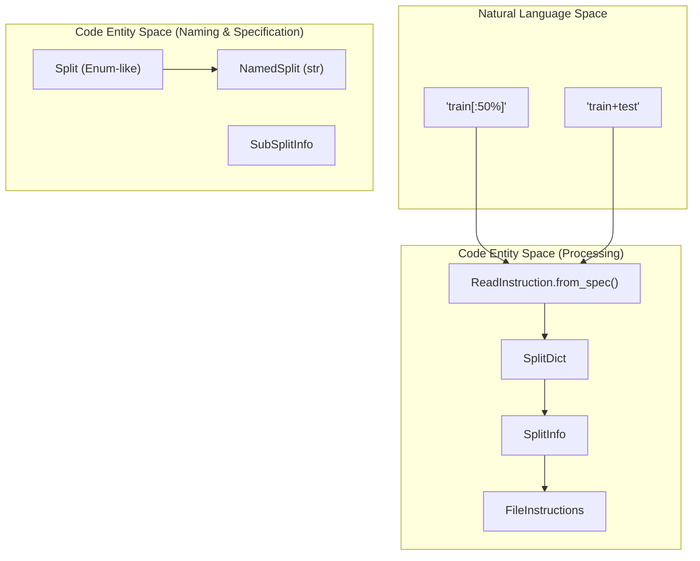
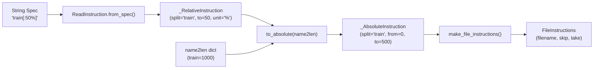

<!-- source: DeepWiki mcp.deepwiki.com · repo huggingface/datasets · page 7.3 Splits and ReadInstructions · fetched 2026-10-26 -->

# Splits and ReadInstructions

Relevant source files

The following files were used as context for generating this wiki page:

- [src/datasets/arrow_reader.py](src/datasets/arrow_reader.py)
- [src/datasets/download/download_manager.py](src/datasets/download/download_manager.py)
- [src/datasets/naming.py](src/datasets/naming.py)
- [src/datasets/splits.py](src/datasets/splits.py)
- [tests/test_arrow_reader.py](tests/test_arrow_reader.py)

This document explains the split system and data reading infrastructure in the `datasets` library. It covers how datasets are divided into splits (train, test, validation), how to specify which portions of data to read using `ReadInstruction` and slicing syntax, and how the readers translate these instructions into actual file read operations.

## Split System Overview

Datasets are typically divided into **splits** - distinct subsets used at different stages of machine learning workflows. The library provides a flexible split system that allows:
- Standard named splits (`Split.TRAIN`, `Split.TEST`, `Split.VALIDATION`) [src/datasets/splits.py:314-318]().
- Custom split names using `NamedSplit` [src/datasets/splits.py:321-322]().
- Split composition (merging splits using the `+` operator) [src/datasets/splits.py:149-151]().
- Split slicing (selecting portions of splits using percent or absolute indices) [src/datasets/splits.py:153-169]().

**Split System Architecture**

The following diagram bridges the user's natural language intent (e.g., "Give me half of the training data") to the internal code entities that process it.

**Natural Language to Code Entity Space**

**Sources:** [src/datasets/splits.py:31-81](), [src/datasets/splits.py:314-452](), [src/datasets/arrow_reader.py:77-164]()

## Split Classes

### SplitInfo

`SplitInfo` is a dataclass that stores metadata about a single split, including the number of examples, size in bytes, and optional shard information for distributed datasets [src/datasets/splits.py:31-45]().

| Field | Type | Description |
|-------|------|-------------|
| `name` | `str` | Split name (e.g., "train") |
| `num_examples` | `int` | Total number of examples in the split |
| `num_bytes` | `int` | Total size in bytes |
| `shard_lengths` | `list[int]` | Number of examples per shard (if sharded) |

The `file_instructions` property converts the split metadata into file read instructions using `make_file_instructions()` [src/datasets/splits.py:47-56]().

**Sources:** [src/datasets/splits.py:31-56](), [src/datasets/arrow_reader.py:92-164]()

### SplitDict

`SplitDict` is a dictionary container that manages all splits in a dataset [src/datasets/splits.py:519-599](). It extends `NonMutableDict` and validates that keys match split names. It supports complex access patterns, such as returning a `SubSplitInfo` when a slice string (e.g., `train[10:20]`) is passed as a key [src/datasets/splits.py:545-560]().

**Sources:** [src/datasets/splits.py:519-599]()

## ReadInstruction System

`ReadInstruction` is the core class for specifying what data to read from splits. It bridges user-friendly split specifications to concrete file operations [src/datasets/arrow_reader.py:456-457]().

### Internal Resolution Flow

The diagram below shows how a string specification like `train[:50%]` is resolved into absolute file offsets.

**Instruction Resolution Flow**

**Sources:** [src/datasets/arrow_reader.py:456-566](), [src/datasets/arrow_reader.py:92-164](), [src/datasets/arrow_reader.py:363-454]()

### FileInstructions

`FileInstructions` represents the concrete file-level operations needed to read data [src/datasets/arrow_reader.py:77-90]().

- `num_examples`: Total examples to read across all files [src/datasets/arrow_reader.py:88]().
- `file_instructions`: A list of dictionaries, where each dictionary contains `filename`, `skip` (number of examples to skip), and `take` (number of examples to read, -1 for all) [src/datasets/arrow_reader.py:89]().

**Sources:** [src/datasets/arrow_reader.py:77-90]()

## Reader Implementation

The reader classes execute the `FileInstructions` to load data into Arrow tables.

### BaseReader and ArrowReader

`BaseReader` provides the foundation for reading files [src/datasets/arrow_reader.py:167-182](). Its `read_files` method iterates through the `file_instructions`, potentially using `thread_map` for parallel loading if multiple files are involved [src/datasets/arrow_reader.py:187-217]().

`ArrowReader` specializes this for Apache Arrow files [src/datasets/arrow_reader.py:285-286](). It can load tables as `MemoryMappedTable` (default) or `InMemoryTable` depending on the `in_memory` flag [src/datasets/arrow_reader.py:309-328]().

**Sources:** [src/datasets/arrow_reader.py:167-330]()

### Sharded File Mapping

When a split is sharded (stored in multiple files), `make_file_instructions` calculates the correct `skip` and `take` values for each individual file by tracking the global index across `shard_lengths` [src/datasets/arrow_reader.py:148-160](). It uses `filenames_for_dataset_split` from `naming.py` to resolve the actual file paths on disk based on the split name and shard count [src/datasets/naming.py:70-84]().

**Sources:** [src/datasets/arrow_reader.py:148-160](), [src/datasets/naming.py:70-84]()

## DownloadManager Interactions

The `DownloadManager` handles the acquisition of raw data files before they are processed into splits. It tracks downloaded and extracted paths to ensure that the dataset builder can access the required resources [src/datasets/download/download_manager.py:71-108]().

- `download()`: Downloads URLs and records sizes and checksums [src/datasets/download/download_manager.py:131-179]().
- `DownloadMode`: Controls whether to reuse existing data or force a fresh download/generation [src/datasets/download/download_manager.py:50-68]().

**Sources:** [src/datasets/download/download_manager.py:50-179]()

## SplitGenerator for Builders

During the dataset creation phase, implementations of `DatasetBuilder` define their splits using `SplitGenerator` [src/datasets/splits.py:601-636]().

- `name`: The name of the split (e.g., `Split.TRAIN`) [src/datasets/splits.py:605]().
- `gen_kwargs`: A dictionary of arguments passed to the builder's generation method (e.g., `_generate_examples`) [src/datasets/splits.py:606]().

**Sources:** [src/datasets/splits.py:601-636]()

---

