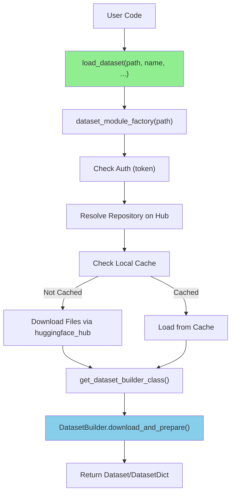
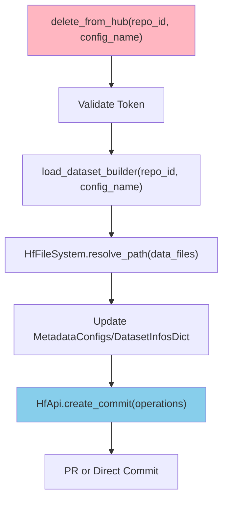

<!-- source: DeepWiki mcp.deepwiki.com · repo huggingface/datasets · page 8 Hugging Face Hub Integration · fetched 2026-10-26 -->

# Hugging Face Hub Integration

<details>
<summary>Relevant source files</summary>

The following files were used as context for generating this wiki page:

- [docs/source/cli.mdx](docs/source/cli.mdx)
- [src/datasets/commands/datasets_cli.py](src/datasets/commands/datasets_cli.py)
- [src/datasets/hub.py](src/datasets/hub.py)
- [src/datasets/utils/hub.py](src/datasets/utils/hub.py)
- [tests/fixtures/hub.py](tests/fixtures/hub.py)
- [tests/test_hub.py](tests/test_hub.py)
- [tests/test_upstream_hub.py](tests/test_upstream_hub.py)

</details>


This document covers the integration between 🤗 Datasets and the Hugging Face Hub, which serves as a centralized platform for hosting, discovering, and sharing datasets. Hub integration enables dataset versioning, collaborative development, automatic data viewing, and seamless loading of datasets from the community.

For information about the actual `Dataset` and `DatasetDict` classes themselves, see [Dataset and DatasetDict Classes](#2.1). For details on repository structure conventions, see [Repository Structure and Workflow](#8.2). For filesystem operations with cloud storage, see [Filesystem Support](#8.3).

## Hub as a Dataset Platform

The Hugging Face Hub provides a Git-based repository system for datasets with additional features optimized for machine learning workflows. Each dataset repository can contain data files in various formats (CSV, JSON, Parquet, image, audio), metadata configuration, and documentation.

Key Hub features for datasets:
- **Versioning**: Git-based version control for dataset revisions using the `revision` parameter.
- **Dataset Viewer**: Automatic web-based preview of dataset contents.
- **Metadata**: Structured YAML frontmatter for discoverability, often stored in `README.md`.
- **Access Control**: Public and private datasets with gated access options.
- **Collaboration**: Community contributions via pull requests (PRs).

Sources: [tests/test_upstream_hub.py:107-113](), [src/datasets/hub.py:92-94](), [src/datasets/hub.py:48-50]()

## Loading Datasets from the Hub

### Basic Loading Pattern

The `load_dataset()` function serves as the primary interface for loading datasets from the Hub. The function automatically resolves dataset identifiers and downloads required files.



**Diagram: Dataset Loading Pipeline from Hub**

Sources: [tests/test_upstream_hub.py:27-29](), [tests/test_upstream_hub.py:66-66](), [src/datasets/hub.py:42-42]()

### Load Function Signatures

The main loading pattern uses repository identifiers in the format `username/dataset-name`:

```python
from datasets import load_dataset

# Load entire dataset
dataset = load_dataset("rajpurkar/squad")

# Load specific configuration/subset
dataset = load_dataset("nyu-mll/glue", "cola")

# Stream without downloading
dataset = load_dataset("timm/imagenet-1k-wds", streaming=True)
```

Sources: [tests/test_upstream_hub.py:66-66](), [tests/test_upstream_hub.py:114-114]()

### Authentication and Private Datasets

Private datasets require authentication tokens. The library handles tokens via the `token` parameter in loading and maintenance functions.

```python
from datasets import load_dataset

# Load a private dataset
ds = load_dataset("org/private-ds", token="hf_xxxxx")
```

Sources: [tests/test_upstream_hub.py:113-114](), [src/datasets/hub.py:25-26]()

## Uploading Datasets to the Hub

### Programmatic Upload

The `push_to_hub` method (available on `Dataset` and `DatasetDict`) provides the programmatic interface for sharing datasets. This method typically handles repository creation, conversion of local data to Parquet, and metadata updates.

For details, see [Hub Operations](#8.1).

Sources: [tests/test_upstream_hub.py:65-65](), [tests/test_upstream_hub.py:130-130]()

### CLI for Testing and Maintenance

The `datasets-cli` tool provides commands to verify and manage Hub datasets.

```bash
# Test loading a dataset
datasets-cli test path/to/dataset

# Delete a specific configuration from a repository
datasets-cli delete_from_hub USERNAME/DATASET_NAME CONFIG_NAME
```

Sources: [docs/source/cli.mdx:11-15](), [docs/source/cli.mdx:27-31](), [src/datasets/commands/datasets_cli.py:22-24]()

## Hub Operations API

### delete_from_hub Function

The `delete_from_hub()` function allows for the removal of specific configurations or data files from a Hub repository by creating a commit that deletes the associated files and updates the `README.md` metadata.



**Diagram: delete_from_hub Operation Flow**

Sources: [src/datasets/hub.py:21-95](), [tests/test_hub.py:23-66]()

### Hub URL Construction

The library uses standardized URL patterns to access raw files on the Hub, often interacting with `huggingface_hub` to resolve specific revisions or branches.

Sources: [src/datasets/utils/hub.py:6-7](), [tests/test_hub.py:18-20]()

## Dataset Cards and Metadata

### README.md Structure

Dataset repositories must include a `README.md` file serving as the dataset card. This file contains a YAML frontmatter section that defines the dataset's schema, splits, and other metadata used by the Hub's Dataset Viewer. The `METADATA_CONFIGS_FIELD` constant refers to the key in this YAML where configuration details are stored.

Sources: [src/datasets/hub.py:48-63](), [tests/test_hub.py:10-10](), [tests/test_hub.py:45-54]()

### Metadata Extraction

The library programmatically extracts metadata from the Hub using `DatasetCard` and `MetadataConfigs` to handle configuration names and split info without needing to download the full data files.

Sources: [src/datasets/hub.py:48-53](), [src/datasets/hub.py:65-67]()

## Key Implementation Entities

| Entity | Role | Source |
| :--- | :--- | :--- |
| `push_to_hub` | Method on `Dataset`/`DatasetDict` to upload data to the Hub. | [tests/test_upstream_hub.py:65]() |
| `delete_from_hub` | Utility to remove a configuration and its files from a Hub repo. | [src/datasets/hub.py:21]() |
| `hf_dataset_url` | Helper to generate Hub URLs for dataset files. | [src/datasets/utils/hub.py:6]() |
| `DeleteFromHubCommand` | CLI wrapper for the `delete_from_hub` functionality. | [src/datasets/commands/datasets_cli.py:4]() |
| `HfApi` | The core client from `huggingface_hub` used for Hub interactions. | [src/datasets/hub.py:10]() |

Sources: [src/datasets/hub.py:21-95](), [src/datasets/utils/hub.py:6-7](), [src/datasets/commands/datasets_cli.py:4-24]()

---

