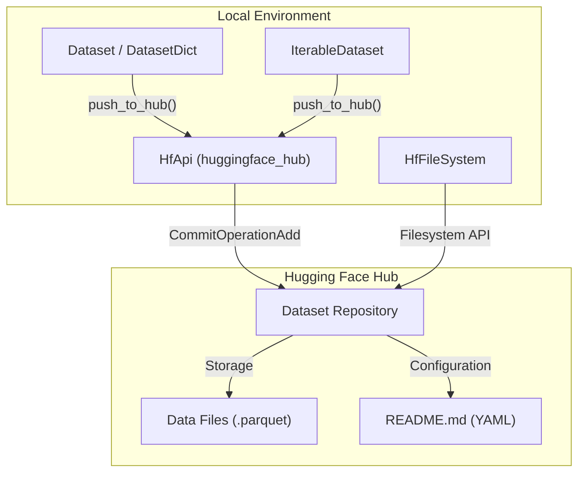
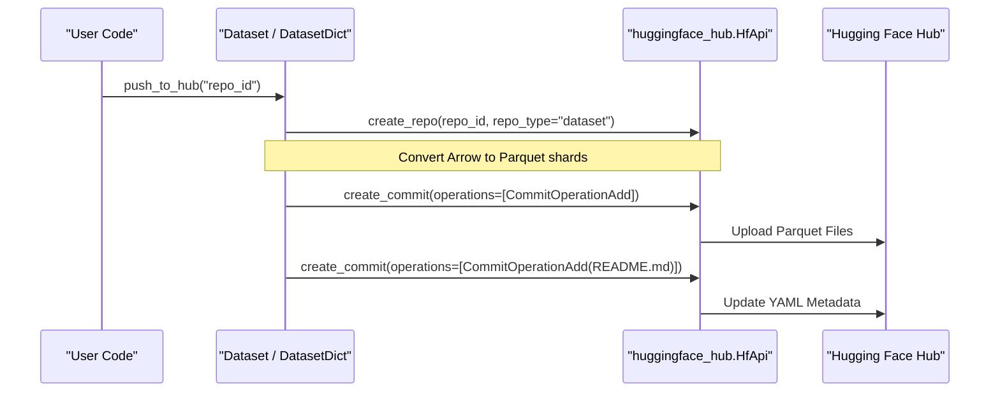
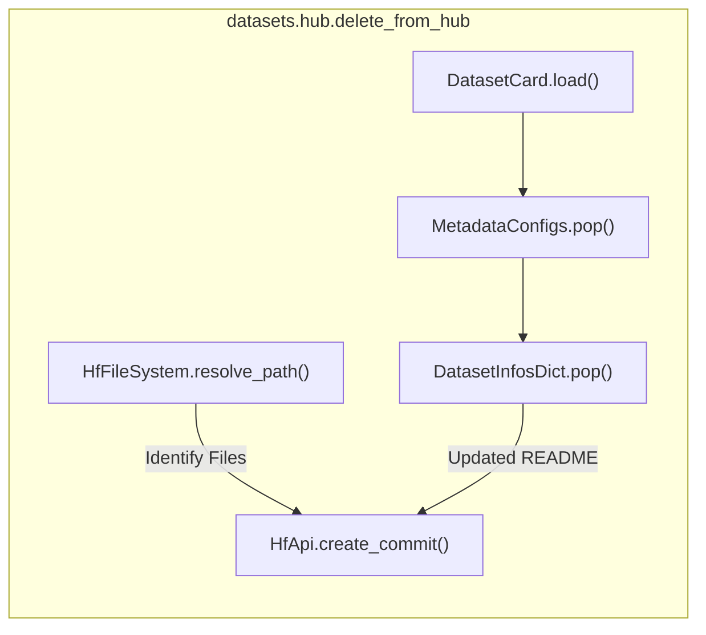

<!-- source: DeepWiki mcp.deepwiki.com · repo huggingface/datasets · page 8.1 Hub Operations · fetched 2026-10-26 -->

# Hub Operations

Relevant source files

The following files were used as context for generating this wiki page:

- [docs/source/cli.mdx](docs/source/cli.mdx)
- [src/datasets/commands/datasets_cli.py](src/datasets/commands/datasets_cli.py)
- [src/datasets/hub.py](src/datasets/hub.py)
- [src/datasets/utils/hub.py](src/datasets/utils/hub.py)
- [tests/fixtures/hub.py](tests/fixtures/hub.py)
- [tests/test_hub.py](tests/test_hub.py)
- [tests/test_upstream_hub.py](tests/test_upstream_hub.py)

This page documents the technical implementation of interactions between the `datasets` library and the Hugging Face Hub. It covers the mechanisms for uploading data via `push_to_hub`, managing repository configurations, and the API layers that facilitate these operations.

## Overview of Hub Interactions

The library interacts with the Hugging Face Hub primarily through the `huggingface_hub` SDK. Key operations include uploading Arrow tables as Parquet files, managing dataset metadata in `README.md` YAML frontmatter, and performing repository maintenance like deleting configurations.

Sources:
- [src/datasets/hub.py:4-12]()
- [src/datasets/utils/hub.py:1-7]()

## Pushing Datasets to the Hub

The `push_to_hub` method is implemented for both `Dataset` and `DatasetDict`. It involves several stages: schema validation, Parquet conversion, shard generation, and metadata synchronization.

### Data Flow: Dataset.push_to_hub

When `push_to_hub` is called, the library follows a specific sequence to ensure the dataset is correctly represented on the Hub.

1.  **Repository Preparation**: It identifies or creates the target repository using `huggingface_hub.HfApi.create_repo`.
2.  **Format Conversion**: Arrow tables are serialized to Parquet.
3.  **Sharding**: If the dataset is large, it is automatically sharded into multiple Parquet files. The default pattern often follows `data/{split}-{index:05d}-of-{total:05d}.parquet`.
4.  **Metadata Update**: The `README.md` is updated or created to include `dataset_info` (features, split sizes, etc.) and `configs` (data file patterns).

Sources:
- [tests/test_upstream_hub.py:59-75]()
- [tests/test_upstream_hub.py:141-158]()

### Implementation Details

The library ensures that pushed datasets are compatible with the Hub's "Dataset Viewer" by generating a `README.md` with appropriate YAML frontmatter.

| Feature | Implementation Detail |
| :--- | :--- |
| **Private Repos** | Controlled via the `private` boolean argument in `push_to_hub`. |
| **Pull Requests** | If `create_pr=True` is passed, changes are pushed to a PR branch instead of `main`. |
| **Revision Control** | Supports pushing to specific branches using the `revision` parameter. |

Sources:
- [tests/test_upstream_hub.py:107-123]()
- [tests/test_upstream_hub.py:141-158]()
- [tests/test_upstream_hub.py:160-172]()

## Deleting from Hub

The library provides a specialized `delete_from_hub` function to remove specific configurations from a dataset repository without deleting the entire repository. This is particularly useful for "data-only" datasets where multiple configurations share a single repository.

### Technical Workflow: delete_from_hub

The `delete_from_hub` function in `src/datasets/hub.py` performs the following steps:

1.  **File Resolution**: It uses `huggingface_hub.HfFileSystem` to resolve the paths of all data files associated with the specific `config_name`.
2.  **Operation Queueing**: It creates a list of `CommitOperationDelete` for every data file found.
3.  **Metadata Cleanup**:
    *   Loads the existing `README.md` as a `DatasetCard`.
    *   Removes the configuration from the `config_names` list.
    *   Uses `MetadataConfigs` and `DatasetInfosDict` to remove entries from the YAML frontmatter.
4.  **Atomic Commit**: Sends a single commit to the Hub containing all deletions and the updated `README.md`.

Sources:
- [src/datasets/hub.py:21-95]()
- [tests/test_hub.py:23-66]()

## CLI Integration

The Hub operations are also exposed via the `datasets-cli`. The `delete_from_hub` command allows users to perform repository maintenance directly from the terminal.

| CLI Command | Internal Function | Purpose |
| :--- | :--- | :--- |
| `datasets-cli delete_from_hub` | `datasets.hub.delete_from_hub` | Deletes a dataset configuration and its associated files. |

Sources:
- [src/datasets/commands/datasets_cli.py:24-35]()
- [docs/source/cli.mdx:21-42]()

## Hub Utilities

The library includes internal utilities for generating Hub-specific URLs and managing authentication.

*   **URL Generation**: `hf_dataset_url` is a partial function of `huggingface_hub.hf_hub_url` with `repo_type="dataset"` pre-configured.
*   **API Client**: The `HfApi` client is initialized with the `library_name="datasets"` and the current version to ensure proper user-agent tracking on the Hub.

Sources:
- [src/datasets/utils/hub.py:1-7]()
- [src/datasets/hub.py:78-83]()
- [tests/test_hub.py:15-20]()

---

