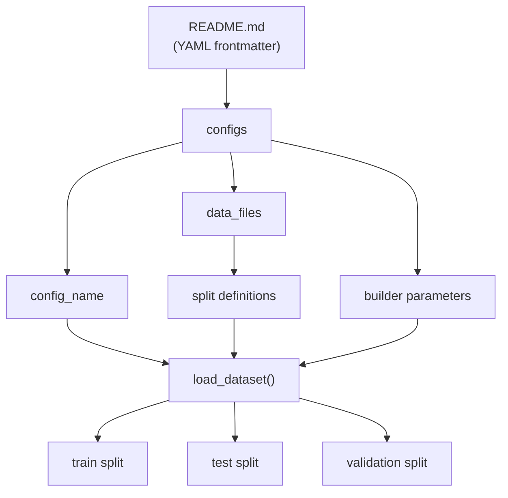
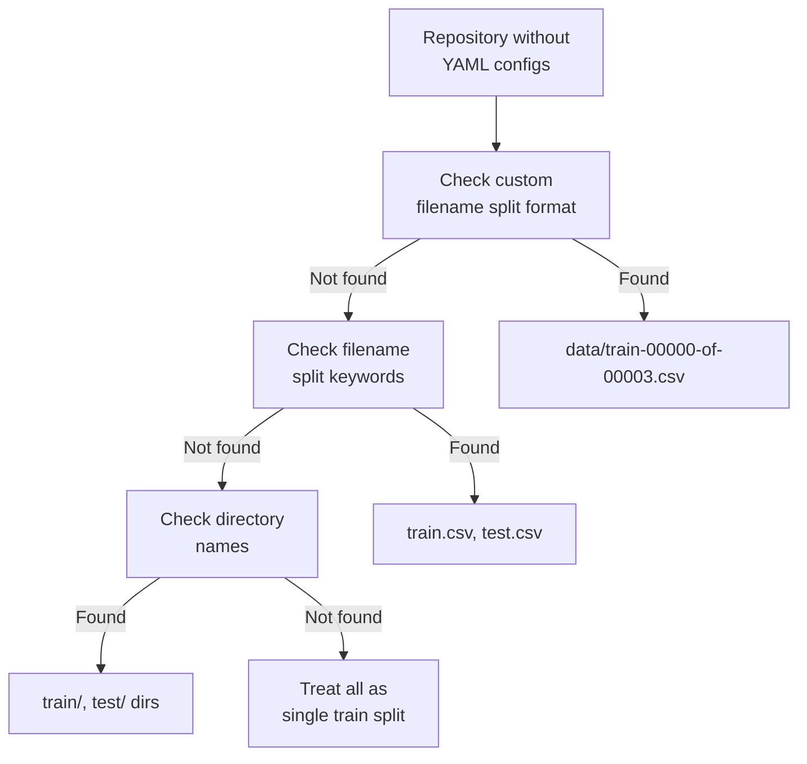
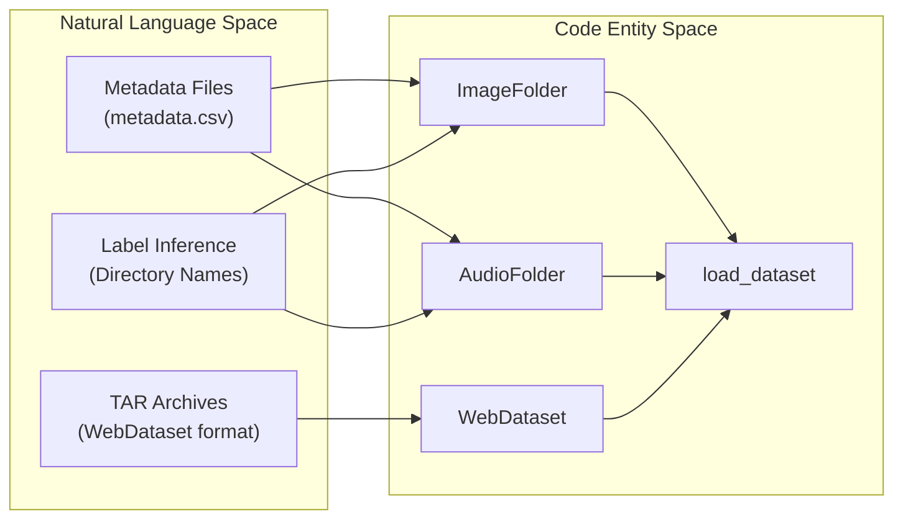
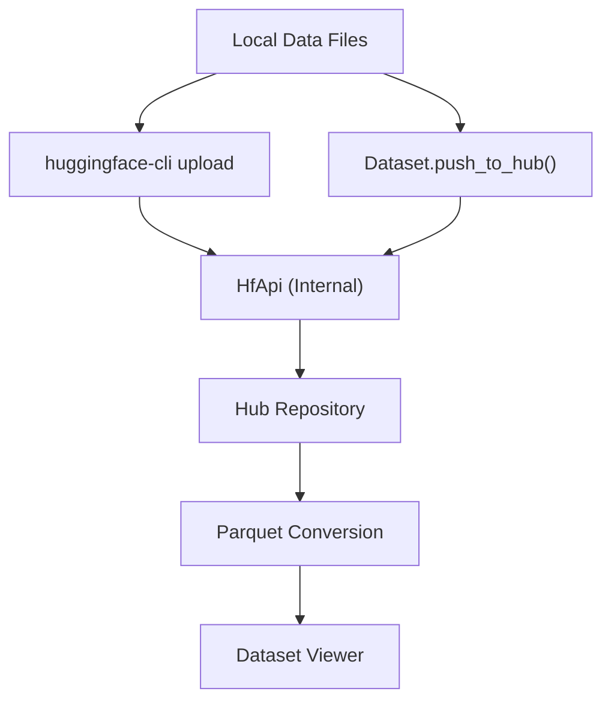

<!-- source: DeepWiki mcp.deepwiki.com · repo huggingface/datasets · page 8.2 Repository Structure and Workflow · fetched 2026-10-26 -->

# Repository Structure and Workflow

<details>
<summary>Relevant source files</summary>

The following files were used as context for generating this wiki page:

- [ADD_NEW_DATASET.md](ADD_NEW_DATASET.md)
- [docs/source/audio_dataset.mdx](docs/source/audio_dataset.mdx)
- [docs/source/image_dataset.mdx](docs/source/image_dataset.mdx)
- [docs/source/repository_structure.mdx](docs/source/repository_structure.mdx)
- [docs/source/share.mdx](docs/source/share.mdx)
- [docs/source/troubleshoot.mdx](docs/source/troubleshoot.mdx)
- [docs/source/upload_dataset.mdx](docs/source/upload_dataset.mdx)

</details>


## Purpose and Scope

This page documents the structure and organization of dataset repositories on the Hugging Face Hub. It covers file layouts, metadata conventions, split definitions, and how the repository structure enables automatic dataset loading and visualization. This section also details the implementation of folder-based builders and the workflow for managing configurations via the CLI and Hub API.

## Basic Repository Structure

A dataset repository on the Hugging Face Hub follows a standardized structure that enables automatic loading via `load_dataset`. The simplest valid repository contains data files and a dataset card:

```
my_dataset_repository/
├── README.md
├── train.csv
└── test.csv
```

The `README.md` file serves as the dataset card and contains YAML metadata in its frontmatter. Data files can be in any supported format: `.txt`, `.csv`, `.json`, `.jsonl`, `.parquet`, `.arrow`, `.mp3`, `.wav`, `.jpg`, `.png`, `.zip`, and others [docs/source/share.mdx:23-27](). When `load_dataset("username/my_dataset")` is called, the library automatically infers the appropriate `DatasetBuilder` based on file extensions [docs/source/repository_structure.mdx:6-7]().

Sources: [docs/source/repository_structure.mdx:1-22](), [docs/source/share.mdx:23-27]()

### Repository Components

| Component | Purpose | Required |
|-----------|---------|----------|
| `README.md` | Dataset card with YAML metadata [docs/source/upload_dataset.mdx:48-52]() | Yes |
| Data files | Actual dataset content [docs/source/share.mdx:59-62]() | Yes |
| `metadata.csv/jsonl/parquet` | Additional column metadata for media [docs/source/image_dataset.mdx:58-65]() | No |
| `.gitattributes` | Git LFS tracking configuration [docs/source/upload_dataset.mdx:26-27]() | Auto-generated |

The Hub automatically converts uploaded datasets to Parquet format for efficient streaming and viewing [docs/source/share.mdx:11-12](). Original files are preserved alongside the converted Parquet files [docs/source/upload_dataset.mdx:38-42]().

Sources: [docs/source/upload_dataset.mdx:8-42](), [docs/source/share.mdx:23-29](), [docs/source/image_dataset.mdx:58-65]()

## YAML Metadata Configuration

The `README.md` file contains a YAML header defining dataset structure through the `configs` field. This configuration controls how `load_dataset` interprets the repository without requiring custom code [docs/source/repository_structure.mdx:23-51]().

### Diagram: YAML Configuration Flow



Sources: [docs/source/repository_structure.mdx:23-51](), [docs/source/repository_structure.mdx:126-142]()

### Split Definition

Splits are defined in the YAML `configs` field [docs/source/repository_structure.mdx:38-91]():

```yaml
---
configs:
- config_name: default
  data_files:
  - split: train
    path: "data/*.csv"
  - split: test
    path: "holdout/*.csv"
---
```

The `path` field supports single file paths, lists of files, or glob patterns [docs/source/repository_structure.mdx:38-91]().

## Automatic Split Detection

When no YAML configuration is provided, the library automatically infers splits using pattern matching. The detection follows a priority hierarchy [docs/source/repository_structure.mdx:153-216]():

### Diagram: Split Detection Hierarchy



Sources: [docs/source/repository_structure.mdx:153-216]()

### Detection Methods

1.  **Custom Filename Split**: Format `data/<split_name>-xxxxx-of-xxxxx.csv`. Supports custom split names [docs/source/repository_structure.mdx:195-213]().
2.  **Filename Keywords**: Split names delimited by non-word characters (e.g., `train`, `val`, `test`). Supported delimiters include underscores, dashes, spaces, dots, and numbers [docs/source/repository_structure.mdx:175-193]().
3.  **Directory Names**: Split inferred from top-level directory structure (e.g., `train/`, `test/`, `validation/`) [docs/source/repository_structure.mdx:158-172]().

## Metadata System for Folder-Based Builders

Folder-based builders like `ImageFolder` and `AudioFolder` support metadata files (CSV, JSONL, or Parquet) to add extra columns (captions, bounding boxes, etc.) [docs/source/image_dataset.mdx:58-65](), [docs/source/audio_dataset.mdx:90-97]().

### Diagram: Folder-Based Builder Workflow



Sources: [docs/source/image_dataset.mdx:12-119](), [docs/source/audio_dataset.mdx:45-141](), [docs/source/audio_dataset.mdx:143-178]()

### Metadata Implementation Details

*   **Label Inference**: Builders like `ImageFolder` automatically infer class labels based on directory names [docs/source/image_dataset.mdx:19-29]().
*   **Metadata Linking**: Metadata files must contain a `file_name` or `*_file_name` field which links media files with their metadata [docs/source/image_dataset.mdx:75-82]().
*   **WebDataset**: A format based on TAR archives suitable for large datasets. Examples are grouped by files sharing the same prefix within the archive [docs/source/image_dataset.mdx:162-177](), [docs/source/audio_dataset.mdx:143-166]().

Sources: [docs/source/image_dataset.mdx:75-119](), [docs/source/audio_dataset.mdx:107-141](), [docs/source/audio_dataset.mdx:143-178]()

## Hub Operations and Workflow

### Parquet Conversion and Viewer

The Hugging Face Hub automatically converts supported datasets to Parquet shards. This enables the **Dataset Viewer**, which allows users to preview rows and statistics without downloading the full dataset [docs/source/share.mdx:11-12]().

### CLI and Hub Management

The library provides utilities to manage repositories directly from the Hub.

*   **`huggingface-cli upload`**: Used to upload files or entire folders to the Hub [docs/source/share.mdx:64-87]().
*   **`Dataset.push_to_hub`**: Programmatic way to upload a processed dataset to the Hub [docs/source/upload_dataset.mdx:90-98]().
*   **Revision Management**: Files can be uploaded to specific branches or PRs using the `--revision` and `--create-pr` flags [docs/source/share.mdx:141-162]().

### Diagram: Hub Upload Workflow



Sources: [docs/source/share.mdx:64-105](), [docs/source/upload_dataset.mdx:90-107](), [docs/source/share.mdx:11-12]()

## Troubleshooting Hub Operations

*   **Authentication**: Requires a token with **write** permission [docs/source/troubleshoot.mdx:11-14]().
*   **Connection Issues**: Large dataset uploads may encounter HTTP 500 errors or connection timeouts; re-running `push_to_hub` allows the Hub to check existing SHAs and resume [docs/source/troubleshoot.mdx:19-27]().
*   **Rate Limiting**: Uploading many shards can trigger `429 Too Many Requests`; upgrading the `datasets` library to `2.15.0` or later is recommended [docs/source/troubleshoot.mdx:29-38]().

Sources: [docs/source/troubleshoot.mdx:7-38]()

---

