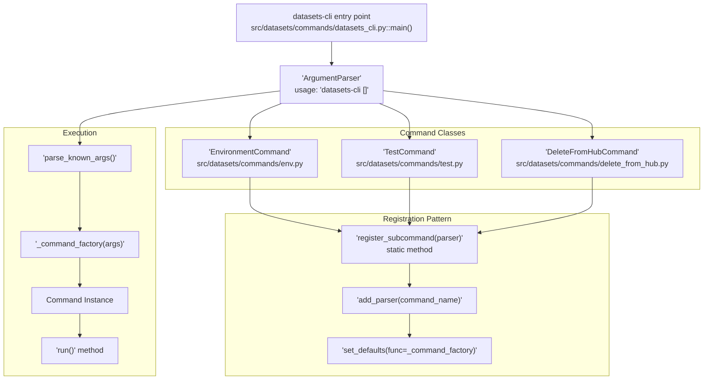
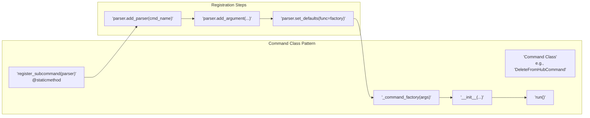
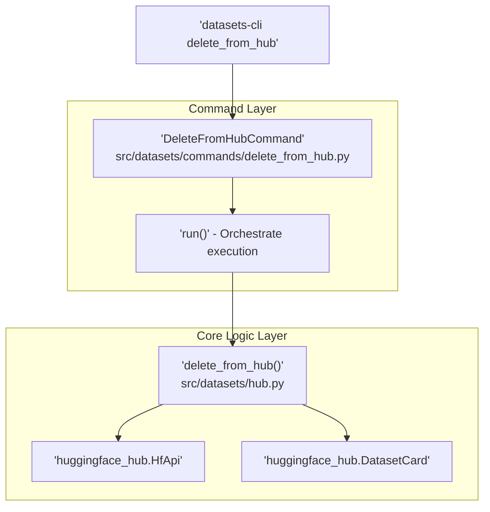

<!-- source: DeepWiki mcp.deepwiki.com · repo huggingface/datasets · page 9 Command-Line Interface · fetched 2026-10-26 -->

# Command-Line Interface

<details>
<summary>Relevant source files</summary>

The following files were used as context for generating this wiki page:

- [.github/workflows/ci.yml](.github/workflows/ci.yml)
- [docs/source/cli.mdx](docs/source/cli.mdx)
- [setup.py](setup.py)
- [src/datasets/__init__.py](src/datasets/__init__.py)
- [src/datasets/commands/datasets_cli.py](src/datasets/commands/datasets_cli.py)
- [src/datasets/hub.py](src/datasets/hub.py)
- [tests/test_hub.py](tests/test_hub.py)
- [tests/utils.py](tests/utils.py)

</details>


This document provides an overview of the `datasets-cli` command-line interface tool. The CLI provides shell commands for dataset operations including environment diagnostics, dataset loading tests, and Hub repository management.

For detailed documentation of individual CLI commands, see [CLI Commands Reference](#9.1). For programmatic Hub operations, see [Hub Operations](#8.1).

## Overview

The `datasets-cli` tool is a command-line interface for interacting with datasets. It is implemented as a Python entry point that provides multiple subcommands for different operations.

**Basic Usage:**
```bash
datasets-cli <command> [<args>]
```

The CLI follows a command pattern architecture where each subcommand is implemented as a separate command class that registers itself with the main argument parser.

Sources: [src/datasets/commands/datasets_cli.py:14-36](), [docs/source/cli.mdx:1-19]()

## Architecture

The CLI uses Python's `argparse` library with a command pattern where each subcommand registers itself and provides a factory function for instantiation.

Title: CLI Architecture and Command Registration


Sources: [src/datasets/commands/datasets_cli.py:1-40](), [docs/source/cli.mdx:7-19]()

## Entry Point

The main entry point is implemented in [src/datasets/commands/datasets_cli.py:14-36](). The `main()` function performs the following operations:

1. Creates an `ArgumentParser` with usage pattern `"datasets-cli <command> [<args>]"` [src/datasets/commands/datasets_cli.py:15-17]().
2. Configures logging verbosity to info level via `set_verbosity_info()` [src/datasets/commands/datasets_cli.py:19]().
3. Registers all subcommands (`env`, `test`, `delete_from_hub`) by calling their `register_subcommand()` static methods [src/datasets/commands/datasets_cli.py:22-24]().
4. Parses known and unknown arguments [src/datasets/commands/datasets_cli.py:27]().
5. Instantiates the selected command via its factory function [src/datasets/commands/datasets_cli.py:34]().
6. Executes the command by calling its `run()` method [src/datasets/commands/datasets_cli.py:35]().

| Step | Function | Purpose |
|------|----------|---------|
| Argument parsing | `parser.parse_known_args()` | Separates known CLI args from command-specific args |
| Unknown args | `parse_unknown_args()` | Converts remaining args to kwargs dictionary [src/datasets/commands/datasets_cli.py:10-11]() |
| Instantiation | `args.func(args, **kwargs)` | Creates command instance via factory function |
| Execution | `service.run()` | Runs the command's main logic |

Sources: [src/datasets/commands/datasets_cli.py:10-36]()

## Command Pattern

Each CLI command follows a consistent structure defined by `BaseDatasetsCLICommand`. For example, the `delete_from_hub` command implements this by defining a `DeleteFromHubCommand` class.

Title: Command Implementation Pattern


**Implementation Requirements:**

1. **Static registration method:** `register_subcommand(parser)` adds the command and its specific arguments (like `--token` or `--revision`) to the argument parser [docs/source/cli.mdx:26-37]().
2. **Factory function:** `_command_factory(args)` creates command instances from parsed arguments.
3. **Constructor:** `__init__()` stores command parameters.
4. **Execution method:** `run()` implements the command logic, often calling core library functions like `datasets.hub.delete_from_hub` [src/datasets/hub.py:21-95]().

Sources: [src/datasets/commands/datasets_cli.py:22-24](), [docs/source/cli.mdx:21-42]()

## Available Commands

The CLI provides several subcommands for managing datasets:

| Command | Purpose | Documentation |
|---------|---------|---------------|
| `test` | Test dataset loading, checksums, and configurations | See [CLI Commands Reference](#9.1) |
| `delete_from_hub` | Delete specific dataset configurations from the Hub | See [CLI Commands Reference](#9.1) |
| `env` | Print system environment and dependency information | See [CLI Commands Reference](#9.1) |

**Example Usage:**

```bash
# Print environment info for debugging
datasets-cli env

# Delete a config from a Hub repository
datasets-cli delete_from_hub USERNAME/DATASET_NAME CONFIG_NAME
```

For details, see [CLI Commands Reference](#9.1).

Sources: [src/datasets/commands/datasets_cli.py:22-24](), [docs/source/cli.mdx:11-15]()

## Command Implementation Layers

CLI commands are implemented as a thin wrapper over core library functionality. This allows the logic to be shared between the CLI and the Python API.

Title: Two-Layer Command Architecture


For example, the `delete_from_hub` CLI command is a wrapper around the `datasets.hub.delete_from_hub` function [src/datasets/hub.py:21](), which uses `HfApi` to perform Git-based commits on the Hub [src/datasets/hub.py:78-93]().

Sources: [src/datasets/hub.py:21-95](), [src/datasets/commands/datasets_cli.py:24]()

## Integration with Library Components

The CLI integrates with the following major systems:

| Component | Purpose | Used By |
|-----------|---------|---------|
| `DatasetBuilder` | Core logic for loading and preparing data | `test` |
| `HfApi` | Hub API interactions for deletion and updates | `delete_from_hub` [src/datasets/hub.py:78-83]() |
| `DatasetCard` | Metadata management in README.md | `delete_from_hub` [src/datasets/hub.py:48]() |
| `MetadataConfigs` | Parsing and updating YAML metadata | `delete_from_hub` [src/datasets/hub.py:53-57]() |

Sources: [src/datasets/hub.py:4-18](), [src/datasets/commands/datasets_cli.py:4-6]()

## Utility Functions

### parse_unknown_args

The CLI includes a utility function in [src/datasets/commands/datasets_cli.py:10-11]() to parse extra command-line arguments not defined in the argparse schema. This allows passing arbitrary `kwargs` to builders or functions.

### Verbosity Configuration

The main CLI entry point sets the logging verbosity to info level via `set_verbosity_info()` [src/datasets/commands/datasets_cli.py:19](). This ensures that users see relevant progress and status updates during command execution.

Sources: [src/datasets/commands/datasets_cli.py:7-19]()

---

