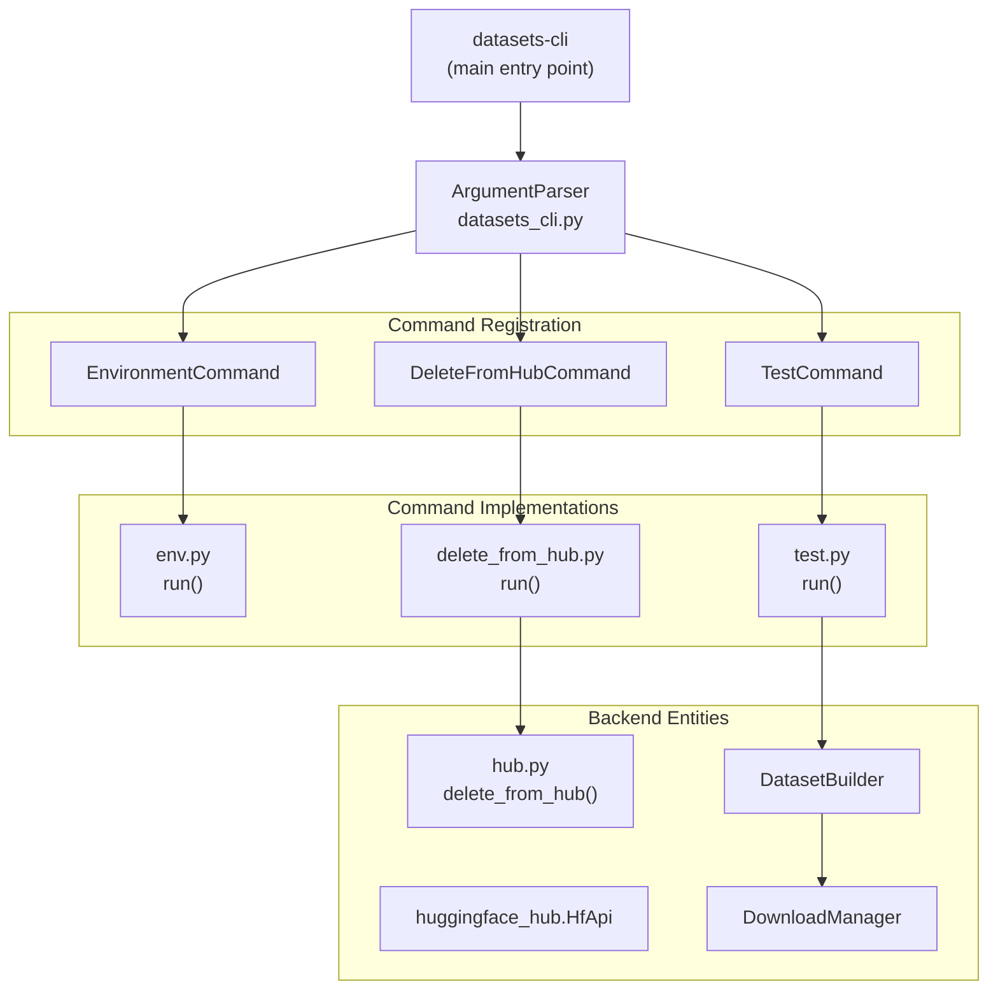
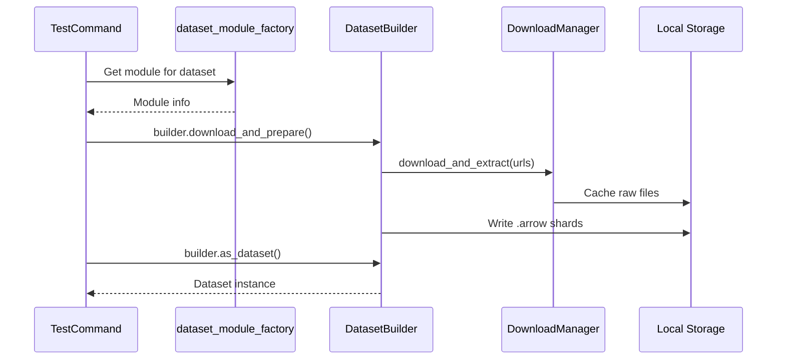
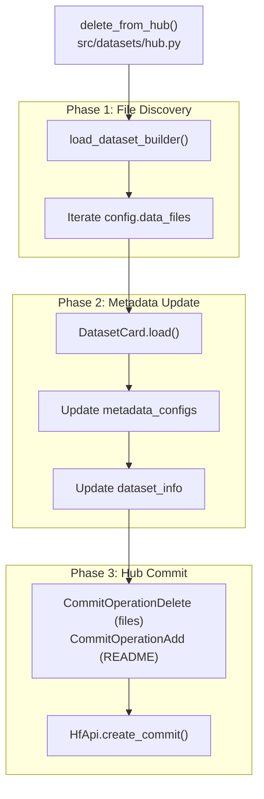
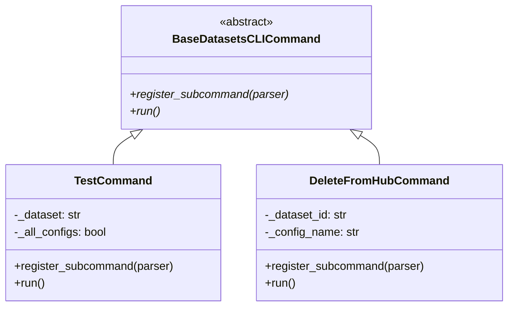

<!-- source: DeepWiki mcp.deepwiki.com · repo huggingface/datasets · page 9.1 CLI Commands Reference · fetched 2026-10-26 -->

# CLI Commands Reference

<details>
<summary>Relevant source files</summary>

The following files were used as context for generating this wiki page:

- [docs/source/cli.mdx](docs/source/cli.mdx)
- [src/datasets/builder.py](src/datasets/builder.py)
- [src/datasets/commands/datasets_cli.py](src/datasets/commands/datasets_cli.py)
- [src/datasets/commands/env.py](src/datasets/commands/env.py)
- [src/datasets/commands/test.py](src/datasets/commands/test.py)
- [src/datasets/hub.py](src/datasets/hub.py)
- [src/datasets/info.py](src/datasets/info.py)
- [tests/commands/test_test.py](tests/commands/test_test.py)
- [tests/test_builder.py](tests/test_builder.py)
- [tests/test_hub.py](tests/test_hub.py)

</details>


This page documents the command-line interface (CLI) provided by the `datasets-cli` tool. The CLI offers shell commands for common dataset operations such as testing dataset loading, managing Hub configurations, and displaying environment information. For general Hub integration including Python API methods like `push_to_hub()`, see [Hub Operations](#8.1).

## Overview

The `datasets-cli` tool provides a unified command-line interface for interacting with datasets. The CLI is implemented using Python's `argparse` module and follows a subcommand pattern where each command is registered as a separate subcommand with its own arguments and handler.

```bash
datasets-cli <command> [<args>]
```

Sources: [src/datasets/commands/datasets_cli.py:1-40](), [docs/source/cli.mdx:1-49]()

## CLI Architecture

The following diagram shows the structure of the CLI system and how commands are registered and executed:

Title: CLI Command Architecture


**CLI Command Flow**

The CLI uses the following execution flow:

1.  **Entry Point**: The `main()` function in `datasets_cli.py` creates an `ArgumentParser` [src/datasets/commands/datasets_cli.py:14-17]().
2.  **Command Registration**: Each command class registers itself as a subcommand using `register_subcommand()` [src/datasets/commands/datasets_cli.py:22-24]().
3.  **Argument Parsing**: The parser processes command-line arguments and invokes the appropriate command factory [src/datasets/commands/datasets_cli.py:27-31]().
4.  **Execution**: The command's `run()` method is called to execute the operation [src/datasets/commands/datasets_cli.py:34-35]().

Sources: [src/datasets/commands/datasets_cli.py:14-40]()

## Available Commands

### env Command
Displays relevant system environment information including Python version, platform details, and installed package versions.

**Usage:**
```bash
datasets-cli env
```

**Implementation:**
The `EnvironmentCommand` collects versions for `datasets`, `huggingface_hub`, `pyarrow`, `pandas`, and `fsspec` [src/datasets/commands/env.py:24-32](). It formats these into a markdown list for easy inclusion in GitHub issues [src/datasets/commands/env.py:34-41]().

Sources: [docs/source/cli.mdx:13](), [src/datasets/commands/env.py:1-42]()

### test Command
Tests dataset loading functionality. This command validates that a dataset can be loaded, processed, and (optionally) that its metadata can be updated.

**Usage:**
```bash
datasets-cli test <dataset_name> [arguments]
```

**Implementation Details:**
The `TestCommand` uses `dataset_module_factory` and `get_dataset_builder_class` to instantiate the appropriate `DatasetBuilder` [src/datasets/commands/test.py:114-115](). It then executes the standard loading pipeline:
1.  **Download and Prepare**: Calls `builder.download_and_prepare()` [src/datasets/commands/test.py:150-158]().
2.  **Load**: Calls `builder.as_dataset()` to verify the Arrow table generation [src/datasets/commands/test.py:159]().
3.  **Metadata Update**: If `--save_info` is used, it writes `DatasetInfosDict` to the directory, typically updating the YAML block in `README.md` [src/datasets/commands/test.py:164-168]().

Title: Test Command Loading Flow


Sources: [src/datasets/commands/test.py:1-168](), [src/datasets/builder.py:946-1025]()

### delete_from_hub Command
Deletes a dataset configuration from a data-only dataset repository on the Hugging Face Hub.

**Usage:**
```bash
datasets-cli delete_from_hub <dataset_id> <config_name> [options]
```

**Arguments:**
*   `dataset_id`: Repository ID (e.g., `org/dataset`).
*   `config_name`: The specific configuration to remove.
*   `--revision`: Target branch (defaults to `main`).

Sources: [src/datasets/commands/delete_from_hub.py:19-43](), [docs/source/cli.mdx:21-49]()

## delete_from_hub Implementation Details

The `delete_from_hub` command performs several operations to cleanly remove a dataset configuration from the Hub:

Title: delete_from_hub Backend Logic


**Deletion Process:**
1.  **Data File Resolution**: Identifies files associated with the config using the builder's `data_files` [src/datasets/hub.py:40-45](). It uses `HfFileSystem` to resolve paths within the repository [src/datasets/hub.py:41-44]().
2.  **Metadata Updates**: Loads the `README.md` via `DatasetCard.load()`. It removes the configuration from `config_names`, `metadata_configs` (using `MetadataConfigs.from_dataset_card_data`), and `dataset_info` (using `DatasetInfosDict.from_dataset_card_data`) [src/datasets/hub.py:47-73]().
3.  **Commit Creation**: Aggregates `CommitOperationDelete` for data files and a `CommitOperationAdd` for the modified `README.md` [src/datasets/hub.py:75-77](). It then calls `HfApi.create_commit(create_pr=True)` to open a PR on the Hub [src/datasets/hub.py:84-92]().

Sources: [src/datasets/hub.py:21-95](), [tests/test_hub.py:23-86]()

## Command Class Structure

All CLI commands follow a standardized inheritance pattern.

Title: CLI Class Hierarchy


Each command class implements:
1.  **Factory Function**: `_test_command_factory` or `_delete_from_hub_command_factory` to map CLI arguments to class initialization [src/datasets/commands/test.py:20-32]().
2.  **Registration**: `register_subcommand` to define the CLI interface via `ArgumentParser` [src/datasets/commands/test.py:39-73]().
3.  **Execution**: `run()` containing the main logic [src/datasets/commands/test.py:108-168]().

Sources: [src/datasets/commands/test.py:35-168](), [src/datasets/commands/delete_from_hub.py:17-43]()

## Authentication and Hub Interaction

Commands interacting with the Hub (like `delete_from_hub`) utilize the `huggingface_hub` library. 

*   **Token Management**: Tokens can be passed explicitly via `--token` or retrieved from the environment/cache via `HfApi` [src/datasets/hub.py:78-83]().
*   **PR Workflow**: By default, Hub-modifying commands create a Pull Request rather than committing directly to the main branch, allowing for review [src/datasets/hub.py:92]().

Sources: [src/datasets/hub.py:21-95](), [tests/test_hub.py:64-68]()

---

