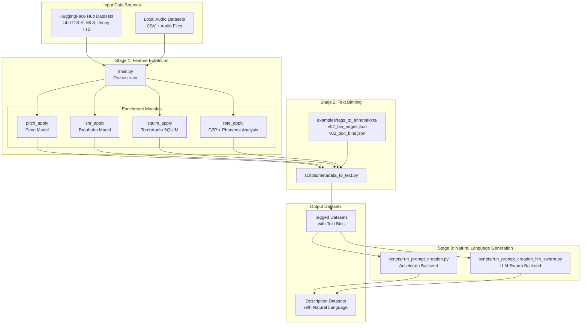
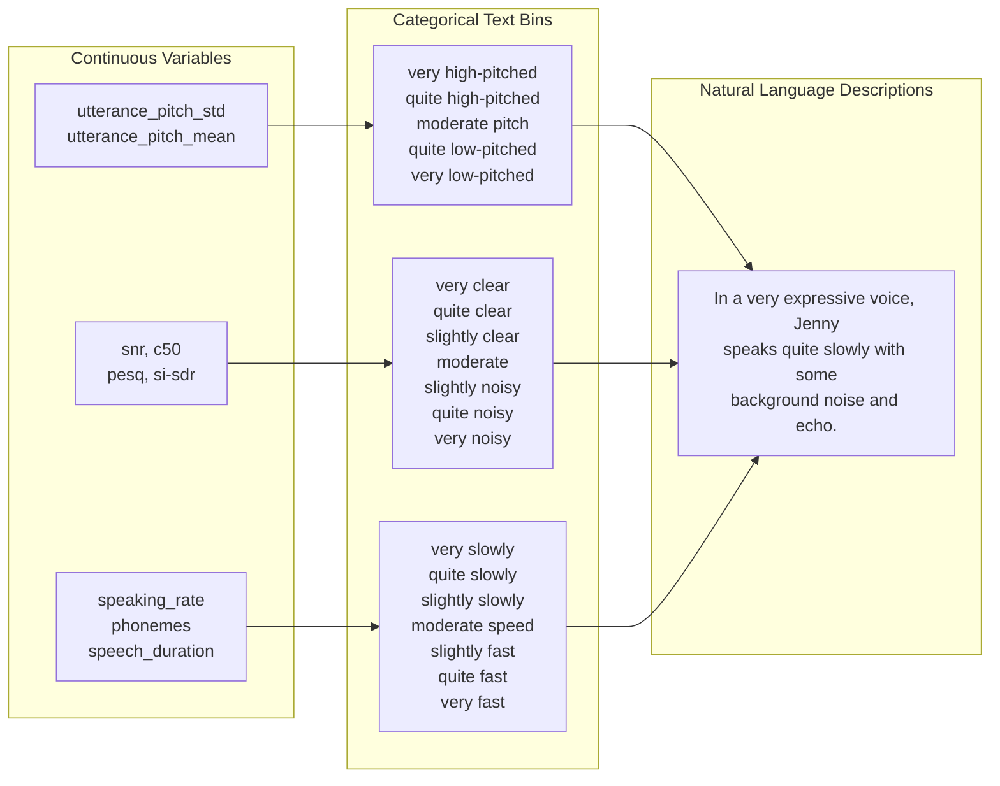
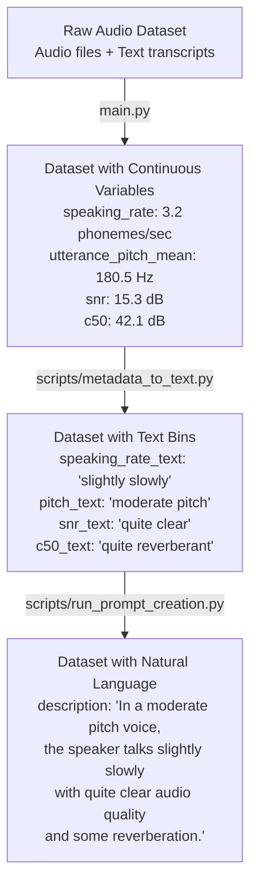

<!-- source: DeepWiki mcp.deepwiki.com · repo huggingface/dataspeech · page 1 Overview · fetched 2026-10-26 -->

# Overview

Relevant source files

The following files were used as context for generating this wiki page:

- [README.md](README.md)
- [examples/tagging/run_main_1k.sh](examples/tagging/run_main_1k.sh)
- [requirements.txt](requirements.txt)

Data-Speech is a comprehensive suite of utility scripts designed for automated annotation and tagging of speech datasets. The system transforms raw audio datasets into richly annotated datasets with natural language descriptions of speech characteristics, enabling advanced conditioning for text-to-speech models and dataset filtering applications.

This document provides an architectural overview of the Data-Speech system and its core processing pipeline. For detailed information about specific components, see [Core Processing Pipeline](#2), [Audio Enrichment Modules](#3), and [Prompt Generation Systems](#4).

## Purpose and Architecture

Data-Speech implements a three-stage pipeline that converts raw audio datasets into annotated datasets with natural language descriptions:

1. **Feature Extraction**: Extract continuous audio characteristics (pitch, SNR, speaking rate, quality metrics)
2. **Text Binning**: Map continuous variables to discrete categorical text bins using statistical distributions
3. **Natural Language Generation**: Convert text bins into coherent natural language descriptions using LLMs

## System Architecture Overview

**Sources:** [README.md:1-50](), [README.md:144-152](), [README.md:233-240]()

## Core Pipeline Components

The system consists of modular components that can be executed independently or as part of the complete pipeline:

**Sources:** [README.md:183-192](), [README.md:198-202](), [README.md:103-104]()

## Key Features and Capabilities

| Feature Category | Components | Description |
|------------------|------------|-------------|
| **Audio Analysis** | `pitch_apply`, `snr_apply`, `squim_apply`, `rate_apply` | Extract pitch statistics, SNR, reverberation, quality metrics, speaking rate |
| **Statistical Binning** | `scripts/metadata_to_text.py` | Map continuous variables to discrete bins using histogram analysis |
| **LLM Integration** | `scripts/run_prompt_creation.py`, `scripts/run_prompt_creation_llm_swarm.py` | Generate natural language descriptions using Accelerate or TGI backends |
| **GPU Acceleration** | Multi-GPU support in `main.py` | Automatically scale processing across available GPUs |
| **Hub Integration** | Dataset upload/download via `datasets` library | Seamless integration with HuggingFace Hub |
| **Configuration Management** | JSON configuration files | Reproducible binning with pre-computed statistical thresholds |

**Sources:** [README.md:54-59](), [README.md:156-170](), [README.md:233-302]()

## Data Flow and Processing Model

**Sources:** [README.md:47-50](), [README.md:196-202](), [README.md:228-232]()

The Data-Speech system is designed for scalability and modularity, supporting both small-scale experimentation and large-scale dataset processing. Each stage can be run independently, enabling flexible workflows for different use cases ranging from dataset filtering to comprehensive annotation for TTS model training.

---

