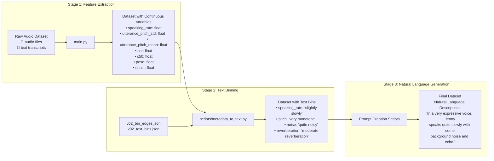
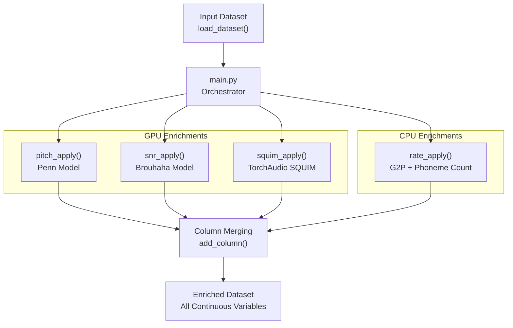
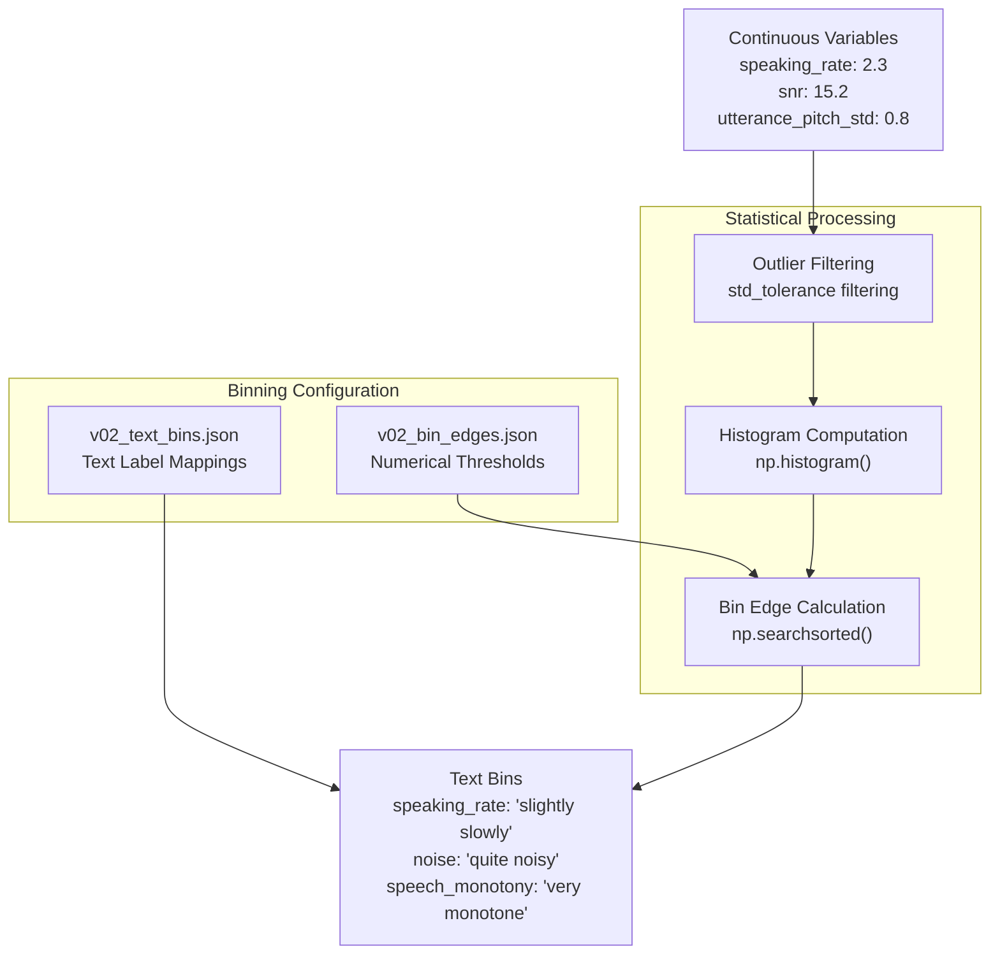
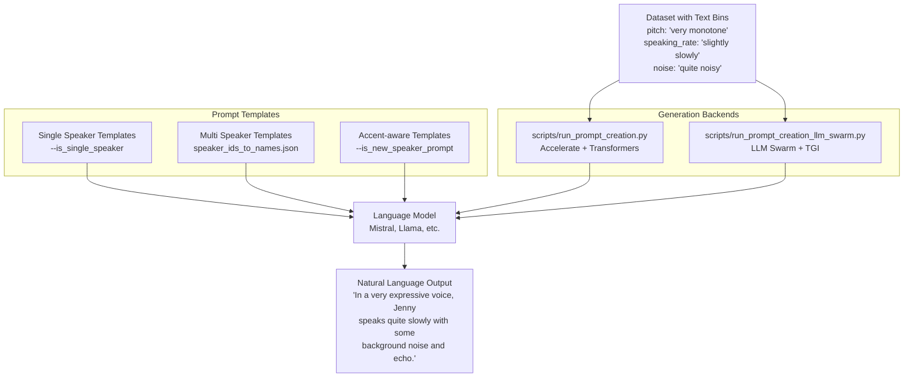

<!-- source: DeepWiki mcp.deepwiki.com · repo huggingface/dataspeech · page 2 Core Processing Pipeline · fetched 2026-10-26 -->

# Core Processing Pipeline

Relevant source files

The following files were used as context for generating this wiki page:

- [README.md](README.md)
- [examples/tagging/run_main_1k.sh](examples/tagging/run_main_1k.sh)
- [main.py](main.py)
- [scripts/metadata_to_text.py](scripts/metadata_to_text.py)

This document explains the three-stage core processing pipeline that transforms raw audio datasets into annotated datasets with natural language descriptions. The pipeline consists of continuous variable extraction, text binning, and natural language description generation.

For information about the individual audio enrichment modules, see [Audio Enrichment Modules](#3). For details about the prompt generation backends, see [Prompt Generation Systems](#4).

## Pipeline Overview

The dataspeech pipeline operates in three sequential stages that progressively transform audio data from raw measurements to human-readable descriptions:

**Pipeline Flow Diagram**

Sources: [main.py:1-114](), [scripts/metadata_to_text.py:1-309](), [README.md:144-152]()

## Stage 1: Feature Extraction

The first stage extracts continuous numerical features from audio files using `main.py` as the orchestrator. This script coordinates multiple enrichment modules to compute acoustic properties.

**Feature Extraction Architecture**

Sources: [main.py:43-103](), [main.py:55-64](), [main.py:66-75](), [main.py:77-94]()

### Key Features Extracted

| Feature | Column Name | Description | Enrichment Module |
|---------|-------------|-------------|-------------------|
| Pitch Statistics | `utterance_pitch_mean`, `utterance_pitch_std` | Mean and standard deviation of fundamental frequency | `pitch_apply` |
| Audio Quality | `snr`, `c50` | Signal-to-noise ratio and reverberation measurement | `snr_apply` |
| Speech Quality | `pesq`, `si-sdr` | Perceptual quality and signal distortion metrics | `squim_apply` |
| Speaking Rate | `speaking_rate`, `phonemes` | Phonemes per second and phoneme transcription | `rate_apply` |

The extraction process uses automatic GPU detection and scales across available hardware. GPU-accelerated modules (`pitch_apply`, `snr_apply`, `squim_apply`) distribute work across all available GPUs, while CPU-intensive operations like phoneme conversion use configurable worker processes.

Sources: [main.py:49-64](), [main.py:66-75](), [main.py:43-53](), [main.py:77-94]()

## Stage 2: Text Binning

The second stage converts continuous numerical features into discrete text categories using `scripts/metadata_to_text.py`. This script applies statistical binning to transform measurements into human-interpretable labels.

**Text Binning Process**

Sources: [scripts/metadata_to_text.py:56-100](), [scripts/metadata_to_text.py:11-19](), [scripts/metadata_to_text.py:196-214]()

### Binning Categories

The system supports several predefined text bin categories with configurable labels:

| Feature | Text Bins | Example Labels |
|---------|-----------|----------------|
| Speaking Rate | 7 bins | `"very slowly"`, `"quite slowly"`, `"moderate speed"`, `"very fast"` |
| Noise Level | 7 bins | `"very noisy"`, `"quite noisy"`, `"moderate ambient sound"`, `"very clear"` |
| Reverberation | 7 bins | `"very roomy sounding"`, `"moderate reverberation"`, `"very confined sounding"` |
| Speech Monotony | 7 bins | `"very monotone"`, `"moderate intonation"`, `"very expressive"` |
| Pitch (Speaker-level) | 7 bins | `"very low pitch"`, `"moderate pitch"`, `"very high pitch"` |

The binning process includes outlier filtering using configurable standard deviation tolerance parameters to ensure robust bin boundaries. For speaker-level features like pitch, the system computes gender-relative bins using the `speaker_level_relative_to_gender()` function.

Sources: [scripts/metadata_to_text.py:11-19](), [scripts/metadata_to_text.py:102-156](), [scripts/metadata_to_text.py:175-179]()

## Stage 3: Natural Language Description Generation

The final stage combines text bins into coherent natural language descriptions using large language models. The system supports two generation backends with different infrastructure requirements.

**Description Generation Architecture**

Sources: [README.md:232-238](), [README.md:276-285](), [README.md:131-136]()

### Generation Configuration

The natural language generation supports several prompt template configurations:

- **Single Speaker Mode**: Uses `--is_single_speaker` flag with `--speaker_name` for consistent speaker references
- **Multi Speaker Mode**: Maps speaker IDs to names using `--speaker_ids_to_name_json` configuration
- **Anonymous Mode**: Generates descriptions without specific speaker names
- **Accent-aware Mode**: Uses `--is_new_speaker_prompt` for improved accent and characteristic description

The system transforms discrete text bins into fluent descriptions by providing structured prompts to instruction-tuned language models. Common models include `mistralai/Mistral-7B-Instruct-v0.2` and `meta-llama/Meta-Llama-3-8B-Instruct`.

Sources: [README.md:112-126](), [README.md:248-261](), [README.md:289-298]()

## Pipeline Integration

The three stages integrate through standardized dataset transformations where each stage reads from and writes to HuggingFace datasets format. The pipeline supports:

- **Distributed Processing**: Automatic GPU detection and multi-GPU scaling
- **Resumable Execution**: Each stage can run independently with intermediate dataset storage
- **Configurable Binning**: Pre-computed bin edges allow consistent labeling across datasets
- **Batch Processing**: Configurable batch sizes and worker counts for performance optimization

The complete pipeline transforms raw audio into rich annotations suitable for training text-to-speech models, with the flexibility to run individual stages for specific use cases like dataset filtering or quality assessment.

Sources: [main.py:96-113](), [scripts/metadata_to_text.py:300-309](), [README.md:304-307]()

---

