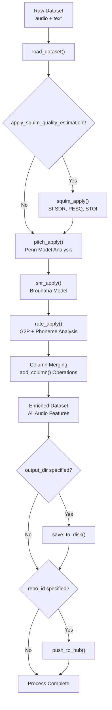
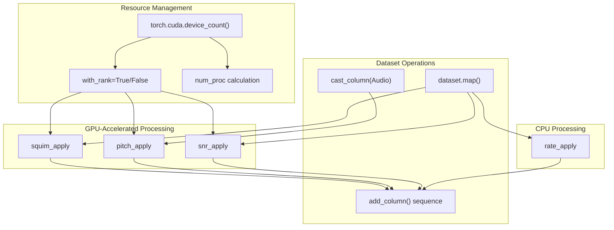
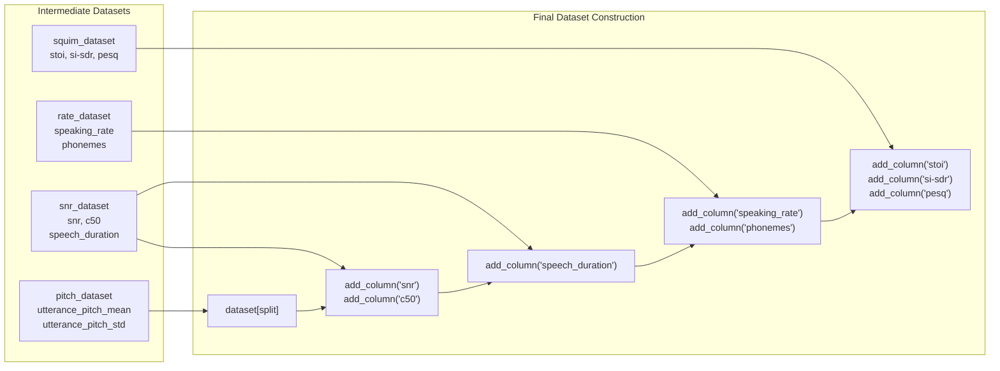

<!-- source: DeepWiki mcp.deepwiki.com · repo huggingface/dataspeech · page 2.1 Feature Extraction (main.py) · fetched 2026-10-26 -->

# Feature Extraction (main.py)

<details>
<summary>Relevant source files</summary>

The following files were used as context for generating this wiki page:

- [examples/tagging/run_main_45k.sh](examples/tagging/run_main_45k.sh)
- [examples/tagging/run_main_dummy.sh](examples/tagging/run_main_dummy.sh)
- [main.py](main.py)

</details>


## Purpose and Scope

The `main.py` script serves as the orchestrator for the first stage of the dataspeech processing pipeline, extracting continuous audio features from raw speech datasets. This module converts audio files and their transcripts into enriched datasets containing quantitative metrics such as pitch statistics, signal quality measures, speaking rates, and acoustic characteristics.

This document covers the feature extraction process only. For information about converting these continuous variables into discrete text bins, see [Metadata to Text Binning](#2.2). For natural language description generation from these features, see [Natural Language Description Generation](#2.3).

## Overview

The `main.py` script applies multiple audio analysis functions to transform input datasets containing audio files and transcripts into comprehensive feature-rich datasets. The extraction process is designed to be resource-adaptive, automatically utilizing available GPUs for computationally intensive tasks while falling back to CPU processing when necessary.



Sources: [main.py:1-114]()

## Command-Line Interface

The script accepts multiple configuration parameters to control processing behavior, resource allocation, and output destinations:

| Parameter Category | Arguments | Purpose |
|-------------------|-----------|---------|
| **Data Source** | `dataset_name`, `--configuration` | Specify input dataset and configuration |
| **Column Mapping** | `--audio_column_name`, `--text_column_name`, `--rename_column` | Configure input column names and standardization |
| **Resource Control** | `--cpu_num_workers`, `--num_workers_per_gpu_for_*` | Control parallelization strategy |
| **Batch Processing** | `--batch_size`, `--penn_batch_size`, `--cpu_writer_batch_size` | Optimize memory usage and throughput |
| **Feature Selection** | `--apply_squim_quality_estimation` | Enable optional quality metrics |
| **Output** | `--output_dir`, `--repo_id` | Specify local and remote output destinations |

The script implements automatic resource detection using `torch.cuda.device_count()` to determine GPU availability and scales worker processes accordingly.

Sources: [main.py:10-28]()

## Processing Workflow

### Audio Feature Extraction Pipeline

The extraction process follows a specific sequence of operations, each handled by specialized functions from the `dataspeech` module:



Sources: [main.py:43-102]()

### Data Processing Sequence

1. **Optional Quality Estimation** ([main.py:43-53]()): If `--apply_squim_quality_estimation` is enabled, extracts SI-SDR, PESQ, and STOI metrics using `squim_apply`

2. **Pitch Analysis** ([main.py:55-64]()): Applies `pitch_apply` with Penn model to extract `utterance_pitch_mean` and `utterance_pitch_std` features. Audio is resampled to 16kHz using `cast_column(Audio(sampling_rate=16_000))`

3. **SNR and Reverberation** ([main.py:66-75]()): Uses `snr_apply` with Brouhaha model to compute signal-to-noise ratio (`snr`), clarity measure (`c50`), and optionally `speech_duration`

4. **Speaking Rate Calculation** ([main.py:77-94]()): Applies `rate_apply` for G2P conversion and phoneme analysis, producing `speaking_rate` and `phonemes` features

### Column Merging Strategy

The script creates separate intermediate datasets for each processing step, then merges columns using `add_column()` operations:



Sources: [main.py:96-102]()

## Resource Management and Parallelization

### GPU vs CPU Processing Strategy

The script implements adaptive resource allocation based on available hardware:

| Processing Type | GPU Available | CPU Fallback | Workers Calculation |
|----------------|---------------|--------------|-------------------|
| **SQUIM Quality** | `with_rank=True` | `with_rank=False` | `torch.cuda.device_count() * num_workers_per_gpu_for_squim` |
| **Pitch Analysis** | `with_rank=True` | `with_rank=False` | `torch.cuda.device_count() * num_workers_per_gpu_for_pitch` |
| **SNR/Reverberation** | `with_rank=True` | `with_rank=False` | `torch.cuda.device_count() * num_workers_per_gpu_for_snr` |
| **Speaking Rate** | Always CPU | `with_rank=False` | `cpu_num_workers` |

### Memory Optimization Techniques

- **Audio Column Removal**: Uses `remove_columns=[audio_column_name]` to prevent rewriting audio data multiple times ([main.py:51,62,73,92]())
- **Batch Size Control**: Separate batch sizes for different operations (`batch_size`, `penn_batch_size`, `cpu_writer_batch_size`)
- **Writer Batch Optimization**: CPU operations use `writer_batch_size` parameter for efficient disk writes ([main.py:83,91]())

Sources: [main.py:20-27](), [main.py:49-50,60-61,71-72,82,90]()

## Output Format and Data Flow

### Generated Feature Columns

The feature extraction process adds the following columns to the original dataset:

| Feature Category | Column Names | Data Type | Source Function |
|-----------------|--------------|-----------|----------------|
| **Pitch Statistics** | `utterance_pitch_mean`, `utterance_pitch_std` | Float | `pitch_apply` |
| **Signal Quality** | `snr`, `c50` | Float | `snr_apply` |
| **Temporal Features** | `speech_duration`, `speaking_rate` | Float | `snr_apply`, `rate_apply` |
| **Linguistic Features** | `phonemes` | String | `rate_apply` |
| **Quality Metrics** | `stoi`, `si-sdr`, `pesq` | Float | `squim_apply` (optional) |

### Output Destinations

The script supports dual output modes:

1. **Local Storage** ([main.py:104-106]()): Uses `dataset.save_to_disk(args.output_dir)` for local caching
2. **HuggingFace Hub** ([main.py:107-112]()): Pushes to specified repository with optional configuration support

The push operation preserves dataset configuration structure when present.

Sources: [main.py:96-112]()

## Usage Examples

### Basic Feature Extraction

```bash
python main.py "blabble-io/libritts_r" \
    --configuration "dev" \
    --output_dir ./tmp_libritts_r_dev/ \
    --text_column_name "text_normalized" \
    --audio_column_name "audio" \
    --cpu_num_workers 8 \
    --rename_column
```

### Production Processing with Quality Metrics

```bash
python main.py "blabble-io/libritts_r" \
    --configuration "clean" \
    --repo_id "ylacombe/libritts-r-text-tags-v3" \
    --text_column_name "text_normalized" \
    --cpu_num_workers 32 \
    --num_workers_per_gpu 4 \
    --apply_squim_quality_estimation \
    --rename_column
```

Sources: [examples/tagging/run_main_dummy.sh:1-10](), [examples/tagging/run_main_45k.sh:3-13]()

---

