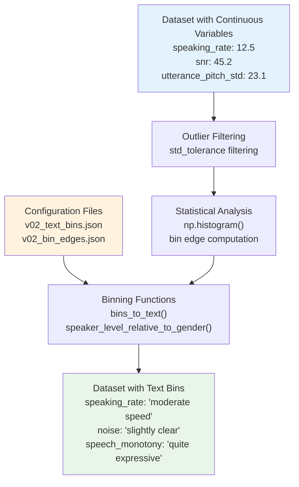
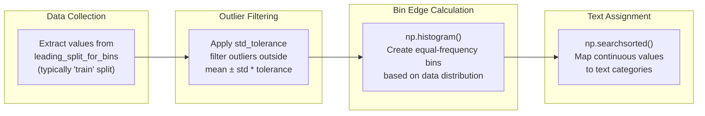
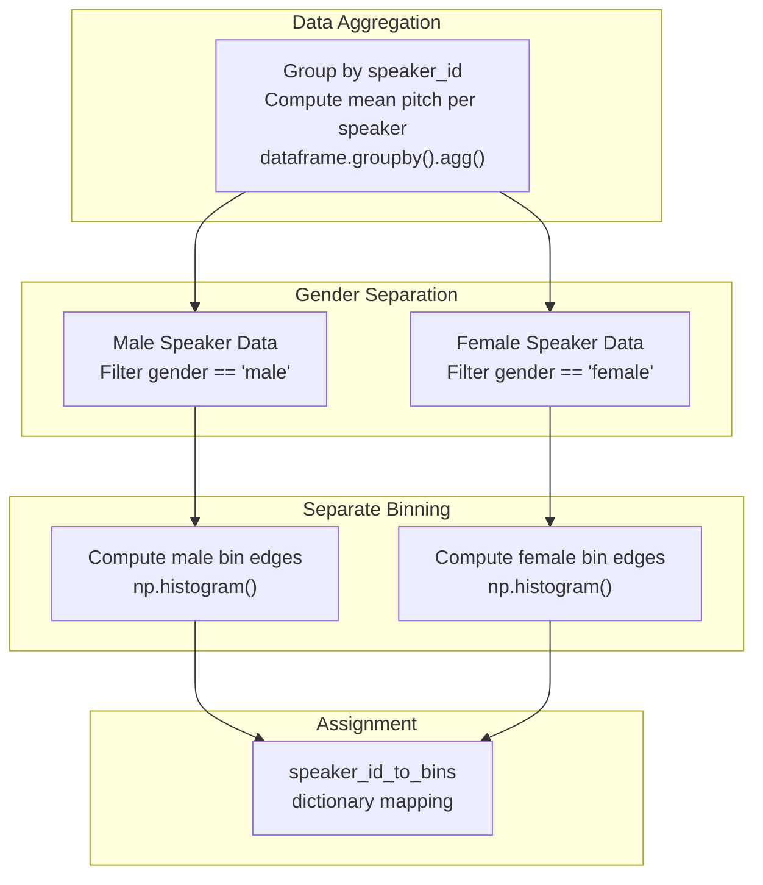
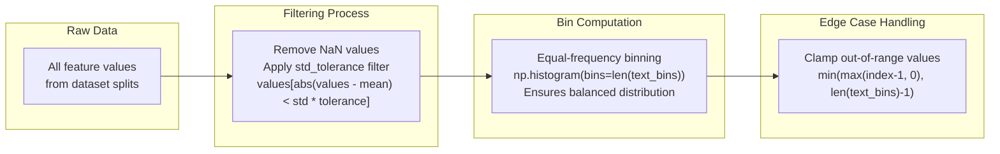
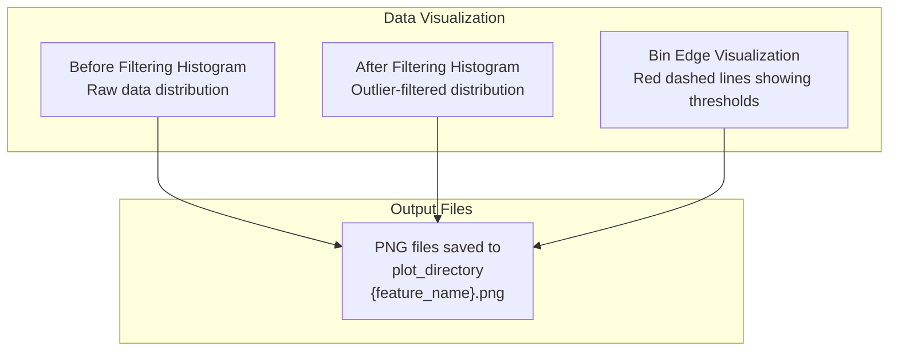

<!-- source: DeepWiki mcp.deepwiki.com · repo huggingface/dataspeech · page 2.2 Metadata to Text Binning · fetched 2026-10-26 -->

# Metadata to Text Binning

<details>
<summary>Relevant source files</summary>

The following files were used as context for generating this wiki page:

- [examples/tags_to_annotations/run_metadata_to_text_10k_v02.sh](examples/tags_to_annotations/run_metadata_to_text_10k_v02.sh)
- [examples/tags_to_annotations/v01_bin_edges.json](examples/tags_to_annotations/v01_bin_edges.json)
- [examples/tags_to_annotations/v02_bin_edges.json](examples/tags_to_annotations/v02_bin_edges.json)
- [examples/tags_to_annotations/v02_text_bins.json](examples/tags_to_annotations/v02_text_bins.json)
- [scripts/metadata_to_text.py](scripts/metadata_to_text.py)

</details>


The metadata to text binning system converts continuous numerical audio features into discrete, human-readable text categories. This system serves as the critical bridge between the raw numerical measurements extracted during feature extraction (see [Feature Extraction](#2.1)) and the natural language description generation (see [Natural Language Description Generation](#2.3)).

The binning process transforms precise measurements like speaking rate (e.g., 12.5 phonemes per second) into categorical descriptions (e.g., "moderate speed"), making the data suitable for natural language processing while maintaining semantic meaning about audio characteristics.

## System Architecture

The binning system is implemented primarily in `scripts/metadata_to_text.py` and uses configuration files to define both the text categories and the numerical thresholds that separate them.

### Binning Process Flow



**Sources:** [scripts/metadata_to_text.py:56-100](), [scripts/metadata_to_text.py:196-214]()

### Text Bin Categories

The system defines predefined text categories for each audio characteristic, organized as ordered lists from lowest to highest intensity:

| Audio Feature | Text Bin Variable | Example Categories |
|---------------|-------------------|-------------------|
| Speaking Rate | `SPEAKER_RATE_BINS` | "very slowly", "moderate speed", "very fast" |
| Signal-to-Noise Ratio | `SNR_BINS` | "very noisy", "moderate ambient sound", "very clear" |
| Reverberation | `REVERBERATION_BINS` | "very roomy sounding", "moderate reverberation", "very confined sounding" |
| Pitch Variation | `UTTERANCE_LEVEL_STD` | "very monotone", "moderate intonation", "very expressive" |
| Pitch Level | `SPEAKER_LEVEL_PITCH_BINS` | "very low pitch", "moderate pitch", "very high pitch" |
| Speech Quality (SI-SDR) | `SI_SDR_BINS` | "extremely noisy", "almost no noise", "very clear" |
| Speech Quality (PESQ) | `PESQ_BINS` | "very bad speech quality", "great speech quality", "wonderful speech quality" |

**Sources:** [scripts/metadata_to_text.py:11-20](), [examples/tags_to_annotations/v02_text_bins.json:1-12]()

## Core Binning Functions

### Standard Binning Process

The `bins_to_text()` function handles most audio features using a standard statistical binning approach:



**Sources:** [scripts/metadata_to_text.py:56-100](), [scripts/metadata_to_text.py:273-276]()

### Gender-Relative Pitch Binning

Speaker-level pitch requires special handling due to biological differences between male and female voices. The `speaker_level_relative_to_gender()` function computes separate bin edges for each gender:



**Sources:** [scripts/metadata_to_text.py:102-156](), [scripts/metadata_to_text.py:266-271]()

## Configuration System

### Text Bin Definitions

The `v02_text_bins.json` file defines the ordered categories for each audio feature:

```json
{
    "speaker_rate_bins": ["very slowly", "slowly", "slightly slowly", "moderate speed", "slightly fast", "fast", "very fast"],
    "snr_bins": ["very noisy", "noisy", "slightly noisy", "balanced in clarity", "slightly clean", "clean", "very clean"],
    "reverberation_bins": ["very distant-sounding", "distant-sounding", "slightly distant-sounding", "slightly close-sounding", "very close-sounding"]
}
```

**Sources:** [examples/tags_to_annotations/v02_text_bins.json:1-12]()

### Bin Edge Configuration

The `v02_bin_edges.json` file stores the numerical thresholds computed from training data:

```json
{
    "speaking_rate": [0.0, 3.826, 7.652, 11.477, 15.303, 19.129, 22.955, 26.781],
    "noise": [17.128, 25.401, 33.675, 41.949, 50.222, 58.496, 66.770, 75.044],
    "pitch_bins_male": [64.653, 81.667, 98.680, 115.694, 132.708, 149.721, 166.735, 183.749],
    "pitch_bins_female": [120.179, 141.624, 163.070, 184.516, 205.961, 227.407, 248.853, 270.299]
}
```

**Sources:** [examples/tags_to_annotations/v02_bin_edges.json:1-10]()

## Outlier Filtering and Statistical Robustness

### Standard Deviation Tolerance

Each audio feature uses configurable standard deviation tolerance to filter outliers before computing bin edges:

| Feature | Default std_tolerance | Purpose |
|---------|----------------------|---------|
| Speaking Rate | 4.0 | Remove extremely fast/slow speech outliers |
| SNR | 3.5 | Filter recordings with unusual noise characteristics |
| Reverberation | 4.0 | Remove extreme acoustic environments |
| Pitch Standard Deviation | 4.0 | Filter unnaturally monotone/expressive speech |
| Pitch (Gender-relative) | 2.0 | More conservative filtering for pitch |

**Sources:** [scripts/metadata_to_text.py:175-179](), [scripts/metadata_to_text.py:68-83]()

### Statistical Distribution Handling



**Sources:** [scripts/metadata_to_text.py:68-83](), [scripts/metadata_to_text.py:90-97]()

## Visualization and Analysis

The system includes comprehensive visualization capabilities through the `visualize_bins_to_text()` function:

### Histogram Generation



**Sources:** [scripts/metadata_to_text.py:22-54](), [scripts/metadata_to_text.py:75-80]()

## Command Line Interface

The `metadata_to_text.py` script provides extensive configuration options:

### Key Parameters

| Parameter | Purpose | Default |
|-----------|---------|---------|
| `--path_to_text_bins` | Custom text bin definitions | Built-in constants |
| `--path_to_bin_edges` | Pre-computed bin edges | Compute from data |
| `--save_bin_edges` | Save computed edges for reuse | None |
| `--avoid_pitch_computation` | Skip gender-relative pitch binning | False |
| `--plot_directory` | Save visualization plots | None |
| `--only_save_plot` | Generate plots without processing | False |

**Sources:** [scripts/metadata_to_text.py:167-182](), [scripts/metadata_to_text.py:158-188]()

### Multi-Dataset Processing

The system supports processing multiple datasets simultaneously using `+`-separated values:

```bash
python scripts/metadata_to_text.py "dataset1+dataset2+dataset3" \
    --configuration "config1+config2+config3" \
    --output_dir "output1+output2+output3"
```

**Sources:** [scripts/metadata_to_text.py:218-238](), [examples/tags_to_annotations/run_metadata_to_text_10k_v02.sh:3-5]()

The binning system ensures consistent, statistically-grounded conversion of numerical audio features into semantically meaningful text categories that can be effectively used for natural language description generation.

---

