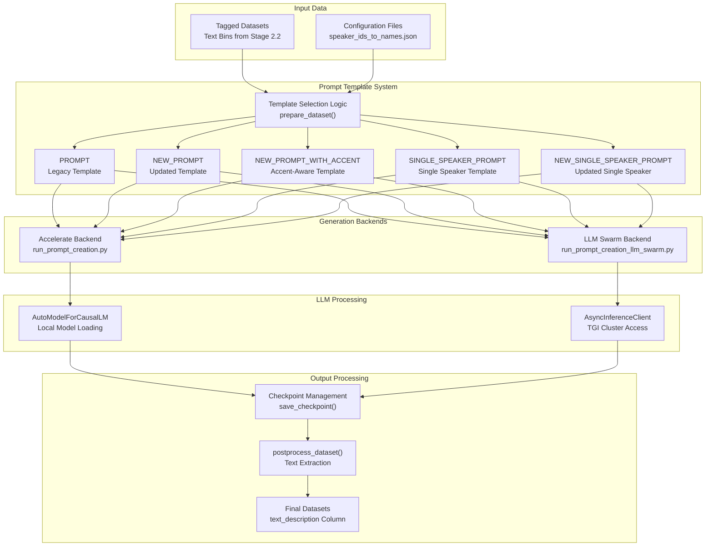
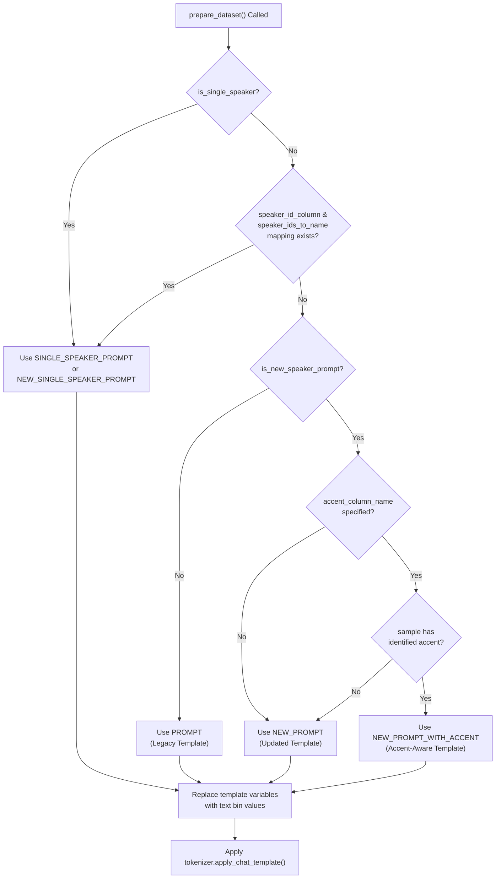
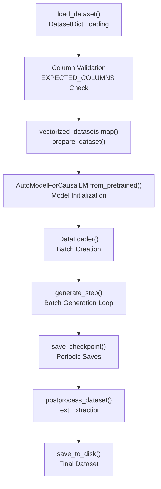
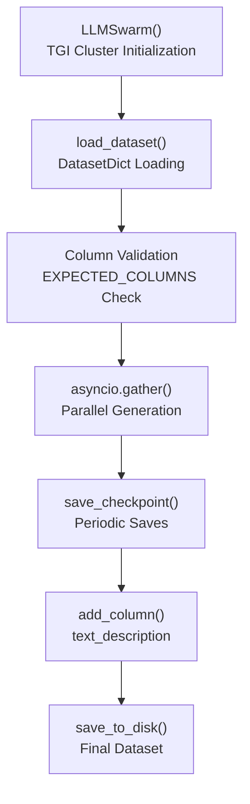

<!-- source: DeepWiki mcp.deepwiki.com · repo huggingface/dataspeech · page 2.3 Natural Language Description Generation · fetched 2026-10-26 -->

# Natural Language Description Generation

<details>
<summary>Relevant source files</summary>

The following files were used as context for generating this wiki page:

- [examples/prompt_creation/run_prompt_creation_dummy.sh](examples/prompt_creation/run_prompt_creation_dummy.sh)
- [examples/prompt_creation/run_prompt_creation_jenny.sh](examples/prompt_creation/run_prompt_creation_jenny.sh)
- [examples/prompt_creation_llm_swarm/nginx.template.conf](examples/prompt_creation_llm_swarm/nginx.template.conf)
- [examples/prompt_creation_llm_swarm/run_prompt_creation_10k.sh](examples/prompt_creation_llm_swarm/run_prompt_creation_10k.sh)
- [examples/tags_to_annotations/run_metadata_to_text_for_finetuning.sh](examples/tags_to_annotations/run_metadata_to_text_for_finetuning.sh)
- [scripts/run_prompt_creation.py](scripts/run_prompt_creation.py)
- [scripts/run_prompt_creation_llm_swarm.py](scripts/run_prompt_creation_llm_swarm.py)

</details>


This document covers the third and final stage of the DataSpeech processing pipeline, where discrete text bins are transformed into coherent natural language descriptions of audio characteristics using Large Language Models (LLMs). This stage takes tagged datasets with text classifications (e.g., "slightly slowly", "very monotone") and produces human-readable descriptions suitable for text-to-speech training.

For information about the preceding stages, see [Feature Extraction](#2.1) and [Metadata to Text Binning](#2.2). For details about the underlying prompt generation infrastructure, see [Prompt Generation Systems](#4).

## System Architecture Overview

The natural language description generation system operates through two main processing backends that share common prompt templates and data handling logic. Both approaches transform structured text bins into conversational descriptions using different distributed computing strategies.



Sources: [scripts/run_prompt_creation.py:1-668](), [scripts/run_prompt_creation_llm_swarm.py:1-553]()

## Prompt Template System

The system uses a sophisticated template selection mechanism to generate appropriate prompts based on dataset characteristics and configuration options. The `prepare_dataset()` function in both backends implements the core template selection logic.

### Template Types and Selection Logic

| Template Name | Use Case | Key Features |
|---------------|----------|--------------|
| `PROMPT` | Legacy multi-speaker | Original 6-keyword format with gender |
| `NEW_PROMPT` | Updated multi-speaker | Improved keyword definitions, better examples |
| `NEW_PROMPT_WITH_ACCENT` | Multi-speaker with accents | Includes accent as 7th keyword |
| `SINGLE_SPEAKER_PROMPT` | Legacy single-speaker | 4-keyword format without gender/pitch |
| `NEW_SINGLE_SPEAKER_PROMPT` | Updated single-speaker | Improved single-speaker prompts |

### Template Selection Logic Flow



Sources: [scripts/run_prompt_creation.py:552-573](), [scripts/run_prompt_creation_llm_swarm.py:408-427]()

### Template Variable Substitution

The system performs variable substitution using a standardized set of expected columns. The `EXPECTED_COLUMNS` set is dynamically configured based on processing options:

```python
# Base multi-speaker columns
EXPECTED_COLUMNS = {"gender", "pitch", "noise", "reverberation", "speech_monotony", "speaking_rate"}

# Single-speaker modification (removes gender and pitch)
if data_args.is_single_speaker:
    EXPECTED_COLUMNS = {"noise", "reverberation", "speech_monotony", "speaking_rate"}

# New prompt modification (replaces 'noise' with 'sdr_noise')
if data_args.is_new_speaker_prompt:
    EXPECTED_COLUMNS.remove("noise")
    EXPECTED_COLUMNS.add("sdr_noise")
```

Sources: [scripts/run_prompt_creation.py:480-486](), [scripts/run_prompt_creation_llm_swarm.py:365-371]()

## Generation Backends Comparison

The system provides two distinct backends for distributed prompt generation, each optimized for different infrastructure requirements and scaling scenarios.

### Backend Architecture Comparison

```mermaid
graph TB
    subgraph "Accelerate Backend Architecture"
        ACCEL_SCRIPT["run_prompt_creation.py"]
        ACCEL_ARGS["ModelArguments<br/>DataArguments"]
        ACCEL_LIB["Accelerator()<br/>Multi-GPU Coordination"]
        ACCEL_MODEL["AutoModelForCausalLM.from_pretrained()<br/>Local Model Loading"]
        ACCEL_GEN["generate_step()<br/>Batch Generation"]
        ACCEL_COLLATOR["DataCollatorWithPadding<br/>Dynamic Padding"]
    end
    
    subgraph "LLM Swarm Backend Architecture"
        SWARM_SCRIPT["run_prompt_creation_llm_swarm.py"]
        SWARM_ARGS["ModelArguments<br/>DataArguments"]
        SWARM_MGR["LLMSwarm<br/>TGI Instance Management"]
        SWARM_CLIENT["AsyncInferenceClient<br/>HTTP API Access"]
        SWARM_GEN["process_text()<br/>Async Generation"]
        SWARM_SEM["asyncio.Semaphore<br/>Concurrency Control"]
    end
    
    ACCEL_SCRIPT --> ACCEL_ARGS
    ACCEL_ARGS --> ACCEL_LIB
    ACCEL_LIB --> ACCEL_MODEL
    ACCEL_MODEL --> ACCEL_GEN
    ACCEL_GEN --> ACCEL_COLLATOR
    
    SWARM_SCRIPT --> SWARM_ARGS
    SWARM_ARGS --> SWARM_MGR
    SWARM_MGR --> SWARM_CLIENT
    SWARM_CLIENT --> SWARM_GEN
    SWARM_GEN --> SWARM_SEM
```



Sources: [scripts/run_prompt_creation.py:12-26](), [scripts/run_prompt_creation_llm_swarm.py:19-22]()

### Key Implementation Differences

| Aspect | Accelerate Backend | LLM Swarm Backend |
|--------|-------------------|-------------------|
| Model Loading | `AutoModelForCausalLM.from_pretrained()` | Remote TGI instances via `AsyncInferenceClient` |
| Concurrency | GPU-based batching with `DataLoader` | Async/await with `asyncio.Semaphore` |
| Error Handling | Accelerate's built-in fault tolerance | Custom retry logic with `max_retries` |
| Checkpointing | Numpy array serialization | JSON-based text storage |
| Resource Management | `per_device_eval_batch_size` | `per_instance_max_parallel_requests` |

Sources: [scripts/run_prompt_creation.py:512-523](), [scripts/run_prompt_creation_llm_swarm.py:402-437]()

## Processing Pipeline Implementation

Both backends follow a similar high-level processing flow but implement the details differently to match their respective execution models.

### Accelerate Backend Pipeline



Sources: [scripts/run_prompt_creation.py:447-662]()

### LLM Swarm Backend Pipeline



Sources: [scripts/run_prompt_creation_llm_swarm.py:389-552]()

## Checkpoint and Recovery System

Both backends implement robust checkpoint and recovery mechanisms to handle long-running generation tasks and infrastructure failures.

### Checkpoint Management Functions

The checkpoint system uses a consistent interface across both backends with the following core functions:

| Function | Purpose | Implementation Details |
|----------|---------|----------------------|
| `save_checkpoint()` | Persist generation progress | JSON serialization with step numbering |
| `load_checkpoint()` | Restore from saved state | Automatic format detection and loading |
| `get_last_checkpoint()` | Find most recent checkpoint | Regex-based checkpoint discovery |
| `sorted_checkpoints()` | Order checkpoints by step | Numerical sorting of checkpoint files |
| `rotate_checkpoints()` | Cleanup old checkpoints | Maintains `save_total_limit` constraint |

### Checkpoint File Format

Checkpoints use the naming pattern `checkpoint-{step}.json` where `step` represents the processing progress. The `_RE_CHECKPOINT` regex pattern `r"^checkpoint-(\d+).json$"` handles checkpoint file recognition.

Sources: [scripts/run_prompt_creation.py:235-281](), [scripts/run_prompt_creation_llm_swarm.py:190-233]()

## Configuration and Customization

The system provides extensive configuration options through dataclass-based argument parsing using `HfArgumentParser`. Key configuration categories include model parameters, data handling, and generation settings.

### Model Configuration Options

```python
@dataclass
class ModelArguments:
    model_name_or_path: str  # LLM model identifier
    per_device_eval_batch_size: int  # Batch size per device
    torch_dtype: str = "float16"  # Precision setting
    temperature: float = 0.6  # Sampling temperature
    max_new_tokens: int = 256  # Generation length limit
    do_sample: bool = True  # Enable sampling mode
```

### Data Processing Configuration

```python
@dataclass  
class DataArguments:
    dataset_name: str  # Input dataset identifier
    output_dir: str  # Output directory path
    is_single_speaker: bool = False  # Single vs multi-speaker mode
    is_new_speaker_prompt: bool = False  # Template version selection
    speaker_ids_to_name_json: str = None  # Speaker name mapping file
    accent_column: str = None  # Accent information column
    save_steps: int = 500  # Checkpoint frequency
```

Sources: [scripts/run_prompt_creation.py:32-192](), [scripts/run_prompt_creation_llm_swarm.py:28-178]()

---

