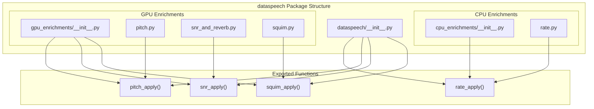
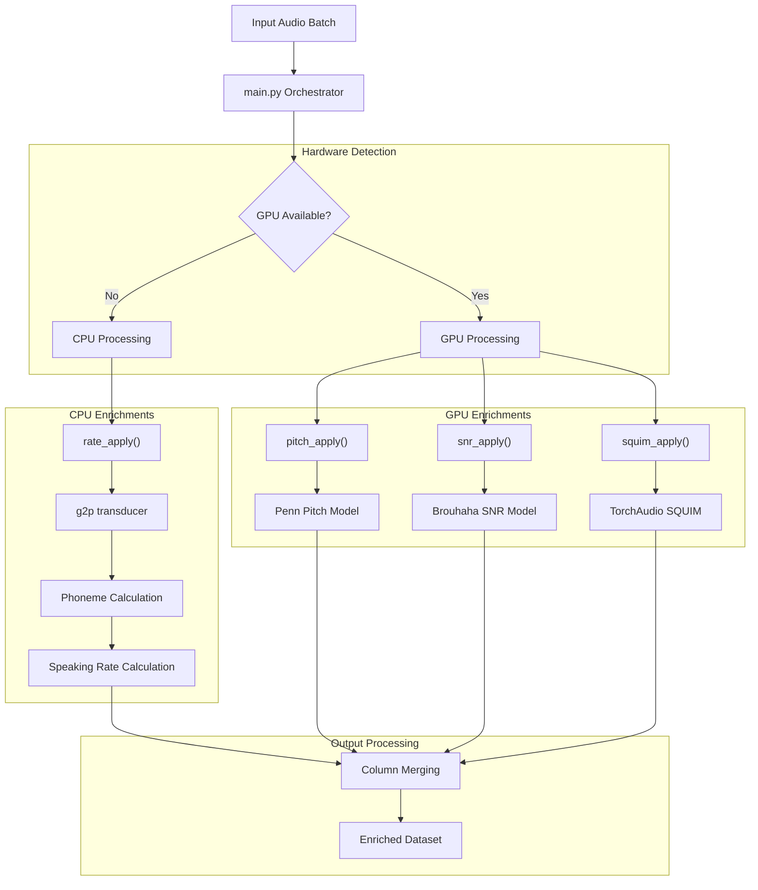
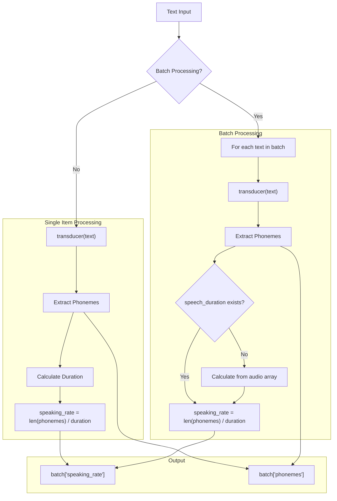

<!-- source: DeepWiki mcp.deepwiki.com · repo huggingface/dataspeech · page 3 Audio Enrichment Modules · fetched 2026-10-26 -->

# Audio Enrichment Modules

<details>
<summary>Relevant source files</summary>

The following files were used as context for generating this wiki page:

- [dataspeech/__init__.py](dataspeech/__init__.py)
- [dataspeech/cpu_enrichments/rate.py](dataspeech/cpu_enrichments/rate.py)
- [dataspeech/gpu_enrichments/__init__.py](dataspeech/gpu_enrichments/__init__.py)

</details>


## Purpose and Scope

The Audio Enrichment Modules form the core feature extraction layer of the DataSpeech pipeline. These modules extract specific acoustic and linguistic characteristics from audio datasets, transforming raw audio into quantifiable metrics such as pitch variation, signal-to-noise ratio, speaking rate, and speech quality measures.

This page provides an architectural overview of the modular enrichment system. For detailed implementation of GPU-accelerated processing, see [GPU-Accelerated Processing](#3.1). For CPU-based processing details, see [CPU-Based Processing](#3.2). The integration of these modules into the main processing pipeline is covered in [Feature Extraction (main.py)](#2.1).

## Architecture Overview

The enrichment system follows a modular architecture where each module is responsible for extracting specific audio characteristics. The system automatically distributes processing across available hardware resources.

**Module Distribution Architecture**


Sources: [dataspeech/__init__.py:1-2](), [dataspeech/gpu_enrichments/__init__.py:1-3]()

## Module Organization

The enrichment modules are organized into two categories based on their computational requirements and hardware optimization:

| Module Type | Location | Functions | Hardware Requirement |
|-------------|----------|-----------|---------------------|
| **CPU Enrichments** | `dataspeech/cpu_enrichments/` | `rate_apply` | CPU-optimized |
| **GPU Enrichments** | `dataspeech/gpu_enrichments/` | `pitch_apply`, `snr_apply`, `squim_apply` | GPU-accelerated |

### Module Interface Pattern

All enrichment modules follow a consistent interface pattern:

```python
def module_apply(batch, rank=None, audio_column_name="audio", text_column_name="text", **kwargs):
    # Process batch data
    # Return modified batch with new columns
    return batch
```

This standardized interface allows for seamless integration with the main processing pipeline and enables batch processing across different hardware configurations.

Sources: [dataspeech/cpu_enrichments/rate.py:5]()

## Integration with Main Pipeline

**Enrichment Module Processing Flow**


Sources: [dataspeech/cpu_enrichments/rate.py:1-44](), [dataspeech/gpu_enrichments/__init__.py:1-3]()

## Available Enrichment Modules

### CPU-Based Modules

| Module | Function | Output Columns | Description |
|--------|----------|---------------|-------------|
| **Rate Analysis** | `rate_apply` | `speaking_rate`, `phonemes` | Calculates speaking rate and extracts phonemes using G2P conversion |

### GPU-Based Modules

| Module | Function | Output Columns | Description |
|--------|----------|---------------|-------------|
| **Pitch Analysis** | `pitch_apply` | `utterance_pitch_mean`, `utterance_pitch_std` | Extracts pitch statistics using Penn model |
| **SNR & Reverberation** | `snr_apply` | `snr`, `c50` | Measures signal-to-noise ratio and reverberation using Brouhaha |
| **Speech Quality** | `squim_apply` | `pesq`, `si_sdr` | Evaluates speech quality using TorchAudio SQUIM metrics |

## Rate Module Implementation Details

The `rate_apply` function demonstrates the typical enrichment module pattern:

**Rate Calculation Process**


The module handles both single-item and batch processing, with flexible duration calculation that can use pre-computed `speech_duration` or calculate from raw audio arrays.

Sources: [dataspeech/cpu_enrichments/rate.py:5-44]()

## Resource Management

The enrichment system integrates with the main pipeline's resource management, supporting configurable parameters for optimal hardware utilization:

- `cpu_num_workers`: Controls CPU-based processing parallelism
- `num_workers_per_gpu`: Manages GPU worker allocation
- `batch_size`: Determines processing batch sizes
- Module-specific parameters (e.g., `penn_batch_size` for pitch processing)

The modular design allows for independent scaling of different enrichment types based on their computational requirements and available hardware resources.

---

