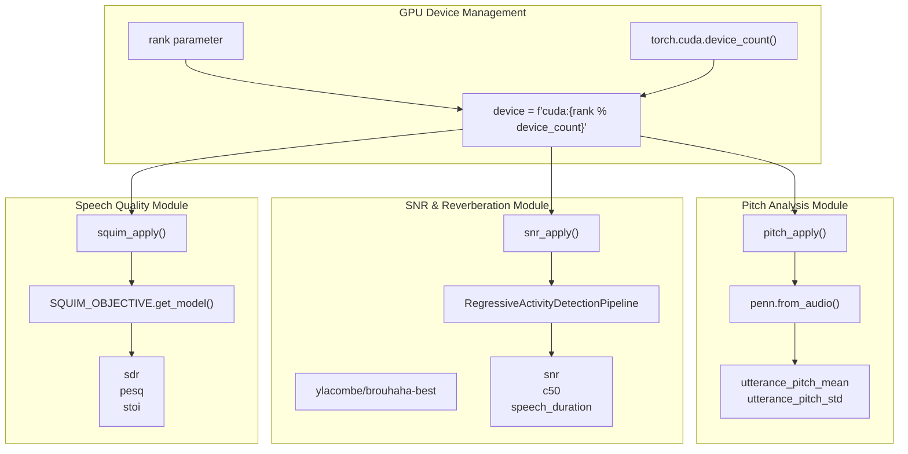
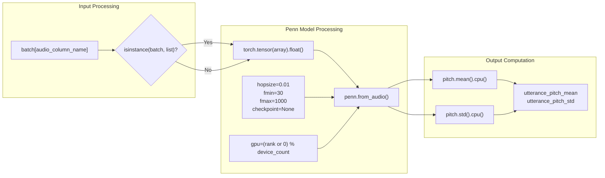
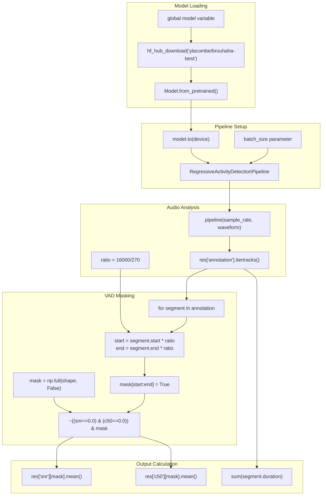
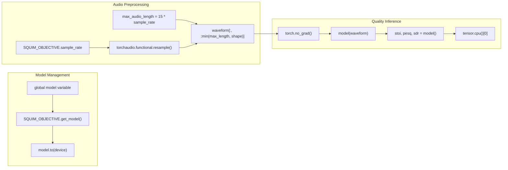
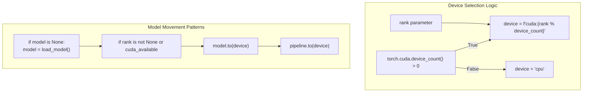
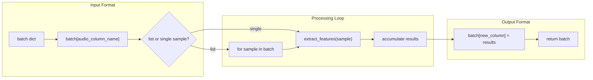

<!-- source: DeepWiki mcp.deepwiki.com · repo huggingface/dataspeech · page 3.1 GPU-Accelerated Processing · fetched 2026-10-26 -->

# GPU-Accelerated Processing

Relevant source files

The following files were used as context for generating this wiki page:

- [dataspeech/gpu_enrichments/pitch.py](dataspeech/gpu_enrichments/pitch.py)
- [dataspeech/gpu_enrichments/snr_and_reverb.py](dataspeech/gpu_enrichments/snr_and_reverb.py)
- [dataspeech/gpu_enrichments/squim.py](dataspeech/gpu_enrichments/squim.py)

This document covers the GPU-accelerated audio enrichment modules that extract computationally intensive audio features from speech datasets. These modules leverage specialized deep learning models to analyze pitch characteristics, signal quality, and acoustic properties that would be too slow to process on CPU at scale.

The GPU processing system consists of three primary modules: pitch analysis using the Penn model, SNR and reverberation detection using Brouhaha, and speech quality assessment using TorchAudio's SQUIM. For CPU-based processing like speaking rate calculation, see [CPU-Based Processing](#3.2).

## Architecture Overview

The GPU enrichment system follows a modular design where each feature extraction function operates independently but shares common patterns for device management and batch processing.

**GPU Processing Pipeline Architecture**

Sources: [dataspeech/gpu_enrichments/pitch.py:1-65](), [dataspeech/gpu_enrichments/snr_and_reverb.py:1-73](), [dataspeech/gpu_enrichments/squim.py:1-46]()

## Pitch Analysis Module

The `pitch_apply` function extracts fundamental frequency statistics using the Penn pitch estimation model. It processes audio samples to compute pitch mean and standard deviation values.

**Pitch Processing Flow**

The function supports configurable parameters including hop size, frequency range, and Penn model batch size. The `penn_batch_size` parameter controls memory usage during inference.

| Parameter | Default Value | Purpose |
|-----------|---------------|---------|
| `hopsize` | 0.01 | 10ms analysis window spacing |
| `fmin` | 30.0 | Minimum frequency for pitch detection |
| `fmax` | 1000.0 | Maximum frequency for pitch detection |
| `penn_batch_size` | 4096 | Batch size for Penn model inference |

Sources: [dataspeech/gpu_enrichments/pitch.py:5-21](), [dataspeech/gpu_enrichments/pitch.py:23-64]()

## SNR and Reverberation Module

The `snr_apply` function uses the Brouhaha model to extract signal-to-noise ratio, reverberation (C50), and speech duration metrics. It includes voice activity detection to focus analysis on speech segments.

**SNR Processing with VAD Masking**

The module implements sophisticated masking to exclude silence and invalid measurements from the final statistics. The `ratio` constant converts between time domain and analysis window indices.

Sources: [dataspeech/gpu_enrichments/snr_and_reverb.py:8-24](), [dataspeech/gpu_enrichments/snr_and_reverb.py:34-49](), [dataspeech/gpu_enrichments/snr_and_reverb.py:38-44]()

## Speech Quality Metrics Module

The `squim_apply` function leverages TorchAudio's SQUIM (Speech Quality and Intelligibility Measures) model to compute perceptual quality metrics including SDR, PESQ, and STOI.

**SQUIM Quality Assessment Pipeline**

The module includes a 15-second maximum audio length limit to prevent memory issues with very long audio samples. Audio is automatically resampled to match SQUIM's expected sample rate.

| Output Metric | Description |
|---------------|-------------|
| `sdr` | Signal-to-Distortion Ratio |
| `pesq` | Perceptual Evaluation of Speech Quality |
| `stoi` | Short-Time Objective Intelligibility |

Sources: [dataspeech/gpu_enrichments/squim.py:5-11](), [dataspeech/gpu_enrichments/squim.py:24-30](), [dataspeech/gpu_enrichments/squim.py:37-42]()

## GPU Resource Management

All GPU enrichment modules implement consistent device management patterns to support multi-GPU environments and graceful CPU fallback.

**Device Assignment Strategy**

The `rank` parameter enables distributed processing where each worker process uses a different GPU. The modulo operation ensures even distribution across available devices.

**Common GPU Management Parameters**

| Parameter | Type | Purpose |
|-----------|------|---------|
| `rank` | int \| None | Process rank for multi-GPU distribution |
| `batch_size` | int | Batch size for model inference |
| `audio_column_name` | str | Input column containing audio data |

Sources: [dataspeech/gpu_enrichments/pitch.py:39](), [dataspeech/gpu_enrichments/snr_and_reverb.py:18-26](), [dataspeech/gpu_enrichments/squim.py:12-18]()

## Integration Patterns

GPU enrichment functions follow standardized interfaces for seamless integration with the main processing pipeline. All functions accept dataset batches and return modified batches with additional feature columns.

**Batch Processing Interface**

This consistent interface allows the main processing pipeline to call any GPU enrichment function without modification, enabling modular feature selection based on processing requirements.

Sources: [dataspeech/gpu_enrichments/pitch.py:24-46](), [dataspeech/gpu_enrichments/snr_and_reverb.py:30-54](), [dataspeech/gpu_enrichments/squim.py:19-34]()

---

