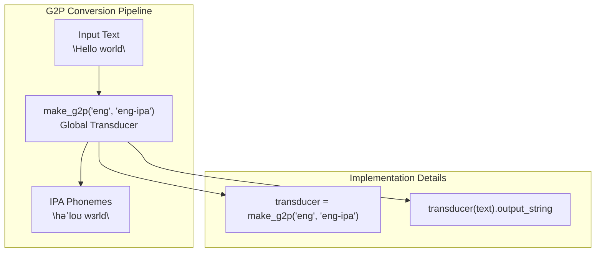
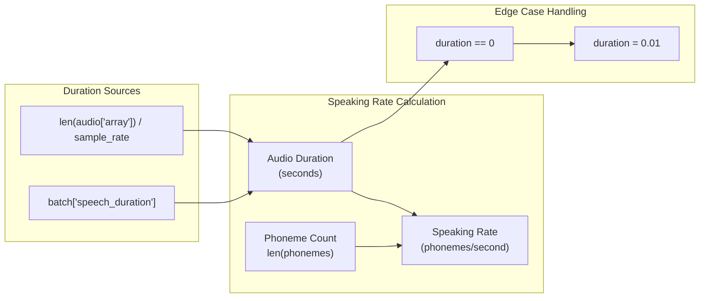
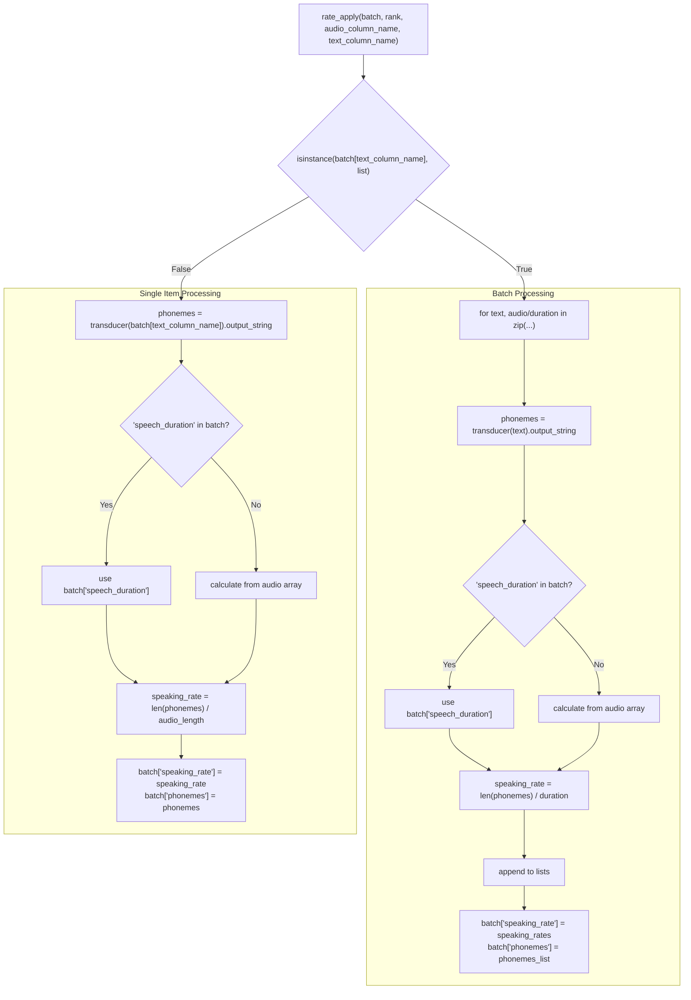
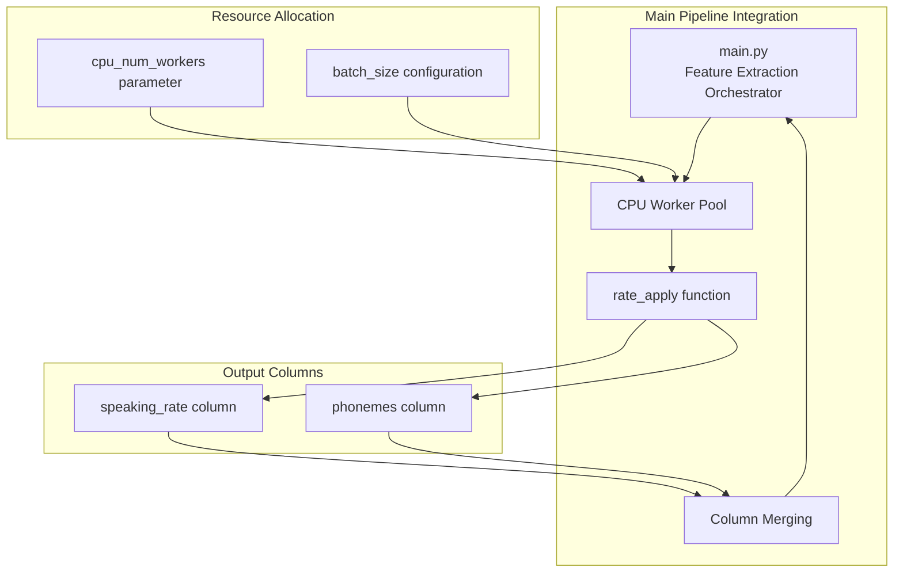

<!-- source: DeepWiki mcp.deepwiki.com · repo huggingface/dataspeech · page 3.2 CPU-Based Processing · fetched 2026-10-26 -->

# CPU-Based Processing

Relevant source files

The following files were used as context for generating this wiki page:

- [dataspeech/cpu_enrichments/rate.py](dataspeech/cpu_enrichments/rate.py)

This section covers the CPU-based audio enrichment modules in the DataSpeech pipeline. CPU-based processing handles computationally lighter tasks that don't require GPU acceleration, primarily focusing on text-based analysis and linguistic feature extraction. For information about GPU-accelerated audio processing modules, see [GPU-Accelerated Processing](#3.1).

The CPU-based enrichments currently include speaking rate calculation and phoneme extraction through grapheme-to-phoneme (G2P) conversion. These modules are designed to run efficiently on CPU resources while the GPU resources are dedicated to more computationally intensive audio analysis tasks.

## Rate-Based Enrichment Module

The primary CPU-based enrichment is implemented in the `rate_apply` function, which performs two key linguistic analysis tasks: phoneme extraction and speaking rate calculation.

### G2P Conversion Process

The module uses the `g2p` library to convert text transcriptions into phonemes using International Phonetic Alphabet (IPA) notation. A global transducer is initialized for English-to-IPA conversion:

**G2P Conversion Flow**
Sources: [dataspeech/cpu_enrichments/rate.py:1-3](), [dataspeech/cpu_enrichments/rate.py:11](), [dataspeech/cpu_enrichments/rate.py:18](), [dataspeech/cpu_enrichments/rate.py:32]()

### Speaking Rate Calculation

Speaking rate is computed as the ratio of phonemes to audio duration, measured in phonemes per second. The calculation handles two different duration sources:

| Duration Source | Calculation Method | Use Case |
|----------------|-------------------|----------|
| `speech_duration` | Pre-computed duration from previous processing | When speech duration is already extracted |
| Audio array length | `len(audio["array"]) / sample_rate` | When processing raw audio data |

**Speaking Rate Calculation Logic**
Sources: [dataspeech/cpu_enrichments/rate.py:10-15](), [dataspeech/cpu_enrichments/rate.py:17-27](), [dataspeech/cpu_enrichments/rate.py:33-42]()

## Function Implementation Details

The `rate_apply` function processes both batch and single-item inputs with the following signature and behavior:

### Function Parameters

| Parameter | Type | Description |
|-----------|------|-------------|
| `batch` | dict | Input batch containing text and audio data |
| `rank` | int/None | Optional process rank for distributed processing |
| `audio_column_name` | str | Column name for audio data (default: "audio") |
| `text_column_name` | str | Column name for text data (default: "text") |

### Processing Logic Flow

**Function Processing Flow**
Sources: [dataspeech/cpu_enrichments/rate.py:5-44]()

## Integration with Pipeline Architecture

The CPU-based processing integrates with the main processing pipeline through the enrichment system. The `rate_apply` function is called as part of the feature extraction stage:

**Pipeline Integration Architecture**
Sources: [dataspeech/cpu_enrichments/rate.py:5](), [dataspeech/cpu_enrichments/rate.py:29-30](), [dataspeech/cpu_enrichments/rate.py:41-42]()

## Error Handling and Edge Cases

The implementation includes several safeguards for robust processing:

### Zero Duration Handling
When audio duration is zero (which can occur with very short clips or processing errors), the function uses a fallback value of 0.01 seconds to prevent division by zero errors.

### Data Type Flexibility
The function handles both list-based batch processing and single-item processing, automatically detecting the input format and adapting the processing logic accordingly.

**Error Handling Implementation**
Sources: [dataspeech/cpu_enrichments/rate.py:12](), [dataspeech/cpu_enrichments/rate.py:34]()

## Performance Characteristics

CPU-based processing is chosen for the rate enrichment because:

1. **G2P Conversion**: Text-to-phoneme conversion is primarily a lookup and rule-based operation that doesn't benefit significantly from GPU parallelization
2. **Memory Efficiency**: Phoneme processing has low memory requirements compared to audio signal processing
3. **Resource Optimization**: Allows GPU resources to be dedicated to computationally intensive audio analysis tasks

The speaking rate calculation is lightweight and can be efficiently parallelized across CPU cores using standard multiprocessing approaches.

Sources: [dataspeech/cpu_enrichments/rate.py:1-44]()

---

