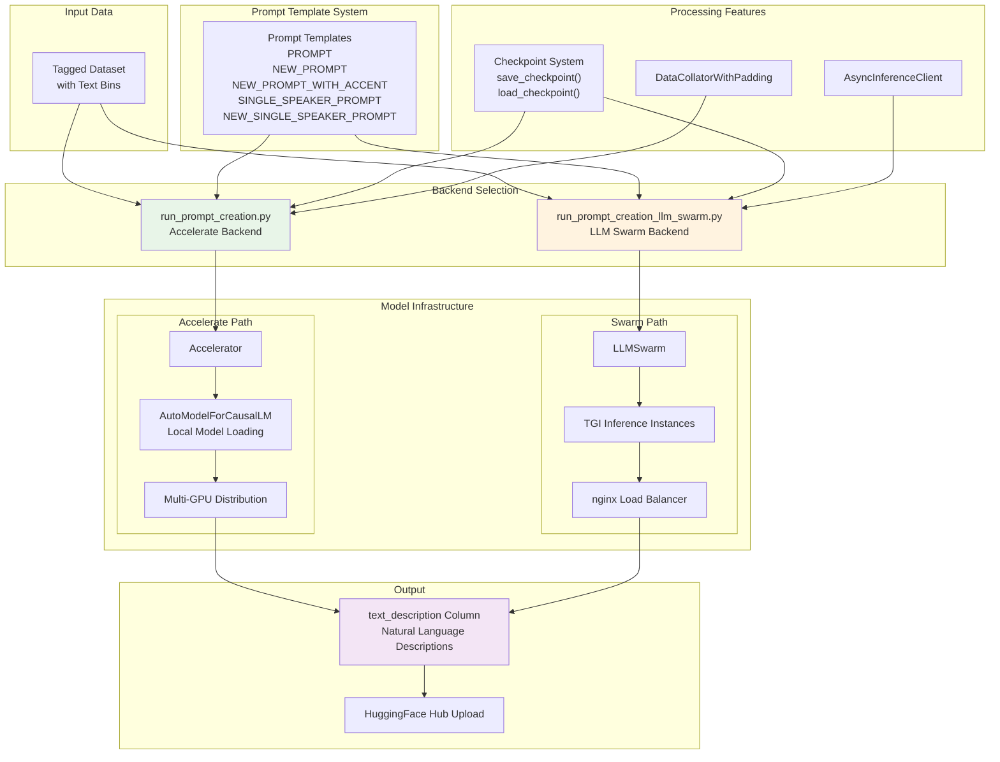
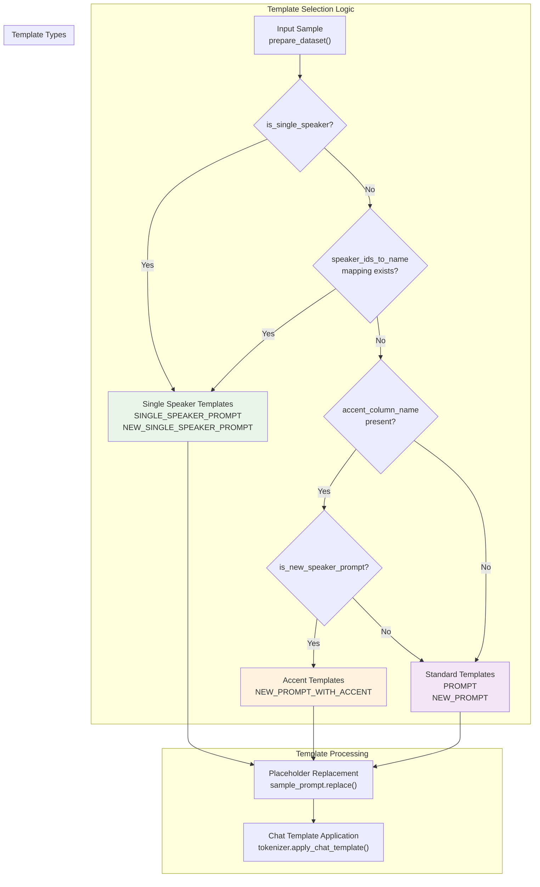
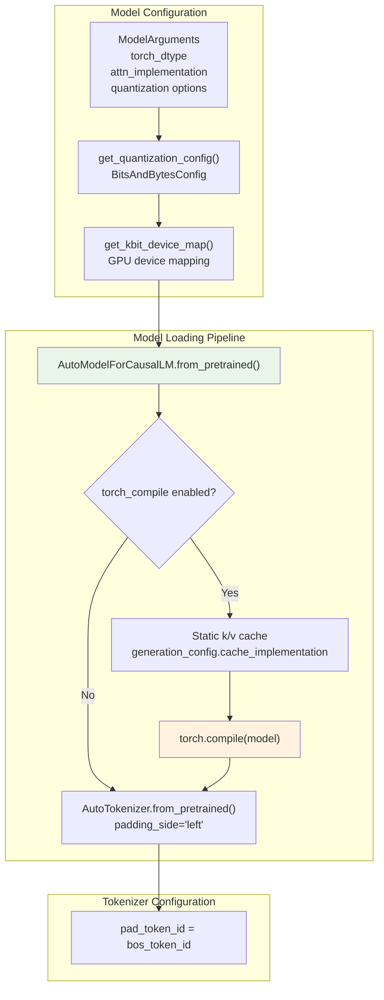
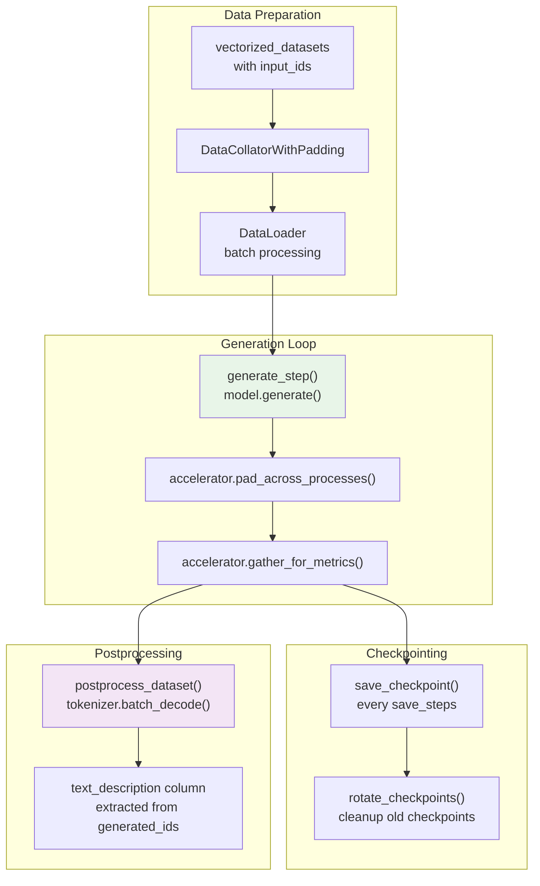

<!-- source: DeepWiki mcp.deepwiki.com · repo huggingface/dataspeech · page 4 Prompt Generation Systems · fetched 2026-10-26 -->

# Prompt Generation Systems

<details>
<summary>Relevant source files</summary>

The following files were used as context for generating this wiki page:

- [examples/prompt_creation/run_prompt_creation_dummy.sh](examples/prompt_creation/run_prompt_creation_dummy.sh)
- [examples/prompt_creation_llm_swarm/nginx.template.conf](examples/prompt_creation_llm_swarm/nginx.template.conf)
- [examples/prompt_creation_llm_swarm/run_prompt_creation_10k.sh](examples/prompt_creation_llm_swarm/run_prompt_creation_10k.sh)
- [scripts/run_prompt_creation.py](scripts/run_prompt_creation.py)
- [scripts/run_prompt_creation_llm_swarm.py](scripts/run_prompt_creation_llm_swarm.py)

</details>


This document covers the prompt generation systems that convert text bins (categorical audio feature descriptions) into natural language descriptions of speech characteristics. These systems represent the final stage of the dataspeech pipeline, transforming structured metadata like "slightly slowly" and "very monotone" into fluent descriptions such as "In a very expressive voice, Jenny speaks quite slowly with some background noise and echo."

For information about the preceding text binning stage, see [Metadata to Text Binning](#2.2). For details about the overall processing pipeline, see [Core Processing Pipeline](#2).

## Architecture Overview

The prompt generation system provides two distinct backends for large language model inference, each optimized for different deployment scenarios and scale requirements.



**Sources:** [scripts/run_prompt_creation.py:1-668](), [scripts/run_prompt_creation_llm_swarm.py:1-553]()

## Backend Comparison

The two prompt generation backends serve different deployment scenarios with distinct trade-offs in complexity, scalability, and resource requirements.

| Feature | Accelerate Backend | LLM Swarm Backend |
|---------|-------------------|-------------------|
| **Implementation** | `run_prompt_creation.py` | `run_prompt_creation_llm_swarm.py` |
| **Model Loading** | Local via `AutoModelForCausalLM` | Remote via TGI instances |
| **Distribution** | Accelerate library | LLM Swarm + nginx |
| **Processing** | Synchronous batching | Asynchronous requests |
| **Memory Model** | Direct GPU memory | Distributed inference |
| **Quantization** | BitsAndBytesConfig support | TGI-managed |
| **Checkpointing** | Per-batch with rotation | Per-chunk streaming |
| **Complexity** | Higher setup, simpler scaling | Lower setup, complex infrastructure |

**Sources:** [scripts/run_prompt_creation.py:31-108](), [scripts/run_prompt_creation_llm_swarm.py:27-91]()

## Prompt Template System

Both backends utilize a unified prompt template system that adapts to different speaker configurations and audio feature sets. The template selection logic determines the appropriate prompt based on dataset characteristics.



**Sources:** [scripts/run_prompt_creation.py:552-573](), [scripts/run_prompt_creation_llm_swarm.py:408-427]()

### Template Variants

The system provides five core prompt templates, each optimized for specific dataset configurations:

**Legacy Templates:**
- `PROMPT`: Original 6-keyword template with traditional terminology [scripts/run_prompt_creation.py:320-330]()
- `SINGLE_SPEAKER_PROMPT`: 4-keyword version for mono-speaker datasets [scripts/run_prompt_creation.py:400-412]()

**Modern Templates:**
- `NEW_PROMPT`: Updated 6-keyword template with revised terminology [scripts/run_prompt_creation.py:332-353]()
- `NEW_PROMPT_WITH_ACCENT`: 7-keyword version including accent information [scripts/run_prompt_creation.py:355-377]()
- `NEW_SINGLE_SPEAKER_PROMPT`: Updated single-speaker template [scripts/run_prompt_creation.py:380-398]()

### Expected Columns

The prompt system validates input datasets against expected column sets that vary based on configuration:

```python
EXPECTED_COLUMNS = {"gender", "pitch", "noise", "reverberation", "speech_monotony", "speaking_rate"}

# Single speaker datasets exclude gender and pitch
if data_args.is_single_speaker:
    EXPECTED_COLUMNS = {"noise", "reverberation", "speech_monotony", "speaking_rate"}
    
# New prompt format uses sdr_noise instead of noise
if data_args.is_new_speaker_prompt:
    EXPECTED_COLUMNS.remove("noise")
    EXPECTED_COLUMNS.add("sdr_noise")
```

**Sources:** [scripts/run_prompt_creation.py:480-487](), [scripts/run_prompt_creation_llm_swarm.py:365-371]()

## Model Loading and Configuration

### Accelerate Backend Model Setup

The Accelerate backend provides comprehensive model configuration options including quantization, compilation, and distributed loading:



**Sources:** [scripts/run_prompt_creation.py:199-545]()

### LLM Swarm Infrastructure Setup

The LLM Swarm backend orchestrates distributed inference through TGI instances and load balancing:

```python
with LLMSwarm(
    LLMSwarmConfig(
        instances=model_args.num_instances,
        inference_engine="tgi",
        slurm_template_path="./tgi_h100.template.slurm",
        load_balancer_template_path="./nginx.template.conf",
        model=model_args.model_name_or_path,
        per_instance_max_parallel_requests=model_args.per_instance_max_parallel_requests,
    )
) as llm_swarm:
```

**Sources:** [scripts/run_prompt_creation_llm_swarm.py:389-400](), [examples/prompt_creation_llm_swarm/nginx.template.conf:1-29]()

## Generation and Processing

### Accelerate Backend Processing

The Accelerate backend uses synchronous batch processing with DataLoader integration:



**Sources:** [scripts/run_prompt_creation.py:584-653]()

### LLM Swarm Async Processing

The LLM Swarm backend uses asynchronous processing with semaphore-controlled concurrency:

```python
async def process_text(sample):
    # Template selection and prompt preparation
    sample_prompt = tokenizer.apply_chat_template(sample_prompt, tokenize=False)
    
    attempt = 0
    while attempt < model_args.max_retries:
        try:
            async with semaphore:
                return await client.text_generation(
                    prompt=sample_prompt,
                    max_new_tokens=model_args.max_new_tokens,
                    temperature=model_args.temperature,
                    do_sample=model_args.do_sample,
                )
        except Exception as e:
            # Retry logic with exponential backoff
```

**Sources:** [scripts/run_prompt_creation_llm_swarm.py:408-448]()

## Checkpoint and Resume System

Both backends implement robust checkpointing to handle long-running generation tasks and enable resume functionality after interruptions.

### Checkpoint File Format

Checkpoints are stored as JSON files with numeric step identifiers:
- Filename pattern: `checkpoint-{step}.json`
- Content: List of generated text strings (Swarm) or token ID arrays (Accelerate)
- Regex pattern: `^checkpoint-(\d+).json$`

### Checkpoint Management Functions

| Function | Purpose | Backend |
|----------|---------|---------|
| `save_checkpoint()` | Save current progress | Both |
| `load_checkpoint()` | Restore from checkpoint | Both |
| `get_last_checkpoint()` | Find most recent checkpoint | Both |
| `rotate_checkpoints()` | Cleanup old checkpoints | Both |
| `sorted_checkpoints()` | Order checkpoints by step | Both |

**Sources:** [scripts/run_prompt_creation.py:235-302](), [scripts/run_prompt_creation_llm_swarm.py:190-250]()

## Usage Examples

### Accelerate Backend Example

```bash
python run_prompt_creation.py \
  --dataset_name "ylacombe/libritts_r_tags_and_text" \
  --dataset_config_name "clean" \
  --model_name_or_path "mistralai/Mistral-7B-Instruct-v0.2" \
  --per_device_eval_batch_size 8 \
  --output_dir "./descriptions" \
  --push_to_hub \
  --hub_dataset_id "user/dataset-descriptions"
```

### LLM Swarm Backend Example

```bash
python run_prompt_creation_llm_swarm.py \
  --dataset_name "ylacombe/mls-eng-10k-text-tags-v2" \
  --model_name_or_path "mistralai/Mistral-7B-Instruct-v0.2" \
  --num_instances 4 \
  --per_instance_max_parallel_requests 100 \
  --output_dir "./descriptions"
```

**Sources:** [examples/prompt_creation/run_prompt_creation_dummy.sh:1-18](), [examples/prompt_creation_llm_swarm/run_prompt_creation_10k.sh:1-10]()

---

