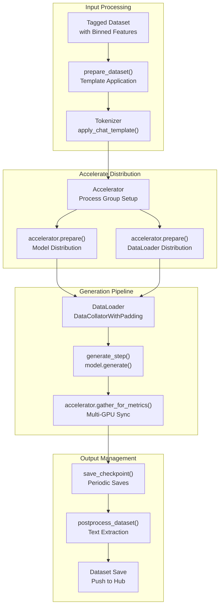
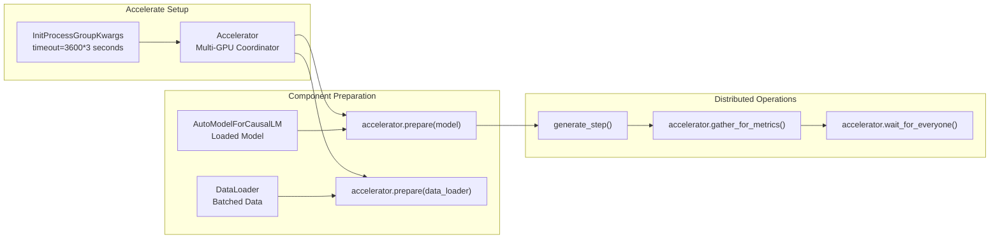
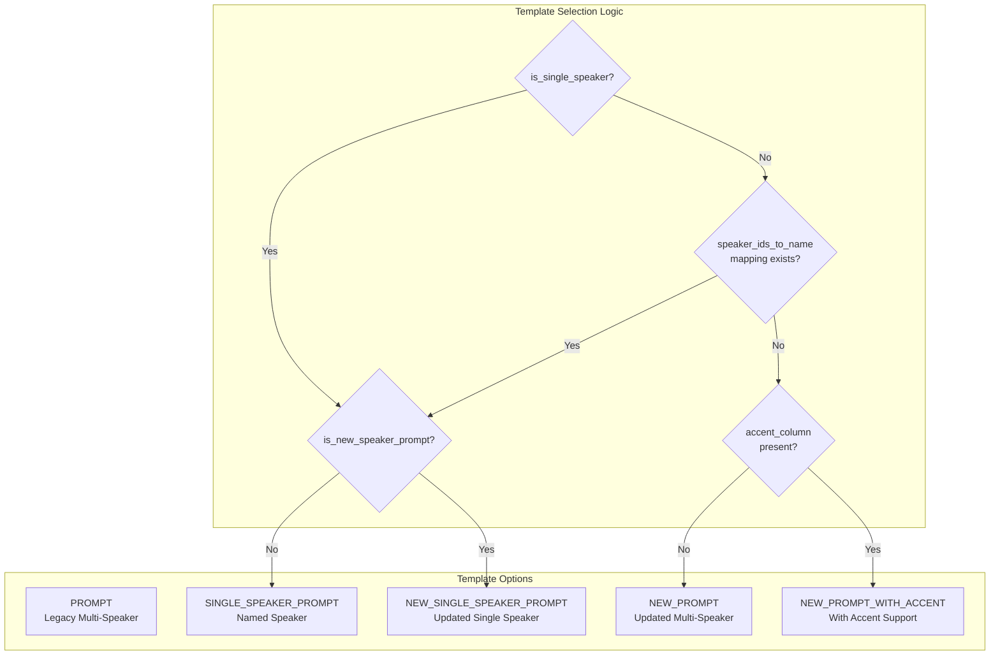
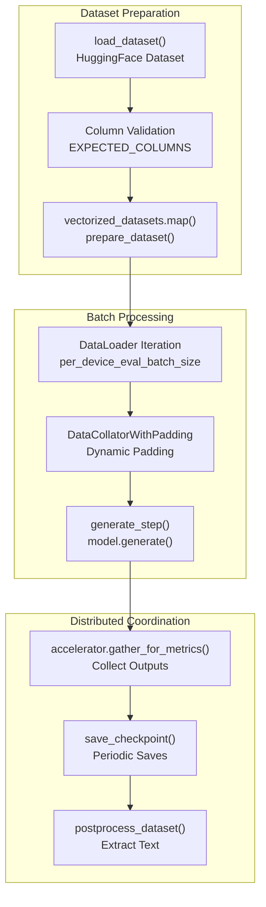
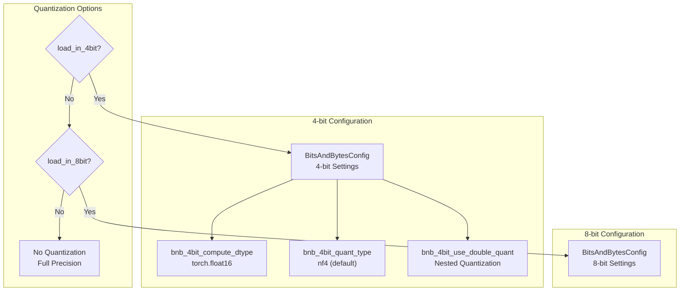

<!-- source: DeepWiki mcp.deepwiki.com · repo huggingface/dataspeech · page 4.1 Accelerate-Based Generation · fetched 2026-10-26 -->

# Accelerate-Based Generation

<details>
<summary>Relevant source files</summary>

The following files were used as context for generating this wiki page:

- [examples/prompt_creation/run_prompt_creation_10k.sh](examples/prompt_creation/run_prompt_creation_10k.sh)
- [examples/prompt_creation/run_prompt_creation_1k.sh](examples/prompt_creation/run_prompt_creation_1k.sh)
- [examples/prompt_creation/run_prompt_creation_dummy.sh](examples/prompt_creation/run_prompt_creation_dummy.sh)
- [scripts/run_prompt_creation.py](scripts/run_prompt_creation.py)

</details>


This document covers the Accelerate-based approach for generating natural language descriptions from audio feature tags. This system uses the HuggingFace Accelerate library to distribute transformer model inference across multiple GPUs for high-throughput prompt generation. For the alternative distributed approach using TGI instances, see [LLM Swarm Generation](#4.2).

## System Architecture

The Accelerate-based generation system provides a scalable solution for converting binned audio features into natural language descriptions using large language models. The system is implemented in `run_prompt_creation.py` and leverages Accelerate's multi-GPU distribution capabilities.



Sources: [scripts/run_prompt_creation.py:1-668]()

## Core Components

### Model and Data Arguments

The system uses dataclass-based configuration through `ModelArguments` and `DataArguments` classes that define all processing parameters.

| Component | Purpose | Key Parameters |
|-----------|---------|----------------|
| `ModelArguments` | Model configuration | `model_name_or_path`, `per_device_eval_batch_size`, `torch_dtype`, `load_in_4bit` |
| `DataArguments` | Data processing config | `dataset_name`, `output_dir`, `max_eval_samples`, `push_to_hub` |
| Quantization | Memory optimization | `BitsAndBytesConfig` for 4-bit/8-bit inference |

Sources: [scripts/run_prompt_creation.py:31-108](), [scripts/run_prompt_creation.py:110-192]()

### Accelerate Integration

The system initializes Accelerate with extended timeout for large model operations and prepares both model and data components for distributed processing.



Sources: [scripts/run_prompt_creation.py:440-441](), [scripts/run_prompt_creation.py:581-582](), [scripts/run_prompt_creation.py:610]()

## Prompt Template System

The system supports multiple prompt templates for different use cases, with dynamic template selection based on dataset characteristics.

### Template Types



Sources: [scripts/run_prompt_creation.py:320-413](), [scripts/run_prompt_creation.py:552-574]()

### Feature Column Mapping

The system expects specific column names in the input dataset and maps them to prompt placeholders:

| Expected Column | Description | Template Placeholder |
|----------------|-------------|---------------------|
| `gender` | Speaker gender | `[gender]` |
| `pitch` | Pitch characteristics | `[pitch]` |
| `noise` / `sdr_noise` | Noise level | `[noise]` / `[sdr_noise]` |
| `reverberation` | Room acoustics | `[reverberation]` |
| `speech_monotony` | Voice expressiveness | `[speech_monotony]` |
| `speaking_rate` | Speech pace | `[speaking_rate]` |
| `accent` | Speaker accent (optional) | `[accent]` |

Sources: [scripts/run_prompt_creation.py:480-487](), [scripts/run_prompt_creation.py:565-569]()

## Generation Pipeline

### Data Processing Flow

The generation pipeline processes datasets through several stages with distributed coordination:



Sources: [scripts/run_prompt_creation.py:602-653](), [scripts/run_prompt_creation.py:584-594](), [scripts/run_prompt_creation.py:595-600]()

### Checkpointing and Recovery

The system implements comprehensive checkpointing for long-running generation jobs:

| Function | Purpose | Key Features |
|----------|---------|--------------|
| `save_checkpoint()` | Periodic saves | JSON serialization of generated IDs |
| `load_checkpoint()` | Recovery on restart | Restore generation state |
| `get_last_checkpoint()` | Find latest save | Pattern matching for checkpoint files |
| `rotate_checkpoints()` | Cleanup old saves | Maintain `save_total_limit` checkpoints |

Sources: [scripts/run_prompt_creation.py:235-281](), [scripts/run_prompt_creation.py:617-624]()

## Model Configuration and Optimization

### Quantization Support

The system supports memory-efficient inference through quantization:



Sources: [scripts/run_prompt_creation.py:199-218](), [scripts/run_prompt_creation.py:510-523]()

### Performance Optimizations

| Optimization | Implementation | Benefits |
|-------------|----------------|----------|
| `torch.compile` | Static k/v cache | Faster generation for compatible models |
| Device mapping | `get_kbit_device_map()` | Optimal GPU memory usage |
| Attention implementation | SDPA (default) | Efficient attention computation |
| Mixed precision | FP16 via Accelerate | Reduced memory usage |

Sources: [scripts/run_prompt_creation.py:525-534](), [scripts/run_prompt_creation.py:221-228]()

## Usage Examples

### Multi-GPU Inference

The system is typically launched using Accelerate's multi-GPU launcher:

```bash
accelerate launch --multi_gpu --mixed_precision=fp16 --num_processes=8 run_prompt_creation.py \
  --dataset_name "parler-tts/libritts-r-tags-and-text" \
  --model_name_or_path "mistralai/Mistral-7B-Instruct-v0.2" \
  --per_device_eval_batch_size 64 \
  --load_in_4bit \
  --push_to_hub \
  --hub_dataset_id "parler-tts/libritts-r-tags-and-text-generated"
```

Sources: [examples/prompt_creation/run_prompt_creation_1k.sh:3-13](), [examples/prompt_creation/run_prompt_creation_10k.sh:3-13]()

### Single Speaker Processing

For datasets with a single speaker, the system uses specialized prompts:

```bash
python run_prompt_creation.py \
  --dataset_name "speaker_dataset" \
  --is_single_speaker \
  --speaker_name "Jenny" \
  --model_name_or_path "mistralai/Mistral-7B-Instruct-v0.2"
```

Sources: [scripts/run_prompt_creation.py:177-179](), [scripts/run_prompt_creation.py:547-548]()

### Output Format

The system generates a `text_description` column containing natural language descriptions extracted from the model's output, with input prompts and generated tokens removed during postprocessing.

Sources: [scripts/run_prompt_creation.py:595-600](), [scripts/run_prompt_creation.py:646-652]()

---

