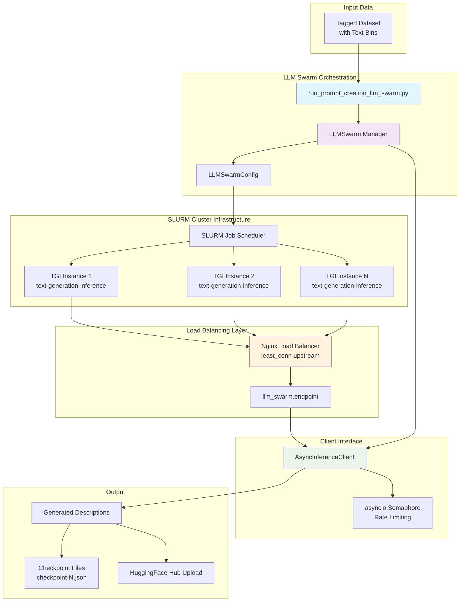
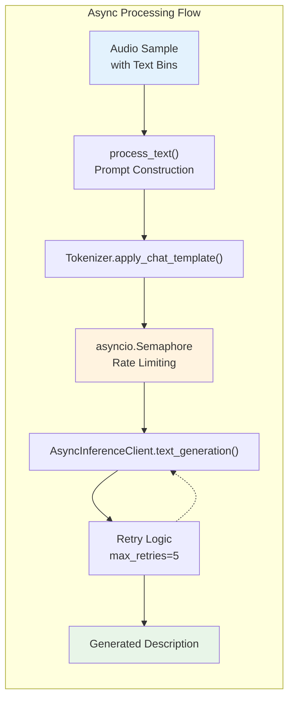
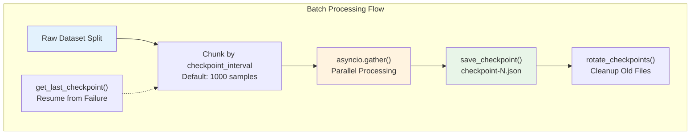

<!-- source: DeepWiki mcp.deepwiki.com · repo huggingface/dataspeech · page 4.2 LLM Swarm Generation · fetched 2026-10-26 -->

# LLM Swarm Generation

<details>
<summary>Relevant source files</summary>

The following files were used as context for generating this wiki page:

- [examples/prompt_creation_llm_swarm/nginx.template.conf](examples/prompt_creation_llm_swarm/nginx.template.conf)
- [examples/prompt_creation_llm_swarm/run_prompt_creation_10k.sh](examples/prompt_creation_llm_swarm/run_prompt_creation_10k.sh)
- [examples/prompt_creation_llm_swarm/run_prompt_creation_1k.sh](examples/prompt_creation_llm_swarm/run_prompt_creation_1k.sh)
- [examples/prompt_creation_llm_swarm/run_prompt_creation_dummy.sh](examples/prompt_creation_llm_swarm/run_prompt_creation_dummy.sh)
- [examples/prompt_creation_llm_swarm/run_prompt_creation_full_mls.sh](examples/prompt_creation_llm_swarm/run_prompt_creation_full_mls.sh)
- [examples/prompt_creation_llm_swarm/tgi_h100.template.slurm](examples/prompt_creation_llm_swarm/tgi_h100.template.slurm)
- [scripts/run_prompt_creation_llm_swarm.py](scripts/run_prompt_creation_llm_swarm.py)

</details>


## Purpose and Scope

The LLM Swarm Generation system provides a distributed, high-throughput approach for generating natural language descriptions of audio characteristics in the DataSpeech pipeline. This system serves as an alternative to the Accelerate-based generation approach (see [Accelerate-Based Generation](#4.1)) and is specifically designed for large-scale batch processing using multiple Text Generation Inference (TGI) instances with load balancing.

The system takes binned audio metadata (output from the text binning stage) and converts it into coherent natural language descriptions using distributed large language model inference. It leverages the `llm_swarm` library to orchestrate multiple TGI containers across a compute cluster, enabling parallel processing of thousands of audio samples.

## System Architecture

### Distributed Inference Architecture



Sources: [`scripts/run_prompt_creation_llm_swarm.py:389-400`](), [`examples/prompt_creation_llm_swarm/tgi_h100.template.slurm:1-53`](), [`examples/prompt_creation_llm_swarm/nginx.template.conf:1-25`]()

## Core Components

### LLMSwarm Configuration and Management

The system uses the `LLMSwarm` context manager to orchestrate distributed inference:

| Component | Purpose | Configuration |
|-----------|---------|---------------|
| `LLMSwarmConfig` | Defines swarm parameters | `instances`, `inference_engine`, `model`, `revision` |
| `slurm_template_path` | SLURM job template | `tgi_h100.template.slurm` |
| `load_balancer_template_path` | Nginx configuration | `nginx.template.conf` |
| `per_instance_max_parallel_requests` | Request throttling | Default: 500 per instance |

The core swarm setup occurs in [`scripts/run_prompt_creation_llm_swarm.py:389-400`]():

```python
with LLMSwarm(
    LLMSwarmConfig(
        instances=model_args.num_instances,
        inference_engine="tgi",
        slurm_template_path="./tgi_h100.template.slurm",
        load_balancer_template_path="./nginx.template.conf",
        model=model_args.model_name_or_path,
        revision=model_args.model_revision,
        per_instance_max_parallel_requests=model_args.per_instance_max_parallel_requests,
        debug_endpoint=model_args.debug_endpoint,
    )
) as llm_swarm:
```

### Asynchronous Processing Pipeline



Sources: [`scripts/run_prompt_creation_llm_swarm.py:408-449`](), [`scripts/run_prompt_creation_llm_swarm.py:401-402`]()

## Processing Workflow

### Prompt Template Selection and Processing

The system supports multiple prompt templates based on dataset characteristics:

| Prompt Type | Condition | Template Variable |
|-------------|-----------|-------------------|
| Single Speaker | `is_single_speaker=True` | `SINGLE_SPEAKER_PROMPT` or `NEW_SINGLE_SPEAKER_PROMPT` |
| Named Speaker | `speaker_ids_to_name` mapping exists | Uses speaker name from JSON mapping |
| With Accent | `accent_column` specified | `NEW_PROMPT_WITH_ACCENT` |
| Standard Multi-Speaker | Default case | `PROMPT` or `NEW_PROMPT` |

The prompt selection logic is implemented in [`scripts/run_prompt_creation_llm_swarm.py:408-425`]():

```python
async def process_text(sample):
    sample_prompt = PROMPT
    if is_single_speaker:
        sample_prompt = SINGLE_SPEAKER_PROMPT if not is_new_speaker_prompt else NEW_SINGLE_SPEAKER_PROMPT
        sample_prompt = sample_prompt.replace(f"[speaker_name]", speaker_name)
    elif (speaker_id_column and speaker_ids_to_name.get(str(sample.get(speaker_id_column)), None)):
        name =  speaker_ids_to_name.get(str(sample.get(speaker_id_column)), None)
        sample_prompt = SINGLE_SPEAKER_PROMPT if not is_new_speaker_prompt else NEW_SINGLE_SPEAKER_PROMPT
        sample_prompt = sample_prompt.replace(f"[speaker_name]", name)
```

### Batch Processing and Checkpointing

The system processes datasets in configurable chunks with automatic checkpointing:



Sources: [`scripts/run_prompt_creation_llm_swarm.py:520-535`](), [`scripts/run_prompt_creation_llm_swarm.py:190-233`]()

## Configuration and Templates  

### Model Arguments Configuration

| Parameter | Type | Default | Purpose |
|-----------|------|---------|---------|
| `model_name_or_path` | str | Required | HuggingFace model identifier |
| `num_instances` | int | 1 | Number of TGI instances to spawn |
| `per_instance_max_parallel_requests` | int | 500 | Request limit per TGI instance |
| `checkpoint_interval` | int | 1000 | Samples per checkpoint batch |
| `max_retries` | int | 5 | Retry attempts for failed requests |
| `temperature` | float | 0.6 | Sampling temperature |
| `max_new_tokens` | int | 256 | Generation length limit |

### Data Arguments Configuration

| Parameter | Type | Purpose |
|-----------|------|---------|
| `dataset_name` | str | Source dataset on HuggingFace Hub |
| `output_dir` | str | Local output directory |
| `save_steps` | int | Checkpoint frequency (default: 100) |
| `push_to_hub` | bool | Upload results to HuggingFace Hub |
| `hub_dataset_id` | str | Target repository for upload |
| `speaker_ids_to_name_json` | str | Speaker ID to name mapping file |

Sources: [`scripts/run_prompt_creation_llm_swarm.py:27-91`](), [`scripts/run_prompt_creation_llm_swarm.py:93-179`]()

## Infrastructure Setup

### SLURM Template Configuration

The TGI instances are deployed using SLURM with the template at [`examples/prompt_creation_llm_swarm/tgi_h100.template.slurm`]():

```bash
#!/bin/bash
#SBATCH --job-name=llm-swarm
#SBATCH --partition hopper-prod
#SBATCH --gpus={{gpus}}
#SBATCH --cpus-per-task=12
#SBATCH --mem-per-cpu=11G
```

Key template variables:
- `{{model}}` - Model identifier
- `{{revision}}` - Model revision/branch
- `{{model_max_length}}` - Maximum sequence length
- `{{slurm_hosts_path}}` - File to write instance endpoints

### Load Balancer Configuration

Nginx provides load balancing across TGI instances using [`examples/prompt_creation_llm_swarm/nginx.template.conf`]():

```nginx
upstream mytgi {
    least_conn;
    {{servers}}
}

server {
    listen {{port}};
    location / {
        proxy_pass http://mytgi;
        proxy_read_timeout 300s;
        proxy_connect_timeout 60s;
    }
}
```

Sources: [`examples/prompt_creation_llm_swarm/tgi_h100.template.slurm:1-53`](), [`examples/prompt_creation_llm_swarm/nginx.template.conf:1-25`]()

## Error Handling and Resilience

### Retry Mechanism

The system implements exponential backoff retry logic in [`scripts/run_prompt_creation_llm_swarm.py:428-448`]():

```python
attempt = 0
while attempt < model_args.max_retries:
    try:
        async with semaphore:
            return await client.text_generation(...)
    except Exception as e:
        attempt += 1
        if attempt < model_args.max_retries:
            await asyncio.sleep(model_args.retry_delay_in_s)
        else:
            raise ValueError(f"Max retries reached. Failed with error: {e}.")
```

### Checkpoint Recovery

The system supports automatic recovery from interruptions through checkpoint files:
- `save_checkpoint()` - Saves progress at regular intervals
- `get_last_checkpoint()` - Resumes from last saved state  
- `rotate_checkpoints()` - Manages checkpoint file retention

Sources: [`scripts/run_prompt_creation_llm_swarm.py:235-251`](), [`scripts/run_prompt_creation_llm_swarm.py:515-518`]()

---

