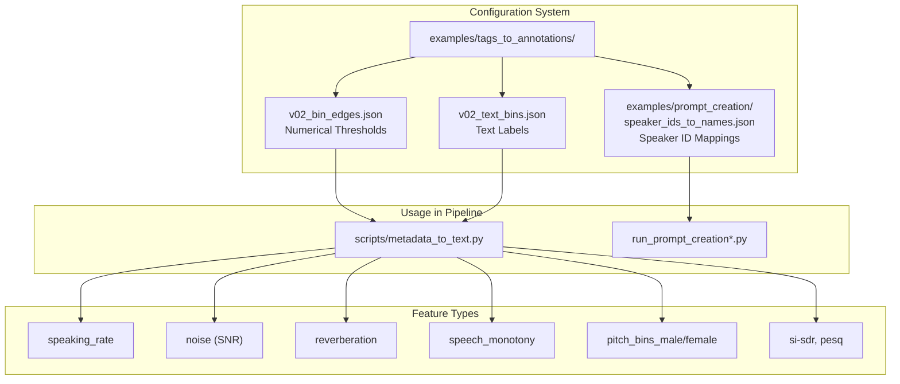
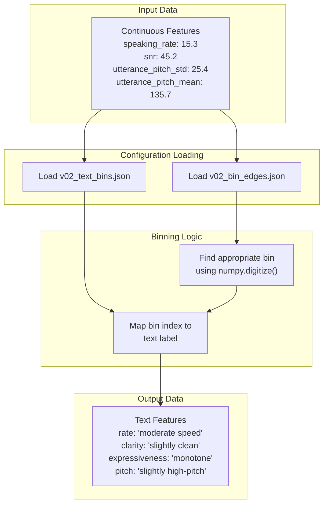
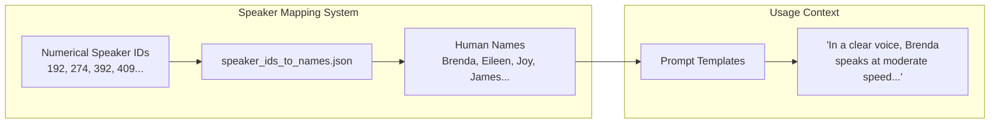
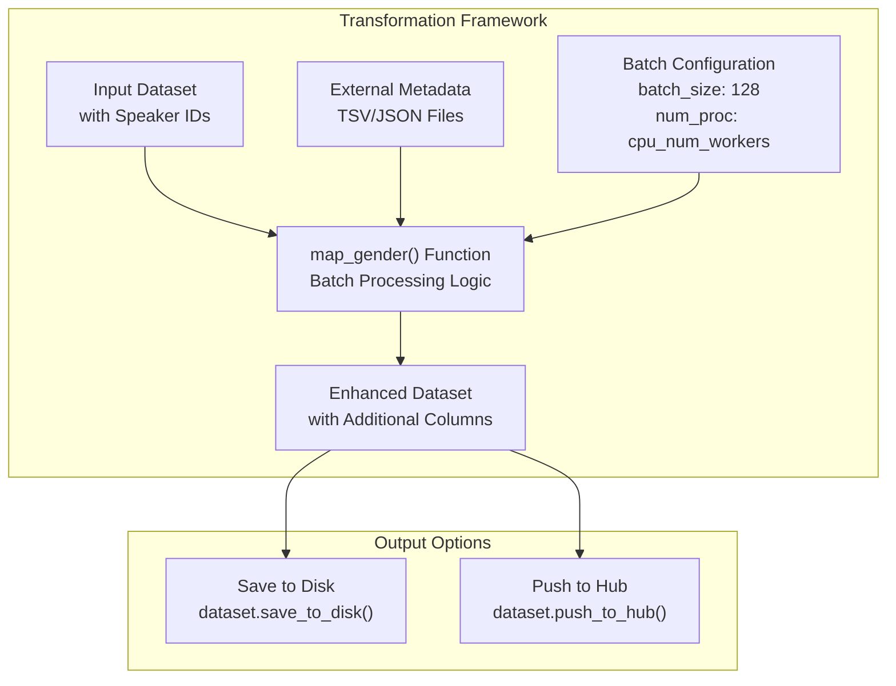

<!-- source: DeepWiki mcp.deepwiki.com · repo huggingface/dataspeech · page 5 Configuration and Data Management · fetched 2026-10-26 -->

# Configuration and Data Management

Relevant source files

The following files were used as context for generating this wiki page:

- [examples/prompt_creation/speaker_ids_to_names.json](examples/prompt_creation/speaker_ids_to_names.json)
- [examples/tags_to_annotations/v02_bin_edges.json](examples/tags_to_annotations/v02_bin_edges.json)
- [examples/tags_to_annotations/v02_text_bins.json](examples/tags_to_annotations/v02_text_bins.json)
- [scripts/per_dataset_script/add_gender_to_libritts_r.py](scripts/per_dataset_script/add_gender_to_libritts_r.py)

This document covers the configuration system and data management utilities that enable flexible, reproducible processing in the dataspeech pipeline. The configuration system primarily supports the binning and text classification stage of the processing pipeline, allowing continuous audio features to be mapped to discrete text descriptions through configurable thresholds and labels.

For information about the core processing pipeline that uses these configurations, see [Core Processing Pipeline](#2). For details about the enrichment modules that generate the continuous features, see [Audio Enrichment Modules](#3).

## Configuration Files Overview

The dataspeech system uses JSON configuration files to define how continuous audio features are transformed into discrete text bins. This configuration-driven approach enables consistent processing across different datasets and allows for easy adjustment of binning strategies.

### Configuration File Structure

Sources: [examples/tags_to_annotations/v02_bin_edges.json:1-10](), [examples/tags_to_annotations/v02_text_bins.json:1-12](), [examples/prompt_creation/speaker_ids_to_names.json:1-36]()

## Binning Configuration System

The binning system transforms continuous audio features into discrete text categories using two complementary configuration files.

### Bin Edges Configuration

The `v02_bin_edges.json` file defines numerical thresholds for each audio feature type:

| Feature Type | Thresholds | Purpose |
|--------------|------------|---------|
| `speaking_rate` | 7 thresholds (0.0 to 26.78) | Maps words per second to speed categories |
| `noise` | 7 thresholds (17.13 to 75.04) | Maps SNR values to clarity levels |
| `reverberation` | 5 thresholds (10 to 60) | Maps C50 values to distance perception |
| `speech_monotony` | 5 thresholds (0.0 to 142.65) | Maps pitch standard deviation to expressiveness |
| `pitch_bins_male` | 7 thresholds (64.65 to 183.75 Hz) | Gender-specific pitch categorization |
| `pitch_bins_female` | 7 thresholds (120.18 to 270.30 Hz) | Gender-specific pitch categorization |
| `si-sdr` | 6 thresholds (-17.80 to 34.39) | Maps signal-to-distortion ratio |
| `pesq` | 6 thresholds (1.0 to 4.50) | Maps perceptual quality scores |

### Text Bins Configuration

The `v02_text_bins.json` file provides human-readable labels corresponding to each bin:

| Feature Category | Text Labels |
|------------------|-------------|
| `speaker_rate_bins` | "very slowly", "slowly", "slightly slowly", "moderate speed", "slightly fast", "fast", "very fast" |
| `snr_bins` | "very noisy", "noisy", "slightly noisy", "balanced in clarity", "slightly clean", "clean", "very clean" |
| `reverberation_bins` | "very distant-sounding", "distant-sounding", "slightly distant-sounding", "slightly close-sounding", "very close-sounding" |
| `utterance_level_std` | "very monotone", "monotone", "slightly expressive and animated", "expressive and animated", "very expressive and animated" |
| `speaker_level_pitch_bins` | "very low-pitch", "low-pitch", "slightly low-pitch", "moderate pitch", "slightly high-pitch", "high-pitch", "very high-pitch" |

### Binning Process Flow

Sources: [examples/tags_to_annotations/v02_bin_edges.json:2-9](), [examples/tags_to_annotations/v02_text_bins.json:2-11]()

## Speaker Metadata Management

The system includes utilities for managing speaker-specific metadata, enabling personalized natural language descriptions.

### Speaker ID to Name Mapping

The `speaker_ids_to_names.json` file maps numerical speaker IDs to human-readable names for use in prompt generation:

The mapping covers 35 speakers from the LibriTTS-R dataset, providing names like "Brenda" (ID 192), "James" (ID 409), and "Emily" (ID 887).

Sources: [examples/prompt_creation/speaker_ids_to_names.json:2-35]()

### Gender Metadata Addition

The system includes utilities for adding gender metadata to datasets. The `add_gender_to_libritts_r.py` script demonstrates this pattern:

| Parameter | Purpose | Default |
|-----------|---------|---------|
| `dataset_name` | HuggingFace dataset identifier or local path | Required |
| `tsv_path` | Path to TSV file containing speaker gender information | Required |
| `speaker_id_column_name` | Column name containing speaker IDs | "speaker_id" |
| `cpu_num_workers` | Number of workers for parallel processing | 1 |

The script implements a `map_gender()` function that:
1. Loads speaker metadata from a TSV file
2. Maps "M"/"F" gender codes to "male"/"female" text labels
3. Applies the mapping across the dataset in batches

Sources: [scripts/per_dataset_script/add_gender_to_libritts_r.py:31-35]()

## Data Transformation Utilities

The configuration system supports various data transformation patterns used throughout the pipeline.

### Batch Processing Pattern

### Configuration-Driven Processing

The system follows a consistent pattern where processing parameters are externalized into configuration files, enabling:

- **Reproducibility**: Same configurations produce identical results
- **Flexibility**: Easy adjustment of binning strategies without code changes  
- **Consistency**: Uniform processing across different datasets
- **Maintainability**: Centralized configuration management

Sources: [scripts/per_dataset_script/add_gender_to_libritts_r.py:22-44]()

## Integration with Pipeline Stages

The configuration system integrates with multiple stages of the dataspeech pipeline:

### Stage 2: Metadata to Text Conversion

The binning configurations are primarily consumed by `scripts/metadata_to_text.py`, which:
1. Loads both `v02_bin_edges.json` and `v02_text_bins.json`
2. Applies binning logic to continuous features
3. Generates text classifications for each audio characteristic

### Stage 3: Prompt Generation

Speaker mappings and other metadata configurations are used by prompt generation scripts:
- `run_prompt_creation.py` (Accelerate-based approach)
- `run_prompt_creation_llm_swarm.py` (LLM Swarm approach)

These scripts use speaker name mappings to create personalized natural language descriptions.

Sources: [examples/tags_to_annotations/v02_bin_edges.json:1-10](), [examples/tags_to_annotations/v02_text_bins.json:1-12](), [examples/prompt_creation/speaker_ids_to_names.json:1-36]()

---

