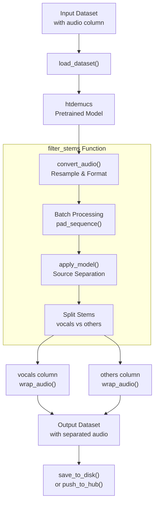
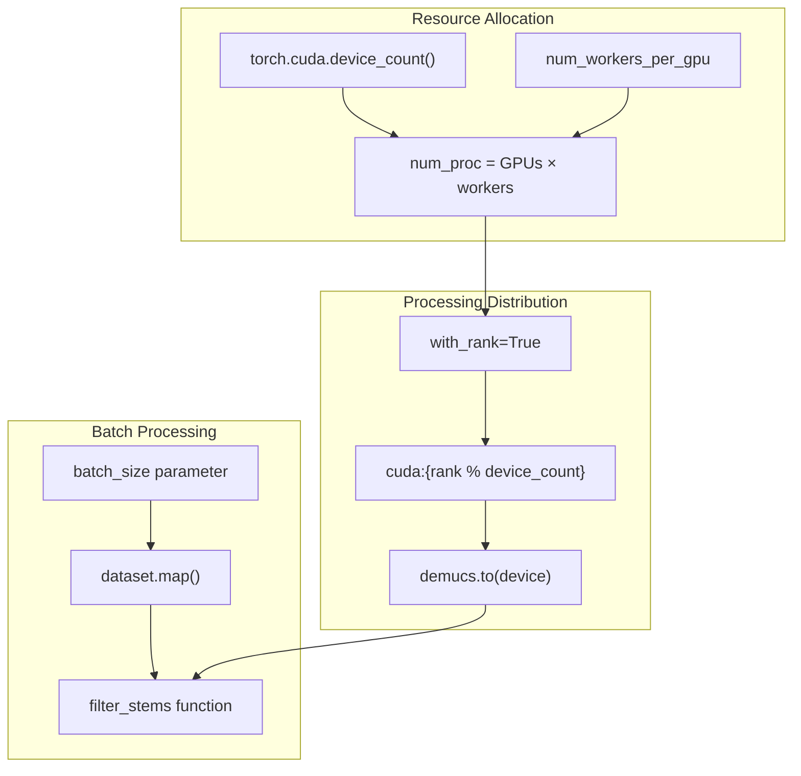
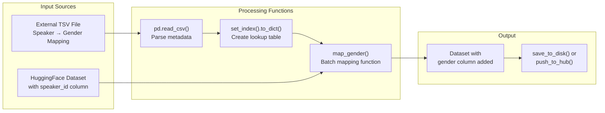
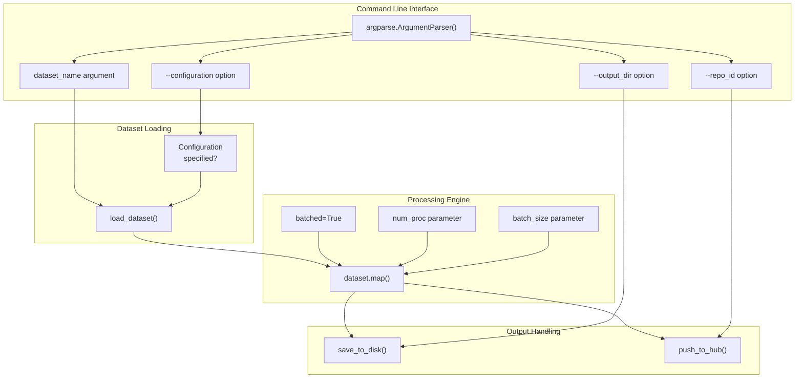

<!-- source: DeepWiki mcp.deepwiki.com · repo huggingface/dataspeech · page 6 Dataset Processing and Filtering · fetched 2026-10-26 -->

# Dataset Processing and Filtering

<details>
<summary>Relevant source files</summary>

The following files were used as context for generating this wiki page:

- [scripts/filter_audio_separation.py](scripts/filter_audio_separation.py)
- [scripts/per_dataset_script/add_gender_to_MLS.py](scripts/per_dataset_script/add_gender_to_MLS.py)
- [scripts/per_dataset_script/add_gender_to_libritts_r.py](scripts/per_dataset_script/add_gender_to_libritts_r.py)

</details>


This page covers specialized dataset processing and filtering tools that complement the main data-speech pipeline. These tools handle specific dataset transformations including audio source separation, metadata enrichment, and quality filtering operations. Unlike the core three-stage pipeline covered in [Core Processing Pipeline](#2), these utilities perform targeted preprocessing tasks on datasets before or alongside the main enrichment process.

For information about the main feature extraction pipeline, see [Core Processing Pipeline](#2). For configuration management and data transformation utilities, see [Configuration and Data Management](#5).

## Audio Source Separation

The audio source separation system uses the Demucs model to separate audio tracks into vocal and non-vocal components. This preprocessing step enables downstream analysis of speech characteristics independent of background music or noise.

### Architecture Overview



### Processing Implementation

The `filter_stems` function in [scripts/filter_audio_separation.py:23-51]() handles the core separation logic:

| Processing Step | Implementation | Purpose |
|-----------------|----------------|---------|
| Audio Conversion | `convert_audio()` with `demucs.samplerate` | Standardize sample rate and channels |
| Batch Padding | `torch.nn.utils.rnn.pad_sequence()` | Enable batch processing of variable-length audio |
| Source Separation | `apply_model(demucs, wavs)` | Extract individual audio sources |
| Stem Extraction | Index-based splitting `stems[0,-1]` | Separate vocals from other instruments |

The function supports both single audio samples and batched processing [scripts/filter_audio_separation.py:30-40](), with automatic GPU device assignment based on worker rank [scripts/filter_audio_separation.py:24-28]().

### GPU Resource Management



Sources: [scripts/filter_audio_separation.py:1-96]()

## Gender Metadata Addition

The gender metadata addition system enriches datasets with speaker gender information by mapping speaker IDs to gender labels using external metadata files.

### Dataset-Specific Implementations

Two specialized scripts handle different dataset formats:

| Dataset | Script | TSV Format | Separator | Speaker Column | Gender Column |
|---------|--------|------------|-----------|----------------|---------------|
| MLS | `add_gender_to_MLS.py` | Pipe-separated | `\|` | ` SPEAKER   ` | `   GENDER   ` |
| LibriTTS-R | `add_gender_to_libritts_r.py` | Tab-separated | `\t` | `READER` | `READER` |

### Processing Workflow



### Gender Mapping Logic

The `map_gender` function implements the core mapping logic [scripts/per_dataset_script/add_gender_to_MLS.py:35-37]():

```python
def map_gender(speaker_ids):
    genders = [speaker_dataset[int(speaker)].strip() for speaker in speaker_ids]
    return {"gender": ["male" if g=="M" else "female" for g in genders]}
```

This function:
- Converts speaker IDs to integers for lookup
- Maps gender codes (`M`/`F`) to full names (`male`/`female`)
- Processes batches of speaker IDs efficiently
- Returns a dictionary compatible with HuggingFace Datasets

Sources: [scripts/per_dataset_script/add_gender_to_MLS.py:1-50](), [scripts/per_dataset_script/add_gender_to_libritts_r.py:1-46]()

## Processing Patterns and Architecture

### Common Processing Framework

All dataset processing tools follow a consistent architectural pattern:



### Multiprocessing Configuration

All scripts use `set_start_method("spawn")` for cross-platform multiprocessing compatibility [scripts/filter_audio_separation.py:54](), [scripts/per_dataset_script/add_gender_to_MLS.py:8]().

### Parameter Patterns

| Parameter Category | Common Arguments | Purpose |
|-------------------|------------------|---------|
| Input | `dataset_name`, `--configuration` | Dataset identification |
| Processing | `--batch_size`, `--cpu_num_workers` | Performance tuning |
| Output | `--output_dir`, `--repo_id` | Result destination |
| Domain-specific | `--audio_column_name`, `--speaker_id_column_name` | Column targeting |

Sources: [scripts/filter_audio_separation.py:53-94](), [scripts/per_dataset_script/add_gender_to_MLS.py:7-49](), [scripts/per_dataset_script/add_gender_to_libritts_r.py:7-45]()

## Usage Examples

### Audio Separation Processing

```bash
python scripts/filter_audio_separation.py \
    "parler-tts/libritts-r-tags-and-text-generated" \
    --batch_size 16 \
    --num_workers_per_gpu 2 \
    --repo_id "output-repo/separated-audio"
```

### Gender Metadata Addition

```bash
python scripts/per_dataset_script/add_gender_to_MLS.py \
    "parler-tts/mls_eng" \
    "speakers.tsv" \
    --configuration "train" \
    --cpu_num_workers 4 \
    --repo_id "output-repo/mls-with-gender"
```

These tools integrate seamlessly with the main data-speech pipeline by preparing datasets with the appropriate metadata and audio separation required for downstream processing stages.

Sources: [scripts/filter_audio_separation.py:56-94](), [scripts/per_dataset_script/add_gender_to_MLS.py:9-49]()

---

