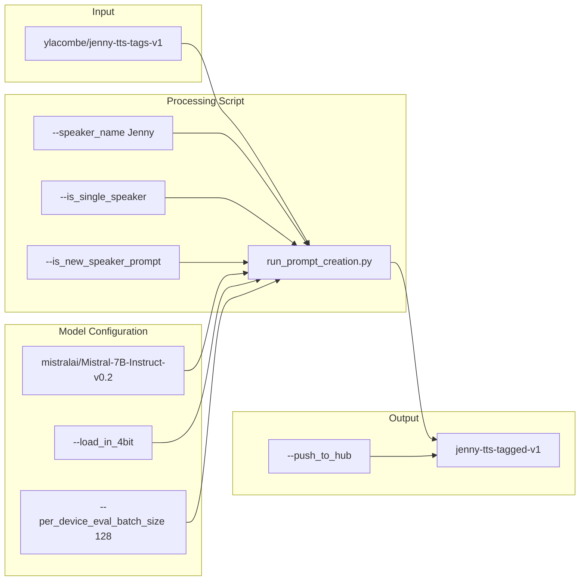
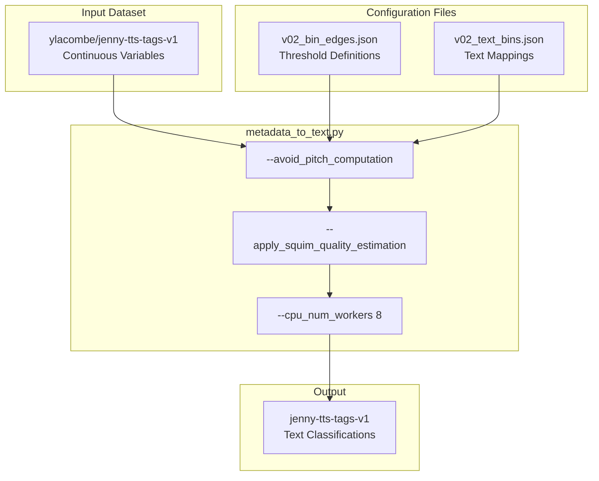
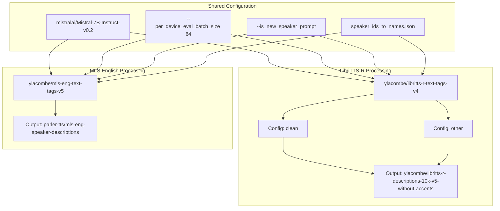
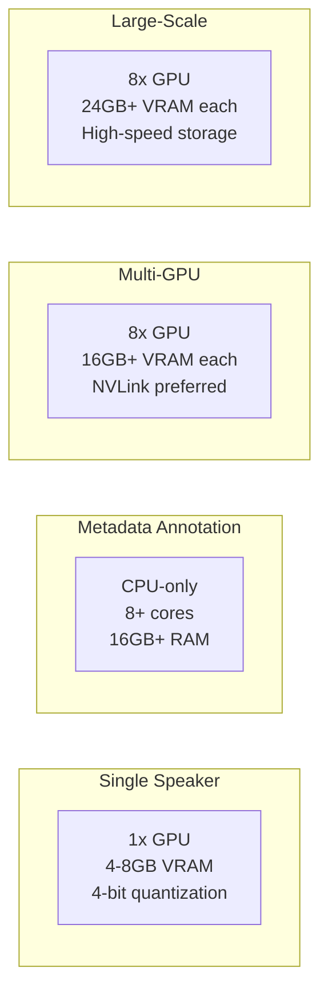

<!-- source: DeepWiki mcp.deepwiki.com · repo huggingface/dataspeech · page 7 Examples and Usage Patterns · fetched 2026-10-26 -->

# Examples and Usage Patterns

Relevant source files

The following files were used as context for generating this wiki page:

- [examples/prompt_creation/run_prompt_creation_1k_with_speaker_consistency.sh](examples/prompt_creation/run_prompt_creation_1k_with_speaker_consistency.sh)
- [examples/prompt_creation/run_prompt_creation_45k.sh](examples/prompt_creation/run_prompt_creation_45k.sh)
- [examples/prompt_creation/run_prompt_creation_jenny.sh](examples/prompt_creation/run_prompt_creation_jenny.sh)
- [examples/tags_to_annotations/run_metadata_to_text_for_finetuning.sh](examples/tags_to_annotations/run_metadata_to_text_for_finetuning.sh)

This document provides comprehensive examples of common usage patterns for the dataspeech toolkit, demonstrating how to apply the three-stage processing pipeline to real-world audio datasets. The examples cover single dataset processing, multi-GPU distributed operations, and large-scale batch processing workflows.

For detailed information about the underlying processing pipeline stages, see [Core Processing Pipeline](#2). For configuration file management, see [Configuration and Data Management](#5).

## Usage Pattern Categories

The dataspeech toolkit supports four primary usage patterns, each optimized for different scale and resource requirements:

| Pattern | Scale | Resource Requirements | Primary Use Case |
|---------|-------|----------------------|------------------|
| Single Speaker Processing | 1-10K samples | Single GPU | Fine-tuning datasets, speaker-specific models |
| Metadata Annotation | 10K-100K samples | CPU-focused | Text classification, binning operations |
| Multi-GPU Distributed | 10K-50K samples | Multi-GPU cluster | Production pipelines, balanced datasets |
| Large-Scale Batch | 100K+ samples | Multi-GPU + storage | Research datasets, comprehensive processing |

## Single Speaker Processing Pattern

Single speaker processing focuses on generating high-quality descriptions for datasets with consistent speaker characteristics. This pattern is commonly used for fine-tuning TTS models on specific voices.

### Jenny TTS Single Speaker Example

The most straightforward usage pattern processes a single-speaker dataset end-to-end:

**Key Configuration Parameters:**
- `--is_single_speaker`: Enables single-speaker prompt templates
- `--is_new_speaker_prompt`: Uses updated prompt format for better quality
- `--load_in_4bit`: Reduces memory usage for consumer GPUs
- `--attn_implementation "sdpa"`: Optimizes attention computation

Sources: [examples/prompt_creation/run_prompt_creation_jenny.sh:1-17]()

## Metadata to Text Annotation Pattern

This pattern converts continuous audio features into discrete text classifications, serving as the bridge between feature extraction and natural language generation.

### Binning Configuration Workflow

**Processing Parameters:**
- `--avoid_pitch_computation`: Skips pitch analysis when already available
- `--apply_squim_quality_estimation`: Adds SQUIM quality metrics
- `--cpu_num_workers`: Controls parallel processing threads

Sources: [examples/tags_to_annotations/run_metadata_to_text_for_finetuning.sh:1-13]()

## Multi-GPU Distributed Processing Pattern

For production-scale datasets, the toolkit supports distributed processing across multiple GPUs using the Accelerate framework.

### Accelerate-Based Distribution

**Key Distribution Features:**
- `--multi_gpu`: Enables distributed processing
- `--mixed_precision=fp16`: Reduces memory usage and increases speed  
- `--num_processes=8`: Distributes work across 8 GPU processes
- Separate processing for `clean` and `other` dataset configurations

Sources: [examples/prompt_creation/run_prompt_creation_1k_with_speaker_consistency.sh:1-31]()

## Large-Scale Batch Processing Pattern

The most comprehensive usage pattern processes multiple large datasets sequentially, optimized for research and production environments.

### Multi-Dataset Sequential Processing

**Processing Sequence:**
1. LibriTTS-R clean configuration (high-quality samples)
2. LibriTTS-R other configuration (diverse quality samples)  
3. MLS English dataset (multilingual speakers)

**Optimization Parameters:**
- Consistent batch size across datasets for memory efficiency
- Shared speaker name mapping for consistency
- Hub upload for each completed dataset

Sources: [examples/prompt_creation/run_prompt_creation_45k.sh:1-43]()

## Configuration Pattern Matrix

The following table summarizes the key configuration patterns across different usage scenarios:

| Parameter | Single Speaker | Metadata Annotation | Multi-GPU | Large-Scale |
|-----------|----------------|---------------------|-----------|-------------|
| `batch_size` | 128 | N/A | 64 | 64 |
| `num_workers` | 8-24 | 8 | 4 | 4 |
| `precision` | Default | N/A | fp16 | fp16 |
| `memory_opt` | 4bit | N/A | Standard | Standard |
| `speaker_handling` | Single | N/A | Multi | Multi |
| `output_strategy` | Direct hub | Local | Hub | Sequential hub |

## Resource Requirements by Pattern

### Memory and Compute Requirements

### Performance Characteristics

| Pattern | Throughput | Latency | Resource Efficiency | Scalability |
|---------|------------|---------|-------------------|-------------|
| Single Speaker | Low | Low | High | Limited |
| Metadata Annotation | High | Very Low | Very High | High |
| Multi-GPU | High | Medium | Medium | High |
| Large-Scale | Very High | High | Medium | Very High |

## Common Parameter Combinations

### Quality-Focused Configuration
For maximum output quality with slower processing:
- `per_device_eval_batch_size`: 32-64
- `load_in_4bit`: False
- `attn_implementation`: "sdpa"
- `is_new_speaker_prompt`: True

### Speed-Focused Configuration  
For maximum throughput with acceptable quality:
- `per_device_eval_batch_size`: 128-256
- `load_in_4bit`: True
- `mixed_precision`: "fp16"
- `dataloader_num_workers`: 8+

### Memory-Constrained Configuration
For limited VRAM environments:
- `per_device_eval_batch_size`: 16-32
- `load_in_4bit`: True
- `gradient_checkpointing`: True

Sources: [examples/prompt_creation/run_prompt_creation_jenny.sh:1-17](), [examples/prompt_creation/run_prompt_creation_1k_with_speaker_consistency.sh:1-31](), [examples/prompt_creation/run_prompt_creation_45k.sh:1-43]()

---

