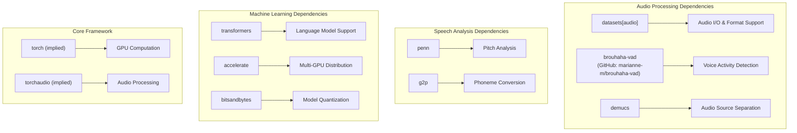
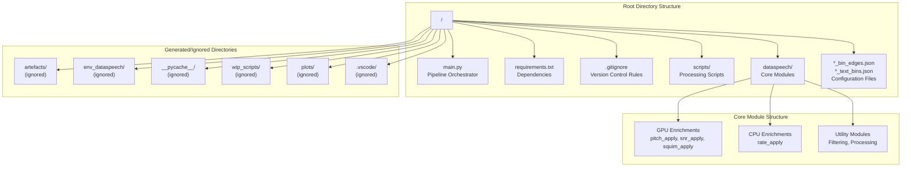
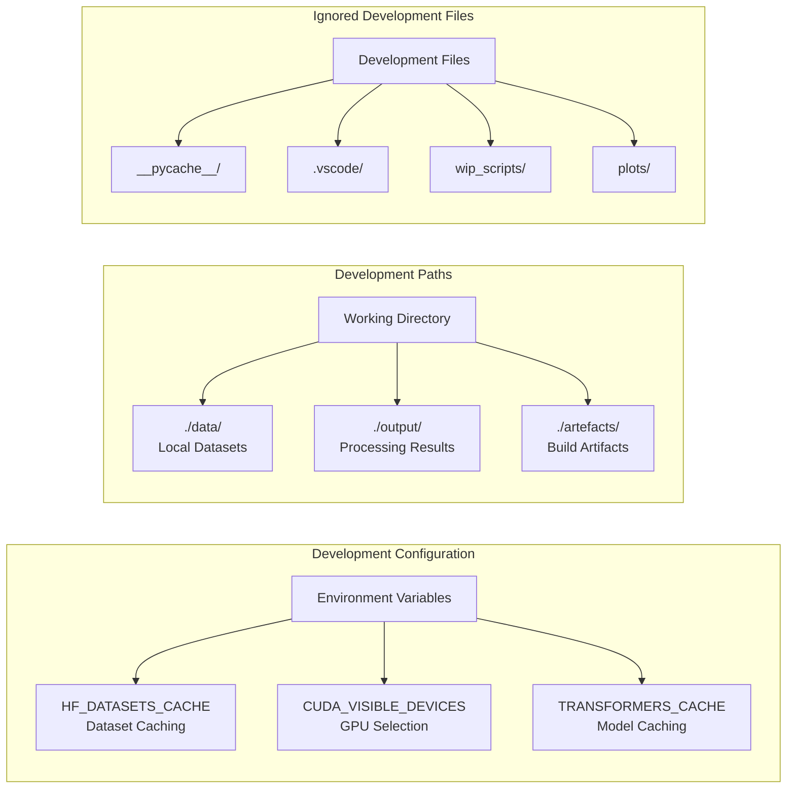
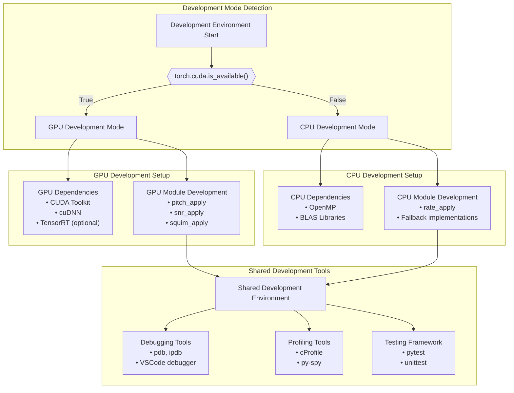
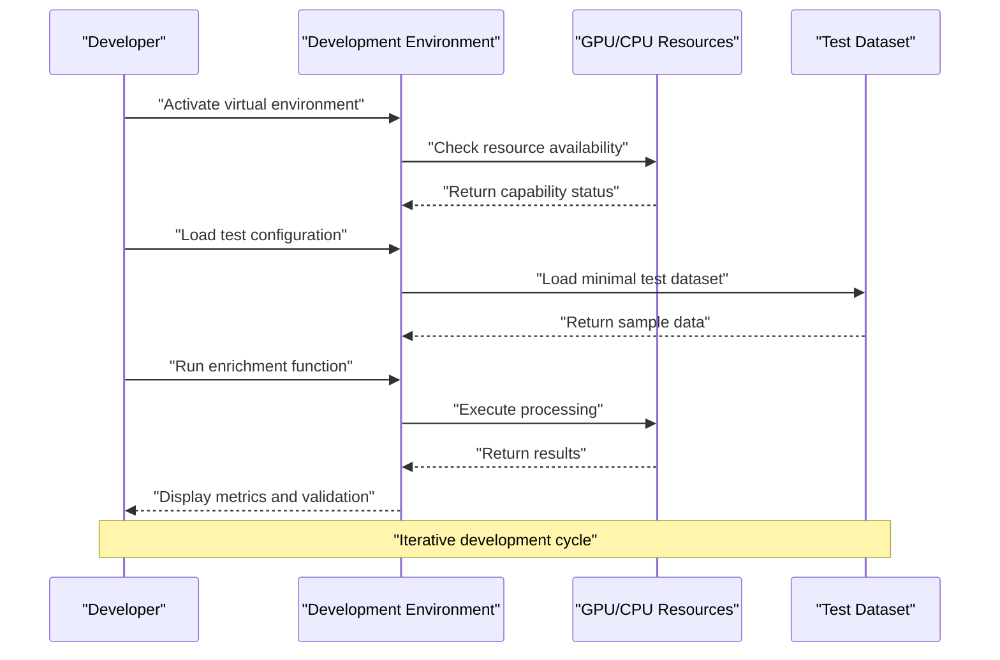

<!-- source: DeepWiki mcp.deepwiki.com · repo huggingface/dataspeech · page 8 Development and Environment Setup · fetched 2026-10-26 -->

# Development and Environment Setup

<details>
<summary>Relevant source files</summary>

The following files were used as context for generating this wiki page:

- [.gitignore](.gitignore)
- [requirements.txt](requirements.txt)

</details>


## Purpose and Scope

This page covers the technical setup required for developing and contributing to the dataspeech codebase. It includes dependency management, environment configuration, project structure understanding, and development workflows. For information about running the processing pipeline, see [Core Processing Pipeline](#2). For configuration of specific processing modules, see [Configuration and Data Management](#5).

## Prerequisites and System Requirements

The dataspeech repository requires specific system capabilities depending on the intended usage:

### Hardware Requirements

| Component | Minimum | Recommended | Purpose |
|-----------|---------|-------------|---------|
| RAM | 8GB | 16GB+ | Dataset loading and processing |
| GPU Memory | N/A (CPU only) | 8GB+ VRAM | GPU-accelerated enrichments |
| Storage | 50GB | 200GB+ | Dataset caching and artifacts |
| CPU | 4 cores | 8+ cores | Parallel processing |

### Software Prerequisites

- Python 3.8+
- CUDA 11.8+ (for GPU acceleration)
- Git (for repository management)
- Optional: Docker (for containerized development)

## Installation and Dependencies

### Core Dependencies Structure



Sources: [requirements.txt:1-8]()

### Installation Process

1. **Environment Creation**
```bash
python -m venv env_dataspeech
source env_dataspeech/bin/activate  # Linux/Mac
# env_dataspeech\Scripts\activate  # Windows
```

2. **Dependency Installation**
```bash
pip install -r requirements.txt
```

3. **GPU Setup Verification**
```python
import torch
print(f"CUDA available: {torch.cuda.is_available()}")
print(f"GPU count: {torch.cuda.device_count()}")
```

## Project Structure and Code Organization

### Development File Structure



Sources: [.gitignore:1-6]()

### Code Entity Mapping

The development environment interacts with these key code entities:

| Directory/File | Primary Classes/Functions | Development Purpose |
|----------------|---------------------------|-------------------|
| `main.py` | Pipeline orchestration functions | Entry point debugging |
| `dataspeech/` | `*_apply` functions | Module development |
| `scripts/` | Processing scripts | Workflow automation |
| `*.json` | Configuration dictionaries | Parameter tuning |

## Development Environment Configuration

### Environment Variables and Paths



Sources: [.gitignore:1-6]()

### GPU vs CPU Development Setup

The development environment must accommodate both GPU and CPU execution modes:



## Development Workflow

### Common Development Tasks

1. **Module Development**
   - Implement new enrichment functions in `dataspeech/`
   - Follow the `*_apply` naming convention
   - Ensure GPU/CPU compatibility

2. **Script Development**
   - Create processing scripts in `scripts/`
   - Use existing scripts as templates
   - Handle configuration management

3. **Configuration Updates**
   - Modify bin edge definitions
   - Update text classification mappings
   - Validate configuration consistency

### Development Testing Pattern



### Debugging and Development Utilities

The development environment provides several debugging capabilities:

| Tool | Purpose | Usage Context |
|------|---------|---------------|
| `pdb.set_trace()` | Interactive debugging | Function-level debugging |
| VSCode debugger | Visual debugging | IDE-integrated development |
| `torch.profiler` | GPU performance profiling | Optimization work |
| Dataset sampling | Quick testing | Module validation |

Sources: [requirements.txt:1-8](), [.gitignore:1-6]()

## Development Best Practices

### Code Organization
- Follow the modular enrichment pattern
- Implement both GPU and CPU code paths
- Use configuration files for parameters
- Handle resource constraints gracefully

### Environment Management
- Use virtual environments consistently
- Pin dependency versions for reproducibility
- Test across GPU and CPU configurations
- Monitor resource usage during development

### Version Control
- Respect `.gitignore` patterns for development artifacts
- Keep work-in-progress scripts in `wip_scripts/`
- Commit configuration changes separately from code changes

This development setup supports the full dataspeech processing pipeline while providing the flexibility needed for research and development work.