# Page: Overview

# Overview

<details>
<summary>Relevant source files</summary>

The following files were used as context for generating this wiki page:

- [README.md](README.md)
- [examples/tagging/run_main_1k.sh](examples/tagging/run_main_1k.sh)
- [requirements.txt](requirements.txt)

</details>


Data-Speech is a comprehensive suite of utility scripts designed for automated annotation and tagging of speech datasets. The system transforms raw audio datasets into richly annotated datasets with natural language descriptions of speech characteristics, enabling advanced conditioning for text-to-speech models and dataset filtering applications.

This document provides an architectural overview of the Data-Speech system and its core processing pipeline. For detailed information about specific components, see [Core Processing Pipeline](#2), [Audio Enrichment Modules](#3), and [Prompt Generation Systems](#4).

## Purpose and Architecture

Data-Speech implements a three-stage pipeline that converts raw audio datasets into annotated datasets with natural language descriptions:

1. **Feature Extraction**: Extract continuous audio characteristics (pitch, SNR, speaking rate, quality metrics)
2. **Text Binning**: Map continuous variables to discrete categorical text bins using statistical distributions
3. **Natural Language Generation**: Convert text bins into coherent natural language descriptions using LLMs

## System Architecture Overview

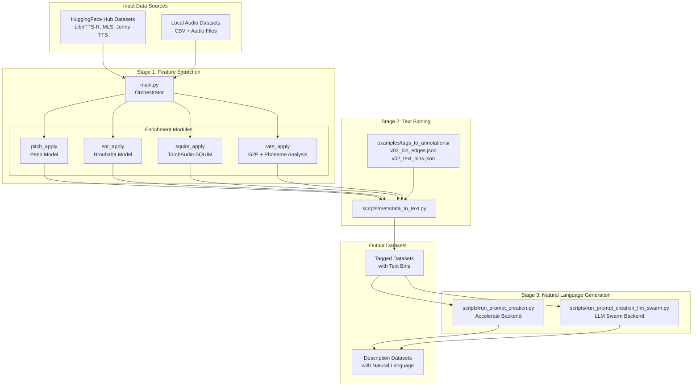

**Sources:** [README.md:1-50](), [README.md:144-152](), [README.md:233-240]()

## Core Pipeline Components

The system consists of modular components that can be executed independently or as part of the complete pipeline:

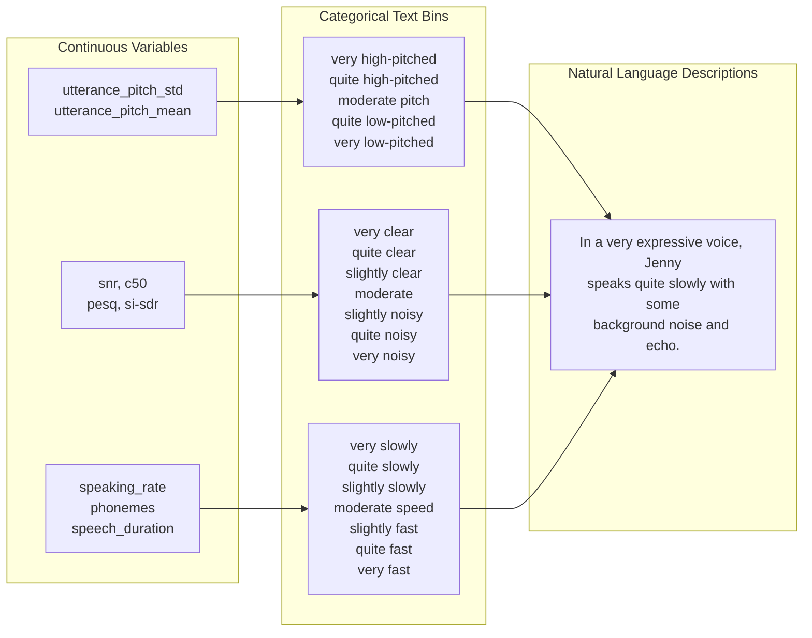

**Sources:** [README.md:183-192](), [README.md:198-202](), [README.md:103-104]()

## Key Features and Capabilities

| Feature Category | Components | Description |
|------------------|------------|-------------|
| **Audio Analysis** | `pitch_apply`, `snr_apply`, `squim_apply`, `rate_apply` | Extract pitch statistics, SNR, reverberation, quality metrics, speaking rate |
| **Statistical Binning** | `scripts/metadata_to_text.py` | Map continuous variables to discrete bins using histogram analysis |
| **LLM Integration** | `scripts/run_prompt_creation.py`, `scripts/run_prompt_creation_llm_swarm.py` | Generate natural language descriptions using Accelerate or TGI backends |
| **GPU Acceleration** | Multi-GPU support in `main.py` | Automatically scale processing across available GPUs |
| **Hub Integration** | Dataset upload/download via `datasets` library | Seamless integration with HuggingFace Hub |
| **Configuration Management** | JSON configuration files | Reproducible binning with pre-computed statistical thresholds |

**Sources:** [README.md:54-59](), [README.md:156-170](), [README.md:233-302]()

## Data Flow and Processing Model

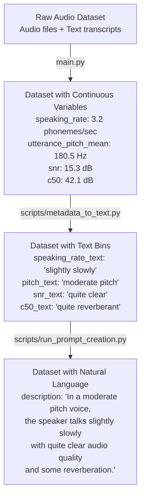

**Sources:** [README.md:47-50](), [README.md:196-202](), [README.md:228-232]()

The Data-Speech system is designed for scalability and modularity, supporting both small-scale experimentation and large-scale dataset processing. Each stage can be run independently, enabling flexible workflows for different use cases ranging from dataset filtering to comprehensive annotation for TTS model training.

---

# Page: Core Processing Pipeline

# Core Processing Pipeline

<details>
<summary>Relevant source files</summary>

The following files were used as context for generating this wiki page:

- [README.md](README.md)
- [examples/tagging/run_main_1k.sh](examples/tagging/run_main_1k.sh)
- [main.py](main.py)
- [scripts/metadata_to_text.py](scripts/metadata_to_text.py)

</details>


This document explains the three-stage core processing pipeline that transforms raw audio datasets into annotated datasets with natural language descriptions. The pipeline consists of continuous variable extraction, text binning, and natural language description generation.

For information about the individual audio enrichment modules, see [Audio Enrichment Modules](#3). For details about the prompt generation backends, see [Prompt Generation Systems](#4).

## Pipeline Overview

The dataspeech pipeline operates in three sequential stages that progressively transform audio data from raw measurements to human-readable descriptions:

**Pipeline Flow Diagram**
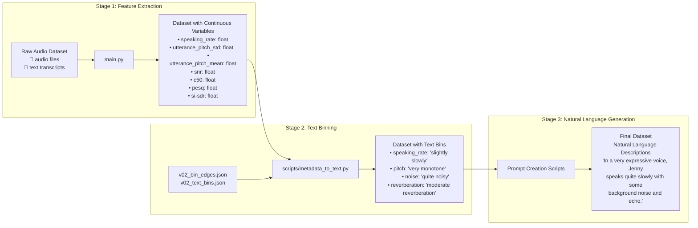

Sources: [main.py:1-114](), [scripts/metadata_to_text.py:1-309](), [README.md:144-152]()

## Stage 1: Feature Extraction

The first stage extracts continuous numerical features from audio files using `main.py` as the orchestrator. This script coordinates multiple enrichment modules to compute acoustic properties.

**Feature Extraction Architecture**
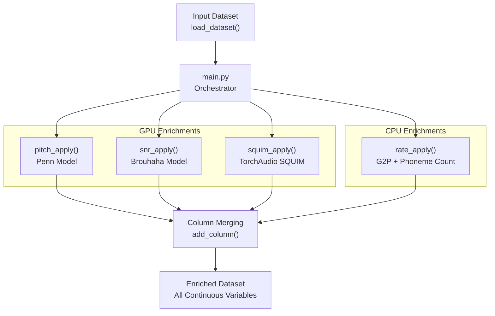

Sources: [main.py:43-103](), [main.py:55-64](), [main.py:66-75](), [main.py:77-94]()

### Key Features Extracted

| Feature | Column Name | Description | Enrichment Module |
|---------|-------------|-------------|-------------------|
| Pitch Statistics | `utterance_pitch_mean`, `utterance_pitch_std` | Mean and standard deviation of fundamental frequency | `pitch_apply` |
| Audio Quality | `snr`, `c50` | Signal-to-noise ratio and reverberation measurement | `snr_apply` |
| Speech Quality | `pesq`, `si-sdr` | Perceptual quality and signal distortion metrics | `squim_apply` |
| Speaking Rate | `speaking_rate`, `phonemes` | Phonemes per second and phoneme transcription | `rate_apply` |

The extraction process uses automatic GPU detection and scales across available hardware. GPU-accelerated modules (`pitch_apply`, `snr_apply`, `squim_apply`) distribute work across all available GPUs, while CPU-intensive operations like phoneme conversion use configurable worker processes.

Sources: [main.py:49-64](), [main.py:66-75](), [main.py:43-53](), [main.py:77-94]()

## Stage 2: Text Binning

The second stage converts continuous numerical features into discrete text categories using `scripts/metadata_to_text.py`. This script applies statistical binning to transform measurements into human-interpretable labels.

**Text Binning Process**
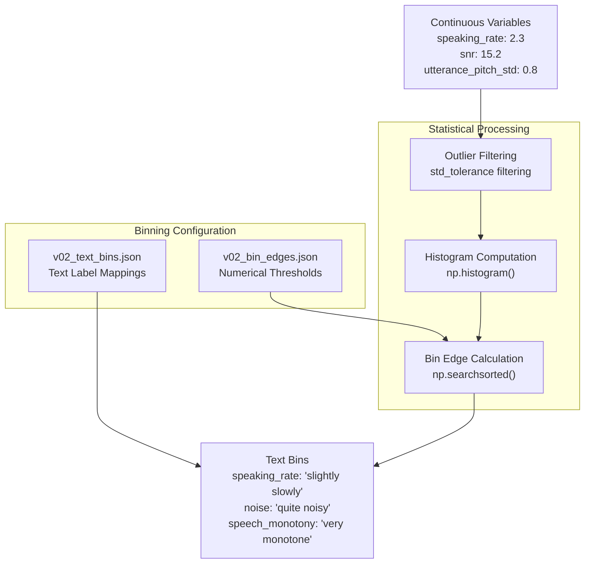

Sources: [scripts/metadata_to_text.py:56-100](), [scripts/metadata_to_text.py:11-19](), [scripts/metadata_to_text.py:196-214]()

### Binning Categories

The system supports several predefined text bin categories with configurable labels:

| Feature | Text Bins | Example Labels |
|---------|-----------|----------------|
| Speaking Rate | 7 bins | `"very slowly"`, `"quite slowly"`, `"moderate speed"`, `"very fast"` |
| Noise Level | 7 bins | `"very noisy"`, `"quite noisy"`, `"moderate ambient sound"`, `"very clear"` |
| Reverberation | 7 bins | `"very roomy sounding"`, `"moderate reverberation"`, `"very confined sounding"` |
| Speech Monotony | 7 bins | `"very monotone"`, `"moderate intonation"`, `"very expressive"` |
| Pitch (Speaker-level) | 7 bins | `"very low pitch"`, `"moderate pitch"`, `"very high pitch"` |

The binning process includes outlier filtering using configurable standard deviation tolerance parameters to ensure robust bin boundaries. For speaker-level features like pitch, the system computes gender-relative bins using the `speaker_level_relative_to_gender()` function.

Sources: [scripts/metadata_to_text.py:11-19](), [scripts/metadata_to_text.py:102-156](), [scripts/metadata_to_text.py:175-179]()

## Stage 3: Natural Language Description Generation

The final stage combines text bins into coherent natural language descriptions using large language models. The system supports two generation backends with different infrastructure requirements.

**Description Generation Architecture**
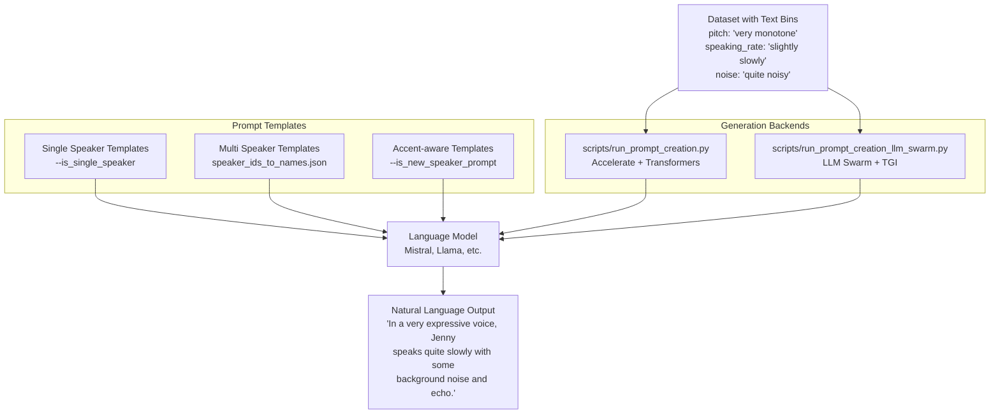

Sources: [README.md:232-238](), [README.md:276-285](), [README.md:131-136]()

### Generation Configuration

The natural language generation supports several prompt template configurations:

- **Single Speaker Mode**: Uses `--is_single_speaker` flag with `--speaker_name` for consistent speaker references
- **Multi Speaker Mode**: Maps speaker IDs to names using `--speaker_ids_to_name_json` configuration
- **Anonymous Mode**: Generates descriptions without specific speaker names
- **Accent-aware Mode**: Uses `--is_new_speaker_prompt` for improved accent and characteristic description

The system transforms discrete text bins into fluent descriptions by providing structured prompts to instruction-tuned language models. Common models include `mistralai/Mistral-7B-Instruct-v0.2` and `meta-llama/Meta-Llama-3-8B-Instruct`.

Sources: [README.md:112-126](), [README.md:248-261](), [README.md:289-298]()

## Pipeline Integration

The three stages integrate through standardized dataset transformations where each stage reads from and writes to HuggingFace datasets format. The pipeline supports:

- **Distributed Processing**: Automatic GPU detection and multi-GPU scaling
- **Resumable Execution**: Each stage can run independently with intermediate dataset storage
- **Configurable Binning**: Pre-computed bin edges allow consistent labeling across datasets
- **Batch Processing**: Configurable batch sizes and worker counts for performance optimization

The complete pipeline transforms raw audio into rich annotations suitable for training text-to-speech models, with the flexibility to run individual stages for specific use cases like dataset filtering or quality assessment.

Sources: [main.py:96-113](), [scripts/metadata_to_text.py:300-309](), [README.md:304-307]()

---

# Page: Feature Extraction (main.py)

# Feature Extraction (main.py)

<details>
<summary>Relevant source files</summary>

The following files were used as context for generating this wiki page:

- [examples/tagging/run_main_45k.sh](examples/tagging/run_main_45k.sh)
- [examples/tagging/run_main_dummy.sh](examples/tagging/run_main_dummy.sh)
- [main.py](main.py)

</details>


## Purpose and Scope

The `main.py` script serves as the orchestrator for the first stage of the dataspeech processing pipeline, extracting continuous audio features from raw speech datasets. This module converts audio files and their transcripts into enriched datasets containing quantitative metrics such as pitch statistics, signal quality measures, speaking rates, and acoustic characteristics.

This document covers the feature extraction process only. For information about converting these continuous variables into discrete text bins, see [Metadata to Text Binning](#2.2). For natural language description generation from these features, see [Natural Language Description Generation](#2.3).

## Overview

The `main.py` script applies multiple audio analysis functions to transform input datasets containing audio files and transcripts into comprehensive feature-rich datasets. The extraction process is designed to be resource-adaptive, automatically utilizing available GPUs for computationally intensive tasks while falling back to CPU processing when necessary.

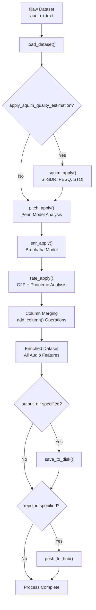

Sources: [main.py:1-114]()

## Command-Line Interface

The script accepts multiple configuration parameters to control processing behavior, resource allocation, and output destinations:

| Parameter Category | Arguments | Purpose |
|-------------------|-----------|---------|
| **Data Source** | `dataset_name`, `--configuration` | Specify input dataset and configuration |
| **Column Mapping** | `--audio_column_name`, `--text_column_name`, `--rename_column` | Configure input column names and standardization |
| **Resource Control** | `--cpu_num_workers`, `--num_workers_per_gpu_for_*` | Control parallelization strategy |
| **Batch Processing** | `--batch_size`, `--penn_batch_size`, `--cpu_writer_batch_size` | Optimize memory usage and throughput |
| **Feature Selection** | `--apply_squim_quality_estimation` | Enable optional quality metrics |
| **Output** | `--output_dir`, `--repo_id` | Specify local and remote output destinations |

The script implements automatic resource detection using `torch.cuda.device_count()` to determine GPU availability and scales worker processes accordingly.

Sources: [main.py:10-28]()

## Processing Workflow

### Audio Feature Extraction Pipeline

The extraction process follows a specific sequence of operations, each handled by specialized functions from the `dataspeech` module:

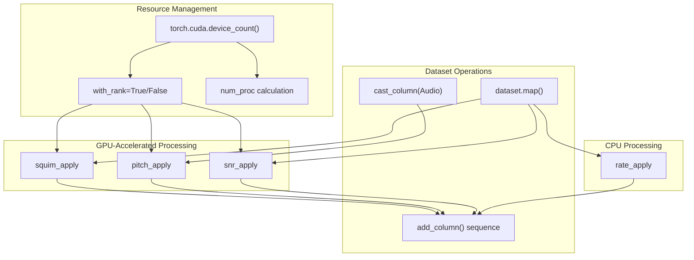

Sources: [main.py:43-102]()

### Data Processing Sequence

1. **Optional Quality Estimation** ([main.py:43-53]()): If `--apply_squim_quality_estimation` is enabled, extracts SI-SDR, PESQ, and STOI metrics using `squim_apply`

2. **Pitch Analysis** ([main.py:55-64]()): Applies `pitch_apply` with Penn model to extract `utterance_pitch_mean` and `utterance_pitch_std` features. Audio is resampled to 16kHz using `cast_column(Audio(sampling_rate=16_000))`

3. **SNR and Reverberation** ([main.py:66-75]()): Uses `snr_apply` with Brouhaha model to compute signal-to-noise ratio (`snr`), clarity measure (`c50`), and optionally `speech_duration`

4. **Speaking Rate Calculation** ([main.py:77-94]()): Applies `rate_apply` for G2P conversion and phoneme analysis, producing `speaking_rate` and `phonemes` features

### Column Merging Strategy

The script creates separate intermediate datasets for each processing step, then merges columns using `add_column()` operations:

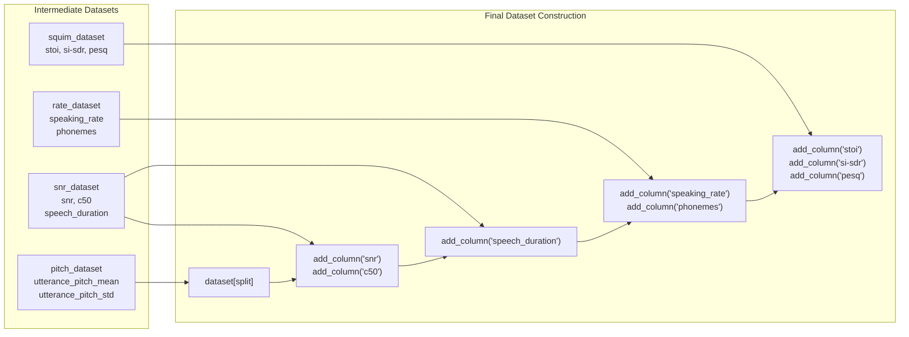

Sources: [main.py:96-102]()

## Resource Management and Parallelization

### GPU vs CPU Processing Strategy

The script implements adaptive resource allocation based on available hardware:

| Processing Type | GPU Available | CPU Fallback | Workers Calculation |
|----------------|---------------|--------------|-------------------|
| **SQUIM Quality** | `with_rank=True` | `with_rank=False` | `torch.cuda.device_count() * num_workers_per_gpu_for_squim` |
| **Pitch Analysis** | `with_rank=True` | `with_rank=False` | `torch.cuda.device_count() * num_workers_per_gpu_for_pitch` |
| **SNR/Reverberation** | `with_rank=True` | `with_rank=False` | `torch.cuda.device_count() * num_workers_per_gpu_for_snr` |
| **Speaking Rate** | Always CPU | `with_rank=False` | `cpu_num_workers` |

### Memory Optimization Techniques

- **Audio Column Removal**: Uses `remove_columns=[audio_column_name]` to prevent rewriting audio data multiple times ([main.py:51,62,73,92]())
- **Batch Size Control**: Separate batch sizes for different operations (`batch_size`, `penn_batch_size`, `cpu_writer_batch_size`)
- **Writer Batch Optimization**: CPU operations use `writer_batch_size` parameter for efficient disk writes ([main.py:83,91]())

Sources: [main.py:20-27](), [main.py:49-50,60-61,71-72,82,90]()

## Output Format and Data Flow

### Generated Feature Columns

The feature extraction process adds the following columns to the original dataset:

| Feature Category | Column Names | Data Type | Source Function |
|-----------------|--------------|-----------|----------------|
| **Pitch Statistics** | `utterance_pitch_mean`, `utterance_pitch_std` | Float | `pitch_apply` |
| **Signal Quality** | `snr`, `c50` | Float | `snr_apply` |
| **Temporal Features** | `speech_duration`, `speaking_rate` | Float | `snr_apply`, `rate_apply` |
| **Linguistic Features** | `phonemes` | String | `rate_apply` |
| **Quality Metrics** | `stoi`, `si-sdr`, `pesq` | Float | `squim_apply` (optional) |

### Output Destinations

The script supports dual output modes:

1. **Local Storage** ([main.py:104-106]()): Uses `dataset.save_to_disk(args.output_dir)` for local caching
2. **HuggingFace Hub** ([main.py:107-112]()): Pushes to specified repository with optional configuration support

The push operation preserves dataset configuration structure when present.

Sources: [main.py:96-112]()

## Usage Examples

### Basic Feature Extraction

```bash
python main.py "blabble-io/libritts_r" \
    --configuration "dev" \
    --output_dir ./tmp_libritts_r_dev/ \
    --text_column_name "text_normalized" \
    --audio_column_name "audio" \
    --cpu_num_workers 8 \
    --rename_column
```

### Production Processing with Quality Metrics

```bash
python main.py "blabble-io/libritts_r" \
    --configuration "clean" \
    --repo_id "ylacombe/libritts-r-text-tags-v3" \
    --text_column_name "text_normalized" \
    --cpu_num_workers 32 \
    --num_workers_per_gpu 4 \
    --apply_squim_quality_estimation \
    --rename_column
```

Sources: [examples/tagging/run_main_dummy.sh:1-10](), [examples/tagging/run_main_45k.sh:3-13]()

---

# Page: Metadata to Text Binning

# Metadata to Text Binning

<details>
<summary>Relevant source files</summary>

The following files were used as context for generating this wiki page:

- [examples/tags_to_annotations/run_metadata_to_text_10k_v02.sh](examples/tags_to_annotations/run_metadata_to_text_10k_v02.sh)
- [examples/tags_to_annotations/v01_bin_edges.json](examples/tags_to_annotations/v01_bin_edges.json)
- [examples/tags_to_annotations/v02_bin_edges.json](examples/tags_to_annotations/v02_bin_edges.json)
- [examples/tags_to_annotations/v02_text_bins.json](examples/tags_to_annotations/v02_text_bins.json)
- [scripts/metadata_to_text.py](scripts/metadata_to_text.py)

</details>


The metadata to text binning system converts continuous numerical audio features into discrete, human-readable text categories. This system serves as the critical bridge between the raw numerical measurements extracted during feature extraction (see [Feature Extraction](#2.1)) and the natural language description generation (see [Natural Language Description Generation](#2.3)).

The binning process transforms precise measurements like speaking rate (e.g., 12.5 phonemes per second) into categorical descriptions (e.g., "moderate speed"), making the data suitable for natural language processing while maintaining semantic meaning about audio characteristics.

## System Architecture

The binning system is implemented primarily in `scripts/metadata_to_text.py` and uses configuration files to define both the text categories and the numerical thresholds that separate them.

### Binning Process Flow

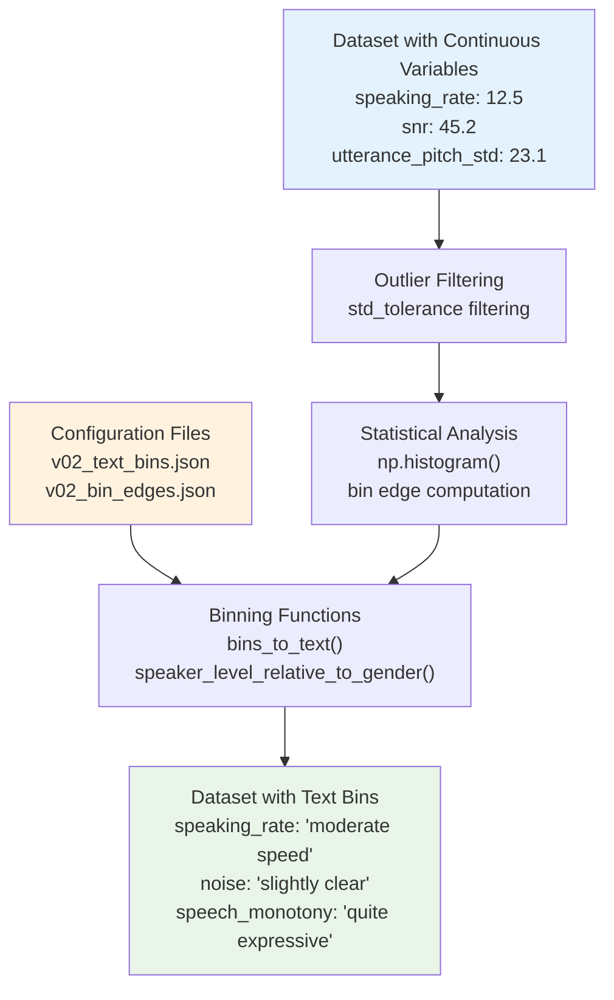

**Sources:** [scripts/metadata_to_text.py:56-100](), [scripts/metadata_to_text.py:196-214]()

### Text Bin Categories

The system defines predefined text categories for each audio characteristic, organized as ordered lists from lowest to highest intensity:

| Audio Feature | Text Bin Variable | Example Categories |
|---------------|-------------------|-------------------|
| Speaking Rate | `SPEAKER_RATE_BINS` | "very slowly", "moderate speed", "very fast" |
| Signal-to-Noise Ratio | `SNR_BINS` | "very noisy", "moderate ambient sound", "very clear" |
| Reverberation | `REVERBERATION_BINS` | "very roomy sounding", "moderate reverberation", "very confined sounding" |
| Pitch Variation | `UTTERANCE_LEVEL_STD` | "very monotone", "moderate intonation", "very expressive" |
| Pitch Level | `SPEAKER_LEVEL_PITCH_BINS` | "very low pitch", "moderate pitch", "very high pitch" |
| Speech Quality (SI-SDR) | `SI_SDR_BINS` | "extremely noisy", "almost no noise", "very clear" |
| Speech Quality (PESQ) | `PESQ_BINS` | "very bad speech quality", "great speech quality", "wonderful speech quality" |

**Sources:** [scripts/metadata_to_text.py:11-20](), [examples/tags_to_annotations/v02_text_bins.json:1-12]()

## Core Binning Functions

### Standard Binning Process

The `bins_to_text()` function handles most audio features using a standard statistical binning approach:

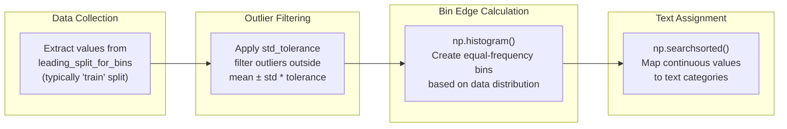

**Sources:** [scripts/metadata_to_text.py:56-100](), [scripts/metadata_to_text.py:273-276]()

### Gender-Relative Pitch Binning

Speaker-level pitch requires special handling due to biological differences between male and female voices. The `speaker_level_relative_to_gender()` function computes separate bin edges for each gender:

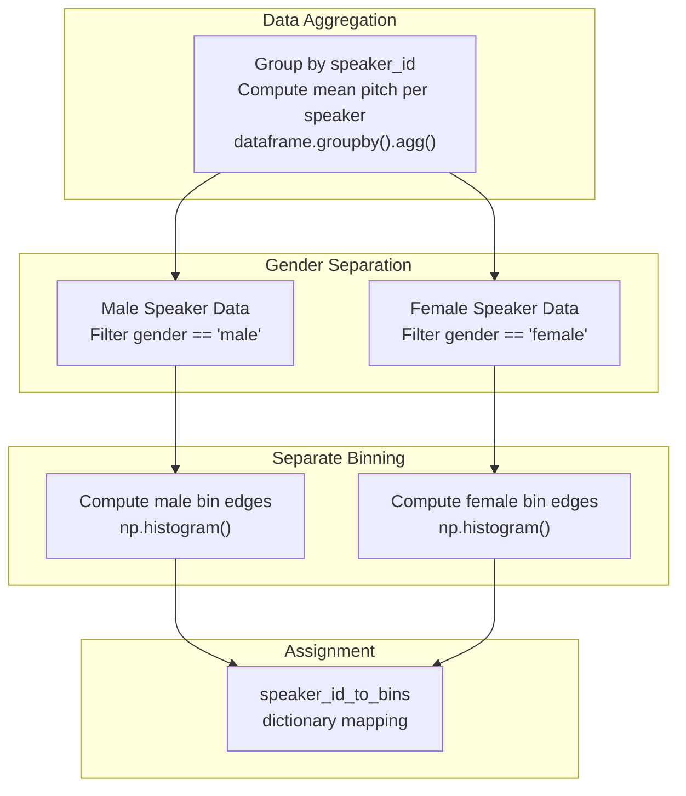

**Sources:** [scripts/metadata_to_text.py:102-156](), [scripts/metadata_to_text.py:266-271]()

## Configuration System

### Text Bin Definitions

The `v02_text_bins.json` file defines the ordered categories for each audio feature:

```json
{
    "speaker_rate_bins": ["very slowly", "slowly", "slightly slowly", "moderate speed", "slightly fast", "fast", "very fast"],
    "snr_bins": ["very noisy", "noisy", "slightly noisy", "balanced in clarity", "slightly clean", "clean", "very clean"],
    "reverberation_bins": ["very distant-sounding", "distant-sounding", "slightly distant-sounding", "slightly close-sounding", "very close-sounding"]
}
```

**Sources:** [examples/tags_to_annotations/v02_text_bins.json:1-12]()

### Bin Edge Configuration

The `v02_bin_edges.json` file stores the numerical thresholds computed from training data:

```json
{
    "speaking_rate": [0.0, 3.826, 7.652, 11.477, 15.303, 19.129, 22.955, 26.781],
    "noise": [17.128, 25.401, 33.675, 41.949, 50.222, 58.496, 66.770, 75.044],
    "pitch_bins_male": [64.653, 81.667, 98.680, 115.694, 132.708, 149.721, 166.735, 183.749],
    "pitch_bins_female": [120.179, 141.624, 163.070, 184.516, 205.961, 227.407, 248.853, 270.299]
}
```

**Sources:** [examples/tags_to_annotations/v02_bin_edges.json:1-10]()

## Outlier Filtering and Statistical Robustness

### Standard Deviation Tolerance

Each audio feature uses configurable standard deviation tolerance to filter outliers before computing bin edges:

| Feature | Default std_tolerance | Purpose |
|---------|----------------------|---------|
| Speaking Rate | 4.0 | Remove extremely fast/slow speech outliers |
| SNR | 3.5 | Filter recordings with unusual noise characteristics |
| Reverberation | 4.0 | Remove extreme acoustic environments |
| Pitch Standard Deviation | 4.0 | Filter unnaturally monotone/expressive speech |
| Pitch (Gender-relative) | 2.0 | More conservative filtering for pitch |

**Sources:** [scripts/metadata_to_text.py:175-179](), [scripts/metadata_to_text.py:68-83]()

### Statistical Distribution Handling

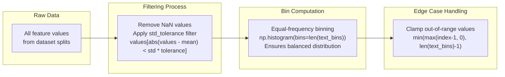

**Sources:** [scripts/metadata_to_text.py:68-83](), [scripts/metadata_to_text.py:90-97]()

## Visualization and Analysis

The system includes comprehensive visualization capabilities through the `visualize_bins_to_text()` function:

### Histogram Generation

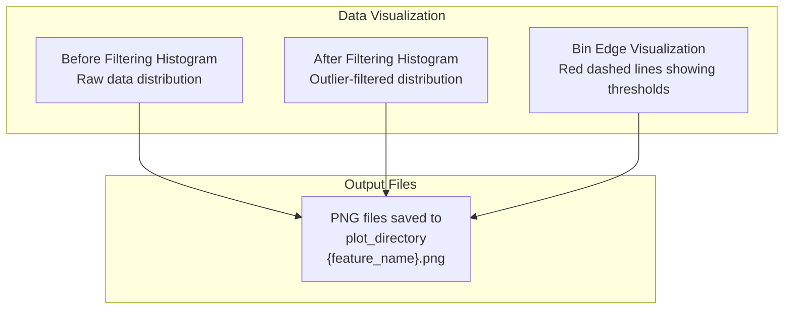

**Sources:** [scripts/metadata_to_text.py:22-54](), [scripts/metadata_to_text.py:75-80]()

## Command Line Interface

The `metadata_to_text.py` script provides extensive configuration options:

### Key Parameters

| Parameter | Purpose | Default |
|-----------|---------|---------|
| `--path_to_text_bins` | Custom text bin definitions | Built-in constants |
| `--path_to_bin_edges` | Pre-computed bin edges | Compute from data |
| `--save_bin_edges` | Save computed edges for reuse | None |
| `--avoid_pitch_computation` | Skip gender-relative pitch binning | False |
| `--plot_directory` | Save visualization plots | None |
| `--only_save_plot` | Generate plots without processing | False |

**Sources:** [scripts/metadata_to_text.py:167-182](), [scripts/metadata_to_text.py:158-188]()

### Multi-Dataset Processing

The system supports processing multiple datasets simultaneously using `+`-separated values:

```bash
python scripts/metadata_to_text.py "dataset1+dataset2+dataset3" \
    --configuration "config1+config2+config3" \
    --output_dir "output1+output2+output3"
```

**Sources:** [scripts/metadata_to_text.py:218-238](), [examples/tags_to_annotations/run_metadata_to_text_10k_v02.sh:3-5]()

The binning system ensures consistent, statistically-grounded conversion of numerical audio features into semantically meaningful text categories that can be effectively used for natural language description generation.

---

# Page: Natural Language Description Generation

# Natural Language Description Generation

<details>
<summary>Relevant source files</summary>

The following files were used as context for generating this wiki page:

- [examples/prompt_creation/run_prompt_creation_dummy.sh](examples/prompt_creation/run_prompt_creation_dummy.sh)
- [examples/prompt_creation/run_prompt_creation_jenny.sh](examples/prompt_creation/run_prompt_creation_jenny.sh)
- [examples/prompt_creation_llm_swarm/nginx.template.conf](examples/prompt_creation_llm_swarm/nginx.template.conf)
- [examples/prompt_creation_llm_swarm/run_prompt_creation_10k.sh](examples/prompt_creation_llm_swarm/run_prompt_creation_10k.sh)
- [examples/tags_to_annotations/run_metadata_to_text_for_finetuning.sh](examples/tags_to_annotations/run_metadata_to_text_for_finetuning.sh)
- [scripts/run_prompt_creation.py](scripts/run_prompt_creation.py)
- [scripts/run_prompt_creation_llm_swarm.py](scripts/run_prompt_creation_llm_swarm.py)

</details>


This document covers the third and final stage of the DataSpeech processing pipeline, where discrete text bins are transformed into coherent natural language descriptions of audio characteristics using Large Language Models (LLMs). This stage takes tagged datasets with text classifications (e.g., "slightly slowly", "very monotone") and produces human-readable descriptions suitable for text-to-speech training.

For information about the preceding stages, see [Feature Extraction](#2.1) and [Metadata to Text Binning](#2.2). For details about the underlying prompt generation infrastructure, see [Prompt Generation Systems](#4).

## System Architecture Overview

The natural language description generation system operates through two main processing backends that share common prompt templates and data handling logic. Both approaches transform structured text bins into conversational descriptions using different distributed computing strategies.

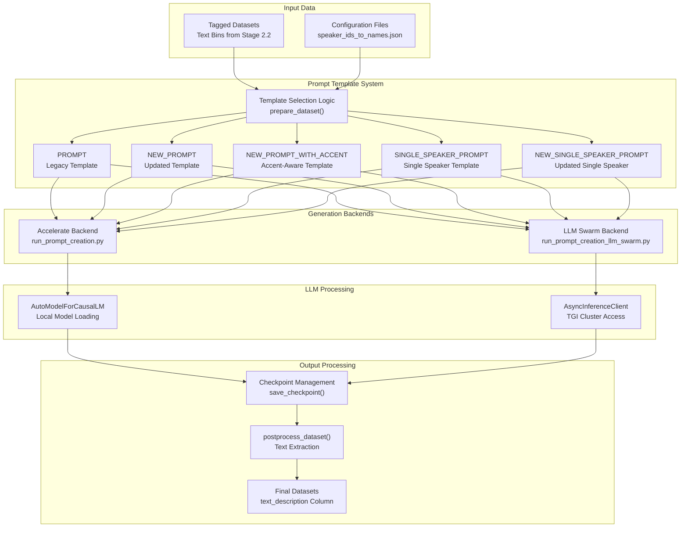

Sources: [scripts/run_prompt_creation.py:1-668](), [scripts/run_prompt_creation_llm_swarm.py:1-553]()

## Prompt Template System

The system uses a sophisticated template selection mechanism to generate appropriate prompts based on dataset characteristics and configuration options. The `prepare_dataset()` function in both backends implements the core template selection logic.

### Template Types and Selection Logic

| Template Name | Use Case | Key Features |
|---------------|----------|--------------|
| `PROMPT` | Legacy multi-speaker | Original 6-keyword format with gender |
| `NEW_PROMPT` | Updated multi-speaker | Improved keyword definitions, better examples |
| `NEW_PROMPT_WITH_ACCENT` | Multi-speaker with accents | Includes accent as 7th keyword |
| `SINGLE_SPEAKER_PROMPT` | Legacy single-speaker | 4-keyword format without gender/pitch |
| `NEW_SINGLE_SPEAKER_PROMPT` | Updated single-speaker | Improved single-speaker prompts |

### Template Selection Logic Flow

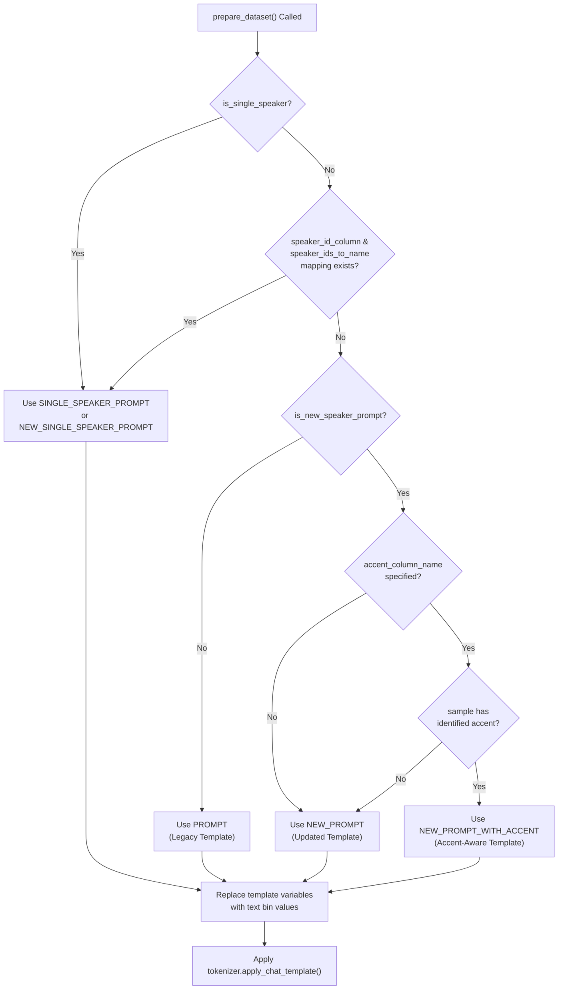

Sources: [scripts/run_prompt_creation.py:552-573](), [scripts/run_prompt_creation_llm_swarm.py:408-427]()

### Template Variable Substitution

The system performs variable substitution using a standardized set of expected columns. The `EXPECTED_COLUMNS` set is dynamically configured based on processing options:

```python
# Base multi-speaker columns
EXPECTED_COLUMNS = {"gender", "pitch", "noise", "reverberation", "speech_monotony", "speaking_rate"}

# Single-speaker modification (removes gender and pitch)
if data_args.is_single_speaker:
    EXPECTED_COLUMNS = {"noise", "reverberation", "speech_monotony", "speaking_rate"}

# New prompt modification (replaces 'noise' with 'sdr_noise')
if data_args.is_new_speaker_prompt:
    EXPECTED_COLUMNS.remove("noise")
    EXPECTED_COLUMNS.add("sdr_noise")
```

Sources: [scripts/run_prompt_creation.py:480-486](), [scripts/run_prompt_creation_llm_swarm.py:365-371]()

## Generation Backends Comparison

The system provides two distinct backends for distributed prompt generation, each optimized for different infrastructure requirements and scaling scenarios.

### Backend Architecture Comparison

```mermaid
graph TB
    subgraph "Accelerate Backend Architecture"
        ACCEL_SCRIPT["run_prompt_creation.py"]
        ACCEL_ARGS["ModelArguments<br/>DataArguments"]
        ACCEL_LIB["Accelerator()<br/>Multi-GPU Coordination"]
        ACCEL_MODEL["AutoModelForCausalLM.from_pretrained()<br/>Local Model Loading"]
        ACCEL_GEN["generate_step()<br/>Batch Generation"]
        ACCEL_COLLATOR["DataCollatorWithPadding<br/>Dynamic Padding"]
    end
    
    subgraph "LLM Swarm Backend Architecture"
        SWARM_SCRIPT["run_prompt_creation_llm_swarm.py"]
        SWARM_ARGS["ModelArguments<br/>DataArguments"]
        SWARM_MGR["LLMSwarm<br/>TGI Instance Management"]
        SWARM_CLIENT["AsyncInferenceClient<br/>HTTP API Access"]
        SWARM_GEN["process_text()<br/>Async Generation"]
        SWARM_SEM["asyncio.Semaphore<br/>Concurrency Control"]
    end
    
    ACCEL_SCRIPT --> ACCEL_ARGS
    ACCEL_ARGS --> ACCEL_LIB
    ACCEL_LIB --> ACCEL_MODEL
    ACCEL_MODEL --> ACCEL_GEN
    ACCEL_GEN --> ACCEL_COLLATOR
    
    SWARM_SCRIPT --> SWARM_ARGS
    SWARM_ARGS --> SWARM_MGR
    SWARM_MGR --> SWARM_CLIENT
    SWARM_CLIENT --> SWARM_GEN
    SWARM_GEN --> SWARM_SEM
```

Sources: [scripts/run_prompt_creation.py:12-26](), [scripts/run_prompt_creation_llm_swarm.py:19-22]()

### Key Implementation Differences

| Aspect | Accelerate Backend | LLM Swarm Backend |
|--------|-------------------|-------------------|
| Model Loading | `AutoModelForCausalLM.from_pretrained()` | Remote TGI instances via `AsyncInferenceClient` |
| Concurrency | GPU-based batching with `DataLoader` | Async/await with `asyncio.Semaphore` |
| Error Handling | Accelerate's built-in fault tolerance | Custom retry logic with `max_retries` |
| Checkpointing | Numpy array serialization | JSON-based text storage |
| Resource Management | `per_device_eval_batch_size` | `per_instance_max_parallel_requests` |

Sources: [scripts/run_prompt_creation.py:512-523](), [scripts/run_prompt_creation_llm_swarm.py:402-437]()

## Processing Pipeline Implementation

Both backends follow a similar high-level processing flow but implement the details differently to match their respective execution models.

### Accelerate Backend Pipeline

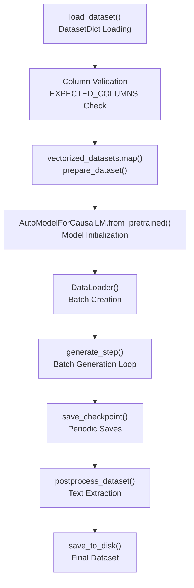

Sources: [scripts/run_prompt_creation.py:447-662]()

### LLM Swarm Backend Pipeline

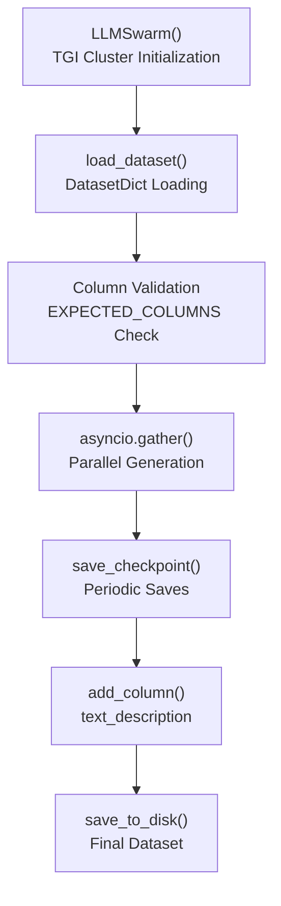

Sources: [scripts/run_prompt_creation_llm_swarm.py:389-552]()

## Checkpoint and Recovery System

Both backends implement robust checkpoint and recovery mechanisms to handle long-running generation tasks and infrastructure failures.

### Checkpoint Management Functions

The checkpoint system uses a consistent interface across both backends with the following core functions:

| Function | Purpose | Implementation Details |
|----------|---------|----------------------|
| `save_checkpoint()` | Persist generation progress | JSON serialization with step numbering |
| `load_checkpoint()` | Restore from saved state | Automatic format detection and loading |
| `get_last_checkpoint()` | Find most recent checkpoint | Regex-based checkpoint discovery |
| `sorted_checkpoints()` | Order checkpoints by step | Numerical sorting of checkpoint files |
| `rotate_checkpoints()` | Cleanup old checkpoints | Maintains `save_total_limit` constraint |

### Checkpoint File Format

Checkpoints use the naming pattern `checkpoint-{step}.json` where `step` represents the processing progress. The `_RE_CHECKPOINT` regex pattern `r"^checkpoint-(\d+).json$"` handles checkpoint file recognition.

Sources: [scripts/run_prompt_creation.py:235-281](), [scripts/run_prompt_creation_llm_swarm.py:190-233]()

## Configuration and Customization

The system provides extensive configuration options through dataclass-based argument parsing using `HfArgumentParser`. Key configuration categories include model parameters, data handling, and generation settings.

### Model Configuration Options

```python
@dataclass
class ModelArguments:
    model_name_or_path: str  # LLM model identifier
    per_device_eval_batch_size: int  # Batch size per device
    torch_dtype: str = "float16"  # Precision setting
    temperature: float = 0.6  # Sampling temperature
    max_new_tokens: int = 256  # Generation length limit
    do_sample: bool = True  # Enable sampling mode
```

### Data Processing Configuration

```python
@dataclass  
class DataArguments:
    dataset_name: str  # Input dataset identifier
    output_dir: str  # Output directory path
    is_single_speaker: bool = False  # Single vs multi-speaker mode
    is_new_speaker_prompt: bool = False  # Template version selection
    speaker_ids_to_name_json: str = None  # Speaker name mapping file
    accent_column: str = None  # Accent information column
    save_steps: int = 500  # Checkpoint frequency
```

Sources: [scripts/run_prompt_creation.py:32-192](), [scripts/run_prompt_creation_llm_swarm.py:28-178]()

---

# Page: Audio Enrichment Modules

# Audio Enrichment Modules

<details>
<summary>Relevant source files</summary>

The following files were used as context for generating this wiki page:

- [dataspeech/__init__.py](dataspeech/__init__.py)
- [dataspeech/cpu_enrichments/rate.py](dataspeech/cpu_enrichments/rate.py)
- [dataspeech/gpu_enrichments/__init__.py](dataspeech/gpu_enrichments/__init__.py)

</details>


## Purpose and Scope

The Audio Enrichment Modules form the core feature extraction layer of the DataSpeech pipeline. These modules extract specific acoustic and linguistic characteristics from audio datasets, transforming raw audio into quantifiable metrics such as pitch variation, signal-to-noise ratio, speaking rate, and speech quality measures.

This page provides an architectural overview of the modular enrichment system. For detailed implementation of GPU-accelerated processing, see [GPU-Accelerated Processing](#3.1). For CPU-based processing details, see [CPU-Based Processing](#3.2). The integration of these modules into the main processing pipeline is covered in [Feature Extraction (main.py)](#2.1).

## Architecture Overview

The enrichment system follows a modular architecture where each module is responsible for extracting specific audio characteristics. The system automatically distributes processing across available hardware resources.

**Module Distribution Architecture**
```mermaid
graph TB
    subgraph "dataspeech Package Structure"
        MAIN_INIT["dataspeech/__init__.py"]
        
        subgraph "CPU Enrichments"
            CPU_INIT["cpu_enrichments/__init__.py"]
            RATE_MODULE["rate.py"]
        end
        
        subgraph "GPU Enrichments"
            GPU_INIT["gpu_enrichments/__init__.py"]
            PITCH_MODULE["pitch.py"]
            SNR_MODULE["snr_and_reverb.py"]
            SQUIM_MODULE["squim.py"]
        end
    end
    
    subgraph "Exported Functions"
        RATE_APPLY["rate_apply()"]
        PITCH_APPLY["pitch_apply()"]
        SNR_APPLY["snr_apply()"]
        SQUIM_APPLY["squim_apply()"]
    end
    
    MAIN_INIT --> RATE_APPLY
    MAIN_INIT --> PITCH_APPLY
    MAIN_INIT --> SNR_APPLY
    MAIN_INIT --> SQUIM_APPLY
    
    CPU_INIT --> RATE_APPLY
    GPU_INIT --> PITCH_APPLY
    GPU_INIT --> SNR_APPLY
    GPU_INIT --> SQUIM_APPLY
    
    RATE_MODULE --> RATE_APPLY
    PITCH_MODULE --> PITCH_APPLY
    SNR_MODULE --> SNR_APPLY
    SQUIM_MODULE --> SQUIM_APPLY
```

Sources: [dataspeech/__init__.py:1-2](), [dataspeech/gpu_enrichments/__init__.py:1-3]()

## Module Organization

The enrichment modules are organized into two categories based on their computational requirements and hardware optimization:

| Module Type | Location | Functions | Hardware Requirement |
|-------------|----------|-----------|---------------------|
| **CPU Enrichments** | `dataspeech/cpu_enrichments/` | `rate_apply` | CPU-optimized |
| **GPU Enrichments** | `dataspeech/gpu_enrichments/` | `pitch_apply`, `snr_apply`, `squim_apply` | GPU-accelerated |

### Module Interface Pattern

All enrichment modules follow a consistent interface pattern:

```python
def module_apply(batch, rank=None, audio_column_name="audio", text_column_name="text", **kwargs):
    # Process batch data
    # Return modified batch with new columns
    return batch
```

This standardized interface allows for seamless integration with the main processing pipeline and enables batch processing across different hardware configurations.

Sources: [dataspeech/cpu_enrichments/rate.py:5]()

## Integration with Main Pipeline

**Enrichment Module Processing Flow**
```mermaid
flowchart TD
    INPUT_BATCH["Input Audio Batch"]
    MAIN_ORCHESTRATOR["main.py Orchestrator"]
    
    subgraph "Hardware Detection"
        GPU_CHECK{"GPU Available?"}
        CPU_FALLBACK["CPU Processing"]
        GPU_PROCESSING["GPU Processing"]
    end
    
    subgraph "CPU Enrichments"
        RATE_APPLY_FUNC["rate_apply()"]
        G2P_TRANSDUCER["g2p transducer"]
        PHONEME_CALC["Phoneme Calculation"]
        SPEAKING_RATE_CALC["Speaking Rate Calculation"]
    end
    
    subgraph "GPU Enrichments"
        PITCH_APPLY_FUNC["pitch_apply()"]
        SNR_APPLY_FUNC["snr_apply()"]
        SQUIM_APPLY_FUNC["squim_apply()"]
        PENN_MODEL["Penn Pitch Model"]
        BROUHAHA_MODEL["Brouhaha SNR Model"]
        TORCHAUIDO_SQUIM["TorchAudio SQUIM"]
    end
    
    subgraph "Output Processing"
        COLUMN_MERGE["Column Merging"]
        ENRICHED_DATASET["Enriched Dataset"]
    end
    
    INPUT_BATCH --> MAIN_ORCHESTRATOR
    MAIN_ORCHESTRATOR --> GPU_CHECK
    
    GPU_CHECK -->|"No"| CPU_FALLBACK
    GPU_CHECK -->|"Yes"| GPU_PROCESSING
    
    CPU_FALLBACK --> RATE_APPLY_FUNC
    GPU_PROCESSING --> PITCH_APPLY_FUNC
    GPU_PROCESSING --> SNR_APPLY_FUNC
    GPU_PROCESSING --> SQUIM_APPLY_FUNC
    
    RATE_APPLY_FUNC --> G2P_TRANSDUCER
    G2P_TRANSDUCER --> PHONEME_CALC
    PHONEME_CALC --> SPEAKING_RATE_CALC
    
    PITCH_APPLY_FUNC --> PENN_MODEL
    SNR_APPLY_FUNC --> BROUHAHA_MODEL
    SQUIM_APPLY_FUNC --> TORCHAUIDO_SQUIM
    
    SPEAKING_RATE_CALC --> COLUMN_MERGE
    PENN_MODEL --> COLUMN_MERGE
    BROUHAHA_MODEL --> COLUMN_MERGE
    TORCHAUIDO_SQUIM --> COLUMN_MERGE
    
    COLUMN_MERGE --> ENRICHED_DATASET
```

Sources: [dataspeech/cpu_enrichments/rate.py:1-44](), [dataspeech/gpu_enrichments/__init__.py:1-3]()

## Available Enrichment Modules

### CPU-Based Modules

| Module | Function | Output Columns | Description |
|--------|----------|---------------|-------------|
| **Rate Analysis** | `rate_apply` | `speaking_rate`, `phonemes` | Calculates speaking rate and extracts phonemes using G2P conversion |

### GPU-Based Modules

| Module | Function | Output Columns | Description |
|--------|----------|---------------|-------------|
| **Pitch Analysis** | `pitch_apply` | `utterance_pitch_mean`, `utterance_pitch_std` | Extracts pitch statistics using Penn model |
| **SNR & Reverberation** | `snr_apply` | `snr`, `c50` | Measures signal-to-noise ratio and reverberation using Brouhaha |
| **Speech Quality** | `squim_apply` | `pesq`, `si_sdr` | Evaluates speech quality using TorchAudio SQUIM metrics |

## Rate Module Implementation Details

The `rate_apply` function demonstrates the typical enrichment module pattern:

**Rate Calculation Process**
```mermaid
flowchart TD
    TEXT_INPUT["Text Input"]
    BATCH_CHECK{"Batch Processing?"}
    
    subgraph "Single Item Processing"
        SINGLE_G2P["transducer(text)"]
        SINGLE_PHONEMES["Extract Phonemes"]
        SINGLE_DURATION["Calculate Duration"]
        SINGLE_RATE["speaking_rate = len(phonemes) / duration"]
    end
    
    subgraph "Batch Processing"
        BATCH_LOOP["For each text in batch"]
        BATCH_G2P["transducer(text)"]
        BATCH_PHONEMES["Extract Phonemes"]
        BATCH_DURATION{"speech_duration exists?"}
        BATCH_AUDIO_CALC["Calculate from audio array"]
        BATCH_RATE["speaking_rate = len(phonemes) / duration"]
    end
    
    subgraph "Output"
        RATE_COLUMN["batch['speaking_rate']"]
        PHONEMES_COLUMN["batch['phonemes']"]
    end
    
    TEXT_INPUT --> BATCH_CHECK
    BATCH_CHECK -->|"No"| SINGLE_G2P
    BATCH_CHECK -->|"Yes"| BATCH_LOOP
    
    SINGLE_G2P --> SINGLE_PHONEMES
    SINGLE_PHONEMES --> SINGLE_DURATION
    SINGLE_DURATION --> SINGLE_RATE
    
    BATCH_LOOP --> BATCH_G2P
    BATCH_G2P --> BATCH_PHONEMES
    BATCH_PHONEMES --> BATCH_DURATION
    BATCH_DURATION -->|"Yes"| BATCH_RATE
    BATCH_DURATION -->|"No"| BATCH_AUDIO_CALC
    BATCH_AUDIO_CALC --> BATCH_RATE
    
    SINGLE_RATE --> RATE_COLUMN
    BATCH_RATE --> RATE_COLUMN
    SINGLE_PHONEMES --> PHONEMES_COLUMN
    BATCH_PHONEMES --> PHONEMES_COLUMN
```

The module handles both single-item and batch processing, with flexible duration calculation that can use pre-computed `speech_duration` or calculate from raw audio arrays.

Sources: [dataspeech/cpu_enrichments/rate.py:5-44]()

## Resource Management

The enrichment system integrates with the main pipeline's resource management, supporting configurable parameters for optimal hardware utilization:

- `cpu_num_workers`: Controls CPU-based processing parallelism
- `num_workers_per_gpu`: Manages GPU worker allocation
- `batch_size`: Determines processing batch sizes
- Module-specific parameters (e.g., `penn_batch_size` for pitch processing)

The modular design allows for independent scaling of different enrichment types based on their computational requirements and available hardware resources.

---

# Page: GPU-Accelerated Processing

# GPU-Accelerated Processing

<details>
<summary>Relevant source files</summary>

The following files were used as context for generating this wiki page:

- [dataspeech/gpu_enrichments/pitch.py](dataspeech/gpu_enrichments/pitch.py)
- [dataspeech/gpu_enrichments/snr_and_reverb.py](dataspeech/gpu_enrichments/snr_and_reverb.py)
- [dataspeech/gpu_enrichments/squim.py](dataspeech/gpu_enrichments/squim.py)

</details>


This document covers the GPU-accelerated audio enrichment modules that extract computationally intensive audio features from speech datasets. These modules leverage specialized deep learning models to analyze pitch characteristics, signal quality, and acoustic properties that would be too slow to process on CPU at scale.

The GPU processing system consists of three primary modules: pitch analysis using the Penn model, SNR and reverberation detection using Brouhaha, and speech quality assessment using TorchAudio's SQUIM. For CPU-based processing like speaking rate calculation, see [CPU-Based Processing](#3.2).

## Architecture Overview

The GPU enrichment system follows a modular design where each feature extraction function operates independently but shares common patterns for device management and batch processing.

**GPU Processing Pipeline Architecture**
```mermaid
graph TB
    subgraph "GPU Device Management"
        RANK["rank parameter"]
        DEVICE_COUNT["torch.cuda.device_count()"]
        DEVICE_ASSIGN["device = f'cuda:{rank % device_count}'"]
    end
    
    subgraph "Pitch Analysis Module"
        PITCH_FUNC["pitch_apply()"]
        PENN_MODEL["penn.from_audio()"]
        PITCH_OUTPUT["utterance_pitch_mean<br/>utterance_pitch_std"]
    end
    
    subgraph "SNR & Reverberation Module"  
        SNR_FUNC["snr_apply()"]
        BROUHAHA_MODEL["RegressiveActivityDetectionPipeline"]
        BROUHAHA_DOWNLOAD["ylacombe/brouhaha-best"]
        SNR_OUTPUT["snr<br/>c50<br/>speech_duration"]
    end
    
    subgraph "Speech Quality Module"
        SQUIM_FUNC["squim_apply()"]
        SQUIM_MODEL["SQUIM_OBJECTIVE.get_model()"]
        SQUIM_OUTPUT["sdr<br/>pesq<br/>stoi"]
    end
    
    RANK --> DEVICE_ASSIGN
    DEVICE_COUNT --> DEVICE_ASSIGN
    
    DEVICE_ASSIGN --> PITCH_FUNC
    DEVICE_ASSIGN --> SNR_FUNC  
    DEVICE_ASSIGN --> SQUIM_FUNC
    
    PITCH_FUNC --> PENN_MODEL
    SNR_FUNC --> BROUHAHA_MODEL
    SQUIM_FUNC --> SQUIM_MODEL
    
    PENN_MODEL --> PITCH_OUTPUT
    BROUHAHA_MODEL --> SNR_OUTPUT
    SQUIM_MODEL --> SQUIM_OUTPUT
```

Sources: [dataspeech/gpu_enrichments/pitch.py:1-65](), [dataspeech/gpu_enrichments/snr_and_reverb.py:1-73](), [dataspeech/gpu_enrichments/squim.py:1-46]()

## Pitch Analysis Module

The `pitch_apply` function extracts fundamental frequency statistics using the Penn pitch estimation model. It processes audio samples to compute pitch mean and standard deviation values.

**Pitch Processing Flow**
```mermaid
flowchart LR
    subgraph "Input Processing"
        AUDIO_BATCH["batch[audio_column_name]"]
        LIST_CHECK{"isinstance(batch, list)?"}
    end
    
    subgraph "Penn Model Processing"
        PENN_PARAMS["hopsize=0.01<br/>fmin=30<br/>fmax=1000<br/>checkpoint=None"]
        PENN_CALL["penn.from_audio()"]
        TENSOR_CONVERT["torch.tensor(array).float()"]
        GPU_ASSIGN["gpu=(rank or 0) % device_count"]
    end
    
    subgraph "Output Computation"
        PITCH_MEAN["pitch.mean().cpu()"]
        PITCH_STD["pitch.std().cpu()"]
        OUTPUT_COLS["utterance_pitch_mean<br/>utterance_pitch_std"]
    end
    
    AUDIO_BATCH --> LIST_CHECK
    LIST_CHECK -->|"Yes"| TENSOR_CONVERT
    LIST_CHECK -->|"No"| TENSOR_CONVERT
    
    TENSOR_CONVERT --> PENN_CALL
    PENN_PARAMS --> PENN_CALL
    GPU_ASSIGN --> PENN_CALL
    
    PENN_CALL --> PITCH_MEAN
    PENN_CALL --> PITCH_STD
    PITCH_MEAN --> OUTPUT_COLS
    PITCH_STD --> OUTPUT_COLS
```

The function supports configurable parameters including hop size, frequency range, and Penn model batch size. The `penn_batch_size` parameter controls memory usage during inference.

| Parameter | Default Value | Purpose |
|-----------|---------------|---------|
| `hopsize` | 0.01 | 10ms analysis window spacing |
| `fmin` | 30.0 | Minimum frequency for pitch detection |
| `fmax` | 1000.0 | Maximum frequency for pitch detection |
| `penn_batch_size` | 4096 | Batch size for Penn model inference |

Sources: [dataspeech/gpu_enrichments/pitch.py:5-21](), [dataspeech/gpu_enrichments/pitch.py:23-64]()

## SNR and Reverberation Module

The `snr_apply` function uses the Brouhaha model to extract signal-to-noise ratio, reverberation (C50), and speech duration metrics. It includes voice activity detection to focus analysis on speech segments.

**SNR Processing with VAD Masking**
```mermaid
flowchart TD
    subgraph "Model Loading"
        GLOBAL_MODEL["global model variable"]
        HF_DOWNLOAD["hf_hub_download('ylacombe/brouhaha-best')"]
        MODEL_INIT["Model.from_pretrained()"]
    end
    
    subgraph "Pipeline Setup"
        DEVICE_MOVE["model.to(device)"]
        PIPELINE_CREATE["RegressiveActivityDetectionPipeline"]
        BATCH_SIZE_CONFIG["batch_size parameter"]
    end
    
    subgraph "Audio Analysis"
        PIPELINE_CALL["pipeline(sample_rate, waveform)"]
        VAD_ANNOTATION["res['annotation'].itertracks()"]
        RATIO_CALC["ratio = 16000/270"]
    end
    
    subgraph "VAD Masking"
        MASK_INIT["mask = np.full(shape, False)"]
        SEGMENT_LOOP["for segment in annotation"]
        START_END["start = segment.start * ratio<br/>end = segment.end * ratio"]
        MASK_UPDATE["mask[start:end] = True"]
        ZERO_FILTER["~((snr==0.0) & (c50==0.0)) & mask"]
    end
    
    subgraph "Output Calculation"
        SNR_MEAN["res['snr'][mask].mean()"]
        C50_MEAN["res['c50'][mask].mean()"]
        DURATION_SUM["sum(segment.duration)"]
    end
    
    GLOBAL_MODEL --> HF_DOWNLOAD
    HF_DOWNLOAD --> MODEL_INIT
    MODEL_INIT --> DEVICE_MOVE
    DEVICE_MOVE --> PIPELINE_CREATE
    BATCH_SIZE_CONFIG --> PIPELINE_CREATE
    
    PIPELINE_CREATE --> PIPELINE_CALL
    PIPELINE_CALL --> VAD_ANNOTATION
    RATIO_CALC --> START_END
    
    VAD_ANNOTATION --> SEGMENT_LOOP
    SEGMENT_LOOP --> START_END
    START_END --> MASK_UPDATE
    MASK_INIT --> ZERO_FILTER
    MASK_UPDATE --> ZERO_FILTER
    
    ZERO_FILTER --> SNR_MEAN
    ZERO_FILTER --> C50_MEAN
    VAD_ANNOTATION --> DURATION_SUM
```

The module implements sophisticated masking to exclude silence and invalid measurements from the final statistics. The `ratio` constant converts between time domain and analysis window indices.

Sources: [dataspeech/gpu_enrichments/snr_and_reverb.py:8-24](), [dataspeech/gpu_enrichments/snr_and_reverb.py:34-49](), [dataspeech/gpu_enrichments/snr_and_reverb.py:38-44]()

## Speech Quality Metrics Module

The `squim_apply` function leverages TorchAudio's SQUIM (Speech Quality and Intelligibility Measures) model to compute perceptual quality metrics including SDR, PESQ, and STOI.

**SQUIM Quality Assessment Pipeline**
```mermaid
flowchart LR
    subgraph "Model Management"
        SQUIM_GLOBAL["global model variable"]
        SQUIM_PIPELINE["SQUIM_OBJECTIVE.get_model()"]
        MODEL_TO_DEVICE["model.to(device)"]
    end
    
    subgraph "Audio Preprocessing"
        RESAMPLE["torchaudio.functional.resample()"]
        TARGET_SR["SQUIM_OBJECTIVE.sample_rate"]
        MAX_LENGTH["max_audio_length = 15 * sample_rate"]
        TRUNCATE["waveform[:, :min(max_length, shape)]"]
    end
    
    subgraph "Quality Inference"
        NO_GRAD["torch.no_grad()"]
        MODEL_CALL["model(waveform)"]
        TRIPLE_OUTPUT["stoi, pesq, sdr = model()"]
        CPU_TRANSFER["tensor.cpu()[0]"]
    end
    
    SQUIM_GLOBAL --> SQUIM_PIPELINE
    SQUIM_PIPELINE --> MODEL_TO_DEVICE
    
    TARGET_SR --> RESAMPLE
    MAX_LENGTH --> TRUNCATE
    RESAMPLE --> TRUNCATE
    
    TRUNCATE --> NO_GRAD
    NO_GRAD --> MODEL_CALL
    MODEL_CALL --> TRIPLE_OUTPUT
    TRIPLE_OUTPUT --> CPU_TRANSFER
```

The module includes a 15-second maximum audio length limit to prevent memory issues with very long audio samples. Audio is automatically resampled to match SQUIM's expected sample rate.

| Output Metric | Description |
|---------------|-------------|
| `sdr` | Signal-to-Distortion Ratio |
| `pesq` | Perceptual Evaluation of Speech Quality |
| `stoi` | Short-Time Objective Intelligibility |

Sources: [dataspeech/gpu_enrichments/squim.py:5-11](), [dataspeech/gpu_enrichments/squim.py:24-30](), [dataspeech/gpu_enrichments/squim.py:37-42]()

## GPU Resource Management

All GPU enrichment modules implement consistent device management patterns to support multi-GPU environments and graceful CPU fallback.

**Device Assignment Strategy**
```mermaid
graph TD
    subgraph "Device Selection Logic"
        RANK_PARAM["rank parameter"]
        CUDA_CHECK["torch.cuda.device_count() > 0"]
        DEVICE_CALC["device = f'cuda:{rank % device_count}'"]
        CPU_FALLBACK["device = 'cpu'"]
    end
    
    subgraph "Model Movement Patterns"
        LAZY_LOAD["if model is None:<br/>    model = load_model()"]
        RANK_CHECK["if rank is not None or cuda_available"]
        MODEL_TO_GPU["model.to(device)"]
        PIPELINE_TO_GPU["pipeline.to(device)"]
    end
    
    RANK_PARAM --> DEVICE_CALC
    CUDA_CHECK -->|"True"| DEVICE_CALC
    CUDA_CHECK -->|"False"| CPU_FALLBACK
    
    LAZY_LOAD --> RANK_CHECK
    RANK_CHECK --> MODEL_TO_GPU
    MODEL_TO_GPU --> PIPELINE_TO_GPU
```

The `rank` parameter enables distributed processing where each worker process uses a different GPU. The modulo operation ensures even distribution across available devices.

**Common GPU Management Parameters**

| Parameter | Type | Purpose |
|-----------|------|---------|
| `rank` | int \| None | Process rank for multi-GPU distribution |
| `batch_size` | int | Batch size for model inference |
| `audio_column_name` | str | Input column containing audio data |

Sources: [dataspeech/gpu_enrichments/pitch.py:39](), [dataspeech/gpu_enrichments/snr_and_reverb.py:18-26](), [dataspeech/gpu_enrichments/squim.py:12-18]()

## Integration Patterns

GPU enrichment functions follow standardized interfaces for seamless integration with the main processing pipeline. All functions accept dataset batches and return modified batches with additional feature columns.

**Batch Processing Interface**
```mermaid
graph LR
    subgraph "Input Format"
        INPUT_BATCH["batch dict"]
        AUDIO_COLUMN["batch[audio_column_name]"]
        LIST_OR_SINGLE{"list or single sample?"}
    end
    
    subgraph "Processing Loop"
        SAMPLE_ITER["for sample in batch"]
        FEATURE_EXTRACT["extract_features(sample)"]
        ACCUMULATE["accumulate results"]
    end
    
    subgraph "Output Format"
        BATCH_UPDATE["batch[new_column] = results"]
        RETURN_BATCH["return batch"]
    end
    
    INPUT_BATCH --> AUDIO_COLUMN
    AUDIO_COLUMN --> LIST_OR_SINGLE
    LIST_OR_SINGLE -->|"list"| SAMPLE_ITER
    LIST_OR_SINGLE -->|"single"| FEATURE_EXTRACT
    
    SAMPLE_ITER --> FEATURE_EXTRACT
    FEATURE_EXTRACT --> ACCUMULATE
    ACCUMULATE --> BATCH_UPDATE
    BATCH_UPDATE --> RETURN_BATCH
```

This consistent interface allows the main processing pipeline to call any GPU enrichment function without modification, enabling modular feature selection based on processing requirements.

Sources: [dataspeech/gpu_enrichments/pitch.py:24-46](), [dataspeech/gpu_enrichments/snr_and_reverb.py:30-54](), [dataspeech/gpu_enrichments/squim.py:19-34]()

---

# Page: CPU-Based Processing

# CPU-Based Processing

<details>
<summary>Relevant source files</summary>

The following files were used as context for generating this wiki page:

- [dataspeech/cpu_enrichments/rate.py](dataspeech/cpu_enrichments/rate.py)

</details>


This section covers the CPU-based audio enrichment modules in the DataSpeech pipeline. CPU-based processing handles computationally lighter tasks that don't require GPU acceleration, primarily focusing on text-based analysis and linguistic feature extraction. For information about GPU-accelerated audio processing modules, see [GPU-Accelerated Processing](#3.1).

The CPU-based enrichments currently include speaking rate calculation and phoneme extraction through grapheme-to-phoneme (G2P) conversion. These modules are designed to run efficiently on CPU resources while the GPU resources are dedicated to more computationally intensive audio analysis tasks.

## Rate-Based Enrichment Module

The primary CPU-based enrichment is implemented in the `rate_apply` function, which performs two key linguistic analysis tasks: phoneme extraction and speaking rate calculation.

### G2P Conversion Process

The module uses the `g2p` library to convert text transcriptions into phonemes using International Phonetic Alphabet (IPA) notation. A global transducer is initialized for English-to-IPA conversion:

```mermaid
graph TB
    subgraph "G2P Conversion Pipeline"
        TEXT["Input Text<br/>\"Hello world\""]
        TRANSDUCER["make_g2p('eng', 'eng-ipa')<br/>Global Transducer"]
        PHONEMES["IPA Phonemes<br/>\"həˈloʊ wɜrld\""]
    end
    
    TEXT --> TRANSDUCER
    TRANSDUCER --> PHONEMES
    
    subgraph "Implementation Details"
        INIT["transducer = make_g2p('eng', 'eng-ipa')"]
        CONVERT["transducer(text).output_string"]
    end
    
    TRANSDUCER --> INIT
    TRANSDUCER --> CONVERT
```

**G2P Conversion Flow**
Sources: [dataspeech/cpu_enrichments/rate.py:1-3](), [dataspeech/cpu_enrichments/rate.py:11](), [dataspeech/cpu_enrichments/rate.py:18](), [dataspeech/cpu_enrichments/rate.py:32]()

### Speaking Rate Calculation

Speaking rate is computed as the ratio of phonemes to audio duration, measured in phonemes per second. The calculation handles two different duration sources:

| Duration Source | Calculation Method | Use Case |
|----------------|-------------------|----------|
| `speech_duration` | Pre-computed duration from previous processing | When speech duration is already extracted |
| Audio array length | `len(audio["array"]) / sample_rate` | When processing raw audio data |

```mermaid
graph LR
    subgraph "Speaking Rate Calculation"
        PHONEMES["Phoneme Count<br/>len(phonemes)"]
        DURATION["Audio Duration<br/>(seconds)"]
        RATE["Speaking Rate<br/>(phonemes/second)"]
    end
    
    subgraph "Duration Sources"
        PRECOMPUTED["batch['speech_duration']"]
        AUDIO_CALC["len(audio['array']) / sample_rate"]
    end
    
    PRECOMPUTED --> DURATION
    AUDIO_CALC --> DURATION
    PHONEMES --> RATE
    DURATION --> RATE
    
    subgraph "Edge Case Handling"
        ZERO_CHECK["duration == 0"]
        FALLBACK["duration = 0.01"]
    end
    
    DURATION --> ZERO_CHECK
    ZERO_CHECK --> FALLBACK
```

**Speaking Rate Calculation Logic**
Sources: [dataspeech/cpu_enrichments/rate.py:10-15](), [dataspeech/cpu_enrichments/rate.py:17-27](), [dataspeech/cpu_enrichments/rate.py:33-42]()

## Function Implementation Details

The `rate_apply` function processes both batch and single-item inputs with the following signature and behavior:

### Function Parameters

| Parameter | Type | Description |
|-----------|------|-------------|
| `batch` | dict | Input batch containing text and audio data |
| `rank` | int/None | Optional process rank for distributed processing |
| `audio_column_name` | str | Column name for audio data (default: "audio") |
| `text_column_name` | str | Column name for text data (default: "text") |

### Processing Logic Flow

```mermaid
flowchart TD
    INPUT["rate_apply(batch, rank, audio_column_name, text_column_name)"]
    
    CHECK_LIST{"isinstance(batch[text_column_name], list)"}
    
    subgraph "Batch Processing"
        BATCH_LOOP["for text, audio/duration in zip(...)"]
        BATCH_G2P["phonemes = transducer(text).output_string"]
        BATCH_DURATION{"'speech_duration' in batch?"}
        BATCH_PRECOMP["use batch['speech_duration']"]
        BATCH_CALC["calculate from audio array"]
        BATCH_RATE["speaking_rate = len(phonemes) / duration"]
        BATCH_APPEND["append to lists"]
        BATCH_ASSIGN["batch['speaking_rate'] = speaking_rates<br/>batch['phonemes'] = phonemes_list"]
    end
    
    subgraph "Single Item Processing"
        SINGLE_G2P["phonemes = transducer(batch[text_column_name]).output_string"]
        SINGLE_DURATION{"'speech_duration' in batch?"}
        SINGLE_PRECOMP["use batch['speech_duration']"]
        SINGLE_CALC["calculate from audio array"]
        SINGLE_RATE["speaking_rate = len(phonemes) / audio_length"]
        SINGLE_ASSIGN["batch['speaking_rate'] = speaking_rate<br/>batch['phonemes'] = phonemes"]
    end
    
    INPUT --> CHECK_LIST
    CHECK_LIST -->|True| BATCH_LOOP
    CHECK_LIST -->|False| SINGLE_G2P
    
    BATCH_LOOP --> BATCH_G2P
    BATCH_G2P --> BATCH_DURATION
    BATCH_DURATION -->|Yes| BATCH_PRECOMP
    BATCH_DURATION -->|No| BATCH_CALC
    BATCH_PRECOMP --> BATCH_RATE
    BATCH_CALC --> BATCH_RATE
    BATCH_RATE --> BATCH_APPEND
    BATCH_APPEND --> BATCH_ASSIGN
    
    SINGLE_G2P --> SINGLE_DURATION
    SINGLE_DURATION -->|Yes| SINGLE_PRECOMP
    SINGLE_DURATION -->|No| SINGLE_CALC
    SINGLE_PRECOMP --> SINGLE_RATE
    SINGLE_CALC --> SINGLE_RATE
    SINGLE_RATE --> SINGLE_ASSIGN
```

**Function Processing Flow**
Sources: [dataspeech/cpu_enrichments/rate.py:5-44]()

## Integration with Pipeline Architecture

The CPU-based processing integrates with the main processing pipeline through the enrichment system. The `rate_apply` function is called as part of the feature extraction stage:

```mermaid
graph TB
    subgraph "Main Pipeline Integration"
        MAIN["main.py<br/>Feature Extraction Orchestrator"]
        CPU_WORKER["CPU Worker Pool"]
        RATE_APPLY["rate_apply function"]
        MERGE["Column Merging"]
    end
    
    subgraph "Resource Allocation"
        CONFIG["cpu_num_workers parameter"]
        BATCH_SIZE["batch_size configuration"]
    end
    
    subgraph "Output Columns"
        SPEAKING_RATE["speaking_rate column"]
        PHONEMES["phonemes column"]
    end
    
    MAIN --> CPU_WORKER
    CONFIG --> CPU_WORKER
    BATCH_SIZE --> CPU_WORKER
    CPU_WORKER --> RATE_APPLY
    RATE_APPLY --> SPEAKING_RATE
    RATE_APPLY --> PHONEMES
    SPEAKING_RATE --> MERGE
    PHONEMES --> MERGE
    MERGE --> MAIN
```

**Pipeline Integration Architecture**
Sources: [dataspeech/cpu_enrichments/rate.py:5](), [dataspeech/cpu_enrichments/rate.py:29-30](), [dataspeech/cpu_enrichments/rate.py:41-42]()

## Error Handling and Edge Cases

The implementation includes several safeguards for robust processing:

### Zero Duration Handling
When audio duration is zero (which can occur with very short clips or processing errors), the function uses a fallback value of 0.01 seconds to prevent division by zero errors.

### Data Type Flexibility
The function handles both list-based batch processing and single-item processing, automatically detecting the input format and adapting the processing logic accordingly.

**Error Handling Implementation**
Sources: [dataspeech/cpu_enrichments/rate.py:12](), [dataspeech/cpu_enrichments/rate.py:34]()

## Performance Characteristics

CPU-based processing is chosen for the rate enrichment because:

1. **G2P Conversion**: Text-to-phoneme conversion is primarily a lookup and rule-based operation that doesn't benefit significantly from GPU parallelization
2. **Memory Efficiency**: Phoneme processing has low memory requirements compared to audio signal processing
3. **Resource Optimization**: Allows GPU resources to be dedicated to computationally intensive audio analysis tasks

The speaking rate calculation is lightweight and can be efficiently parallelized across CPU cores using standard multiprocessing approaches.

Sources: [dataspeech/cpu_enrichments/rate.py:1-44]()

---

# Page: Prompt Generation Systems

# Prompt Generation Systems

<details>
<summary>Relevant source files</summary>

The following files were used as context for generating this wiki page:

- [examples/prompt_creation/run_prompt_creation_dummy.sh](examples/prompt_creation/run_prompt_creation_dummy.sh)
- [examples/prompt_creation_llm_swarm/nginx.template.conf](examples/prompt_creation_llm_swarm/nginx.template.conf)
- [examples/prompt_creation_llm_swarm/run_prompt_creation_10k.sh](examples/prompt_creation_llm_swarm/run_prompt_creation_10k.sh)
- [scripts/run_prompt_creation.py](scripts/run_prompt_creation.py)
- [scripts/run_prompt_creation_llm_swarm.py](scripts/run_prompt_creation_llm_swarm.py)

</details>


This document covers the prompt generation systems that convert text bins (categorical audio feature descriptions) into natural language descriptions of speech characteristics. These systems represent the final stage of the dataspeech pipeline, transforming structured metadata like "slightly slowly" and "very monotone" into fluent descriptions such as "In a very expressive voice, Jenny speaks quite slowly with some background noise and echo."

For information about the preceding text binning stage, see [Metadata to Text Binning](#2.2). For details about the overall processing pipeline, see [Core Processing Pipeline](#2).

## Architecture Overview

The prompt generation system provides two distinct backends for large language model inference, each optimized for different deployment scenarios and scale requirements.

```mermaid
graph TB
    subgraph "Input Data"
        TAGGED_DS["Tagged Dataset<br/>with Text Bins"]
    end
    
    subgraph "Prompt Template System"
        PROMPT_TEMPLATES["Prompt Templates<br/>PROMPT<br/>NEW_PROMPT<br/>NEW_PROMPT_WITH_ACCENT<br/>SINGLE_SPEAKER_PROMPT<br/>NEW_SINGLE_SPEAKER_PROMPT"]
    end
    
    subgraph "Backend Selection"
        ACCEL_BACKEND["run_prompt_creation.py<br/>Accelerate Backend"]
        SWARM_BACKEND["run_prompt_creation_llm_swarm.py<br/>LLM Swarm Backend"]
    end
    
    subgraph "Model Infrastructure"
        subgraph "Accelerate Path"
            ACCEL_LIB["Accelerator"]
            LOCAL_MODEL["AutoModelForCausalLM<br/>Local Model Loading"]
            GPU_DIST["Multi-GPU Distribution"]
        end
        
        subgraph "Swarm Path"
            LLM_SWARM["LLMSwarm"]
            TGI_INSTANCES["TGI Inference Instances"]
            NGINX_LB["nginx Load Balancer"]
        end
    end
    
    subgraph "Processing Features"
        CHECKPOINTS["Checkpoint System<br/>save_checkpoint()<br/>load_checkpoint()"]
        DATA_COLLATOR["DataCollatorWithPadding"]
        ASYNC_PROC["AsyncInferenceClient"]
    end
    
    subgraph "Output"
        DESCRIPTIONS["text_description Column<br/>Natural Language Descriptions"]
        HUB_UPLOAD["HuggingFace Hub Upload"]
    end
    
    TAGGED_DS --> ACCEL_BACKEND
    TAGGED_DS --> SWARM_BACKEND
    
    PROMPT_TEMPLATES --> ACCEL_BACKEND
    PROMPT_TEMPLATES --> SWARM_BACKEND
    
    ACCEL_BACKEND --> ACCEL_LIB
    ACCEL_LIB --> LOCAL_MODEL
    LOCAL_MODEL --> GPU_DIST
    
    SWARM_BACKEND --> LLM_SWARM
    LLM_SWARM --> TGI_INSTANCES
    TGI_INSTANCES --> NGINX_LB
    
    CHECKPOINTS --> ACCEL_BACKEND
    CHECKPOINTS --> SWARM_BACKEND
    DATA_COLLATOR --> ACCEL_BACKEND
    ASYNC_PROC --> SWARM_BACKEND
    
    GPU_DIST --> DESCRIPTIONS
    NGINX_LB --> DESCRIPTIONS
    
    DESCRIPTIONS --> HUB_UPLOAD
    
    style ACCEL_BACKEND fill:#e8f5e8
    style SWARM_BACKEND fill:#fff3e0
    style DESCRIPTIONS fill:#f3e5f5
```

**Sources:** [scripts/run_prompt_creation.py:1-668](), [scripts/run_prompt_creation_llm_swarm.py:1-553]()

## Backend Comparison

The two prompt generation backends serve different deployment scenarios with distinct trade-offs in complexity, scalability, and resource requirements.

| Feature | Accelerate Backend | LLM Swarm Backend |
|---------|-------------------|-------------------|
| **Implementation** | `run_prompt_creation.py` | `run_prompt_creation_llm_swarm.py` |
| **Model Loading** | Local via `AutoModelForCausalLM` | Remote via TGI instances |
| **Distribution** | Accelerate library | LLM Swarm + nginx |
| **Processing** | Synchronous batching | Asynchronous requests |
| **Memory Model** | Direct GPU memory | Distributed inference |
| **Quantization** | BitsAndBytesConfig support | TGI-managed |
| **Checkpointing** | Per-batch with rotation | Per-chunk streaming |
| **Complexity** | Higher setup, simpler scaling | Lower setup, complex infrastructure |

**Sources:** [scripts/run_prompt_creation.py:31-108](), [scripts/run_prompt_creation_llm_swarm.py:27-91]()

## Prompt Template System

Both backends utilize a unified prompt template system that adapts to different speaker configurations and audio feature sets. The template selection logic determines the appropriate prompt based on dataset characteristics.

```mermaid
graph TB
    subgraph "Template Selection Logic"
        INPUT_SAMPLE["Input Sample<br/>prepare_dataset()"]
        
        SINGLE_CHECK{"is_single_speaker?"}
        SPEAKER_MAP_CHECK{"speaker_ids_to_name<br/>mapping exists?"}
        ACCENT_CHECK{"accent_column_name<br/>present?"}
        NEW_PROMPT_CHECK{"is_new_speaker_prompt?"}
        
        INPUT_SAMPLE --> SINGLE_CHECK
        SINGLE_CHECK -->|Yes| SINGLE_TEMPLATES
        SINGLE_CHECK -->|No| SPEAKER_MAP_CHECK
        
        SPEAKER_MAP_CHECK -->|Yes| SINGLE_TEMPLATES
        SPEAKER_MAP_CHECK -->|No| ACCENT_CHECK
        
        ACCENT_CHECK -->|Yes| NEW_PROMPT_CHECK
        ACCENT_CHECK -->|No| STANDARD_TEMPLATES
        
        NEW_PROMPT_CHECK -->|Yes| ACCENT_TEMPLATES
        NEW_PROMPT_CHECK -->|No| STANDARD_TEMPLATES
    end
    
    subgraph "Template Types"
        SINGLE_TEMPLATES["Single Speaker Templates<br/>SINGLE_SPEAKER_PROMPT<br/>NEW_SINGLE_SPEAKER_PROMPT"]
        
        ACCENT_TEMPLATES["Accent Templates<br/>NEW_PROMPT_WITH_ACCENT"]
        
        STANDARD_TEMPLATES["Standard Templates<br/>PROMPT<br/>NEW_PROMPT"]
    end
    
    subgraph "Template Processing"
        PLACEHOLDER_REPLACE["Placeholder Replacement<br/>sample_prompt.replace()"]
        CHAT_TEMPLATE["Chat Template Application<br/>tokenizer.apply_chat_template()"]
    end
    
    SINGLE_TEMPLATES --> PLACEHOLDER_REPLACE
    ACCENT_TEMPLATES --> PLACEHOLDER_REPLACE
    STANDARD_TEMPLATES --> PLACEHOLDER_REPLACE
    
    PLACEHOLDER_REPLACE --> CHAT_TEMPLATE
    
    style SINGLE_TEMPLATES fill:#e8f5e8
    style ACCENT_TEMPLATES fill:#fff3e0
    style STANDARD_TEMPLATES fill:#f3e5f5
```

**Sources:** [scripts/run_prompt_creation.py:552-573](), [scripts/run_prompt_creation_llm_swarm.py:408-427]()

### Template Variants

The system provides five core prompt templates, each optimized for specific dataset configurations:

**Legacy Templates:**
- `PROMPT`: Original 6-keyword template with traditional terminology [scripts/run_prompt_creation.py:320-330]()
- `SINGLE_SPEAKER_PROMPT`: 4-keyword version for mono-speaker datasets [scripts/run_prompt_creation.py:400-412]()

**Modern Templates:**
- `NEW_PROMPT`: Updated 6-keyword template with revised terminology [scripts/run_prompt_creation.py:332-353]()
- `NEW_PROMPT_WITH_ACCENT`: 7-keyword version including accent information [scripts/run_prompt_creation.py:355-377]()
- `NEW_SINGLE_SPEAKER_PROMPT`: Updated single-speaker template [scripts/run_prompt_creation.py:380-398]()

### Expected Columns

The prompt system validates input datasets against expected column sets that vary based on configuration:

```python
EXPECTED_COLUMNS = {"gender", "pitch", "noise", "reverberation", "speech_monotony", "speaking_rate"}

# Single speaker datasets exclude gender and pitch
if data_args.is_single_speaker:
    EXPECTED_COLUMNS = {"noise", "reverberation", "speech_monotony", "speaking_rate"}
    
# New prompt format uses sdr_noise instead of noise
if data_args.is_new_speaker_prompt:
    EXPECTED_COLUMNS.remove("noise")
    EXPECTED_COLUMNS.add("sdr_noise")
```

**Sources:** [scripts/run_prompt_creation.py:480-487](), [scripts/run_prompt_creation_llm_swarm.py:365-371]()

## Model Loading and Configuration

### Accelerate Backend Model Setup

The Accelerate backend provides comprehensive model configuration options including quantization, compilation, and distributed loading:

```mermaid
graph TB
    subgraph "Model Configuration"
        MODEL_ARGS["ModelArguments<br/>torch_dtype<br/>attn_implementation<br/>quantization options"]
        
        QUANT_CONFIG["get_quantization_config()<br/>BitsAndBytesConfig"]
        
        DEVICE_MAP["get_kbit_device_map()<br/>GPU device mapping"]
    end
    
    subgraph "Model Loading Pipeline"
        AUTO_MODEL["AutoModelForCausalLM.from_pretrained()"]
        TORCH_COMPILE_CHECK{"torch_compile enabled?"}
        STATIC_CACHE["Static k/v cache<br/>generation_config.cache_implementation"]
        COMPILED_MODEL["torch.compile(model)"]
        
        AUTO_MODEL --> TORCH_COMPILE_CHECK
        TORCH_COMPILE_CHECK -->|Yes| STATIC_CACHE
        STATIC_CACHE --> COMPILED_MODEL
        TORCH_COMPILE_CHECK -->|No| TOKENIZER_SETUP
        COMPILED_MODEL --> TOKENIZER_SETUP
    end
    
    subgraph "Tokenizer Configuration"
        TOKENIZER_SETUP["AutoTokenizer.from_pretrained()<br/>padding_side='left'"]
        PAD_TOKEN_CONFIG["pad_token_id = bos_token_id"]
    end
    
    MODEL_ARGS --> QUANT_CONFIG
    QUANT_CONFIG --> DEVICE_MAP
    DEVICE_MAP --> AUTO_MODEL
    
    TOKENIZER_SETUP --> PAD_TOKEN_CONFIG
    
    style AUTO_MODEL fill:#e8f5e8
    style COMPILED_MODEL fill:#fff3e0
```

**Sources:** [scripts/run_prompt_creation.py:199-545]()

### LLM Swarm Infrastructure Setup

The LLM Swarm backend orchestrates distributed inference through TGI instances and load balancing:

```python
with LLMSwarm(
    LLMSwarmConfig(
        instances=model_args.num_instances,
        inference_engine="tgi",
        slurm_template_path="./tgi_h100.template.slurm",
        load_balancer_template_path="./nginx.template.conf",
        model=model_args.model_name_or_path,
        per_instance_max_parallel_requests=model_args.per_instance_max_parallel_requests,
    )
) as llm_swarm:
```

**Sources:** [scripts/run_prompt_creation_llm_swarm.py:389-400](), [examples/prompt_creation_llm_swarm/nginx.template.conf:1-29]()

## Generation and Processing

### Accelerate Backend Processing

The Accelerate backend uses synchronous batch processing with DataLoader integration:

```mermaid
graph TB
    subgraph "Data Preparation"
        VECTORIZED_DS["vectorized_datasets<br/>with input_ids"]
        DATA_COLLATOR["DataCollatorWithPadding"]
        DATALOADER["DataLoader<br/>batch processing"]
    end
    
    subgraph "Generation Loop"
        GENERATE_STEP["generate_step()<br/>model.generate()"]
        PAD_ACROSS["accelerator.pad_across_processes()"]
        GATHER_METRICS["accelerator.gather_for_metrics()"]
    end
    
    subgraph "Checkpointing"
        SAVE_CHECKPOINT["save_checkpoint()<br/>every save_steps"]
        ROTATE_CHECKPOINTS["rotate_checkpoints()<br/>cleanup old checkpoints"]
    end
    
    subgraph "Postprocessing"
        POSTPROCESS["postprocess_dataset()<br/>tokenizer.batch_decode()"]
        TEXT_DESCRIPTION["text_description column<br/>extracted from generated_ids"]
    end
    
    VECTORIZED_DS --> DATA_COLLATOR
    DATA_COLLATOR --> DATALOADER
    DATALOADER --> GENERATE_STEP
    
    GENERATE_STEP --> PAD_ACROSS
    PAD_ACROSS --> GATHER_METRICS
    GATHER_METRICS --> SAVE_CHECKPOINT
    
    SAVE_CHECKPOINT --> ROTATE_CHECKPOINTS
    GATHER_METRICS --> POSTPROCESS
    POSTPROCESS --> TEXT_DESCRIPTION
    
    style GENERATE_STEP fill:#e8f5e8
    style POSTPROCESS fill:#f3e5f5
```

**Sources:** [scripts/run_prompt_creation.py:584-653]()

### LLM Swarm Async Processing

The LLM Swarm backend uses asynchronous processing with semaphore-controlled concurrency:

```python
async def process_text(sample):
    # Template selection and prompt preparation
    sample_prompt = tokenizer.apply_chat_template(sample_prompt, tokenize=False)
    
    attempt = 0
    while attempt < model_args.max_retries:
        try:
            async with semaphore:
                return await client.text_generation(
                    prompt=sample_prompt,
                    max_new_tokens=model_args.max_new_tokens,
                    temperature=model_args.temperature,
                    do_sample=model_args.do_sample,
                )
        except Exception as e:
            # Retry logic with exponential backoff
```

**Sources:** [scripts/run_prompt_creation_llm_swarm.py:408-448]()

## Checkpoint and Resume System

Both backends implement robust checkpointing to handle long-running generation tasks and enable resume functionality after interruptions.

### Checkpoint File Format

Checkpoints are stored as JSON files with numeric step identifiers:
- Filename pattern: `checkpoint-{step}.json`
- Content: List of generated text strings (Swarm) or token ID arrays (Accelerate)
- Regex pattern: `^checkpoint-(\d+).json$`

### Checkpoint Management Functions

| Function | Purpose | Backend |
|----------|---------|---------|
| `save_checkpoint()` | Save current progress | Both |
| `load_checkpoint()` | Restore from checkpoint | Both |
| `get_last_checkpoint()` | Find most recent checkpoint | Both |
| `rotate_checkpoints()` | Cleanup old checkpoints | Both |
| `sorted_checkpoints()` | Order checkpoints by step | Both |

**Sources:** [scripts/run_prompt_creation.py:235-302](), [scripts/run_prompt_creation_llm_swarm.py:190-250]()

## Usage Examples

### Accelerate Backend Example

```bash
python run_prompt_creation.py \
  --dataset_name "ylacombe/libritts_r_tags_and_text" \
  --dataset_config_name "clean" \
  --model_name_or_path "mistralai/Mistral-7B-Instruct-v0.2" \
  --per_device_eval_batch_size 8 \
  --output_dir "./descriptions" \
  --push_to_hub \
  --hub_dataset_id "user/dataset-descriptions"
```

### LLM Swarm Backend Example

```bash
python run_prompt_creation_llm_swarm.py \
  --dataset_name "ylacombe/mls-eng-10k-text-tags-v2" \
  --model_name_or_path "mistralai/Mistral-7B-Instruct-v0.2" \
  --num_instances 4 \
  --per_instance_max_parallel_requests 100 \
  --output_dir "./descriptions"
```

**Sources:** [examples/prompt_creation/run_prompt_creation_dummy.sh:1-18](), [examples/prompt_creation_llm_swarm/run_prompt_creation_10k.sh:1-10]()

---

# Page: Accelerate-Based Generation

# Accelerate-Based Generation

<details>
<summary>Relevant source files</summary>

The following files were used as context for generating this wiki page:

- [examples/prompt_creation/run_prompt_creation_10k.sh](examples/prompt_creation/run_prompt_creation_10k.sh)
- [examples/prompt_creation/run_prompt_creation_1k.sh](examples/prompt_creation/run_prompt_creation_1k.sh)
- [examples/prompt_creation/run_prompt_creation_dummy.sh](examples/prompt_creation/run_prompt_creation_dummy.sh)
- [scripts/run_prompt_creation.py](scripts/run_prompt_creation.py)

</details>


This document covers the Accelerate-based approach for generating natural language descriptions from audio feature tags. This system uses the HuggingFace Accelerate library to distribute transformer model inference across multiple GPUs for high-throughput prompt generation. For the alternative distributed approach using TGI instances, see [LLM Swarm Generation](#4.2).

## System Architecture

The Accelerate-based generation system provides a scalable solution for converting binned audio features into natural language descriptions using large language models. The system is implemented in `run_prompt_creation.py` and leverages Accelerate's multi-GPU distribution capabilities.

```mermaid
graph TD
    subgraph "Input Processing"
        INPUT["Tagged Dataset<br/>with Binned Features"]
        PREP["prepare_dataset()<br/>Template Application"]
        TOKENIZE["Tokenizer<br/>apply_chat_template()"]
    end
    
    subgraph "Accelerate Distribution"
        ACCEL["Accelerator<br/>Process Group Setup"]
        MODEL_PREP["accelerator.prepare()<br/>Model Distribution"]
        DATA_PREP["accelerator.prepare()<br/>DataLoader Distribution"]
    end
    
    subgraph "Generation Pipeline"
        DATALOADER["DataLoader<br/>DataCollatorWithPadding"]
        GENERATE["generate_step()<br/>model.generate()"]
        GATHER["accelerator.gather_for_metrics()<br/>Multi-GPU Sync"]
    end
    
    subgraph "Output Management"
        CHECKPOINT["save_checkpoint()<br/>Periodic Saves"]
        POSTPROCESS["postprocess_dataset()<br/>Text Extraction"]
        SAVE["Dataset Save<br/>Push to Hub"]
    end
    
    INPUT --> PREP
    PREP --> TOKENIZE
    TOKENIZE --> ACCEL
    
    ACCEL --> MODEL_PREP
    ACCEL --> DATA_PREP
    
    MODEL_PREP --> DATALOADER
    DATA_PREP --> DATALOADER
    DATALOADER --> GENERATE
    GENERATE --> GATHER
    
    GATHER --> CHECKPOINT
    CHECKPOINT --> POSTPROCESS
    POSTPROCESS --> SAVE
```

Sources: [scripts/run_prompt_creation.py:1-668]()

## Core Components

### Model and Data Arguments

The system uses dataclass-based configuration through `ModelArguments` and `DataArguments` classes that define all processing parameters.

| Component | Purpose | Key Parameters |
|-----------|---------|----------------|
| `ModelArguments` | Model configuration | `model_name_or_path`, `per_device_eval_batch_size`, `torch_dtype`, `load_in_4bit` |
| `DataArguments` | Data processing config | `dataset_name`, `output_dir`, `max_eval_samples`, `push_to_hub` |
| Quantization | Memory optimization | `BitsAndBytesConfig` for 4-bit/8-bit inference |

Sources: [scripts/run_prompt_creation.py:31-108](), [scripts/run_prompt_creation.py:110-192]()

### Accelerate Integration

The system initializes Accelerate with extended timeout for large model operations and prepares both model and data components for distributed processing.

```mermaid
graph LR
    subgraph "Accelerate Setup"
        KWARGS["InitProcessGroupKwargs<br/>timeout=3600*3 seconds"]
        ACCELERATOR["Accelerator<br/>Multi-GPU Coordinator"]
        
        KWARGS --> ACCELERATOR
    end
    
    subgraph "Component Preparation"
        MODEL["AutoModelForCausalLM<br/>Loaded Model"]
        DATALOADER["DataLoader<br/>Batched Data"]
        
        ACCELERATOR --> PREP_MODEL["accelerator.prepare(model)"]
        ACCELERATOR --> PREP_DATA["accelerator.prepare(data_loader)"]
        
        MODEL --> PREP_MODEL
        DATALOADER --> PREP_DATA
    end
    
    subgraph "Distributed Operations"
        GENERATE["generate_step()"]
        GATHER["accelerator.gather_for_metrics()"]
        SYNC["accelerator.wait_for_everyone()"]
        
        PREP_MODEL --> GENERATE
        GENERATE --> GATHER
        GATHER --> SYNC
    end
```

Sources: [scripts/run_prompt_creation.py:440-441](), [scripts/run_prompt_creation.py:581-582](), [scripts/run_prompt_creation.py:610]()

## Prompt Template System

The system supports multiple prompt templates for different use cases, with dynamic template selection based on dataset characteristics.

### Template Types

```mermaid
graph TD
    subgraph "Template Selection Logic"
        CHECK_SINGLE{"is_single_speaker?"}
        CHECK_NEW{"is_new_speaker_prompt?"}
        CHECK_SPEAKER{"speaker_ids_to_name<br/>mapping exists?"}
        CHECK_ACCENT{"accent_column<br/>present?"}
    end
    
    subgraph "Template Options"
        LEGACY["PROMPT<br/>Legacy Multi-Speaker"]
        SINGLE["SINGLE_SPEAKER_PROMPT<br/>Named Speaker"]
        NEW_SINGLE["NEW_SINGLE_SPEAKER_PROMPT<br/>Updated Single Speaker"]
        NEW_MULTI["NEW_PROMPT<br/>Updated Multi-Speaker"]
        NEW_ACCENT["NEW_PROMPT_WITH_ACCENT<br/>With Accent Support"]
    end
    
    CHECK_SINGLE -->|Yes| CHECK_NEW
    CHECK_NEW -->|Yes| NEW_SINGLE
    CHECK_NEW -->|No| SINGLE
    
    CHECK_SINGLE -->|No| CHECK_SPEAKER
    CHECK_SPEAKER -->|Yes| CHECK_NEW
    CHECK_SPEAKER -->|No| CHECK_ACCENT
    
    CHECK_ACCENT -->|Yes| NEW_ACCENT
    CHECK_ACCENT -->|No| NEW_MULTI
```

Sources: [scripts/run_prompt_creation.py:320-413](), [scripts/run_prompt_creation.py:552-574]()

### Feature Column Mapping

The system expects specific column names in the input dataset and maps them to prompt placeholders:

| Expected Column | Description | Template Placeholder |
|----------------|-------------|---------------------|
| `gender` | Speaker gender | `[gender]` |
| `pitch` | Pitch characteristics | `[pitch]` |
| `noise` / `sdr_noise` | Noise level | `[noise]` / `[sdr_noise]` |
| `reverberation` | Room acoustics | `[reverberation]` |
| `speech_monotony` | Voice expressiveness | `[speech_monotony]` |
| `speaking_rate` | Speech pace | `[speaking_rate]` |
| `accent` | Speaker accent (optional) | `[accent]` |

Sources: [scripts/run_prompt_creation.py:480-487](), [scripts/run_prompt_creation.py:565-569]()

## Generation Pipeline

### Data Processing Flow

The generation pipeline processes datasets through several stages with distributed coordination:

```mermaid
flowchart TD
    subgraph "Dataset Preparation"
        LOAD["load_dataset()<br/>HuggingFace Dataset"]
        MAP["vectorized_datasets.map()<br/>prepare_dataset()"]
        VALIDATE["Column Validation<br/>EXPECTED_COLUMNS"]
    end
    
    subgraph "Batch Processing"
        DATALOADER_LOOP["DataLoader Iteration<br/>per_device_eval_batch_size"]
        COLLATE["DataCollatorWithPadding<br/>Dynamic Padding"]
        GENERATE_STEP["generate_step()<br/>model.generate()"]
    end
    
    subgraph "Distributed Coordination"
        GATHER_METRICS["accelerator.gather_for_metrics()<br/>Collect Outputs"]
        CHECKPOINT_SAVE["save_checkpoint()<br/>Periodic Saves"]
        POSTPROCESS_MAP["postprocess_dataset()<br/>Extract Text"]
    end
    
    LOAD --> VALIDATE
    VALIDATE --> MAP
    MAP --> DATALOADER_LOOP
    
    DATALOADER_LOOP --> COLLATE
    COLLATE --> GENERATE_STEP
    GENERATE_STEP --> GATHER_METRICS
    
    GATHER_METRICS --> CHECKPOINT_SAVE
    CHECKPOINT_SAVE --> POSTPROCESS_MAP
```

Sources: [scripts/run_prompt_creation.py:602-653](), [scripts/run_prompt_creation.py:584-594](), [scripts/run_prompt_creation.py:595-600]()

### Checkpointing and Recovery

The system implements comprehensive checkpointing for long-running generation jobs:

| Function | Purpose | Key Features |
|----------|---------|--------------|
| `save_checkpoint()` | Periodic saves | JSON serialization of generated IDs |
| `load_checkpoint()` | Recovery on restart | Restore generation state |
| `get_last_checkpoint()` | Find latest save | Pattern matching for checkpoint files |
| `rotate_checkpoints()` | Cleanup old saves | Maintain `save_total_limit` checkpoints |

Sources: [scripts/run_prompt_creation.py:235-281](), [scripts/run_prompt_creation.py:617-624]()

## Model Configuration and Optimization

### Quantization Support

The system supports memory-efficient inference through quantization:

```mermaid
graph TD
    subgraph "Quantization Options"
        CHECK_4BIT{"load_in_4bit?"}
        CHECK_8BIT{"load_in_8bit?"}
        NO_QUANT["No Quantization<br/>Full Precision"]
    end
    
    subgraph "4-bit Configuration"
        BNB_4BIT["BitsAndBytesConfig<br/>4-bit Settings"]
        COMPUTE_DTYPE["bnb_4bit_compute_dtype<br/>torch.float16"]
        QUANT_TYPE["bnb_4bit_quant_type<br/>nf4 (default)"]
        NESTED_QUANT["bnb_4bit_use_double_quant<br/>Nested Quantization"]
    end
    
    subgraph "8-bit Configuration"
        BNB_8BIT["BitsAndBytesConfig<br/>8-bit Settings"]
    end
    
    CHECK_4BIT -->|Yes| BNB_4BIT
    CHECK_8BIT -->|Yes| BNB_8BIT
    CHECK_4BIT -->|No| CHECK_8BIT
    CHECK_8BIT -->|No| NO_QUANT
    
    BNB_4BIT --> COMPUTE_DTYPE
    BNB_4BIT --> QUANT_TYPE  
    BNB_4BIT --> NESTED_QUANT
```

Sources: [scripts/run_prompt_creation.py:199-218](), [scripts/run_prompt_creation.py:510-523]()

### Performance Optimizations

| Optimization | Implementation | Benefits |
|-------------|----------------|----------|
| `torch.compile` | Static k/v cache | Faster generation for compatible models |
| Device mapping | `get_kbit_device_map()` | Optimal GPU memory usage |
| Attention implementation | SDPA (default) | Efficient attention computation |
| Mixed precision | FP16 via Accelerate | Reduced memory usage |

Sources: [scripts/run_prompt_creation.py:525-534](), [scripts/run_prompt_creation.py:221-228]()

## Usage Examples

### Multi-GPU Inference

The system is typically launched using Accelerate's multi-GPU launcher:

```bash
accelerate launch --multi_gpu --mixed_precision=fp16 --num_processes=8 run_prompt_creation.py \
  --dataset_name "parler-tts/libritts-r-tags-and-text" \
  --model_name_or_path "mistralai/Mistral-7B-Instruct-v0.2" \
  --per_device_eval_batch_size 64 \
  --load_in_4bit \
  --push_to_hub \
  --hub_dataset_id "parler-tts/libritts-r-tags-and-text-generated"
```

Sources: [examples/prompt_creation/run_prompt_creation_1k.sh:3-13](), [examples/prompt_creation/run_prompt_creation_10k.sh:3-13]()

### Single Speaker Processing

For datasets with a single speaker, the system uses specialized prompts:

```bash
python run_prompt_creation.py \
  --dataset_name "speaker_dataset" \
  --is_single_speaker \
  --speaker_name "Jenny" \
  --model_name_or_path "mistralai/Mistral-7B-Instruct-v0.2"
```

Sources: [scripts/run_prompt_creation.py:177-179](), [scripts/run_prompt_creation.py:547-548]()

### Output Format

The system generates a `text_description` column containing natural language descriptions extracted from the model's output, with input prompts and generated tokens removed during postprocessing.

Sources: [scripts/run_prompt_creation.py:595-600](), [scripts/run_prompt_creation.py:646-652]()

---

# Page: LLM Swarm Generation

# LLM Swarm Generation

<details>
<summary>Relevant source files</summary>

The following files were used as context for generating this wiki page:

- [examples/prompt_creation_llm_swarm/nginx.template.conf](examples/prompt_creation_llm_swarm/nginx.template.conf)
- [examples/prompt_creation_llm_swarm/run_prompt_creation_10k.sh](examples/prompt_creation_llm_swarm/run_prompt_creation_10k.sh)
- [examples/prompt_creation_llm_swarm/run_prompt_creation_1k.sh](examples/prompt_creation_llm_swarm/run_prompt_creation_1k.sh)
- [examples/prompt_creation_llm_swarm/run_prompt_creation_dummy.sh](examples/prompt_creation_llm_swarm/run_prompt_creation_dummy.sh)
- [examples/prompt_creation_llm_swarm/run_prompt_creation_full_mls.sh](examples/prompt_creation_llm_swarm/run_prompt_creation_full_mls.sh)
- [examples/prompt_creation_llm_swarm/tgi_h100.template.slurm](examples/prompt_creation_llm_swarm/tgi_h100.template.slurm)
- [scripts/run_prompt_creation_llm_swarm.py](scripts/run_prompt_creation_llm_swarm.py)

</details>


## Purpose and Scope

The LLM Swarm Generation system provides a distributed, high-throughput approach for generating natural language descriptions of audio characteristics in the DataSpeech pipeline. This system serves as an alternative to the Accelerate-based generation approach (see [Accelerate-Based Generation](#4.1)) and is specifically designed for large-scale batch processing using multiple Text Generation Inference (TGI) instances with load balancing.

The system takes binned audio metadata (output from the text binning stage) and converts it into coherent natural language descriptions using distributed large language model inference. It leverages the `llm_swarm` library to orchestrate multiple TGI containers across a compute cluster, enabling parallel processing of thousands of audio samples.

## System Architecture

### Distributed Inference Architecture

```mermaid
graph TB
    subgraph "Input Data"
        DS["Tagged Dataset<br/>with Text Bins"]
    end
    
    subgraph "LLM Swarm Orchestration"
        SCRIPT["run_prompt_creation_llm_swarm.py"]
        SWARM["LLMSwarm Manager"]
        CONFIG["LLMSwarmConfig"]
    end
    
    subgraph "SLURM Cluster Infrastructure"
        SLURM["SLURM Job Scheduler"]
        TGI1["TGI Instance 1<br/>text-generation-inference"]
        TGI2["TGI Instance 2<br/>text-generation-inference"] 
        TGI3["TGI Instance N<br/>text-generation-inference"]
        
        SLURM --> TGI1
        SLURM --> TGI2
        SLURM --> TGI3
    end
    
    subgraph "Load Balancing Layer"
        NGINX["Nginx Load Balancer<br/>least_conn upstream"]
        ENDPOINT["llm_swarm.endpoint"]
    end
    
    subgraph "Client Interface"
        CLIENT["AsyncInferenceClient"]
        SEMAPHORE["asyncio.Semaphore<br/>Rate Limiting"]
    end
    
    subgraph "Output"
        RESULTS["Generated Descriptions"]
        CHECKPOINT["Checkpoint Files<br/>checkpoint-N.json"]
        HUB["HuggingFace Hub Upload"]
    end
    
    DS --> SCRIPT
    SCRIPT --> SWARM
    SWARM --> CONFIG
    CONFIG --> SLURM
    
    TGI1 --> NGINX
    TGI2 --> NGINX
    TGI3 --> NGINX
    
    NGINX --> ENDPOINT
    ENDPOINT --> CLIENT
    CLIENT --> SEMAPHORE
    
    SWARM --> CLIENT
    CLIENT --> RESULTS
    RESULTS --> CHECKPOINT
    RESULTS --> HUB
    
    style SCRIPT fill:#e1f5fe
    style SWARM fill:#f3e5f5
    style NGINX fill:#fff3e0
    style CLIENT fill:#e8f5e8
```

Sources: [`scripts/run_prompt_creation_llm_swarm.py:389-400`](), [`examples/prompt_creation_llm_swarm/tgi_h100.template.slurm:1-53`](), [`examples/prompt_creation_llm_swarm/nginx.template.conf:1-25`]()

## Core Components

### LLMSwarm Configuration and Management

The system uses the `LLMSwarm` context manager to orchestrate distributed inference:

| Component | Purpose | Configuration |
|-----------|---------|---------------|
| `LLMSwarmConfig` | Defines swarm parameters | `instances`, `inference_engine`, `model`, `revision` |
| `slurm_template_path` | SLURM job template | `tgi_h100.template.slurm` |
| `load_balancer_template_path` | Nginx configuration | `nginx.template.conf` |
| `per_instance_max_parallel_requests` | Request throttling | Default: 500 per instance |

The core swarm setup occurs in [`scripts/run_prompt_creation_llm_swarm.py:389-400`]():

```python
with LLMSwarm(
    LLMSwarmConfig(
        instances=model_args.num_instances,
        inference_engine="tgi",
        slurm_template_path="./tgi_h100.template.slurm",
        load_balancer_template_path="./nginx.template.conf",
        model=model_args.model_name_or_path,
        revision=model_args.model_revision,
        per_instance_max_parallel_requests=model_args.per_instance_max_parallel_requests,
        debug_endpoint=model_args.debug_endpoint,
    )
) as llm_swarm:
```

### Asynchronous Processing Pipeline

```mermaid
graph LR
    subgraph "Async Processing Flow"
        SAMPLE["Audio Sample<br/>with Text Bins"]
        PROMPT["process_text()<br/>Prompt Construction"]
        TEMPLATE["Tokenizer.apply_chat_template()"]
        SEMAPHORE["asyncio.Semaphore<br/>Rate Limiting"]
        CLIENT["AsyncInferenceClient.text_generation()"]
        RETRY["Retry Logic<br/>max_retries=5"]
        RESULT["Generated Description"]
    end
    
    SAMPLE --> PROMPT
    PROMPT --> TEMPLATE
    TEMPLATE --> SEMAPHORE
    SEMAPHORE --> CLIENT
    CLIENT --> RETRY
    RETRY --> RESULT
    
    RETRY -.-> CLIENT
    
    style SAMPLE fill:#e3f2fd
    style RESULT fill:#e8f5e8
    style SEMAPHORE fill:#fff3e0
```

Sources: [`scripts/run_prompt_creation_llm_swarm.py:408-449`](), [`scripts/run_prompt_creation_llm_swarm.py:401-402`]()

## Processing Workflow

### Prompt Template Selection and Processing

The system supports multiple prompt templates based on dataset characteristics:

| Prompt Type | Condition | Template Variable |
|-------------|-----------|-------------------|
| Single Speaker | `is_single_speaker=True` | `SINGLE_SPEAKER_PROMPT` or `NEW_SINGLE_SPEAKER_PROMPT` |
| Named Speaker | `speaker_ids_to_name` mapping exists | Uses speaker name from JSON mapping |
| With Accent | `accent_column` specified | `NEW_PROMPT_WITH_ACCENT` |
| Standard Multi-Speaker | Default case | `PROMPT` or `NEW_PROMPT` |

The prompt selection logic is implemented in [`scripts/run_prompt_creation_llm_swarm.py:408-425`]():

```python
async def process_text(sample):
    sample_prompt = PROMPT
    if is_single_speaker:
        sample_prompt = SINGLE_SPEAKER_PROMPT if not is_new_speaker_prompt else NEW_SINGLE_SPEAKER_PROMPT
        sample_prompt = sample_prompt.replace(f"[speaker_name]", speaker_name)
    elif (speaker_id_column and speaker_ids_to_name.get(str(sample.get(speaker_id_column)), None)):
        name =  speaker_ids_to_name.get(str(sample.get(speaker_id_column)), None)
        sample_prompt = SINGLE_SPEAKER_PROMPT if not is_new_speaker_prompt else NEW_SINGLE_SPEAKER_PROMPT
        sample_prompt = sample_prompt.replace(f"[speaker_name]", name)
```

### Batch Processing and Checkpointing

The system processes datasets in configurable chunks with automatic checkpointing:

```mermaid
graph TD
    subgraph "Batch Processing Flow"
        DATASET["Raw Dataset Split"]
        CHUNKS["Chunk by checkpoint_interval<br/>Default: 1000 samples"]
        PARALLEL["asyncio.gather()<br/>Parallel Processing"]
        CHECKPOINT["save_checkpoint()<br/>checkpoint-N.json"]
        ROTATE["rotate_checkpoints()<br/>Cleanup Old Files"]
        RESUME["get_last_checkpoint()<br/>Resume from Failure"]
    end
    
    DATASET --> CHUNKS
    CHUNKS --> PARALLEL
    PARALLEL --> CHECKPOINT
    CHECKPOINT --> ROTATE
    
    RESUME -.-> CHUNKS
    
    style DATASET fill:#e3f2fd
    style PARALLEL fill:#fff3e0
    style CHECKPOINT fill:#e8f5e8
```

Sources: [`scripts/run_prompt_creation_llm_swarm.py:520-535`](), [`scripts/run_prompt_creation_llm_swarm.py:190-233`]()

## Configuration and Templates  

### Model Arguments Configuration

| Parameter | Type | Default | Purpose |
|-----------|------|---------|---------|
| `model_name_or_path` | str | Required | HuggingFace model identifier |
| `num_instances` | int | 1 | Number of TGI instances to spawn |
| `per_instance_max_parallel_requests` | int | 500 | Request limit per TGI instance |
| `checkpoint_interval` | int | 1000 | Samples per checkpoint batch |
| `max_retries` | int | 5 | Retry attempts for failed requests |
| `temperature` | float | 0.6 | Sampling temperature |
| `max_new_tokens` | int | 256 | Generation length limit |

### Data Arguments Configuration

| Parameter | Type | Purpose |
|-----------|------|---------|
| `dataset_name` | str | Source dataset on HuggingFace Hub |
| `output_dir` | str | Local output directory |
| `save_steps` | int | Checkpoint frequency (default: 100) |
| `push_to_hub` | bool | Upload results to HuggingFace Hub |
| `hub_dataset_id` | str | Target repository for upload |
| `speaker_ids_to_name_json` | str | Speaker ID to name mapping file |

Sources: [`scripts/run_prompt_creation_llm_swarm.py:27-91`](), [`scripts/run_prompt_creation_llm_swarm.py:93-179`]()

## Infrastructure Setup

### SLURM Template Configuration

The TGI instances are deployed using SLURM with the template at [`examples/prompt_creation_llm_swarm/tgi_h100.template.slurm`]():

```bash
#!/bin/bash
#SBATCH --job-name=llm-swarm
#SBATCH --partition hopper-prod
#SBATCH --gpus={{gpus}}
#SBATCH --cpus-per-task=12
#SBATCH --mem-per-cpu=11G
```

Key template variables:
- `{{model}}` - Model identifier
- `{{revision}}` - Model revision/branch
- `{{model_max_length}}` - Maximum sequence length
- `{{slurm_hosts_path}}` - File to write instance endpoints

### Load Balancer Configuration

Nginx provides load balancing across TGI instances using [`examples/prompt_creation_llm_swarm/nginx.template.conf`]():

```nginx
upstream mytgi {
    least_conn;
    {{servers}}
}

server {
    listen {{port}};
    location / {
        proxy_pass http://mytgi;
        proxy_read_timeout 300s;
        proxy_connect_timeout 60s;
    }
}
```

Sources: [`examples/prompt_creation_llm_swarm/tgi_h100.template.slurm:1-53`](), [`examples/prompt_creation_llm_swarm/nginx.template.conf:1-25`]()

## Error Handling and Resilience

### Retry Mechanism

The system implements exponential backoff retry logic in [`scripts/run_prompt_creation_llm_swarm.py:428-448`]():

```python
attempt = 0
while attempt < model_args.max_retries:
    try:
        async with semaphore:
            return await client.text_generation(...)
    except Exception as e:
        attempt += 1
        if attempt < model_args.max_retries:
            await asyncio.sleep(model_args.retry_delay_in_s)
        else:
            raise ValueError(f"Max retries reached. Failed with error: {e}.")
```

### Checkpoint Recovery

The system supports automatic recovery from interruptions through checkpoint files:
- `save_checkpoint()` - Saves progress at regular intervals
- `get_last_checkpoint()` - Resumes from last saved state  
- `rotate_checkpoints()` - Manages checkpoint file retention

Sources: [`scripts/run_prompt_creation_llm_swarm.py:235-251`](), [`scripts/run_prompt_creation_llm_swarm.py:515-518`]()

---

# Page: Configuration and Data Management

# Configuration and Data Management

<details>
<summary>Relevant source files</summary>

The following files were used as context for generating this wiki page:

- [examples/prompt_creation/speaker_ids_to_names.json](examples/prompt_creation/speaker_ids_to_names.json)
- [examples/tags_to_annotations/v02_bin_edges.json](examples/tags_to_annotations/v02_bin_edges.json)
- [examples/tags_to_annotations/v02_text_bins.json](examples/tags_to_annotations/v02_text_bins.json)
- [scripts/per_dataset_script/add_gender_to_libritts_r.py](scripts/per_dataset_script/add_gender_to_libritts_r.py)

</details>


This document covers the configuration system and data management utilities that enable flexible, reproducible processing in the dataspeech pipeline. The configuration system primarily supports the binning and text classification stage of the processing pipeline, allowing continuous audio features to be mapped to discrete text descriptions through configurable thresholds and labels.

For information about the core processing pipeline that uses these configurations, see [Core Processing Pipeline](#2). For details about the enrichment modules that generate the continuous features, see [Audio Enrichment Modules](#3).

## Configuration Files Overview

The dataspeech system uses JSON configuration files to define how continuous audio features are transformed into discrete text bins. This configuration-driven approach enables consistent processing across different datasets and allows for easy adjustment of binning strategies.

### Configuration File Structure

```mermaid
graph TB
    subgraph "Configuration System"
        CONFIG_DIR["examples/tags_to_annotations/"]
        
        BIN_EDGES["v02_bin_edges.json<br/>Numerical Thresholds"]
        TEXT_BINS["v02_text_bins.json<br/>Text Labels"]
        SPEAKER_MAP["examples/prompt_creation/<br/>speaker_ids_to_names.json<br/>Speaker ID Mappings"]
        
        CONFIG_DIR --> BIN_EDGES
        CONFIG_DIR --> TEXT_BINS
        CONFIG_DIR --> SPEAKER_MAP
    end
    
    subgraph "Usage in Pipeline"
        METADATA_SCRIPT["scripts/metadata_to_text.py"]
        PROMPT_SCRIPTS["run_prompt_creation*.py"]
        
        BIN_EDGES --> METADATA_SCRIPT
        TEXT_BINS --> METADATA_SCRIPT
        SPEAKER_MAP --> PROMPT_SCRIPTS
    end
    
    subgraph "Feature Types"
        RATE["speaking_rate"]
        NOISE["noise (SNR)"]
        REVERB["reverberation"]
        MONOTONY["speech_monotony"]
        PITCH["pitch_bins_male/female"]
        QUALITY["si-sdr, pesq"]
        
        METADATA_SCRIPT --> RATE
        METADATA_SCRIPT --> NOISE
        METADATA_SCRIPT --> REVERB
        METADATA_SCRIPT --> MONOTONY
        METADATA_SCRIPT --> PITCH
        METADATA_SCRIPT --> QUALITY
    end
```

Sources: [examples/tags_to_annotations/v02_bin_edges.json:1-10](), [examples/tags_to_annotations/v02_text_bins.json:1-12](), [examples/prompt_creation/speaker_ids_to_names.json:1-36]()

## Binning Configuration System

The binning system transforms continuous audio features into discrete text categories using two complementary configuration files.

### Bin Edges Configuration

The `v02_bin_edges.json` file defines numerical thresholds for each audio feature type:

| Feature Type | Thresholds | Purpose |
|--------------|------------|---------|
| `speaking_rate` | 7 thresholds (0.0 to 26.78) | Maps words per second to speed categories |
| `noise` | 7 thresholds (17.13 to 75.04) | Maps SNR values to clarity levels |
| `reverberation` | 5 thresholds (10 to 60) | Maps C50 values to distance perception |
| `speech_monotony` | 5 thresholds (0.0 to 142.65) | Maps pitch standard deviation to expressiveness |
| `pitch_bins_male` | 7 thresholds (64.65 to 183.75 Hz) | Gender-specific pitch categorization |
| `pitch_bins_female` | 7 thresholds (120.18 to 270.30 Hz) | Gender-specific pitch categorization |
| `si-sdr` | 6 thresholds (-17.80 to 34.39) | Maps signal-to-distortion ratio |
| `pesq` | 6 thresholds (1.0 to 4.50) | Maps perceptual quality scores |

### Text Bins Configuration

The `v02_text_bins.json` file provides human-readable labels corresponding to each bin:

| Feature Category | Text Labels |
|------------------|-------------|
| `speaker_rate_bins` | "very slowly", "slowly", "slightly slowly", "moderate speed", "slightly fast", "fast", "very fast" |
| `snr_bins` | "very noisy", "noisy", "slightly noisy", "balanced in clarity", "slightly clean", "clean", "very clean" |
| `reverberation_bins` | "very distant-sounding", "distant-sounding", "slightly distant-sounding", "slightly close-sounding", "very close-sounding" |
| `utterance_level_std` | "very monotone", "monotone", "slightly expressive and animated", "expressive and animated", "very expressive and animated" |
| `speaker_level_pitch_bins` | "very low-pitch", "low-pitch", "slightly low-pitch", "moderate pitch", "slightly high-pitch", "high-pitch", "very high-pitch" |

### Binning Process Flow

```mermaid
flowchart TD
    subgraph "Input Data"
        CONTINUOUS["Continuous Features<br/>speaking_rate: 15.3<br/>snr: 45.2<br/>utterance_pitch_std: 25.4<br/>utterance_pitch_mean: 135.7"]
    end
    
    subgraph "Configuration Loading"
        LOAD_EDGES["Load v02_bin_edges.json"]
        LOAD_LABELS["Load v02_text_bins.json"]
    end
    
    subgraph "Binning Logic" 
        FIND_BIN["Find appropriate bin<br/>using numpy.digitize()"]
        MAP_LABEL["Map bin index to<br/>text label"]
    end
    
    subgraph "Output Data"
        TEXT_FEATURES["Text Features<br/>rate: 'moderate speed'<br/>clarity: 'slightly clean'<br/>expressiveness: 'monotone'<br/>pitch: 'slightly high-pitch'"]
    end
    
    CONTINUOUS --> LOAD_EDGES
    CONTINUOUS --> LOAD_LABELS
    
    LOAD_EDGES --> FIND_BIN
    LOAD_LABELS --> MAP_LABEL
    
    FIND_BIN --> MAP_LABEL
    MAP_LABEL --> TEXT_FEATURES
```

Sources: [examples/tags_to_annotations/v02_bin_edges.json:2-9](), [examples/tags_to_annotations/v02_text_bins.json:2-11]()

## Speaker Metadata Management

The system includes utilities for managing speaker-specific metadata, enabling personalized natural language descriptions.

### Speaker ID to Name Mapping

The `speaker_ids_to_names.json` file maps numerical speaker IDs to human-readable names for use in prompt generation:

```mermaid
graph LR
    subgraph "Speaker Mapping System"
        SPEAKER_IDS["Numerical Speaker IDs<br/>192, 274, 392, 409..."]
        MAPPING_FILE["speaker_ids_to_names.json"]
        HUMAN_NAMES["Human Names<br/>Brenda, Eileen, Joy, James..."]
        
        SPEAKER_IDS --> MAPPING_FILE
        MAPPING_FILE --> HUMAN_NAMES
    end
    
    subgraph "Usage Context"
        PROMPT_TEMPLATES["Prompt Templates"]
        FINAL_DESCRIPTIONS["'In a clear voice, Brenda<br/>speaks at moderate speed...'"]
        
        HUMAN_NAMES --> PROMPT_TEMPLATES
        PROMPT_TEMPLATES --> FINAL_DESCRIPTIONS
    end
```

The mapping covers 35 speakers from the LibriTTS-R dataset, providing names like "Brenda" (ID 192), "James" (ID 409), and "Emily" (ID 887).

Sources: [examples/prompt_creation/speaker_ids_to_names.json:2-35]()

### Gender Metadata Addition

The system includes utilities for adding gender metadata to datasets. The `add_gender_to_libritts_r.py` script demonstrates this pattern:

| Parameter | Purpose | Default |
|-----------|---------|---------|
| `dataset_name` | HuggingFace dataset identifier or local path | Required |
| `tsv_path` | Path to TSV file containing speaker gender information | Required |
| `speaker_id_column_name` | Column name containing speaker IDs | "speaker_id" |
| `cpu_num_workers` | Number of workers for parallel processing | 1 |

The script implements a `map_gender()` function that:
1. Loads speaker metadata from a TSV file
2. Maps "M"/"F" gender codes to "male"/"female" text labels
3. Applies the mapping across the dataset in batches

Sources: [scripts/per_dataset_script/add_gender_to_libritts_r.py:31-35]()

## Data Transformation Utilities

The configuration system supports various data transformation patterns used throughout the pipeline.

### Batch Processing Pattern

```mermaid
flowchart TD
    subgraph "Transformation Framework"
        INPUT_DATASET["Input Dataset<br/>with Speaker IDs"]
        EXTERNAL_METADATA["External Metadata<br/>TSV/JSON Files"]
        
        MAPPING_FUNCTION["map_gender() Function<br/>Batch Processing Logic"]
        
        BATCH_CONFIG["Batch Configuration<br/>batch_size: 128<br/>num_proc: cpu_num_workers"]
        
        OUTPUT_DATASET["Enhanced Dataset<br/>with Additional Columns"]
    end
    
    INPUT_DATASET --> MAPPING_FUNCTION
    EXTERNAL_METADATA --> MAPPING_FUNCTION
    BATCH_CONFIG --> MAPPING_FUNCTION
    MAPPING_FUNCTION --> OUTPUT_DATASET
    
    subgraph "Output Options"
        DISK_SAVE["Save to Disk<br/>dataset.save_to_disk()"]
        HUB_PUSH["Push to Hub<br/>dataset.push_to_hub()"]
    end
    
    OUTPUT_DATASET --> DISK_SAVE
    OUTPUT_DATASET --> HUB_PUSH
```

### Configuration-Driven Processing

The system follows a consistent pattern where processing parameters are externalized into configuration files, enabling:

- **Reproducibility**: Same configurations produce identical results
- **Flexibility**: Easy adjustment of binning strategies without code changes  
- **Consistency**: Uniform processing across different datasets
- **Maintainability**: Centralized configuration management

Sources: [scripts/per_dataset_script/add_gender_to_libritts_r.py:22-44]()

## Integration with Pipeline Stages

The configuration system integrates with multiple stages of the dataspeech pipeline:

### Stage 2: Metadata to Text Conversion

The binning configurations are primarily consumed by `scripts/metadata_to_text.py`, which:
1. Loads both `v02_bin_edges.json` and `v02_text_bins.json`
2. Applies binning logic to continuous features
3. Generates text classifications for each audio characteristic

### Stage 3: Prompt Generation

Speaker mappings and other metadata configurations are used by prompt generation scripts:
- `run_prompt_creation.py` (Accelerate-based approach)
- `run_prompt_creation_llm_swarm.py` (LLM Swarm approach)

These scripts use speaker name mappings to create personalized natural language descriptions.

Sources: [examples/tags_to_annotations/v02_bin_edges.json:1-10](), [examples/tags_to_annotations/v02_text_bins.json:1-12](), [examples/prompt_creation/speaker_ids_to_names.json:1-36]()

---

# Page: Dataset Processing and Filtering

# Dataset Processing and Filtering

<details>
<summary>Relevant source files</summary>

The following files were used as context for generating this wiki page:

- [scripts/filter_audio_separation.py](scripts/filter_audio_separation.py)
- [scripts/per_dataset_script/add_gender_to_MLS.py](scripts/per_dataset_script/add_gender_to_MLS.py)
- [scripts/per_dataset_script/add_gender_to_libritts_r.py](scripts/per_dataset_script/add_gender_to_libritts_r.py)

</details>


This page covers specialized dataset processing and filtering tools that complement the main data-speech pipeline. These tools handle specific dataset transformations including audio source separation, metadata enrichment, and quality filtering operations. Unlike the core three-stage pipeline covered in [Core Processing Pipeline](#2), these utilities perform targeted preprocessing tasks on datasets before or alongside the main enrichment process.

For information about the main feature extraction pipeline, see [Core Processing Pipeline](#2). For configuration management and data transformation utilities, see [Configuration and Data Management](#5).

## Audio Source Separation

The audio source separation system uses the Demucs model to separate audio tracks into vocal and non-vocal components. This preprocessing step enables downstream analysis of speech characteristics independent of background music or noise.

### Architecture Overview

```mermaid
flowchart TD
    INPUT["Input Dataset<br/>with audio column"] --> LOAD["load_dataset()"]
    LOAD --> DEMUCS["htdemucs<br/>Pretrained Model"]
    
    subgraph "filter_stems Function"
        CONVERT["convert_audio()<br/>Resample & Format"]
        BATCH["Batch Processing<br/>pad_sequence()"]
        APPLY["apply_model()<br/>Source Separation"]
        SPLIT["Split Stems<br/>vocals vs others"]
    end
    
    DEMUCS --> CONVERT
    CONVERT --> BATCH
    BATCH --> APPLY
    APPLY --> SPLIT
    
    SPLIT --> VOCALS["vocals column<br/>wrap_audio()"]
    SPLIT --> OTHERS["others column<br/>wrap_audio()"]
    
    VOCALS --> OUTPUT["Output Dataset<br/>with separated audio"]
    OTHERS --> OUTPUT
    
    OUTPUT --> SAVE["save_to_disk()<br/>or push_to_hub()"]
```

### Processing Implementation

The `filter_stems` function in [scripts/filter_audio_separation.py:23-51]() handles the core separation logic:

| Processing Step | Implementation | Purpose |
|-----------------|----------------|---------|
| Audio Conversion | `convert_audio()` with `demucs.samplerate` | Standardize sample rate and channels |
| Batch Padding | `torch.nn.utils.rnn.pad_sequence()` | Enable batch processing of variable-length audio |
| Source Separation | `apply_model(demucs, wavs)` | Extract individual audio sources |
| Stem Extraction | Index-based splitting `stems[0,-1]` | Separate vocals from other instruments |

The function supports both single audio samples and batched processing [scripts/filter_audio_separation.py:30-40](), with automatic GPU device assignment based on worker rank [scripts/filter_audio_separation.py:24-28]().

### GPU Resource Management

```mermaid
graph TB
    subgraph "Resource Allocation"
        GPUS["torch.cuda.device_count()"]
        WORKERS["num_workers_per_gpu"]
        CALC["num_proc = GPUs × workers"]
    end
    
    subgraph "Processing Distribution"
        RANK["with_rank=True"]
        DEVICE["cuda:{rank % device_count}"]
        MODEL["demucs.to(device)"]
    end
    
    subgraph "Batch Processing"
        BATCH_SIZE["batch_size parameter"]
        MAP["dataset.map()"]
        STEMS["filter_stems function"]
    end
    
    GPUS --> CALC
    WORKERS --> CALC
    CALC --> RANK
    
    RANK --> DEVICE
    DEVICE --> MODEL
    
    BATCH_SIZE --> MAP
    MAP --> STEMS
    MODEL --> STEMS
```

Sources: [scripts/filter_audio_separation.py:1-96]()

## Gender Metadata Addition

The gender metadata addition system enriches datasets with speaker gender information by mapping speaker IDs to gender labels using external metadata files.

### Dataset-Specific Implementations

Two specialized scripts handle different dataset formats:

| Dataset | Script | TSV Format | Separator | Speaker Column | Gender Column |
|---------|--------|------------|-----------|----------------|---------------|
| MLS | `add_gender_to_MLS.py` | Pipe-separated | `\|` | ` SPEAKER   ` | `   GENDER   ` |
| LibriTTS-R | `add_gender_to_libritts_r.py` | Tab-separated | `\t` | `READER` | `READER` |

### Processing Workflow

```mermaid
flowchart LR
    subgraph "Input Sources"
        DATASET["HuggingFace Dataset<br/>with speaker_id column"]
        TSV["External TSV File<br/>Speaker → Gender Mapping"]
    end
    
    subgraph "Processing Functions"
        LOAD_TSV["pd.read_csv()<br/>Parse metadata"]
        DICT_MAP["set_index().to_dict()<br/>Create lookup table"]
        MAP_GENDER["map_gender()<br/>Batch mapping function"]
    end
    
    subgraph "Output"
        ENRICHED["Dataset with<br/>gender column added"]
        SAVE["save_to_disk() or<br/>push_to_hub()"]
    end
    
    TSV --> LOAD_TSV
    LOAD_TSV --> DICT_MAP
    DICT_MAP --> MAP_GENDER
    
    DATASET --> MAP_GENDER
    MAP_GENDER --> ENRICHED
    ENRICHED --> SAVE
```

### Gender Mapping Logic

The `map_gender` function implements the core mapping logic [scripts/per_dataset_script/add_gender_to_MLS.py:35-37]():

```python
def map_gender(speaker_ids):
    genders = [speaker_dataset[int(speaker)].strip() for speaker in speaker_ids]
    return {"gender": ["male" if g=="M" else "female" for g in genders]}
```

This function:
- Converts speaker IDs to integers for lookup
- Maps gender codes (`M`/`F`) to full names (`male`/`female`)
- Processes batches of speaker IDs efficiently
- Returns a dictionary compatible with HuggingFace Datasets

Sources: [scripts/per_dataset_script/add_gender_to_MLS.py:1-50](), [scripts/per_dataset_script/add_gender_to_libritts_r.py:1-46]()

## Processing Patterns and Architecture

### Common Processing Framework

All dataset processing tools follow a consistent architectural pattern:

```mermaid
graph TD
    subgraph "Command Line Interface"
        ARGS["argparse.ArgumentParser()"]
        DATASET_NAME["dataset_name argument"]
        CONFIG["--configuration option"]
        OUTPUT["--output_dir option"]
        REPO["--repo_id option"]
    end
    
    subgraph "Dataset Loading"
        LOAD_DATASET["load_dataset()"]
        CONDITIONAL["Configuration<br/>specified?"]
    end
    
    subgraph "Processing Engine"
        MAP_FUNCTION["dataset.map()"]
        BATCHED["batched=True"]
        NUM_PROC["num_proc parameter"]
        BATCH_SIZE["batch_size parameter"]
    end
    
    subgraph "Output Handling"
        DISK_SAVE["save_to_disk()"]
        HUB_PUSH["push_to_hub()"]
    end
    
    ARGS --> DATASET_NAME
    ARGS --> CONFIG
    ARGS --> OUTPUT
    ARGS --> REPO
    
    DATASET_NAME --> LOAD_DATASET
    CONFIG --> CONDITIONAL
    CONDITIONAL --> LOAD_DATASET
    
    LOAD_DATASET --> MAP_FUNCTION
    BATCHED --> MAP_FUNCTION
    NUM_PROC --> MAP_FUNCTION
    BATCH_SIZE --> MAP_FUNCTION
    
    MAP_FUNCTION --> DISK_SAVE
    MAP_FUNCTION --> HUB_PUSH
    OUTPUT --> DISK_SAVE
    REPO --> HUB_PUSH
```

### Multiprocessing Configuration

All scripts use `set_start_method("spawn")` for cross-platform multiprocessing compatibility [scripts/filter_audio_separation.py:54](), [scripts/per_dataset_script/add_gender_to_MLS.py:8]().

### Parameter Patterns

| Parameter Category | Common Arguments | Purpose |
|-------------------|------------------|---------|
| Input | `dataset_name`, `--configuration` | Dataset identification |
| Processing | `--batch_size`, `--cpu_num_workers` | Performance tuning |
| Output | `--output_dir`, `--repo_id` | Result destination |
| Domain-specific | `--audio_column_name`, `--speaker_id_column_name` | Column targeting |

Sources: [scripts/filter_audio_separation.py:53-94](), [scripts/per_dataset_script/add_gender_to_MLS.py:7-49](), [scripts/per_dataset_script/add_gender_to_libritts_r.py:7-45]()

## Usage Examples

### Audio Separation Processing

```bash
python scripts/filter_audio_separation.py \
    "parler-tts/libritts-r-tags-and-text-generated" \
    --batch_size 16 \
    --num_workers_per_gpu 2 \
    --repo_id "output-repo/separated-audio"
```

### Gender Metadata Addition

```bash
python scripts/per_dataset_script/add_gender_to_MLS.py \
    "parler-tts/mls_eng" \
    "speakers.tsv" \
    --configuration "train" \
    --cpu_num_workers 4 \
    --repo_id "output-repo/mls-with-gender"
```

These tools integrate seamlessly with the main data-speech pipeline by preparing datasets with the appropriate metadata and audio separation required for downstream processing stages.

Sources: [scripts/filter_audio_separation.py:56-94](), [scripts/per_dataset_script/add_gender_to_MLS.py:9-49]()

---

# Page: Examples and Usage Patterns

# Examples and Usage Patterns

<details>
<summary>Relevant source files</summary>

The following files were used as context for generating this wiki page:

- [examples/prompt_creation/run_prompt_creation_1k_with_speaker_consistency.sh](examples/prompt_creation/run_prompt_creation_1k_with_speaker_consistency.sh)
- [examples/prompt_creation/run_prompt_creation_45k.sh](examples/prompt_creation/run_prompt_creation_45k.sh)
- [examples/prompt_creation/run_prompt_creation_jenny.sh](examples/prompt_creation/run_prompt_creation_jenny.sh)
- [examples/tags_to_annotations/run_metadata_to_text_for_finetuning.sh](examples/tags_to_annotations/run_metadata_to_text_for_finetuning.sh)

</details>


This document provides comprehensive examples of common usage patterns for the dataspeech toolkit, demonstrating how to apply the three-stage processing pipeline to real-world audio datasets. The examples cover single dataset processing, multi-GPU distributed operations, and large-scale batch processing workflows.

For detailed information about the underlying processing pipeline stages, see [Core Processing Pipeline](#2). For configuration file management, see [Configuration and Data Management](#5).

## Usage Pattern Categories

The dataspeech toolkit supports four primary usage patterns, each optimized for different scale and resource requirements:

| Pattern | Scale | Resource Requirements | Primary Use Case |
|---------|-------|----------------------|------------------|
| Single Speaker Processing | 1-10K samples | Single GPU | Fine-tuning datasets, speaker-specific models |
| Metadata Annotation | 10K-100K samples | CPU-focused | Text classification, binning operations |
| Multi-GPU Distributed | 10K-50K samples | Multi-GPU cluster | Production pipelines, balanced datasets |
| Large-Scale Batch | 100K+ samples | Multi-GPU + storage | Research datasets, comprehensive processing |

## Single Speaker Processing Pattern

Single speaker processing focuses on generating high-quality descriptions for datasets with consistent speaker characteristics. This pattern is commonly used for fine-tuning TTS models on specific voices.

### Jenny TTS Single Speaker Example

The most straightforward usage pattern processes a single-speaker dataset end-to-end:

```mermaid
flowchart LR
    subgraph "Input"
        A["ylacombe/jenny-tts-tags-v1"]
    end
    
    subgraph "Processing Script"
        B["run_prompt_creation.py"]
        C["--speaker_name Jenny"]
        D["--is_single_speaker"]
        E["--is_new_speaker_prompt"]
    end
    
    subgraph "Model Configuration"
        F["mistralai/Mistral-7B-Instruct-v0.2"]
        G["--load_in_4bit"]
        H["--per_device_eval_batch_size 128"]
    end
    
    subgraph "Output"
        I["jenny-tts-tagged-v1"]
        J["--push_to_hub"]
    end
    
    A --> B
    C --> B
    D --> B
    E --> B
    
    F --> B
    G --> B
    H --> B
    
    B --> I
    J --> I
```

**Key Configuration Parameters:**
- `--is_single_speaker`: Enables single-speaker prompt templates
- `--is_new_speaker_prompt`: Uses updated prompt format for better quality
- `--load_in_4bit`: Reduces memory usage for consumer GPUs
- `--attn_implementation "sdpa"`: Optimizes attention computation

Sources: [examples/prompt_creation/run_prompt_creation_jenny.sh:1-17]()

## Metadata to Text Annotation Pattern

This pattern converts continuous audio features into discrete text classifications, serving as the bridge between feature extraction and natural language generation.

### Binning Configuration Workflow

```mermaid
flowchart TD
    subgraph "Input Dataset"
        A["ylacombe/jenny-tts-tags-v1<br/>Continuous Variables"]
    end
    
    subgraph "Configuration Files"
        B["v02_bin_edges.json<br/>Threshold Definitions"]
        C["v02_text_bins.json<br/>Text Mappings"]
    end
    
    subgraph "metadata_to_text.py"
        D["--avoid_pitch_computation"]
        E["--apply_squim_quality_estimation"]
        F["--cpu_num_workers 8"]
    end
    
    subgraph "Output"
        G["jenny-tts-tags-v1<br/>Text Classifications"]
    end
    
    A --> D
    B --> D
    C --> D
    D --> E
    E --> F
    F --> G
```

**Processing Parameters:**
- `--avoid_pitch_computation`: Skips pitch analysis when already available
- `--apply_squim_quality_estimation`: Adds SQUIM quality metrics
- `--cpu_num_workers`: Controls parallel processing threads

Sources: [examples/tags_to_annotations/run_metadata_to_text_for_finetuning.sh:1-13]()

## Multi-GPU Distributed Processing Pattern

For production-scale datasets, the toolkit supports distributed processing across multiple GPUs using the Accelerate framework.

### Accelerate-Based Distribution

```mermaid
flowchart TB
    subgraph "Accelerate Configuration"
        A["accelerate launch"]
        B["--multi_gpu"]
        C["--mixed_precision=fp16"]
        D["--num_processes=8"]
    end
    
    subgraph "Dataset Processing"
        E["parler-tts/libritts-r-tags-and-text"]
        F["--dataset_config_name clean"]
        G["--dataset_config_name other"]
    end
    
    subgraph "Model Configuration"
        H["mistralai/Mistral-7B-Instruct-v0.2"]
        I["--per_device_eval_batch_size 64"]
        J["--dataloader_num_workers 4"]
    end
    
    subgraph "Speaker Management"
        K["--is_new_speaker_prompt"]
        L["--speaker_id_column speaker_id"]
        M["speaker_ids_to_names.json"]
    end
    
    subgraph "Output Management"
        N["parler-tts/libritts-r-tags-and-text-generated"]
        O["--push_to_hub"]
    end
    
    A --> B
    B --> C
    C --> D
    
    E --> F
    F --> G
    
    H --> I
    I --> J
    
    K --> L
    L --> M
    
    N --> O
```

**Key Distribution Features:**
- `--multi_gpu`: Enables distributed processing
- `--mixed_precision=fp16`: Reduces memory usage and increases speed  
- `--num_processes=8`: Distributes work across 8 GPU processes
- Separate processing for `clean` and `other` dataset configurations

Sources: [examples/prompt_creation/run_prompt_creation_1k_with_speaker_consistency.sh:1-31]()

## Large-Scale Batch Processing Pattern

The most comprehensive usage pattern processes multiple large datasets sequentially, optimized for research and production environments.

### Multi-Dataset Sequential Processing

```mermaid
flowchart TD
    subgraph "LibriTTS-R Processing"
        A["ylacombe/libritts-r-text-tags-v4"]
        B["Config: clean"]
        C["Config: other"]
        D["Output: ylacombe/libritts-r-descriptions-10k-v5-without-accents"]
    end
    
    subgraph "MLS English Processing"
        E["ylacombe/mls-eng-text-tags-v5"]
        F["Output: parler-tts/mls-eng-speaker-descriptions"]
    end
    
    subgraph "Shared Configuration"
        G["mistralai/Mistral-7B-Instruct-v0.2"]
        H["--per_device_eval_batch_size 64"]
        I["--is_new_speaker_prompt"]
        J["speaker_ids_to_names.json"]
    end
    
    A --> B
    A --> C
    B --> D
    C --> D
    
    E --> F
    
    G --> A
    G --> E
    H --> A
    H --> E
    I --> A
    I --> E
    J --> A
    J --> E
```

**Processing Sequence:**
1. LibriTTS-R clean configuration (high-quality samples)
2. LibriTTS-R other configuration (diverse quality samples)  
3. MLS English dataset (multilingual speakers)

**Optimization Parameters:**
- Consistent batch size across datasets for memory efficiency
- Shared speaker name mapping for consistency
- Hub upload for each completed dataset

Sources: [examples/prompt_creation/run_prompt_creation_45k.sh:1-43]()

## Configuration Pattern Matrix

The following table summarizes the key configuration patterns across different usage scenarios:

| Parameter | Single Speaker | Metadata Annotation | Multi-GPU | Large-Scale |
|-----------|----------------|---------------------|-----------|-------------|
| `batch_size` | 128 | N/A | 64 | 64 |
| `num_workers` | 8-24 | 8 | 4 | 4 |
| `precision` | Default | N/A | fp16 | fp16 |
| `memory_opt` | 4bit | N/A | Standard | Standard |
| `speaker_handling` | Single | N/A | Multi | Multi |
| `output_strategy` | Direct hub | Local | Hub | Sequential hub |

## Resource Requirements by Pattern

### Memory and Compute Requirements

```mermaid
graph LR
    subgraph "Single Speaker"
        A["1x GPU<br/>4-8GB VRAM<br/>4-bit quantization"]
    end
    
    subgraph "Metadata Annotation"
        B["CPU-only<br/>8+ cores<br/>16GB+ RAM"]
    end
    
    subgraph "Multi-GPU"
        C["8x GPU<br/>16GB+ VRAM each<br/>NVLink preferred"]
    end
    
    subgraph "Large-Scale"
        D["8x GPU<br/>24GB+ VRAM each<br/>High-speed storage"]
    end
```

### Performance Characteristics

| Pattern | Throughput | Latency | Resource Efficiency | Scalability |
|---------|------------|---------|-------------------|-------------|
| Single Speaker | Low | Low | High | Limited |
| Metadata Annotation | High | Very Low | Very High | High |
| Multi-GPU | High | Medium | Medium | High |
| Large-Scale | Very High | High | Medium | Very High |

## Common Parameter Combinations

### Quality-Focused Configuration
For maximum output quality with slower processing:
- `per_device_eval_batch_size`: 32-64
- `load_in_4bit`: False
- `attn_implementation`: "sdpa"
- `is_new_speaker_prompt`: True

### Speed-Focused Configuration  
For maximum throughput with acceptable quality:
- `per_device_eval_batch_size`: 128-256
- `load_in_4bit`: True
- `mixed_precision`: "fp16"
- `dataloader_num_workers`: 8+

### Memory-Constrained Configuration
For limited VRAM environments:
- `per_device_eval_batch_size`: 16-32
- `load_in_4bit`: True
- `gradient_checkpointing`: True

Sources: [examples/prompt_creation/run_prompt_creation_jenny.sh:1-17](), [examples/prompt_creation/run_prompt_creation_1k_with_speaker_consistency.sh:1-31](), [examples/prompt_creation/run_prompt_creation_45k.sh:1-43]()

---

# Page: Development and Environment Setup

# Development and Environment Setup

<details>
<summary>Relevant source files</summary>

The following files were used as context for generating this wiki page:

- [.gitignore](.gitignore)
- [requirements.txt](requirements.txt)

</details>


## Purpose and Scope

This page covers the technical setup required for developing and contributing to the dataspeech codebase. It includes dependency management, environment configuration, project structure understanding, and development workflows. For information about running the processing pipeline, see [Core Processing Pipeline](#2). For configuration of specific processing modules, see [Configuration and Data Management](#5).

## Prerequisites and System Requirements

The dataspeech repository requires specific system capabilities depending on the intended usage:

### Hardware Requirements

| Component | Minimum | Recommended | Purpose |
|-----------|---------|-------------|---------|
| RAM | 8GB | 16GB+ | Dataset loading and processing |
| GPU Memory | N/A (CPU only) | 8GB+ VRAM | GPU-accelerated enrichments |
| Storage | 50GB | 200GB+ | Dataset caching and artifacts |
| CPU | 4 cores | 8+ cores | Parallel processing |

### Software Prerequisites

- Python 3.8+
- CUDA 11.8+ (for GPU acceleration)
- Git (for repository management)
- Optional: Docker (for containerized development)

## Installation and Dependencies

### Core Dependencies Structure

```mermaid
graph TB
    subgraph "Audio Processing Dependencies"
        DATASETS["datasets[audio]"] --> AUDIO_IO["Audio I/O & Format Support"]
        BROUHAHA["brouhaha-vad<br/>(GitHub: marianne-m/brouhaha-vad)"] --> VAD["Voice Activity Detection"]
        DEMUCS["demucs"] --> SEPARATION["Audio Source Separation"]
    end
    
    subgraph "Speech Analysis Dependencies"
        PENN["penn"] --> PITCH["Pitch Analysis"]
        G2P["g2p"] --> PHONEMES["Phoneme Conversion"]
    end
    
    subgraph "Machine Learning Dependencies"
        TRANSFORMERS["transformers"] --> LLM["Language Model Support"]
        ACCELERATE["accelerate"] --> DISTRIBUTED["Multi-GPU Distribution"]
        BITSANDBYTES["bitsandbytes"] --> QUANTIZATION["Model Quantization"]
    end
    
    subgraph "Core Framework"
        PYTORCH["torch (implied)"] --> GPU_COMPUTE["GPU Computation"]
        TORCHAUDIO["torchaudio (implied)"] --> AUDIO_PROC["Audio Processing"]
    end
```

Sources: [requirements.txt:1-8]()

### Installation Process

1. **Environment Creation**
```bash
python -m venv env_dataspeech
source env_dataspeech/bin/activate  # Linux/Mac
# env_dataspeech\Scripts\activate  # Windows
```

2. **Dependency Installation**
```bash
pip install -r requirements.txt
```

3. **GPU Setup Verification**
```python
import torch
print(f"CUDA available: {torch.cuda.is_available()}")
print(f"GPU count: {torch.cuda.device_count()}")
```

## Project Structure and Code Organization

### Development File Structure

```mermaid
graph TB
    subgraph "Root Directory Structure"
        ROOT["/"] --> MAIN_PY["main.py<br/>Pipeline Orchestrator"]
        ROOT --> REQUIREMENTS["requirements.txt<br/>Dependencies"]
        ROOT --> GITIGNORE[".gitignore<br/>Version Control Rules"]
        
        ROOT --> SCRIPTS_DIR["scripts/<br/>Processing Scripts"]
        ROOT --> DATASPEECH_DIR["dataspeech/<br/>Core Modules"]
        ROOT --> CONFIG_DIR["*_bin_edges.json<br/>*_text_bins.json<br/>Configuration Files"]
    end
    
    subgraph "Generated/Ignored Directories"
        ROOT --> ARTIFACTS["artefacts/<br/>(ignored)"]
        ROOT --> ENV["env_dataspeech/<br/>(ignored)"]
        ROOT --> CACHE["__pycache__/<br/>(ignored)"]
        ROOT --> WIP["wip_scripts/<br/>(ignored)"]
        ROOT --> PLOTS["plots/<br/>(ignored)"]
        ROOT --> VSCODE[".vscode/<br/>(ignored)"]
    end
    
    subgraph "Core Module Structure"
        DATASPEECH_DIR --> GPU_MODULES["GPU Enrichments<br/>pitch_apply, snr_apply, squim_apply"]
        DATASPEECH_DIR --> CPU_MODULES["CPU Enrichments<br/>rate_apply"]
        DATASPEECH_DIR --> UTILS["Utility Modules<br/>Filtering, Processing"]
    end
```

Sources: [.gitignore:1-6]()

### Code Entity Mapping

The development environment interacts with these key code entities:

| Directory/File | Primary Classes/Functions | Development Purpose |
|----------------|---------------------------|-------------------|
| `main.py` | Pipeline orchestration functions | Entry point debugging |
| `dataspeech/` | `*_apply` functions | Module development |
| `scripts/` | Processing scripts | Workflow automation |
| `*.json` | Configuration dictionaries | Parameter tuning |

## Development Environment Configuration

### Environment Variables and Paths

```mermaid
graph LR
    subgraph "Development Configuration"
        ENV_VAR["Environment Variables"] --> CACHE_DIR["HF_DATASETS_CACHE<br/>Dataset Caching"]
        ENV_VAR --> GPU_CONFIG["CUDA_VISIBLE_DEVICES<br/>GPU Selection"]
        ENV_VAR --> TRANSFORMERS_CACHE["TRANSFORMERS_CACHE<br/>Model Caching"]
    end
    
    subgraph "Development Paths"
        WORK_DIR["Working Directory"] --> DATA_PATH["./data/<br/>Local Datasets"]
        WORK_DIR --> OUTPUT_PATH["./output/<br/>Processing Results"]
        WORK_DIR --> ARTIFACTS_PATH["./artefacts/<br/>Build Artifacts"]
    end
    
    subgraph "Ignored Development Files"
        DEV_FILES["Development Files"] --> PYCACHE["__pycache__/"]
        DEV_FILES --> VSCODE_CONFIG[".vscode/"]
        DEV_FILES --> WIP_SCRIPTS["wip_scripts/"]
        DEV_FILES --> PLOT_OUTPUT["plots/"]
    end
```

Sources: [.gitignore:1-6]()

### GPU vs CPU Development Setup

The development environment must accommodate both GPU and CPU execution modes:

```mermaid
flowchart TD
    subgraph "Development Mode Detection"
        START["Development Environment Start"] --> GPU_CHECK{{"torch.cuda.is_available()"}}
        
        GPU_CHECK -->|True| GPU_DEV["GPU Development Mode"]
        GPU_CHECK -->|False| CPU_DEV["CPU Development Mode"]
    end
    
    subgraph "GPU Development Setup"
        GPU_DEV --> GPU_DEPS["GPU Dependencies<br/>• CUDA Toolkit<br/>• cuDNN<br/>• TensorRT (optional)"]
        GPU_DEV --> GPU_MODULES["GPU Module Development<br/>• pitch_apply<br/>• snr_apply<br/>• squim_apply"]
    end
    
    subgraph "CPU Development Setup"
        CPU_DEV --> CPU_DEPS["CPU Dependencies<br/>• OpenMP<br/>• BLAS Libraries"]
        CPU_DEV --> CPU_MODULES["CPU Module Development<br/>• rate_apply<br/>• Fallback implementations"]
    end
    
    subgraph "Shared Development Tools"
        SHARED["Shared Development Environment"] --> DEBUGGING["Debugging Tools<br/>• pdb, ipdb<br/>• VSCode debugger"]
        SHARED --> PROFILING["Profiling Tools<br/>• cProfile<br/>• py-spy"]
        SHARED --> TESTING["Testing Framework<br/>• pytest<br/>• unittest"]
    end
    
    GPU_MODULES --> SHARED
    CPU_MODULES --> SHARED
```

## Development Workflow

### Common Development Tasks

1. **Module Development**
   - Implement new enrichment functions in `dataspeech/`
   - Follow the `*_apply` naming convention
   - Ensure GPU/CPU compatibility

2. **Script Development**
   - Create processing scripts in `scripts/`
   - Use existing scripts as templates
   - Handle configuration management

3. **Configuration Updates**
   - Modify bin edge definitions
   - Update text classification mappings
   - Validate configuration consistency

### Development Testing Pattern

```mermaid
sequenceDiagram
    participant DEV as "Developer"
    participant ENV as "Development Environment"
    participant GPU as "GPU/CPU Resources"
    participant DATA as "Test Dataset"
    
    DEV->>ENV: "Activate virtual environment"
    ENV->>GPU: "Check resource availability"
    GPU-->>ENV: "Return capability status"
    
    DEV->>ENV: "Load test configuration"
    ENV->>DATA: "Load minimal test dataset"
    DATA-->>ENV: "Return sample data"
    
    DEV->>ENV: "Run enrichment function"
    ENV->>GPU: "Execute processing"
    GPU-->>ENV: "Return results"
    
    ENV-->>DEV: "Display metrics and validation"
    
    Note over DEV,DATA: "Iterative development cycle"
```

### Debugging and Development Utilities

The development environment provides several debugging capabilities:

| Tool | Purpose | Usage Context |
|------|---------|---------------|
| `pdb.set_trace()` | Interactive debugging | Function-level debugging |
| VSCode debugger | Visual debugging | IDE-integrated development |
| `torch.profiler` | GPU performance profiling | Optimization work |
| Dataset sampling | Quick testing | Module validation |

Sources: [requirements.txt:1-8](), [.gitignore:1-6]()

## Development Best Practices

### Code Organization
- Follow the modular enrichment pattern
- Implement both GPU and CPU code paths
- Use configuration files for parameters
- Handle resource constraints gracefully

### Environment Management
- Use virtual environments consistently
- Pin dependency versions for reproducibility
- Test across GPU and CPU configurations
- Monitor resource usage during development

### Version Control
- Respect `.gitignore` patterns for development artifacts
- Keep work-in-progress scripts in `wip_scripts/`
- Commit configuration changes separately from code changes

This development setup supports the full dataspeech processing pipeline while providing the flexibility needed for research and development work.