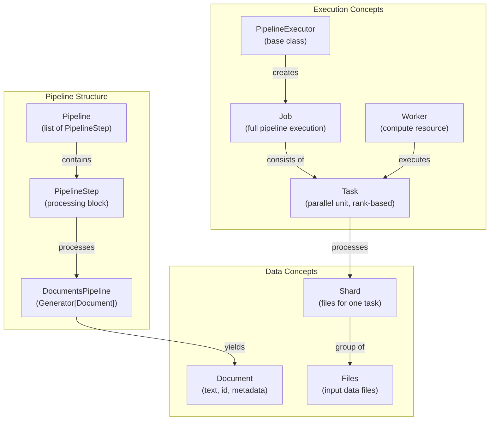
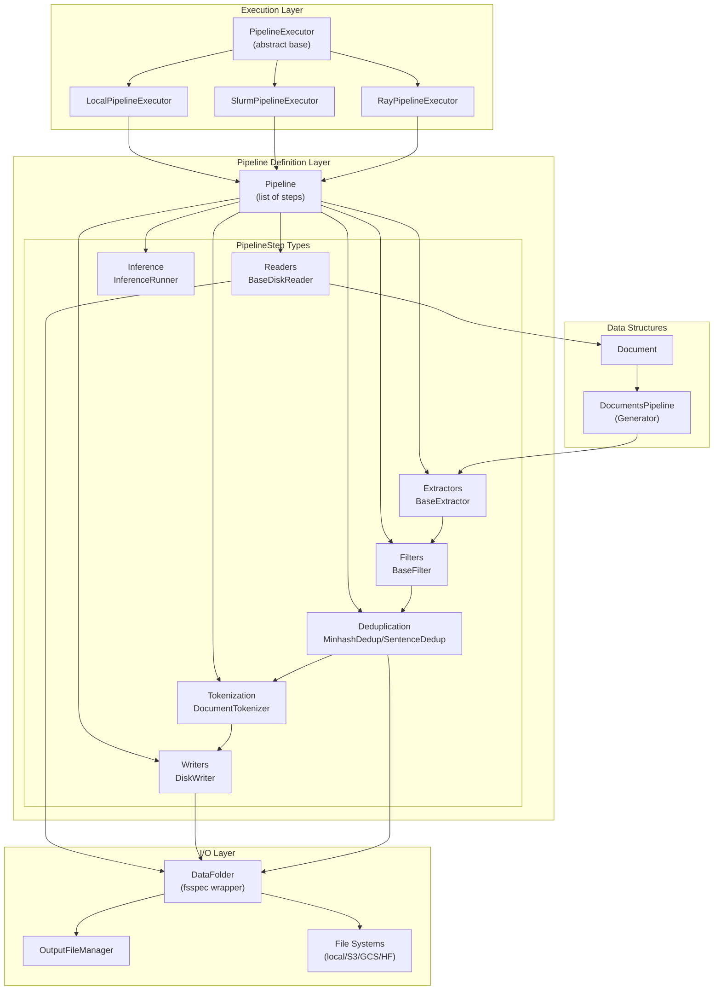
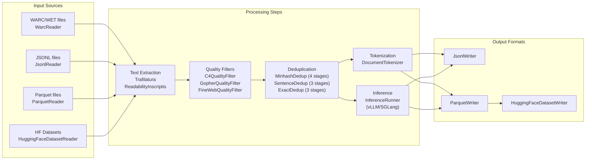
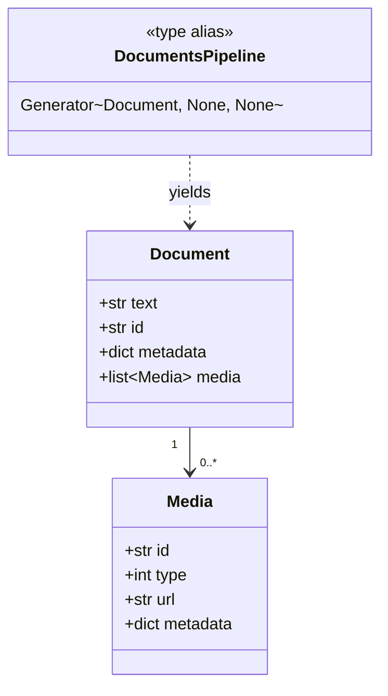
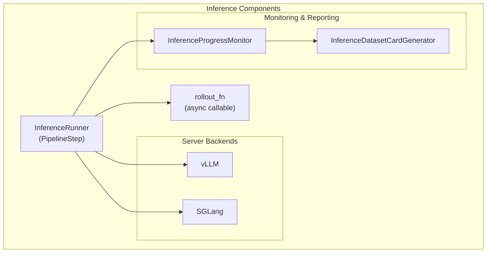

<!-- source: DeepWiki mcp.deepwiki.com · repo huggingface/datatrove · page 1 Overview · fetched 2026-10-26 -->

# Overview

Relevant source files

The following files were used as context for generating this wiki page:

- [.gitignore](.gitignore)
- [README.md](README.md)
- [examples/inference/README.md](examples/inference/README.md)
- [pyproject.toml](pyproject.toml)
- [src/datatrove/__init__.py](src/datatrove/__init__.py)
- [src/datatrove/data.py](src/datatrove/data.py)
- [src/datatrove/pipeline/__init__.py](src/datatrove/pipeline/__init__.py)
- [src/datatrove/utils/__init__.py](src/datatrove/utils/__init__.py)
- [src/datatrove/utils/_import_utils.py](src/datatrove/utils/_import_utils.py)
- [src/datatrove/utils/dataset.py](src/datatrove/utils/dataset.py)
- [tests/pipeline/writers/test_disk_writer.py](tests/pipeline/writers/test_disk_writer.py)
- [uv.lock](uv.lock)

DataTrove is a Python library for processing, filtering, and deduplicating large-scale text data. It provides prebuilt processing blocks with a modular framework for custom functionality, designed for preparing high-quality training data for large language models.

## Purpose and Scope

DataTrove processes massive text datasets with relatively low memory usage through its multi-step pipeline design. Key capabilities include:

- **Data Ingestion**: Format-specific readers (`WarcReader`, `JsonlReader`, `CsvReader`, `ParquetReader`, `HuggingFaceDatasetReader`)
- **Content Extraction**: HTML-to-text conversion (`Trafilatura`, `ReadabilityInscriptis`)
- **Quality Filtering**: Multiple filter implementations (`GopherQualityFilter`, `C4QualityFilter`, `FineWebQualityFilter`, `LanguageFilter`)
- **Deduplication**: Three-level deduplication (`MinhashDedup`, `SentenceDedup`, `ExactDedup`)
- **Synthetic Data Generation**: LLM-powered inference system (`InferenceRunner` with vLLM/SGLang backends)
- **Tokenization**: Training-ready data preparation (`DocumentTokenizer`)
- **Cross-Platform Execution**: Platform-agnostic pipelines (`LocalPipelineExecutor`, `SlurmPipelineExecutor`, `RayPipelineExecutor`)
- **File System Abstraction**: Unified I/O (`DataFolder` with fsspec for local/S3/GCS/HuggingFace Hub)

Sources: [README.md:1-7](), [pyproject.toml:2-4](), [README.md:10-62]()

## Core Concepts

**Execution Model:**
- **Pipeline**: List of `PipelineStep` instances that process data sequentially [README.md:80-80]().
- **PipelineExecutor**: Abstract base class that orchestrates pipeline execution on specific platforms [README.md:81-81]().
- **Job**: Complete execution of a pipeline, managed by an executor [README.md:82-82]().
- **Task**: Individual parallel unit of work with unique rank (0 to `tasks-1`) [README.md:83-83]().
- **Worker**: Compute resource (CPU core, cluster node) that executes tasks [README.md:88-88]().
- **Shard**: Subset of input files assigned to a specific task based on rank [README.md:87-87]().

**Data Model:**
- **Document**: Core data structure with `text` (str), `id` (str), and `metadata` (dict) fields [src/datatrove/data.py:38-55]().
- **DocumentsPipeline**: Type alias for `Generator[Document, None, None]` - the data flow between steps [src/datatrove/data.py:58-58]().
- **Files**: Input data files distributed across tasks via modulo-based sharding [README.md:84-86]().

Sources: [README.md:79-91](), [src/datatrove/data.py:38-58]()

## Layered Architecture

DataTrove follows a layered architecture with clear separation of concerns:

**Execution Layer**:
- `PipelineExecutor` (abstract): Defines interface for running pipelines [README.md:81-81]().
- `LocalPipelineExecutor`: Multiprocessing-based execution on single machine [README.md:21-21]().
- `SlurmPipelineExecutor`: HPC cluster execution via sbatch job arrays [README.md:22-22]().
- `RayPipelineExecutor`: Distributed execution on Ray clusters [README.md:23-23]().

**Pipeline Definition Layer**:
- `Pipeline`: Python list of `PipelineStep` instances [README.md:80-80]().
- Specialized step types include readers, extractors, filters, deduplicators, tokenizers, and inference runners [README.md:106-113]().

**I/O Layer**:
- `DataFolder`: Wraps fsspec for storage backend abstraction [README.md:26-26]().
- Supports local, S3, and HuggingFace Hub [README.md:7-7]().

**Data Structures**:
- `Document`: Core data class with `text`, `id`, `metadata` fields [src/datatrove/data.py:38-55]().
- `DocumentsPipeline`: Type alias for document generator stream [src/datatrove/data.py:58-58]().

Sources: [README.md:20-26](), [src/datatrove/data.py:38-58]()

## Pipeline Processing Flow

**Data Flow Pattern:**
Each pipeline block takes a generator of `Document` as input and returns another generator of `Document` [README.md:107-107]().

| Stage | Classes | Purpose |
|-------|---------|---------|
| **Reading** | `BaseReader`, `JsonlReader`, `ParquetReader` | Load files and create `Document` objects [README.md:108-108](). |
| **Extraction** | `BaseExtractor`, `Trafilatura` | Extract text from HTML/raw formats [README.md:110-110](). |
| **Filtering** | `BaseFilter`, `C4QualityFilter` | Remove low-quality documents [README.md:111-111](). |
| **Deduplication** | `MinhashDedup`, `SentenceDedup` | Remove duplicate content [README.md:112-112](). |
| **Tokenization** | `DocumentTokenizer` | Convert text to training-ready tokens [pyproject.toml:59-59](). |
| **Inference** | `InferenceRunner` | Generate synthetic data using LLMs [examples/inference/README.md:27-27](). |
| **Writing** | `DiskWriter`, `JsonlWriter` | Save processed documents [README.md:109-109](). |

Sources: [README.md:107-113](), [examples/inference/README.md:27-27]()

## Document Data Structure

The `Document` class is the atomic unit of data flowing through pipelines:

**Core Fields:**

| Field | Type | Description |
|-------|------|-------------|
| `text` | `str` | Main text content of the document [src/datatrove/data.py:52-52](). |
| `id` | `str` | Unique identifier [src/datatrove/data.py:53-53](). |
| `metadata` | `dict` | Extensible storage for source info, statistics, flags [src/datatrove/data.py:55-55](). |
| `media` | `list[Media]` | Associated images or media objects [src/datatrove/data.py:54-54](). |

Sources: [src/datatrove/data.py:38-58]()

## Inference System

DataTrove includes a sophisticated inference system for synthetic data generation using LLMs:

**Key Features:**
- **Local & Distributed**: Run on single machines or Slurm clusters [examples/inference/README.md:24-25]().
- **Fault Tolerance**: Automatic chunking and checkpoint recovery [examples/inference/README.md:27-27]().
- **Async Processing**: Uses async rollouts for efficient batching [examples/inference/README.md:14-14]().
- **Live Monitoring**: Lightweight monitor jobs update dataset cards with live progress and ETA [examples/inference/README.md:56-56]().

Sources: [examples/inference/README.md:12-77]()

## Task Orchestration and Completion Tracking

DataTrove implements robust task management with automatic resume capabilities:

**Completion Tracking:**
- DataTrove keeps track of which tasks have completed [README.md:83-83]().
- When relaunching a job, only incomplete tasks will run [README.md:83-83]().
- Task parallelization is achieved by assigning each task a different non-overlapping `shard` of data [README.md:87-87]().

**HF Hub Reliability:**
- When writing to `hf://` paths, the system handles transient Hub errors (e.g., `429 Too Many Requests`) with exponential backoff [examples/inference/README.md:79-80]().
- Transient open errors are retried by the `DiskWriter` [tests/pipeline/writers/test_disk_writer.py:200-200]().

Sources: [README.md:83-87](), [examples/inference/README.md:79-80](), [tests/pipeline/writers/test_disk_writer.py:200-200]()

## Advanced Features

### Deduplication Systems

DataTrove implements three sophisticated deduplication approaches:

1. **MinHash deduplication**: Document-level deduplication using locality-sensitive hashing [README.md:74-74]().
2. **Sentence deduplication**: Identifying and removing duplicate sentences [README.md:75-75]().
3. **Exact substring deduplication**: Removing texts that are substrings of others [README.md:76-76]().

### Tokenization and Data Preparation

DataTrove supports efficient tokenization for large datasets:
- **DocumentTokenizer**: Converts documents into tokenized binary formats [pyproject.toml:59-59]().
- **DatatroveFileDataset**: Optimized PyTorch dataset for sequential reads of tokenized files [src/datatrove/utils/dataset.py:25-41]().
- Supports position tracking and EOS-based position resetting [src/datatrove/utils/dataset.py:48-50]().

Sources: [README.md:74-76](), [src/datatrove/utils/dataset.py:25-50]()

---

