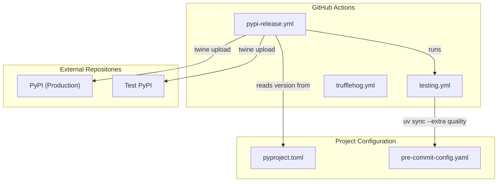
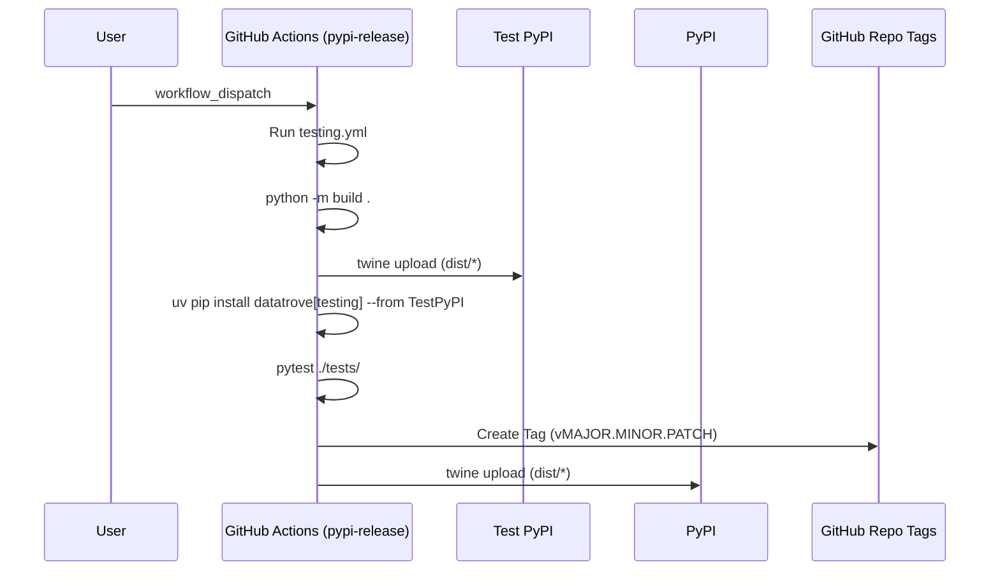

<!-- source: DeepWiki mcp.deepwiki.com · repo huggingface/datatrove · page 10.1 CI/CD and Release Process · fetched 2026-10-26 -->

# CI/CD and Release Process

Relevant source files

The following files were used as context for generating this wiki page:

- [.github/workflows/pypi-release.yml](.github/workflows/pypi-release.yml)
- [.github/workflows/testing.yml](.github/workflows/testing.yml)
- [.github/workflows/trufflehog.yml](.github/workflows/trufflehog.yml)
- [.pre-commit-config.yaml](.pre-commit-config.yaml)

DataTrove utilizes GitHub Actions to maintain code quality, automate testing across multiple Python versions, and manage the deployment lifecycle to PyPI. The CI/CD infrastructure is designed to ensure that the distributed processing capabilities (Ray, Slurm, Multiprocessing) remain stable across updates.

## Code Quality and Continuous Integration

The primary CI workflow, defined in `testing.yml`, is triggered on every push and pull request to the `main` branch [ .github/workflows/testing.yml:3-9 ](). It consists of two parallel tracks: linting/formatting and functional testing.

### Linting and Formatting
The project uses `ruff` for both linting and code formatting [ .github/workflows/testing.yml:29-30 ](). This is also enforced locally via `pre-commit` hooks [ .pre-commit-config.yaml:1-10 ](). The CI environment uses `uv` to synchronize dependencies with the `quality` extra [ .github/workflows/testing.yml:26 ]().

### Automated Testing
DataTrove is tested against Python versions 3.10, 3.11, 3.12, and 3.13 [ .github/workflows/testing.yml:38 ](). 

A critical implementation detail in the test suite involves how `pytest` is invoked. The workflow avoids using `uv run` for the final execution because Ray workers (used in `RayPipelineExecutor` tests) inherit the launcher's environment. If `uv run` is used, workers attempt to recreate environments from project metadata, which can drop the `testing` extras and cause import failures [ .github/workflows/testing.yml:55-57 ](). Instead, the tests are run directly via the virtual environment's python binary [ .github/workflows/testing.yml:57 ]().

### Secret Scanning
The `trufflehog.yml` workflow runs on every push to detect potential secret leaks [ .github/workflows/trufflehog.yml:1-4 ](). It uses the `trufflehog` action with the `--only-verified` flag to minimize false positives [ .github/workflows/trufflehog.yml:15-17 ]().

| Job | Tool | Purpose |
| :--- | :--- | :--- |
| `check_code_quality` | `ruff` | Enforces style and static analysis [ .github/workflows/testing.yml:29-30 ]() |
| `test` | `pytest` | Executes unit and integration tests across Python 3.10-3.13 [ .github/workflows/testing.yml:32-58 ]() |
| `trufflehog` | `trufflehog` | Scans for leaked credentials/tokens [ .github/workflows/trufflehog.yml:7-18 ]() |

**Sources:** [ .github/workflows/testing.yml:1-58 ](), [ .github/workflows/trufflehog.yml:1-18 ](), [ .pre-commit-config.yaml:1-10 ]()

## Release Process and PyPI Deployment

The release process is a manual `workflow_dispatch` trigger that automates the transition from source code to a tagged PyPI release [ .github/workflows/pypi-release.yml:3-4 ]().

### Release Workflow Stages

The `pypi-release.yml` workflow implements a multi-stage validation process:

1.  **Testing Prerequisite**: The release job requires the `testing` workflow to pass successfully before proceeding [ .github/workflows/pypi-release.yml:8-10 ]().
2.  **Distribution Build**: The package is built using the `build` module, generating `.whl` and `sdist` files [ .github/workflows/pypi-release.yml:33 ]().
3.  **Test PyPI Upload**: The artifacts are first uploaded to `testpypi` using `twine` [ .github/workflows/pypi-release.yml:38 ]().
4.  **Integration Verification**: The workflow installs the newly uploaded package from `testpypi` into a fresh environment and re-runs the full test suite to ensure the distribution is functional [ .github/workflows/pypi-release.yml:45-52 ]().
5.  **Tagging**: Upon successful verification, the workflow extracts the version from `pyproject.toml` and creates a corresponding Git tag (e.g., `v0.1.0`) [ .github/workflows/pypi-release.yml:40-44 ](), [ .github/workflows/pypi-release.yml:54-63 ]().
6.  **Production PyPI Upload**: The final step publishes the verified artifacts to the production PyPI repository [ .github/workflows/pypi-release.yml:67-70 ]().

### CI/CD to Code Entity Mapping

The following diagram illustrates how GitHub Actions workflows interact with project configuration and external repositories.

**Workflow and Entity Interaction**

**Sources:** [ .github/workflows/pypi-release.yml:1-71 ](), [ .github/workflows/testing.yml:1-58 ]()

## Secret Management

The CI/CD pipeline relies on several GitHub Secrets for authentication:

*   `TEST_PYPI_TOKEN`: Used for the initial upload to the Test PyPI repository [ .github/workflows/pypi-release.yml:37 ]().
*   `PYPI_TOKEN`: Used for the final production release [ .github/workflows/pypi-release.yml:69 ]().
*   `GITHUB_TOKEN`: Automatically provided by GitHub, used to create Git tags during the release process [ .github/workflows/pypi-release.yml:65 ]().

### Versioning Logic
The release workflow dynamically determines the tag name by parsing the `version` field in `pyproject.toml` using `grep` and `cut` [ .github/workflows/pypi-release.yml:43 ](). This ensures that the Git tag always matches the package version metadata.

**Release Execution Flow**

**Sources:** [ .github/workflows/pypi-release.yml:33-71 ](), [ .github/workflows/testing.yml:57 ]()

---

