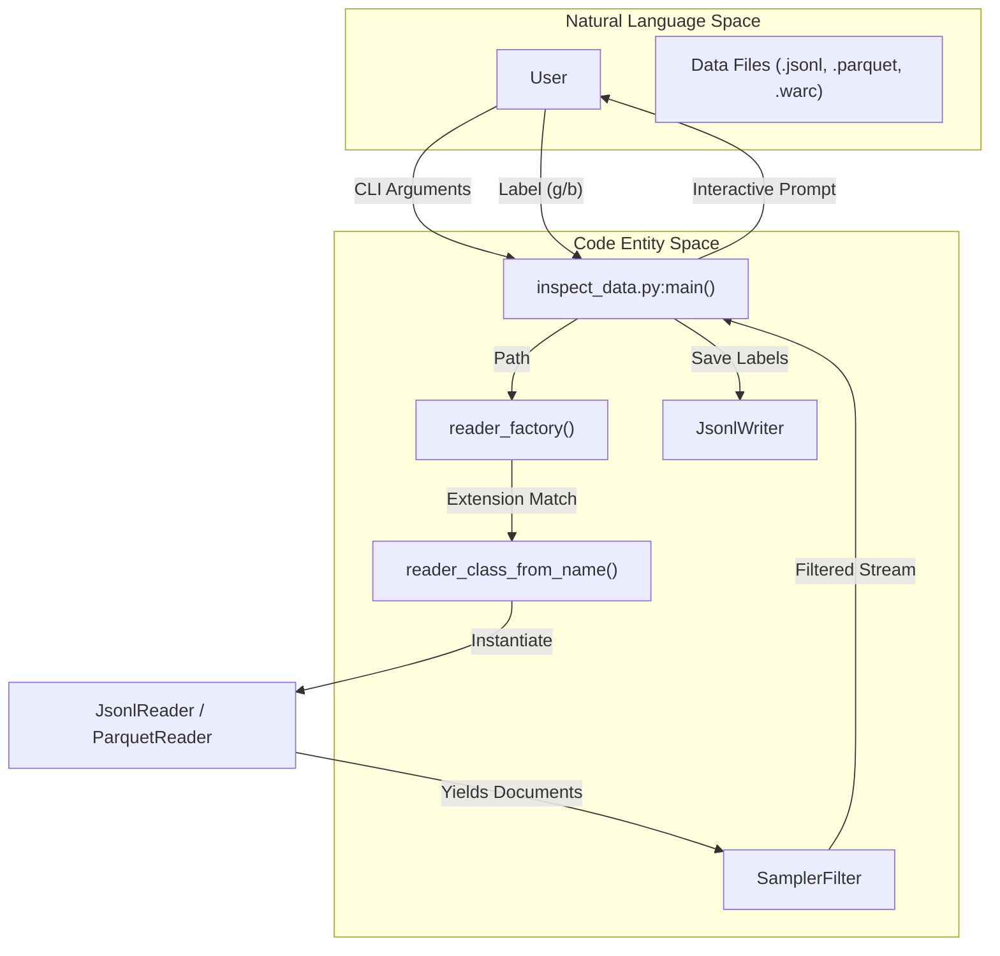
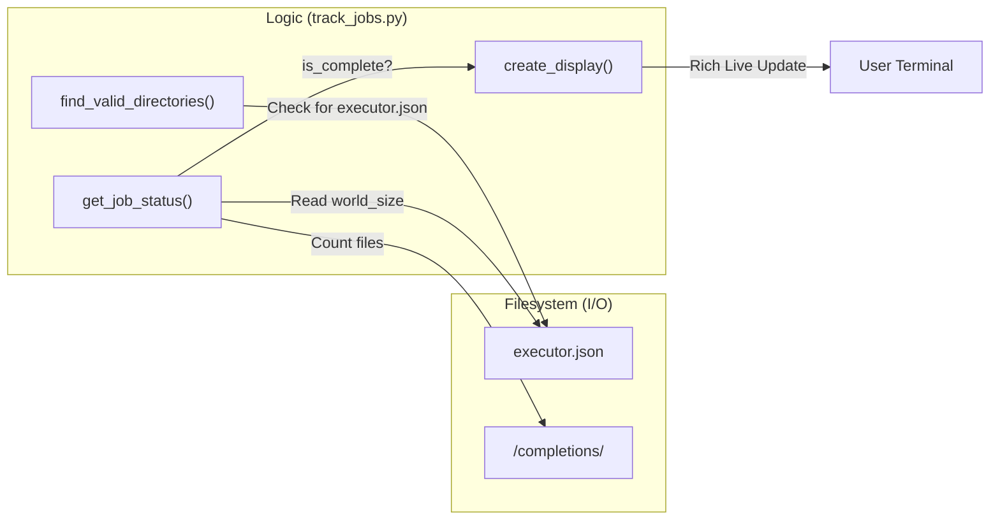

<!-- source: DeepWiki mcp.deepwiki.com · repo huggingface/datatrove · page 10.2 CLI Tools and Utilities · fetched 2026-10-26 -->

# CLI Tools and Utilities

Relevant source files

The following files were used as context for generating this wiki page:

- [src/datatrove/io.py](src/datatrove/io.py)
- [src/datatrove/pipeline/writers/jsonl.py](src/datatrove/pipeline/writers/jsonl.py)
- [src/datatrove/tools/__init__.py](src/datatrove/tools/__init__.py)
- [src/datatrove/tools/check_dataset.py](src/datatrove/tools/check_dataset.py)
- [src/datatrove/tools/inspect_data.py](src/datatrove/tools/inspect_data.py)
- [src/datatrove/tools/launch_pickled_pipeline.py](src/datatrove/tools/launch_pickled_pipeline.py)
- [src/datatrove/tools/merge_stats.py](src/datatrove/tools/merge_stats.py)
- [src/datatrove/tools/track_jobs.py](src/datatrove/tools/track_jobs.py)

DataTrove provides a suite of command-line interface (CLI) tools designed to manage large-scale data processing workflows. These utilities facilitate dataset validation, statistical analysis, job monitoring, and interactive data inspection. They are built upon the core `datatrove.io` and `datatrove.pipeline` abstractions to ensure consistency across local and distributed environments.

## Overview of CLI Utilities

The following table summarizes the primary CLI entry points available in the `datatrove.tools` package:

| Tool | Purpose | Key Dependencies |
| :--- | :--- | :--- |
| `check_dataset` | Validates `.ds` (tokens) and `.ds.index` (offsets) file integrity. | `numpy`, `tokenizers` |
| `merge_stats` | Aggregates JSON statistics from multiple pipeline tasks into a single summary. | `tqdm` |
| `launch_pickled_pipeline` | Resumes or launches a `PipelineExecutor` serialized via `dill`. | `dill` |
| `inspect_data` | Interactive terminal UI to browse and label document samples. | `rich` |
| `track_jobs` | Real-time monitoring of job completion status across multiple logging directories. | `rich` |

Sources: [src/datatrove/tools/check_dataset.py:18-21](), [src/datatrove/tools/merge_stats.py:12-12](), [src/datatrove/tools/launch_pickled_pipeline.py:9-9](), [src/datatrove/tools/inspect_data.py:16-18](), [src/datatrove/tools/track_jobs.py:20-20]()

## Data Inspection and Labeling (`inspect_data`)

The `inspect_data` utility provides a high-level interface for developers to verify the output of their pipelines. It dynamically selects a `Reader` based on file extensions and uses the `rich` library to render document text and metadata in the terminal.

### Data Flow for Inspection
The tool follows a factory pattern to instantiate the correct reader and optionally applies a `SamplerFilter` to reduce the volume of data displayed.

**Key Implementation Details:**
- **Reader Selection**: The `reader_factory` function inspects the first file in the target `DataFolder` to guess the format (e.g., `.jsonl.gz`, `.parquet`, `.warc`) [src/datatrove/tools/inspect_data.py:68-97]().
- **Filtering**: Users can provide a Python expression (e.g., `x.metadata['token_count'] > 5000`) which is evaluated via a lambda in `get_filter_expr` [src/datatrove/tools/inspect_data.py:100-109]().
- **Labeling**: Documents can be marked as "good" or "bad" and are saved using `JsonlWriter` to a specified `label_folder` [src/datatrove/tools/inspect_data.py:152-175]().

Sources: [src/datatrove/tools/inspect_data.py:53-66](), [src/datatrove/tools/inspect_data.py:112-177]()

## Dataset Integrity Verification (`check_dataset`)

This tool ensures that tokenized datasets (typically produced by `DocumentTokenizer`) are correctly formatted. It specifically validates the alignment between data files (`.ds`) and their corresponding index files (`.ds.index`).

**Validation Logic:**
1. **File Alignment**: Asserts that every `.ds` file has a matching `.ds.index` and, optionally, a `.ds.loss` file [src/datatrove/tools/check_dataset.py:76-82]().
2. **Document Boundaries**: Loads `uint64` offsets from the index using `numpy.frombuffer` [src/datatrove/tools/check_dataset.py:24-34]().
3. **EOS Check**: Iterates through each document and verifies that the last token matches the `eos_token` provided by the `load_tokenizer` function [src/datatrove/tools/check_dataset.py:95-100]().

Sources: [src/datatrove/tools/check_dataset.py:56-102](), [src/datatrove/tools/check_dataset.py:37-53]()

## Statistics Aggregation (`merge_stats`)

Pipeline executors generate individual JSON statistics files for every task (rank). `merge_stats` consolidates these into a single report.

**Implementation:**
- The tool iterates through all files in the stats directory and deserializes them into `PipelineStats` objects [src/datatrove/tools/merge_stats.py:33-35]().
- It utilizes the `__add__` implementation of `PipelineStats` to sum counters and average timings across all tasks [src/datatrove/tools/merge_stats.py:36-36]().
- The final result is saved to disk and logged to the console [src/datatrove/tools/merge_stats.py:37-40]().

Sources: [src/datatrove/tools/merge_stats.py:26-41]()

## Job Monitoring (`track_jobs`)

`track_jobs` provides a terminal-based dashboard for monitoring distributed processing progress. It is particularly useful for Slurm or Ray executions where hundreds of tasks may be running concurrently.

**Key Mechanisms:**
- **Completion Detection**: It calculates progress by comparing the number of files in the `completions` subdirectory against the `world_size` defined in `executor.json` [src/datatrove/tools/track_jobs.py:63-75]().
- **Caching**: To handle large numbers of directories, it maintains an `invalid_dirs_cache` and `completed_jobs_cache` to avoid redundant I/O operations [src/datatrove/tools/track_jobs.py:35-60]().
- **Visualization**: Uses `rich.live.Live` to create a dynamic progress bar that updates at a user-defined interval [src/datatrove/tools/track_jobs.py:87-171]().

Sources: [src/datatrove/tools/track_jobs.py:27-53](), [src/datatrove/tools/track_jobs.py:56-85]()

## Executing Pickled Pipelines (`launch_pickled_pipeline`)

In distributed environments, executors often serialize the entire pipeline state to a `.pik` file to ensure workers have identical configurations.

- **Loading**: The tool uses `dill.load` to reconstruct the `PipelineExecutor` object from the file [src/datatrove/tools/launch_pickled_pipeline.py:16-17]().
- **Execution**: Once loaded, it calls `executor.run()`, which initiates the processing logic specific to that executor (e.g., starting Slurm jobs or local worker processes) [src/datatrove/tools/launch_pickled_pipeline.py:18-18]().

Sources: [src/datatrove/tools/launch_pickled_pipeline.py:14-18]()

---

