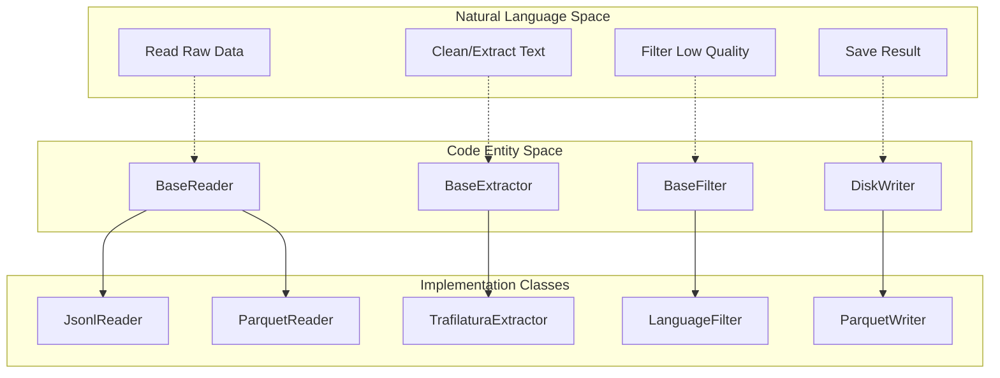
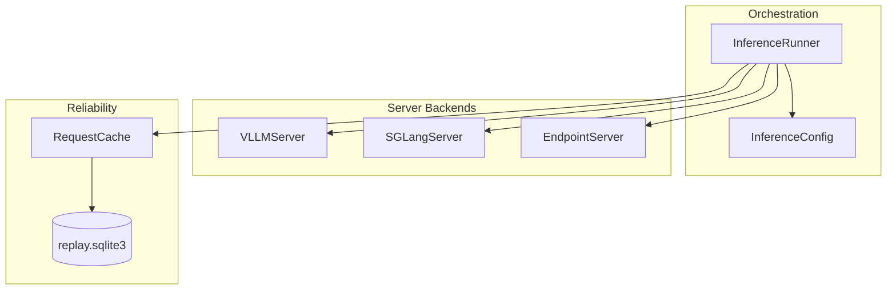

<!-- source: DeepWiki mcp.deepwiki.com · repo huggingface/datatrove · page 11 Glossary · fetched 2026-10-26 -->

# Glossary

Relevant source files

The following files were used as context for generating this wiki page:

- [.gitignore](.gitignore)
- [README.md](README.md)
- [examples/inference/README.md](examples/inference/README.md)
- [pyproject.toml](pyproject.toml)
- [src/datatrove/data.py](src/datatrove/data.py)
- [src/datatrove/executor/base.py](src/datatrove/executor/base.py)
- [src/datatrove/executor/local.py](src/datatrove/executor/local.py)
- [src/datatrove/executor/slurm.py](src/datatrove/executor/slurm.py)
- [src/datatrove/pipeline/dedup/bloom_filter.py](src/datatrove/pipeline/dedup/bloom_filter.py)
- [src/datatrove/pipeline/dedup/exact_substrings.py](src/datatrove/pipeline/dedup/exact_substrings.py)
- [src/datatrove/pipeline/dedup/minhash.py](src/datatrove/pipeline/dedup/minhash.py)
- [src/datatrove/pipeline/dedup/sentence_dedup.py](src/datatrove/pipeline/dedup/sentence_dedup.py)
- [src/datatrove/pipeline/inference/checkpointing.py](src/datatrove/pipeline/inference/checkpointing.py)
- [src/datatrove/pipeline/inference/run_inference.py](src/datatrove/pipeline/inference/run_inference.py)
- [src/datatrove/pipeline/inference/servers/base.py](src/datatrove/pipeline/inference/servers/base.py)
- [src/datatrove/pipeline/inference/servers/dummy_server.py](src/datatrove/pipeline/inference/servers/dummy_server.py)
- [src/datatrove/pipeline/tokens/context_shuffler.py](src/datatrove/pipeline/tokens/context_shuffler.py)
- [src/datatrove/pipeline/tokens/megatron_tokenizer.py](src/datatrove/pipeline/tokens/megatron_tokenizer.py)
- [src/datatrove/pipeline/tokens/merger.py](src/datatrove/pipeline/tokens/merger.py)
- [src/datatrove/pipeline/tokens/tokenizer.py](src/datatrove/pipeline/tokens/tokenizer.py)
- [src/datatrove/utils/_import_utils.py](src/datatrove/utils/_import_utils.py)
- [src/datatrove/utils/dataset.py](src/datatrove/utils/dataset.py)
- [src/datatrove/utils/text.py](src/datatrove/utils/text.py)
- [src/datatrove/utils/tokenization.py](src/datatrove/utils/tokenization.py)
- [tests/pipeline/writers/test_disk_writer.py](tests/pipeline/writers/test_disk_writer.py)
- [uv.lock](uv.lock)

This page provides definitions and technical implementation details for codebase-specific terms, jargon, and domain concepts used throughout DataTrove.

## Core Concepts

### Document
The fundamental unit of data in DataTrove. Every `PipelineStep` consumes and yields `Document` objects.
*   **Implementation**: A dataclass containing `text` (string), `id` (string), and `metadata` (dictionary) [src/datatrove/data.py:101-105]().
*   **Data Flow**: Readers instantiate `Document` objects from raw files; subsequent steps modify the `text` or `metadata` before Writers persist them.

### Pipeline
A sequence of processing steps (readers, filters, writers) that define a data processing workflow [README.md:79-80]().
*   **Implementation**: Typically a `list` of `PipelineStep` instances or custom callables [src/datatrove/executor/base.py:57-58]().

### PipelineStep
The base class for all processing blocks in DataTrove [src/datatrove/pipeline/base.py:21-21]().
*   **Implementation**: Each step implements a `run` method (or acts as a generator) that accepts a `DocumentsPipeline` (a generator of Documents) and yields a `DocumentsPipeline` [README.md:107-107]().

### Executor
A component responsible for launching and managing the execution of a `Pipeline` across different environments (local, Slurm, Ray) [README.md:81-81]().
*   **Implementation**: Inherits from `PipelineExecutor` [src/datatrove/executor/base.py:37-37](). It handles task sharding, logging setup, and completion tracking [src/datatrove/executor/base.py:102-154]().

### Task
A single unit of work within a `Job`. A job is split into multiple tasks to enable parallelization [README.md:83-83]().
*   **Implementation**: Each task is assigned a unique `rank` and processes a specific `shard` of the input data [src/datatrove/executor/base.py:109-110]().

### Worker
A compute resource (e.g., a CPU core or a Slurm job slot) that executes one `Task` at a time [README.md:88-88]().

### Shard
A subset of the total input data assigned to a specific `Task` [README.md:87-87]().

---

## Data Transformation Space

This diagram bridges the conceptual "Natural Language Space" (what a user wants to do) to the "Code Entity Space" (the classes that perform the work).

**Data Transformation Mapping**

**Sources:** [src/datatrove/pipeline/readers/jsonl.py:14-14](), [src/datatrove/pipeline/writers/disk_base.py:15-15](), [README.md:108-113]().

---

## Execution and Infrastructure

### Slurm Job Array
A mechanism used by `SlurmPipelineExecutor` to launch hundreds or thousands of tasks as a single Slurm job entity [src/datatrove/executor/slurm.py:50-58]().
*   **Code Pointer**: The executor generates an `sbatch` script using `#SBATCH --array=...` to handle task distribution [src/datatrove/executor/slurm.py:50-50]().

### Completion Tracking
A mechanism to ensure idempotency. If a pipeline is interrupted, DataTrove can skip already processed tasks.
*   **Implementation**: The `mark_rank_as_completed` method creates a zero-byte file in a `completions/` subdirectory within the `logging_dir` [src/datatrove/executor/base.py:167-175]().

### Fsspec / DataFolder
An abstraction layer for file I/O that allows DataTrove to treat local paths, S3 buckets, and Hugging Face Hub paths interchangeably.
*   **Implementation**: Managed via `get_datafolder` which returns a `DataFolder` instance [src/datatrove/io.py:11-11]().

---

## Deduplication Jargon

### MinHash
A technique for near-duplicate detection by estimating the Jaccard similarity between documents.
*   **Shingles**: Hashed n-grams used as input for MinHash [src/datatrove/pipeline/dedup/minhash.py:190-200]().
*   **Signatures**: A collection of minimum hash values that represent a document's content [src/datatrove/pipeline/dedup/minhash.py:172-189]().
*   **Buckets**: Used in Locality Sensitive Hashing (LSH) to group similar signatures [src/datatrove/pipeline/dedup/minhash.py:46-47]().

### Sentence Dedup
Exact deduplication at the sentence level, popularized by the C4 dataset processing [src/datatrove/pipeline/dedup/sentence_dedup.py:1-4]().
*   **n-sentence span**: A sequence of `n` sentences that are hashed together to detect duplicates [src/datatrove/pipeline/dedup/sentence_dedup.py:43-43]().

---

## Inference and Synthetic Data

### InferenceRunner
The core pipeline step for calling LLMs to generate data [src/datatrove/pipeline/inference/run_inference.py:125-125]().
*   **Rollout Function**: A user-defined function (`rollout_fn`) that determines how a `Document` is transformed into a model prompt [src/datatrove/pipeline/inference/run_inference.py:139-140]().

### RequestCache
A SQLite-backed cache that stores LLM responses to allow for resuming interrupted inference jobs without re-generating existing results [src/datatrove/pipeline/inference/checkpointing.py:38-41]().
*   **Implementation**: Uses `aiosqlite` to store `payload_hash` and the corresponding `result` [src/datatrove/pipeline/inference/checkpointing.py:64-73]().

**Inference System Architecture**

**Sources:** [src/datatrove/pipeline/inference/run_inference.py:26-34](), [src/datatrove/pipeline/inference/checkpointing.py:38-41]().

---

## Tokenization

### TokenizedFile
A binary format for storing tokenized text, optimized for training LLMs [src/datatrove/pipeline/tokens/tokenizer.py:23-23]().
*   **Index File**: A `.index` file containing `uint64` offsets marking the end of each document in the token stream [src/datatrove/pipeline/tokens/tokenizer.py:79-85]().
*   **Loss Metadata**: Optional `.loss` file storing boolean masks for tokens [src/datatrove/pipeline/tokens/tokenizer.py:65-66]().

**Sources:**
*   Executor Base: [src/datatrove/executor/base.py:37-175]()
*   Local Executor: [src/datatrove/executor/local.py:15-152]()
*   Slurm Executor: [src/datatrove/executor/slurm.py:48-168]()
*   Document Data: [src/datatrove/data.py:101-105]()
*   Inference Core: [src/datatrove/pipeline/inference/run_inference.py:42-154]()
*   MinHash: [src/datatrove/pipeline/dedup/minhash.py:40-200]()
*   Sentence Dedup: [src/datatrove/pipeline/dedup/sentence_dedup.py:41-105]()
*   Tokenization: [src/datatrove/pipeline/tokens/tokenizer.py:23-85]()