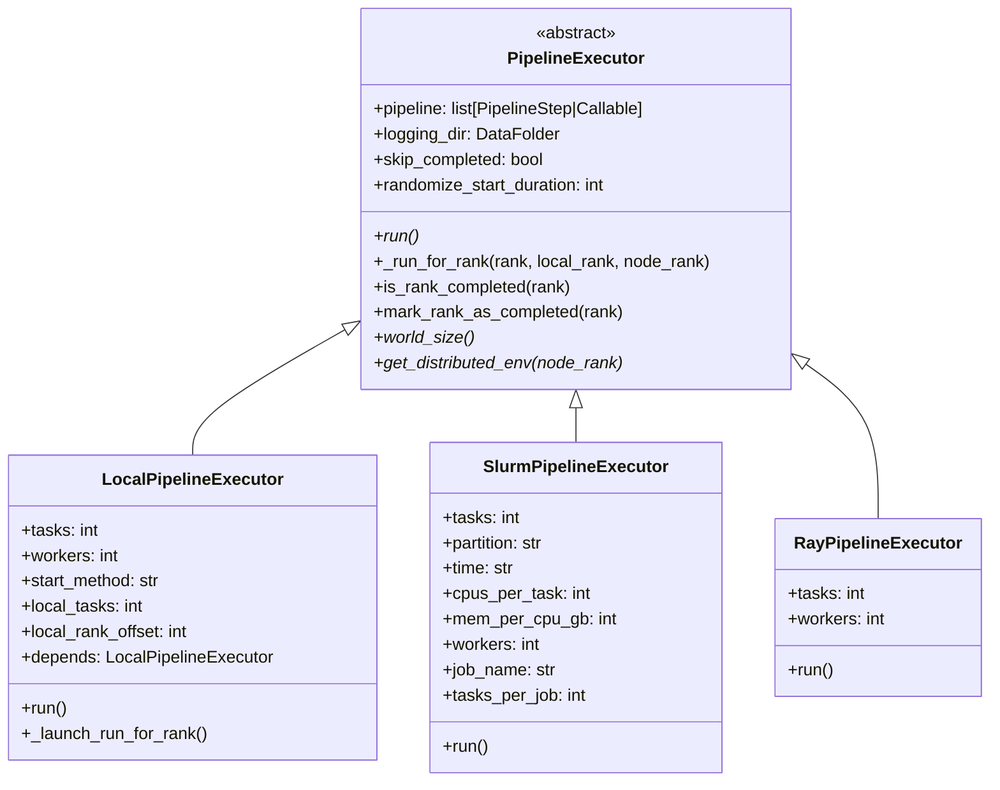
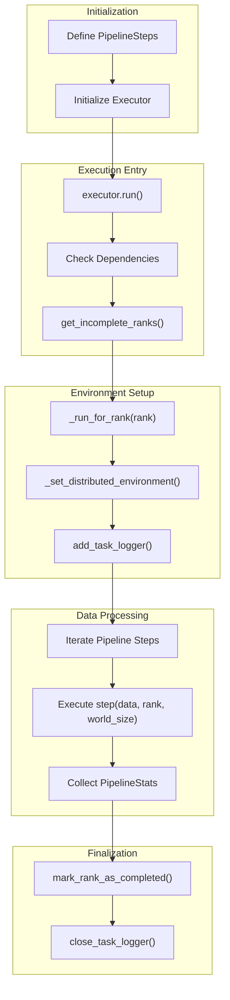

<!-- source: DeepWiki mcp.deepwiki.com · repo huggingface/datatrove · page 2 Pipeline Execution Architecture · fetched 2026-10-26 -->

# Pipeline Execution Architecture

Relevant source files

The following files were used as context for generating this wiki page:

- [src/datatrove/executor/base.py](src/datatrove/executor/base.py)
- [src/datatrove/executor/local.py](src/datatrove/executor/local.py)
- [src/datatrove/executor/slurm.py](src/datatrove/executor/slurm.py)
- [src/datatrove/pipeline/base.py](src/datatrove/pipeline/base.py)
- [src/datatrove/pipeline/filters/base_filter.py](src/datatrove/pipeline/filters/base_filter.py)
- [src/datatrove/pipeline/inference/distributed/__init__.py](src/datatrove/pipeline/inference/distributed/__init__.py)
- [src/datatrove/utils/logging.py](src/datatrove/utils/logging.py)
- [src/datatrove/utils/stats.py](src/datatrove/utils/stats.py)

## Purpose and Scope

The Pipeline Execution Architecture is the foundation of DataTrove's ability to process data at scale. It defines how data processing pipelines are executed, whether locally on a single machine or distributed across a Slurm or Ray cluster. This architecture provides a consistent interface while abstracting away the complexities of parallel and distributed execution.

This document covers the overall design of the execution framework, the different executor implementations, and how tasks are managed throughout the execution lifecycle. For details on specific executor implementations, see:
- [Local Pipeline Execution](#2.1)
- [Slurm Cluster Execution](#2.2)
- [Ray Distributed Execution](#2.3)

Sources: [src/datatrove/executor/base.py:37-47](), [src/datatrove/executor/local.py:15-34](), [src/datatrove/executor/slurm.py:48-106]()

## Core Architecture

The Pipeline Execution Architecture follows a hierarchical design with a common abstract base class and specialized implementations for different execution environments.

### Executor Class Hierarchy

Sources: [src/datatrove/executor/base.py:37-91](), [src/datatrove/executor/local.py:15-60](), [src/datatrove/executor/slurm.py:48-166]()

### Key Components

The architecture consists of an abstract base and specialized implementations:

1.  **`PipelineExecutor`**: The `ABC` defining the interface for all executors [src/datatrove/executor/base.py:37](). It manages the common logic for logging setup, statistics collection, and completion tracking.
2.  **`LocalPipelineExecutor`**: Uses `multiprocess` to run pipelines on a single machine [src/datatrove/executor/local.py:15]().
3.  **`SlurmPipelineExecutor`**: Generates and submits `sbatch` scripts for cluster execution [src/datatrove/executor/slurm.py:48]().
4.  **`RayPipelineExecutor`**: Leverages Ray for distributed task management across nodes.

Sources: [src/datatrove/executor/base.py:37-68](), [src/datatrove/executor/local.py:15-34](), [src/datatrove/executor/slurm.py:48-106]()

## Execution Model

DataTrove's execution model is built around the concept of **tasks**, which are the unit of parallelism.

### Task Execution Flow

Sources: [src/datatrove/executor/base.py:102-154](), [src/datatrove/executor/local.py:84-152](), [src/datatrove/executor/slurm.py:48-52]()

### Distributed Environment
The `PipelineExecutor` provides a standard way to propagate environment variables to workers via `get_distributed_env` [src/datatrove/executor/base.py:79-91](). These variables include node IPs, CPU/Memory limits, and the executor type [src/datatrove/executor/base.py:24-34]().

## Task Management

### Task Tracking and Resumability
Resumability is handled via "completion markers". The executor checks for the existence of a file in `logging_dir/completions/{rank:05d}` [src/datatrove/executor/base.py:165]().
- **`is_rank_completed(rank)`**: Returns `True` if the marker exists and `skip_completed` is enabled [src/datatrove/executor/base.py:156-165]().
- **`mark_rank_as_completed(rank)`**: Creates the empty marker file after a successful run [src/datatrove/executor/base.py:167-173]().

### Parallel Execution Strategy
- **Local**: Uses `multiprocess.Pool` with a configurable `start_method` (default: `forkserver`) [src/datatrove/executor/local.py:27, 134-135]().
- **Slurm**: Uses Slurm Job Arrays. A single Slurm job can handle multiple DataTrove tasks via `tasks_per_job` to minimize scheduler overhead [src/datatrove/executor/slurm.py:105, 142]().

## Pipeline Step Execution

The `_run_for_rank` method handles the lifecycle of a single task [src/datatrove/executor/base.py:102](). It pipes data from one step to the next:

1.  **Logging**: Initializes a `task_XXXXX.log` file [src/datatrove/executor/base.py:122]().
2.  **Step Execution**: Loops through `self.pipeline`. If a step is a `callable`, it is invoked with `(data, rank, world_size)` [src/datatrove/executor/base.py:130-132]().
3.  **Consumption**: If the final step returns a generator, it is exhausted using `deque(pipelined_data, maxlen=0)` [src/datatrove/executor/base.py:137-138]().
4.  **Stats**: `PipelineStats` are gathered from all steps and saved to disk [src/datatrove/executor/base.py:143-146]().

Sources: [src/datatrove/executor/base.py:102-154](), [src/datatrove/pipeline/base.py:9-130]()

## Logging and Statistics

### Statistics Infrastructure
DataTrove uses a tiered stats system:
- **`MetricStats`**: Tracks individual metrics (mean, min, max, variance) using Welford's online algorithm [src/datatrove/utils/stats.py:204-248]().
- **`Stats`**: A collection of `MetricStats` and `TimingStats` for a single `PipelineStep` [src/datatrove/utils/stats.py:55-67]().
- **`PipelineStats`**: Aggregates `Stats` across the entire pipeline for a specific rank [src/datatrove/utils/stats.py:132-139]().

Executors merge these stats at the end of a run to produce a global `stats.json` [src/datatrove/executor/local.py:148-150]().

### Logging Infrastructure
The `add_task_logger` function configures `loguru` to output to both `sys.stderr` and a task-specific log file [src/datatrove/utils/logging.py:40-77](). In distributed settings, logs are prefixed with `[NODE X]` to aid debugging [src/datatrove/utils/logging.py:61]().

Sources: [src/datatrove/utils/stats.py:132-201](), [src/datatrove/utils/logging.py:40-77]()

## Implementation Overviews

### LocalPipelineExecutor
For details, see [Local Pipeline Execution](#2.1).
It manages a `multiprocess.Manager` to handle a queue of available ranks and track completion across worker processes [src/datatrove/executor/local.py:113-118]().

### SlurmPipelineExecutor
For details, see [Slurm Cluster Execution](#2.2).
It handles the generation of complex `sbatch` scripts, including environment activation (conda/venv) and signal handling for job requeueing [src/datatrove/executor/slurm.py:41-45, 121-124]().

### RayPipelineExecutor
For details, see [Ray Distributed Execution](#2.3).
It maps DataTrove tasks to Ray remote functions, providing a middle ground between local multiprocessing and heavy Slurm clusters.

Sources: [src/datatrove/executor/local.py:15-48](), [src/datatrove/executor/slurm.py:48-144]()

---

