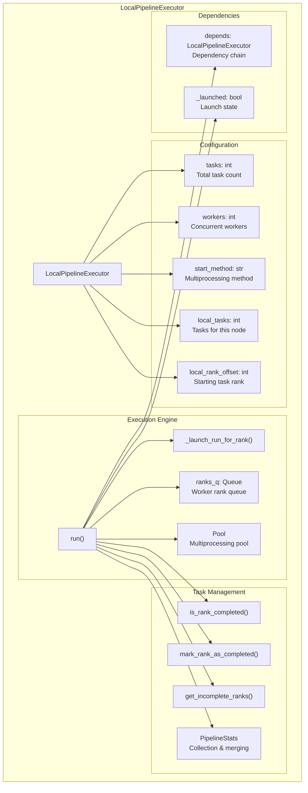
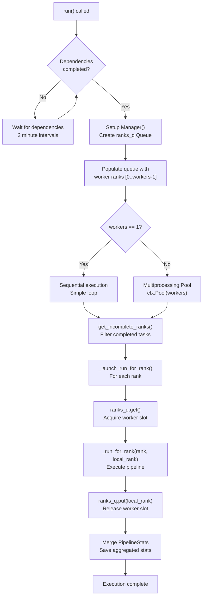
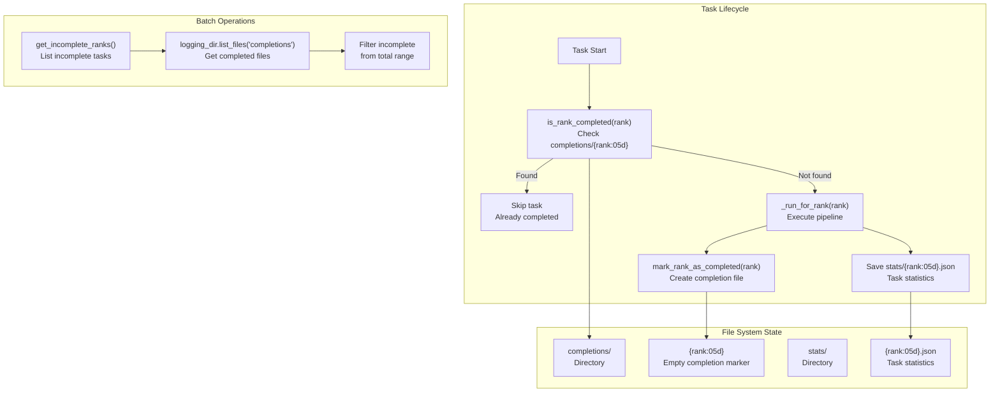
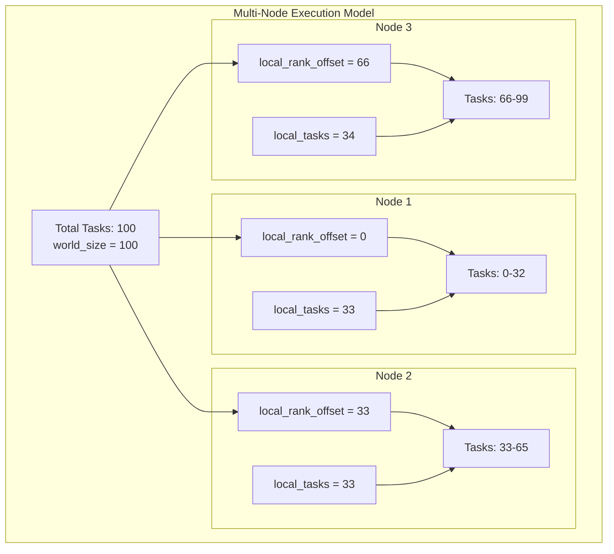

<!-- source: DeepWiki mcp.deepwiki.com · repo huggingface/datatrove · page 2.1 Local Pipeline Execution · fetched 2026-10-26 -->

# Local Pipeline Execution

<details>
<summary>Relevant source files</summary>

The following files were used as context for generating this wiki page:

- [examples/filter_hf_dataset_jobs.py](examples/filter_hf_dataset_jobs.py)
- [examples/minhash_deduplication_jobs.py](examples/minhash_deduplication_jobs.py)
- [examples/tokenize_hf_dataset_jobs.py](examples/tokenize_hf_dataset_jobs.py)
- [src/datatrove/executor/__init__.py](src/datatrove/executor/__init__.py)
- [src/datatrove/executor/base.py](src/datatrove/executor/base.py)
- [src/datatrove/executor/jobs.py](src/datatrove/executor/jobs.py)
- [src/datatrove/executor/local.py](src/datatrove/executor/local.py)
- [src/datatrove/executor/slurm.py](src/datatrove/executor/slurm.py)
- [tests/executor/test_jobs.py](tests/executor/test_jobs.py)

</details>


This document covers the `LocalPipelineExecutor` implementation for running data processing pipelines on local machines with multiprocessing support. The `LocalPipelineExecutor` provides a concrete implementation of the abstract `PipelineExecutor` base class specifically designed for local execution environments.

For information about distributed cluster execution, see [Slurm Cluster Execution](2.2) and [Ray Distributed Execution](2.3). For the overall pipeline execution framework, see [Pipeline Execution Architecture](2).

## Architecture Overview

The `LocalPipelineExecutor` extends the base `PipelineExecutor` class to provide local multiprocessing capabilities for pipeline execution. It manages task distribution across multiple worker processes while maintaining task completion tracking and dependency management.

**LocalPipelineExecutor Architecture**


Sources: [src/datatrove/executor/local.py:15-61](), [src/datatrove/executor/base.py:37-63]()

## Core Components

### LocalPipelineExecutor Class

The `LocalPipelineExecutor` class is the main implementation located in [src/datatrove/executor/local.py:15-161](). It inherits from the abstract `PipelineExecutor` base class and provides the following key functionality:

| Component | Purpose | Key Methods |
|-----------|---------|-------------|
| Task Execution | Runs pipeline steps for each task | `run()`, `_launch_run_for_rank()` |
| Worker Management | Manages multiprocessing workers | Queue-based rank assignment |
| Completion Tracking | Tracks and resumes completed tasks | `is_rank_completed()`, `mark_rank_as_completed()` |
| Statistics Collection | Aggregates performance metrics | `PipelineStats` merging |
| Dependency Management | Handles executor dependencies | `depends` parameter processing |

Sources: [src/datatrove/executor/local.py:15-35](), [src/datatrove/executor/base.py:63-112]()

### Multiprocessing Architecture

The executor uses Python's `multiprocess` library to enable parallel task execution. The multiprocessing implementation includes:

**Multiprocessing Execution Flow**


Sources: [src/datatrove/executor/local.py:84-152](), [src/datatrove/executor/local.py:62-82]()

## Configuration Parameters

The `LocalPipelineExecutor` constructor accepts several configuration parameters for customizing execution behavior:

| Parameter | Type | Default | Description |
|-----------|------|---------|-------------|
| `pipeline` | `list[PipelineStep \| Callable]` | Required | Pipeline steps to execute |
| `tasks` | `int` | `1` | Total number of tasks |
| `workers` | `int` | `-1` | Concurrent workers (-1 = tasks) |
| `logging_dir` | `DataFolderLike` | `None` | Log output directory |
| `depends` | `LocalPipelineExecutor` | `None` | Dependency executor |
| `skip_completed` | `bool` | `True` | Skip already completed tasks |
| `start_method` | `str` | `"forkserver"` | Multiprocessing start method |
| `local_tasks` | `int` | `-1` | Tasks for this node (-1 = all) |
| `local_rank_offset` | `int` | `0` | Starting task rank |
| `randomize_start_duration` | `int` | `0` | Random start delay (seconds) |

Sources: [src/datatrove/executor/local.py:36-60](), [src/datatrove/executor/base.py:50-60]()

## Task Management and Completion Tracking

The executor implements task management to support resumable execution and completion tracking. Ranks that have successfully completed are marked by an empty file in the `completions/` directory within the `logging_dir`.

**Task Completion Tracking System**


Sources: [src/datatrove/executor/base.py:116-154](), [src/datatrove/executor/base.py:156-178](), [src/datatrove/executor/local.py:119-121]()

## Multi-Node Execution Support

The `LocalPipelineExecutor` supports coordinated execution across multiple nodes through the `local_tasks` and `local_rank_offset` parameters. This allows a user to manually shard a large job across several machines.



The validation logic ensures that `local_rank_offset + local_tasks <= tasks` to prevent task range overlap between nodes [src/datatrove/executor/local.py:56-59]().

Sources: [src/datatrove/executor/local.py:45-46](), [src/datatrove/executor/local.py:53-59]()

## Dependency Management

The executor supports chaining multiple `LocalPipelineExecutor` instances through the `depends` parameter. The dependency system ensures that dependent executors complete before starting the current executor by polling for incomplete ranks [src/datatrove/executor/local.py:101-105]().

```python
# Dependency resolution in run() method
if self.depends:
    # take care of launching any unlaunched dependencies
    if not self.depends._launched:
        logger.info(f'Launching dependency job "{self.depends}"')
        self.depends.run()
    while (
        incomplete := len(self.depends.get_incomplete_ranks(skip_completed=True))
    ) > 0:  # set skip_completed=True to get *real* incomplete task count
        logger.info(f"Dependency job still has {incomplete}/{self.depends.world_size} tasks. Waiting...")
        time.sleep(2 * 60)
```

Sources: [src/datatrove/executor/local.py:93-106]()

## Statistics and Logging

The executor collects and aggregates statistics from all tasks using the `PipelineStats` system. Individual task statistics are saved to `stats/{rank:05d}.json` files [src/datatrove/executor/base.py:145-146](), and a merged summary is saved to `stats.json` in the `logging_dir` [src/datatrove/executor/local.py:149-150]().

Logging is handled through the base executor's logging infrastructure, which creates per-task log files using `add_task_logger` [src/datatrove/executor/base.py:122]().

Sources: [src/datatrove/executor/local.py:147-152](), [src/datatrove/executor/base.py:122-123](), [src/datatrove/executor/base.py:143-147]()

---

