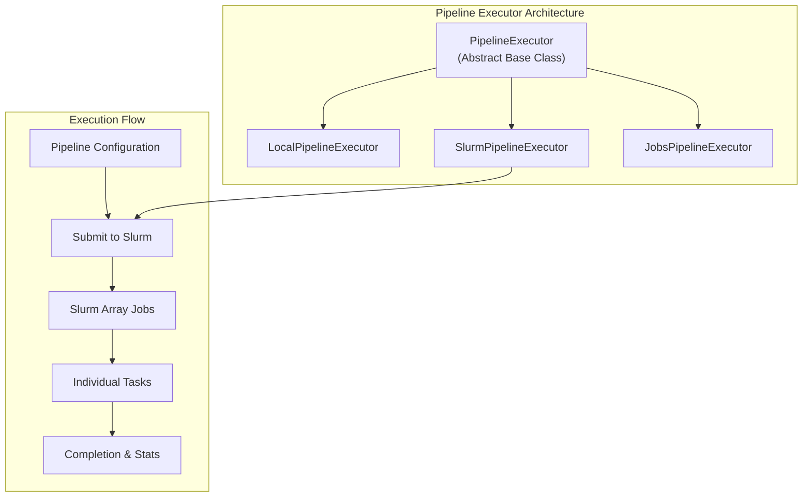
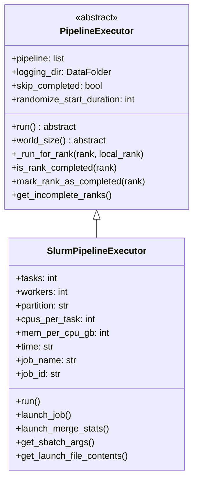
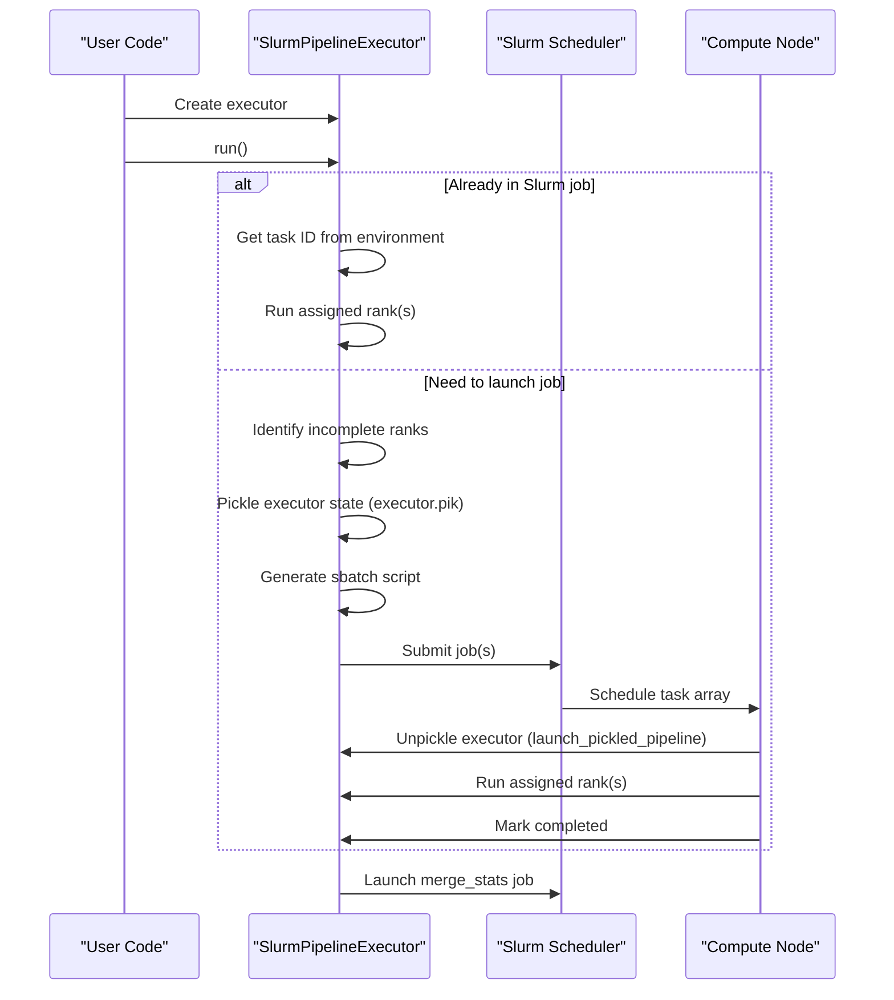
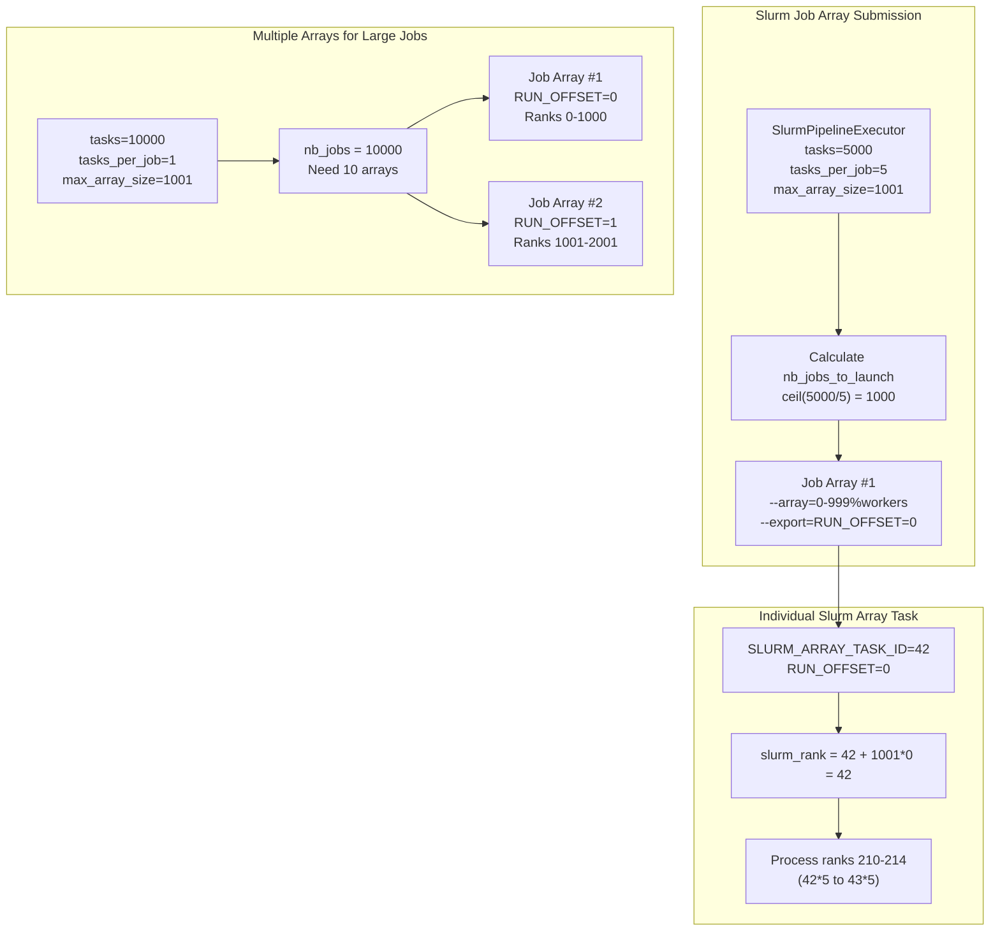
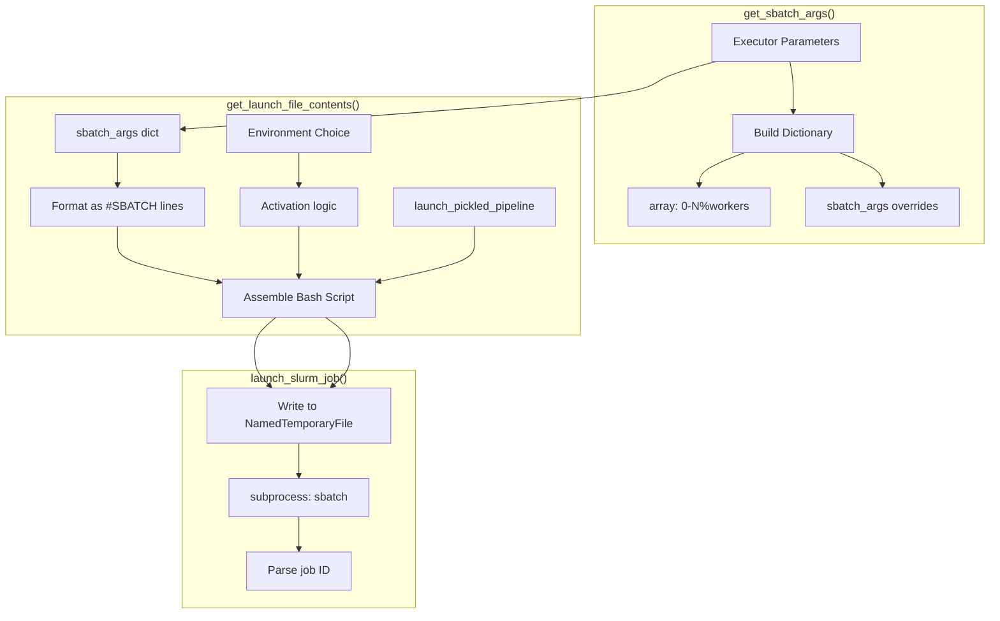
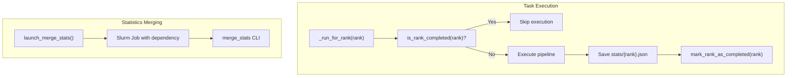

<!-- source: DeepWiki mcp.deepwiki.com · repo huggingface/datatrove · page 2.2 Slurm Cluster Execution · fetched 2026-10-26 -->

# Slurm Cluster Execution

<details>
<summary>Relevant source files</summary>

The following files were used as context for generating this wiki page:

- [examples/filter_hf_dataset_jobs.py](examples/filter_hf_dataset_jobs.py)
- [examples/minhash_deduplication_jobs.py](examples/minhash_deduplication_jobs.py)
- [examples/tokenize_hf_dataset_jobs.py](examples/tokenize_hf_dataset_jobs.py)
- [src/datatrove/executor/__init__.py](src/datatrove/executor/__init__.py)
- [src/datatrove/executor/base.py](src/datatrove/executor/base.py)
- [src/datatrove/executor/jobs.py](src/datatrove/executor/jobs.py)
- [src/datatrove/executor/local.py](src/datatrove/executor/local.py)
- [src/datatrove/executor/slurm.py](src/datatrove/executor/slurm.py)
- [src/datatrove/tools/launch_pickled_pipeline.py](src/datatrove/tools/launch_pickled_pipeline.py)
- [src/datatrove/tools/merge_stats.py](src/datatrove/tools/merge_stats.py)
- [tests/executor/test_jobs.py](tests/executor/test_jobs.py)

</details>


This document describes the Slurm Cluster Execution system within DataTrove, which enables distribution of processing pipelines across computing clusters running the Slurm Workload Manager. For information about running pipelines on a single machine, see [Local Pipeline Execution](#2.1).

## 1. Overview

The Slurm Cluster Execution system allows DataTrove pipelines to scale beyond a single machine by distributing tasks across a Slurm-managed computing cluster. It handles job submission, task distribution, environment setup, and completion tracking.



Sources: [src/datatrove/executor/slurm.py:32-165](), [src/datatrove/executor/base.py:37-58](), [src/datatrove/executor/jobs.py:32-120]()

## 2. SlurmPipelineExecutor

The `SlurmPipelineExecutor` class is the main component responsible for executing pipelines on a Slurm cluster. It extends the abstract `PipelineExecutor` class and implements its interface for distributed execution.



Sources: [src/datatrove/executor/slurm.py:48-165](), [src/datatrove/executor/base.py:37-101]()

### 2.1 Key Parameters

The `SlurmPipelineExecutor` accepts numerous parameters to configure Slurm job execution:

| Parameter | Type | Default | Description |
|-----------|------|---------|-------------|
| pipeline | list | - | List of pipeline steps to execute |
| tasks | int | - | Total number of DataTrove tasks to run |
| time | str | - | Time limit for each job (Slurm format: "HH:MM:SS") |
| partition | str | - | Slurm partition to use |
| cpus_per_task | int | 1 | CPUs allocated per task |
| mem_per_cpu_gb | int | 2 | Memory per CPU in GB |
| gpus_per_task | int | 0 | GPUs allocated per task |
| nodes_per_task | int | 1 | Number of nodes to allocate per task (for multi-node jobs) |
| workers | int | -1 | Number of concurrent tasks (-1 for no limit) |
| job_name | str | "data_processing" | Name for Slurm job |
| qos | str | "normal" | Quality of Service for Slurm job |
| depends | SlurmPipelineExecutor | None | Another executor job that must complete first |
| depends_job_id | str | None | Direct Slurm job ID to depend on |
| max_array_size | int | 1001 | Maximum size of a Slurm array job (cluster-dependent) |
| tasks_per_job | int | 1 | Number of DataTrove tasks per Slurm array task |
| with_srun | bool | True | Whether to use srun for launching tasks |
| srun_args | dict | None | Additional arguments to pass to srun |
| sbatch_args | dict | None | Additional arguments to pass to sbatch |
| max_array_launch_parallel | bool | False | Launch multiple job arrays in parallel if needed |
| stagger_max_array_jobs | int | 0 | Seconds to wait between launching parallel job arrays |
| run_on_dependency_fail | bool | False | Start even if dependency job fails |
| randomize_start_duration | int | 0 | Maximum seconds to randomly delay task start |
| requeue_signals | tuple | ("SIGUSR1",) | Signals that trigger job requeuing (None to disable) |
| mail_type | str | "ALL" | Email notification types (NONE, BEGIN, END, FAIL, REQUEUE, ALL) |
| mail_user | str | None | Email address to send notifications to |
| requeue | bool | True | Whether to requeue jobs that fail |
| slurm_logs_folder | str | None | Where to store raw Slurm log files (local path) |

Sources: [src/datatrove/executor/slurm.py:108-144]()

### 2.2 Environment Configuration

The executor supports various methods for activating Python environments within Slurm jobs:

| Parameter | Description | Priority |
|-----------|-------------|----------|
| env_command | Custom command to activate an environment | Highest (if set) |
| condaenv | Name of conda environment to activate | Medium |
| venv_path | Path to a Python virtual environment to activate | Lowest |

The environment activation is handled in `get_launch_file_contents()`, which generates the appropriate activation command based on which parameter is provided.

Sources: [src/datatrove/executor/slurm.py:121-123](), [src/datatrove/executor/slurm.py:378-388]()

## 3. Execution Workflow

The Slurm execution process involves several distinct phases:



Sources: [src/datatrove/executor/slurm.py:167-198](), [src/datatrove/executor/slurm.py:233-298](), [src/datatrove/tools/launch_pickled_pipeline.py:9-18]()

### 3.1 Job Submission Process

When the `run()` method is called, the executor first checks if it's already running inside a Slurm job by looking for the `SLURM_ARRAY_TASK_ID` environment variable:

**Already Inside Slurm Job:**
1. Calculate `slurm_rank` from `SLURM_ARRAY_TASK_ID` and `RUN_OFFSET`.
2. Determine which DataTrove ranks to process based on `tasks_per_job`.
3. Load the list of ranks to run from `ranks_to_run.json`.
4. Register signal handlers for `requeue_signals` if configured.
5. Execute `_run_for_rank()` for each assigned rank.

**Not Inside Slurm Job (Submission Phase):**
1. Call `launch_job()` to submit work to the cluster.

The `launch_job()` method performs these steps:
1. Resolve dependencies by launching dependent jobs if needed.
2. Get incomplete ranks via `get_incomplete_ranks()`.
3. Serialize the executor state using `dill.dump()` to `executor.pik` with `CONTENTS_FMODE`.
4. Save executor configuration as JSON via `save_executor_as_json()`.
5. Save list of incomplete ranks to `ranks_to_run.json` to avoid race conditions.
6. Calculate number of Slurm jobs needed: `ceil(len(ranks_to_run) / tasks_per_job)`.
7. Generate sbatch script using `get_launch_file_contents()`.
8. Submit job(s) via `launch_slurm_job()` helper.
9. Launch statistics merger job via `launch_merge_stats()`.

Sources: [src/datatrove/executor/slurm.py:191-228](), [src/datatrove/executor/slurm.py:263-330]()

### 3.2 Job Arrays and Scaling

For large pipelines, the executor uses Slurm's job array functionality to distribute work efficiently. The relationship between Slurm jobs and DataTrove tasks is controlled by two key parameters:

**Rank Calculation Formulas:**
```
slurm_rank = SLURM_ARRAY_TASK_ID + max_array_size * RUN_OFFSET
datatrove_ranks = range(slurm_rank * tasks_per_job, (slurm_rank + 1) * tasks_per_job)
```

**Job Array and Task Distribution:**



Sources: [src/datatrove/executor/slurm.py:199-208](), [src/datatrove/executor/slurm.py:298-330]()

### 3.3 Job Dependencies

The executor supports job dependencies through the `dependency` property:

**Dependency Sources:**
1. `depends` parameter: Takes another `SlurmPipelineExecutor` instance.
2. `depends_job_id` parameter: Takes a raw Slurm job ID string directly.
3. Multi-array dependencies: When `max_array_launch_parallel=False`, each subsequent array depends on the previous one.

**Dependency Types:**
- `afterok:<job_id>`: Wait for successful completion (default).
- `afterany:<job_id>`: Wait for completion regardless of success (if `run_on_dependency_fail=True`).

Sources: [src/datatrove/executor/slurm.py:249-261](), [src/datatrove/executor/slurm.py:269-279](), [src/datatrove/executor/slurm.py:325-326]()

## 4. SBATCH Script Generation

The executor generates Slurm job scripts programmatically through two key methods:

**Script Generation Flow:**



Sources: [src/datatrove/executor/slurm.py:332-364](), [src/datatrove/executor/slurm.py:366-402](), [src/datatrove/executor/slurm.py:420-435]()

### 4.1 Signal Handling and Job Recovery

The executor implements specialized signal handling for job recovery in preemptible environments through the `requeue_handler()` function:

```python
def requeue_handler(signum, _frame):
    signame = signal.Signals(signum).name
    logger.warning(f"Received signal {signum} ({signame}). Requeueing and exiting...")
    subprocess.run(["scontrol", "requeue", os.environ.get("SLURM_JOB_ID")])
    sys.exit(15)
```

Sources: [src/datatrove/executor/slurm.py:41-45](), [src/datatrove/executor/slurm.py:210-211]()

## 5. Multi-Node Execution and Distributed Environment

The Slurm executor supports multi-node execution through the `nodes_per_task` parameter.

**Node List Expansion:**

The `expand_slurm_nodelist()` function expands Slurm's compressed node list format using `scontrol show hostnames`.

**Distributed Environment Variables:**

The `get_distributed_env()` method populates environment variables for distributed execution:

```python
def get_distributed_env(self, node_rank: int = -1) -> DistributedEnvVars:
    node_hosts = expand_slurm_nodelist(os.environ["SLURM_NODELIST"])
    return DistributedEnvVars(
        datatrove_node_ips=",".join(node_hosts),
        datatrove_cpus_per_task=str(self.cpus_per_task),
        datatrove_mem_per_cpu=str(self.mem_per_cpu_gb),
        datatrove_gpus_on_node=str(self.gpus_per_task),
        datatrove_executor="SLURM",
    )
```

Sources: [src/datatrove/executor/slurm.py:25-38](), [src/datatrove/executor/slurm.py:404-413](), [src/datatrove/executor/base.py:93-101]()

## 6. Completion Tracking and Statistics

The Slurm executor inherits completion tracking and statistics collection from the `PipelineExecutor` base class.

**Completion Tracking Flow:**



Sources: [src/datatrove/executor/slurm.py:229-247](), [src/datatrove/executor/base.py:102-154](), [src/datatrove/tools/merge_stats.py:26-40]()

## 7. Example Usage

```python
from datatrove.executor.slurm import SlurmPipelineExecutor

executor = SlurmPipelineExecutor(
    pipeline=pipeline,
    tasks=1000,
    time="24:00:00",
    partition="compute",
    cpus_per_task=4,
    mem_per_cpu_gb=8,
    workers=100,
    job_name="datatrove_job",
    condaenv="datatrove",
    logging_dir="s3://my-bucket/logs/my_job"
)

executor.run()
```

Sources: [src/datatrove/executor/slurm.py:48-144](), [examples/filter_hf_dataset_jobs.py:62-81]()

---

