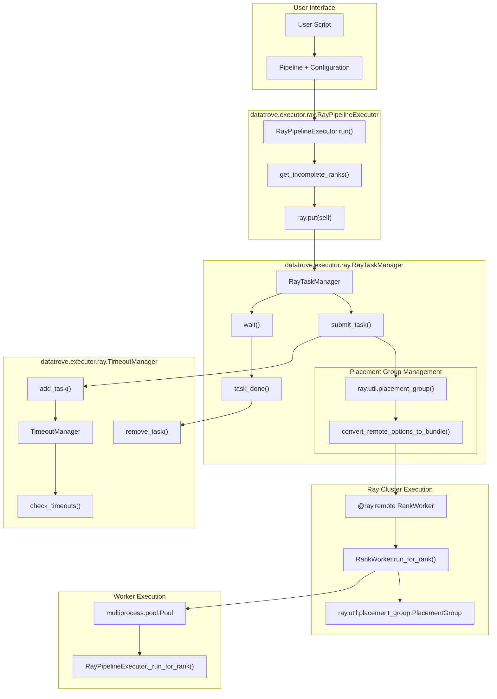
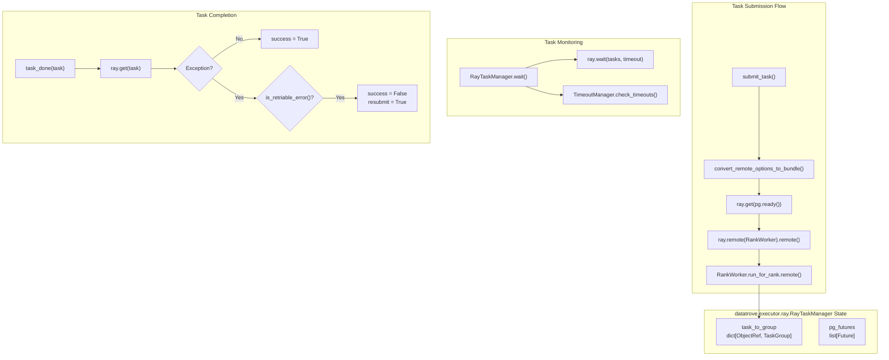

<!-- source: DeepWiki mcp.deepwiki.com · repo huggingface/datatrove · page 2.3 Ray Distributed Execution · fetched 2026-10-26 -->

# Ray Distributed Execution

<details>
<summary>Relevant source files</summary>

The following files were used as context for generating this wiki page:

- [examples/filter_hf_dataset_jobs.py](examples/filter_hf_dataset_jobs.py)
- [examples/minhash_deduplication_jobs.py](examples/minhash_deduplication_jobs.py)
- [examples/tokenize_hf_dataset_jobs.py](examples/tokenize_hf_dataset_jobs.py)
- [src/datatrove/executor/__init__.py](src/datatrove/executor/__init__.py)
- [src/datatrove/executor/jobs.py](src/datatrove/executor/jobs.py)
- [src/datatrove/executor/ray.py](src/datatrove/executor/ray.py)
- [tests/executor/test_jobs.py](tests/executor/test_jobs.py)
- [tests/executor/test_ray.py](tests/executor/test_ray.py)

</details>


This page documents the `RayPipelineExecutor`, which enables distributed pipeline execution using Ray clusters. It covers task management, placement group coordination for multi-node execution, timeout handling, error recovery mechanisms, and resource cleanup.

For local multiprocessing execution, see [Local Pipeline Execution](#2.1). For SLURM cluster execution, see [Slurm Cluster Execution](#2.2). For the base executor abstraction and task sharding concepts, see [Pipeline Execution Architecture](#2).

---

## Architecture Overview

The Ray executor provides distributed execution across Ray clusters with support for multi-node tasks, automatic retries, and resource management.

### System Architecture and Code Entities
The following diagram maps high-level system components to specific classes and functions within the `datatrove` codebase.


**Sources:** [src/datatrove/executor/ray.py:29-44](), [src/datatrove/executor/ray.py:139-157](), [src/datatrove/executor/ray.py:110-118]()

---

## RayPipelineExecutor Configuration

The `RayPipelineExecutor` class extends `PipelineExecutor` and provides Ray-specific configuration for distributed execution. It is defined in `src/datatrove/executor/ray.py`.

### Core Parameters

| Parameter | Type | Default | Description |
|-----------|------|---------|-------------|
| `pipeline` | `list[PipelineStep \| Callable]` | Required | List of pipeline steps to execute |
| `tasks` | `int` | Required | Total number of tasks (determines `world_size`) |
| `workers` | `int` | `-1` | Number of concurrent tasks. `-1` means no limit |
| `logging_dir` | `DataFolderLike` | Auto-generated | Directory for logs, stats, and checkpoints |
| `nodes_per_task` | `int` | `1` | Number of nodes per task (enables placement groups when > 1) |
| `depends` | `RayPipelineExecutor` | `None` | Another executor that must complete first |

### Resource Allocation
Resource requirements are passed to Ray via `remote_options` in `submit_task` [src/datatrove/executor/ray.py:158-160]().

| Parameter | Type | Default | Description |
|-----------|------|---------|-------------|
| `cpus_per_task` | `int` | `1` | CPUs allocated per task |
| `gpus_per_task` | `int` | `0` | GPUs allocated per task |
| `mem_per_task_gb` | `int` | `2` | Memory in GB per task |

**Sources:** [src/datatrove/executor/ray.py:86-97](), [src/datatrove/executor/ray.py:168-179]()

---

## Task Submission and Management

The `RayTaskManager` class handles task lifecycle, including submission, monitoring, completion tracking, and cleanup.

### Task Lifecycle Flow
The following diagram describes how `RayTaskManager` interacts with Ray primitives to manage task execution.


**Sources:** [src/datatrove/executor/ray.py:158-202](), [src/datatrove/executor/ray.py:101-109]()

### TaskGroup Data Structure
The `RayTaskManager` maintains a `TaskGroup` [src/datatrove/executor/ray.py:101-107]() for each submitted batch of tasks:
- `tasks`: List of Ray `ObjectRef` returned by `run_for_rank.remote()` [src/datatrove/executor/ray.py:102]().
- `workers`: List of `ActorHandle` for `RankWorker` [src/datatrove/executor/ray.py:103]().
- `placement_group`: The `PlacementGroup` used for multi-node coordination [src/datatrove/executor/ray.py:104]().
- `ranks`: The specific pipeline ranks being processed by this group [src/datatrove/executor/ray.py:105]().

### Retriable vs Non-Retriable Errors
The task manager identifies retriable errors (like `WorkerCrashedError`) to determine if ranks should be resubmitted. This logic is typically handled during the `ray.get(task)` call in `task_done` or within the main execution loop.

**Sources:** [src/datatrove/executor/ray.py:101-109](), [tests/executor/test_ray.py:161-164]()

---

## Placement Groups for Multi-Node Tasks

When `nodes_per_task > 1`, the Ray executor creates placement groups via `ray.util.placement_group` [src/datatrove/executor/ray.py:168](). This ensures that the required resources are co-located or distributed according to the strategy (defaulting to bundles for each node).

### Placement Group Creation
The `convert_remote_options_to_bundle` function [src/datatrove/executor/ray.py:86-97]() maps executor resources to Ray resource bundles:
- `num_cpus` -> `CPU`
- `memory` -> `memory`
- `num_gpus` -> `GPU`

### Environment Coordination
Within `RankWorker.run_for_rank`, the executor sets environment variables for distributed coordination:
- `RAY_NODELIST`: Comma-separated list of node IPs [src/datatrove/executor/ray.py:63]().
- `RAY_NODEID`: The index of the current node in the group [src/datatrove/executor/ray.py:64]().

**Sources:** [src/datatrove/executor/ray.py:38-68](), [src/datatrove/executor/ray.py:86-97]()

---

## Timeout Management

The `TimeoutManager` class [src/datatrove/executor/ray.py:110-137]() tracks task start times and identifies tasks that exceed the configured duration.

### Timeout Behavior
1. **Task Registration**: When a task is submitted, `add_task(task)` [src/datatrove/executor/ray.py:119-120]() records `time.time()`.
2. **Periodic Checks**: `check_timeouts()` [src/datatrove/executor/ray.py:125-136]() iterates through `task_start_times` and returns tasks where `elapsed > timeout_seconds`.
3. **Cleanup**: Once a task is finished or cancelled, `remove_task(task)` [src/datatrove/executor/ray.py:122-123]() removes it from tracking.

**Sources:** [src/datatrove/executor/ray.py:110-137]()

---

## Cleanup and Resource Management

The `RayTaskManager` implements cleanup to prevent resource leaks.

### Cleanup Operations
When `RayTaskManager` exits (as a context manager) or when tasks finish:
1. **Placement Groups**: Placement groups are tracked and can be removed via `ray.util.remove_placement_group`.
2. **Actors**: `RankWorker` actors are terminated.
3. **Tasks**: Pending tasks are cancelled if necessary.

**Sources:** [src/datatrove/executor/ray.py:139-202](), [tests/executor/test_ray.py:244-250]()

---

## Usage Example

The following example demonstrates setting up a `RayPipelineExecutor` for a standard processing task.

```python
from datatrove.executor.ray import RayPipelineExecutor
from datatrove.pipeline.readers import JsonlReader
from datatrove.pipeline.writers import JsonlWriter

executor = RayPipelineExecutor(
    pipeline=[
        JsonlReader("s3://my-bucket/input/"),
        # ... steps ...
        JsonlWriter("s3://my-bucket/output/"),
    ],
    tasks=100,
    workers=20,
    logging_dir="s3://my-bucket/logs/",
    nodes_per_task=1
)

executor.run()
```

**Sources:** [tests/executor/test_ray.py:54-60](), [src/datatrove/executor/ray.py:13-18]()

---

