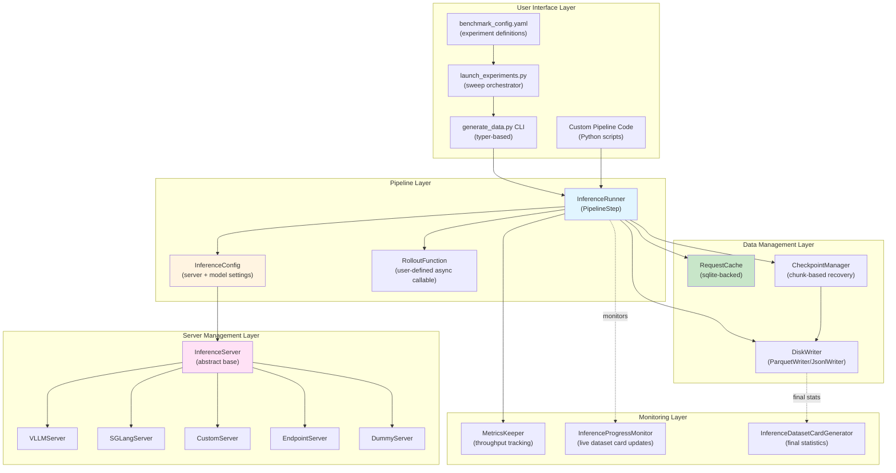
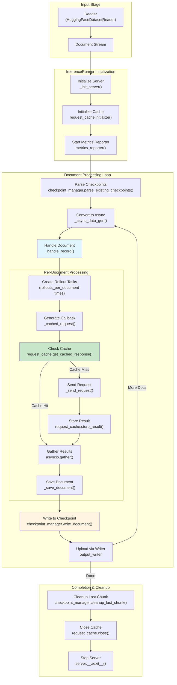
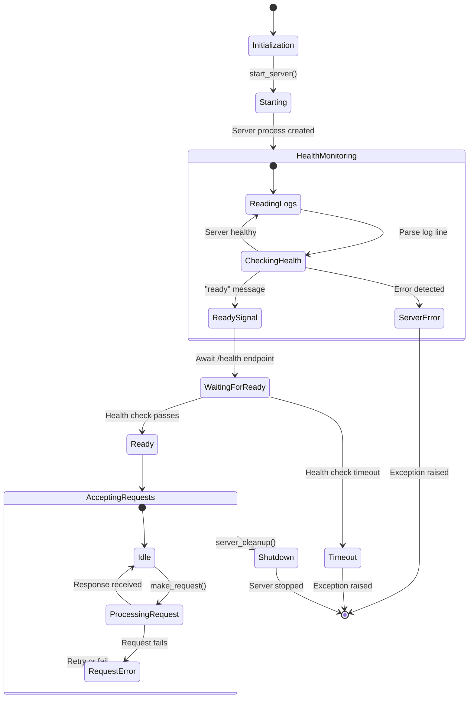

<!-- source: DeepWiki mcp.deepwiki.com · repo huggingface/datatrove · page 3 Inference and Synthetic Data Generation · fetched 2026-10-26 -->

# Inference and Synthetic Data Generation

<details>
<summary>Relevant source files</summary>

The following files were used as context for generating this wiki page:

- [.gitignore](.gitignore)
- [README.md](README.md)
- [examples/inference/README.md](examples/inference/README.md)
- [examples/inference/benchmark/README.md](examples/inference/benchmark/README.md)
- [examples/inference/benchmark/analyze_results.py](examples/inference/benchmark/analyze_results.py)
- [examples/inference/benchmark/launch_experiments.py](examples/inference/benchmark/launch_experiments.py)
- [examples/inference/benchmark/sample_benchmark_config.yaml](examples/inference/benchmark/sample_benchmark_config.yaml)
- [examples/inference/generate_data.py](examples/inference/generate_data.py)
- [examples/inference/utils.py](examples/inference/utils.py)
- [src/datatrove/pipeline/inference/checkpointing.py](src/datatrove/pipeline/inference/checkpointing.py)
- [src/datatrove/pipeline/inference/run_inference.py](src/datatrove/pipeline/inference/run_inference.py)
- [src/datatrove/pipeline/inference/servers/base.py](src/datatrove/pipeline/inference/servers/base.py)
- [src/datatrove/pipeline/inference/servers/dummy_server.py](src/datatrove/pipeline/inference/servers/dummy_server.py)

</details>


## Purpose and Scope

This section covers DataTrove's inference system for generating synthetic datasets using large language models. The system enables scalable LLM inference on document collections, supporting batch processing from thousands to millions of examples with automatic checkpointing, request caching, and progress tracking.

The inference system handles:
- **Synthetic data generation** at scale (data augmentation, rewriting, translation, summarization)
- **Multi-server backends** (vLLM, SGLang, custom HTTP endpoints)
- **Fault tolerance** through chunk-based checkpointing and request-level caching
- **Distributed execution** across multiple GPUs and nodes
- **Progress monitoring** with live dataset card updates

For general pipeline execution concepts, see [Pipeline Execution Architecture](#2). For writing output data, see [Data Writers and Output Management](#7). For tokenization of generated data for training, see [Tokenization and Data Preparation](#6).

**Sources:** [README.md:331-362](), [examples/inference/generate_data.py:1-58](), [src/datatrove/pipeline/inference/run_inference.py:1-11]()

---

## System Architecture

The inference system consists of four main layers working together to process documents through LLM inference:

### Component Overview



**Sources:** [src/datatrove/pipeline/inference/run_inference.py:100-161](), [examples/inference/generate_data.py:95-157](), [src/datatrove/pipeline/inference/servers/__init__.py:1-9]()

---

## Core Concepts

### Rollout Functions

A **rollout function** is an async callable that orchestrates one or more generation requests for a single document. The function signature is defined by `RolloutFunction` [src/datatrove/pipeline/inference/types.py:34-34]():

```python
async def rollout_fn(
    document: Document,
    generate: Callable[[dict], Awaitable[InferenceResult]],
    **shared_context
) -> InferenceResult | dict | list | str | None
```

The `generate` callback sends a single request to the inference server and returns an `InferenceResult`. The rollout can call `generate` multiple times (sequentially or in parallel) to implement complex patterns like chunked processing or multi-turn conversations.

**Return value handling:**
- `InferenceResult`: Stored as-is in `document.metadata[metadata_key]` [src/datatrove/pipeline/inference/run_inference.py:145-145]().
- Other JSON-serializable values (dict, list, str, int, float, bool): Stored directly.
- `None`: Document is excluded from output (all rollouts must return `None` to exclude).

For details, see [InferenceRunner Core](#3.1).

**Sources:** [src/datatrove/pipeline/inference/run_inference.py:125-161](), [src/datatrove/pipeline/inference/types.py:34-34](), [examples/inference/README.md:12-19]()

---

### Request Caching and Checkpointing

The inference system provides two levels of fault tolerance:

#### Request-Level Caching

The `RequestCache` [src/datatrove/pipeline/inference/checkpointing.py:38-38]() is an `aiosqlite`-backed cache used to store individual request results. It deduplicates requests using a payload hash generated via `xxhash` [src/datatrove/pipeline/inference/checkpointing.py:105-109]().

**Sources:** [src/datatrove/pipeline/inference/checkpointing.py:38-120](), [src/datatrove/pipeline/inference/run_inference.py:143-143]()

#### Chunk-Based Checkpointing

The `CheckpointManager` [src/datatrove/pipeline/inference/checkpointing.py:123-123]() (detailed in child pages) manages document persistence in local chunks. If a task fails, it resumes from the last completed chunk identified by `last_chunk/<rank>.txt`.

**Sources:** [src/datatrove/pipeline/inference/checkpointing.py:123-250](), [examples/inference/README.md:82-87]()

---

## Inference Execution Flow

### End-to-End Processing Pipeline



**Sources:** [src/datatrove/pipeline/inference/run_inference.py:483-571](), [src/datatrove/pipeline/inference/run_inference.py:416-479]()

---

## Server Backend Architecture

All server backends inherit from the `InferenceServer` [src/datatrove/pipeline/inference/servers/base.py:121-121]() abstract base class. This class provides the infrastructure for managing server processes, including port selection via `_find_available_port` [src/datatrove/pipeline/inference/servers/base.py:74-74]() and health monitoring.

### Server Lifecycle Management



For details on specific implementations like `VLLMServer` or `SGLangServer`, see [Server Backends and Configuration](#3.3).

**Sources:** [src/datatrove/pipeline/inference/servers/base.py:121-174](), [src/datatrove/pipeline/inference/servers/vllm_server.py:14-14](), [src/datatrove/pipeline/inference/servers/dummy_server.py:81-81]()

---

## Benchmarking System

The benchmark system uses `launch_experiments.py` [examples/inference/benchmark/launch_experiments.py:62-62]() to orchestrate parameter sweeps defined in YAML. It follows a tiered approach to optimize throughput by sweeping parameters like `tp`, `max-num-seqs`, and `speculative-config`.

Key metrics are analyzed using `analyze_results.py` [examples/inference/benchmark/analyze_results.py:1-22](), which parses server logs to extract `avg_prompt_throughput` and `avg_generation_throughput` [examples/inference/benchmark/analyze_results.py:128-129]().

For details, see [Benchmark System and Experiment Management](#3.2).

**Sources:** [examples/inference/benchmark/sample_benchmark_config.yaml:5-14](), [examples/inference/benchmark/launch_experiments.py:1-27](), [examples/inference/benchmark/analyze_results.py:68-134]()

---

## Progress Monitoring and Dataset Cards

The system provides real-time visibility into large-scale generation jobs:

- **Progress Monitoring**: The `InferenceProgressMonitor` (detailed in child pages) tracks completion rates and calculates ETAs.
- **Dataset Cards**: `InferenceDatasetCardGenerator` [src/datatrove/pipeline/inference/dataset_card_generator.py:33-33]() automatically produces a `README.md` for the generated Hugging Face dataset, including model metadata and token statistics.

For details, see [Progress Monitoring and Dataset Cards](#3.4).

**Sources:** [examples/inference/generate_data.py:69-72](), [examples/inference/README.md:51-57]()

---

