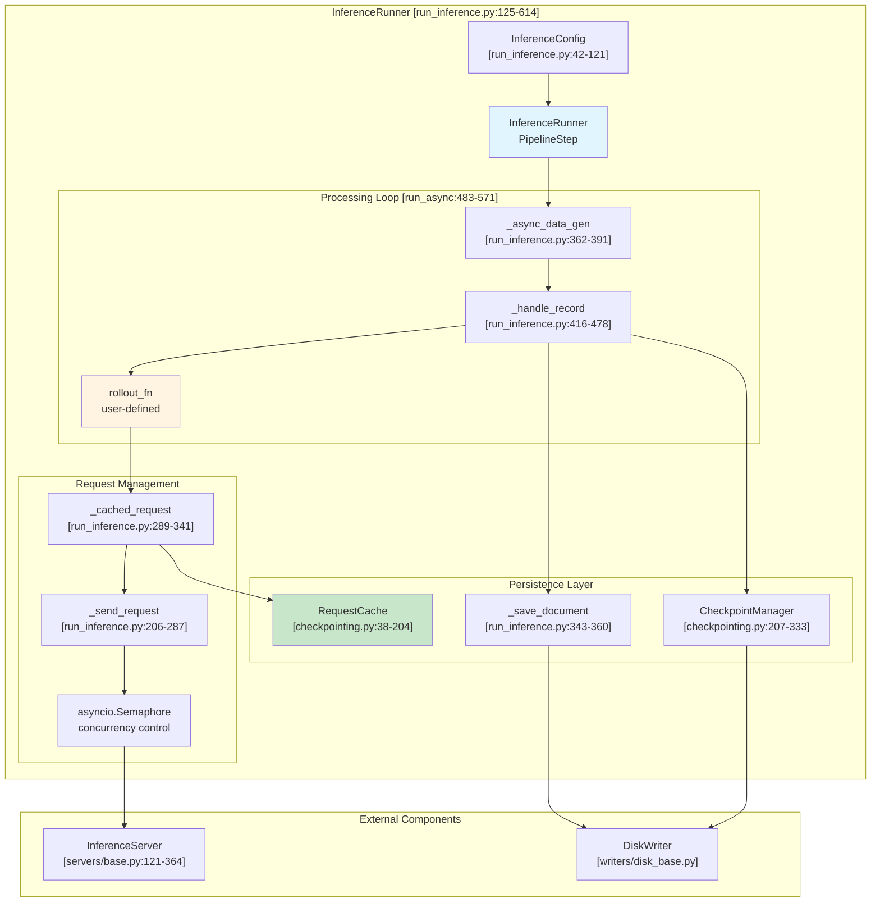
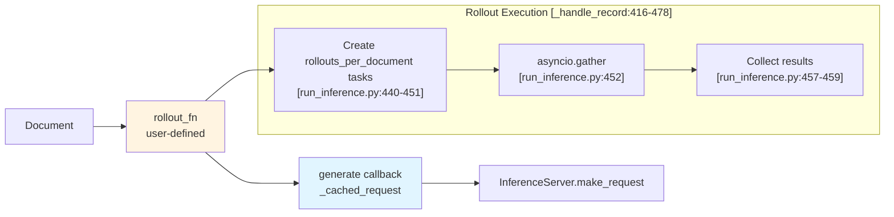
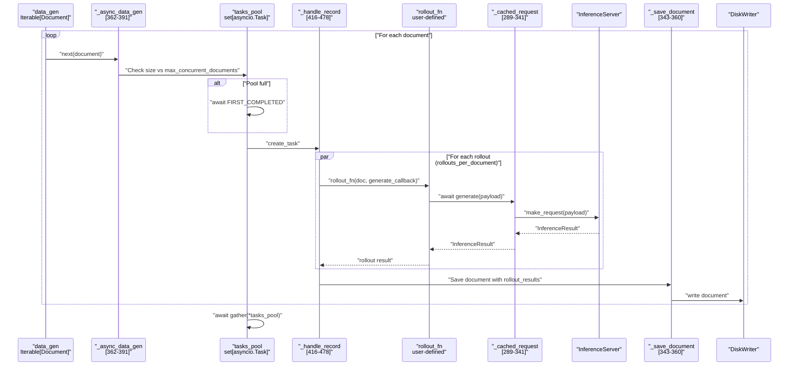
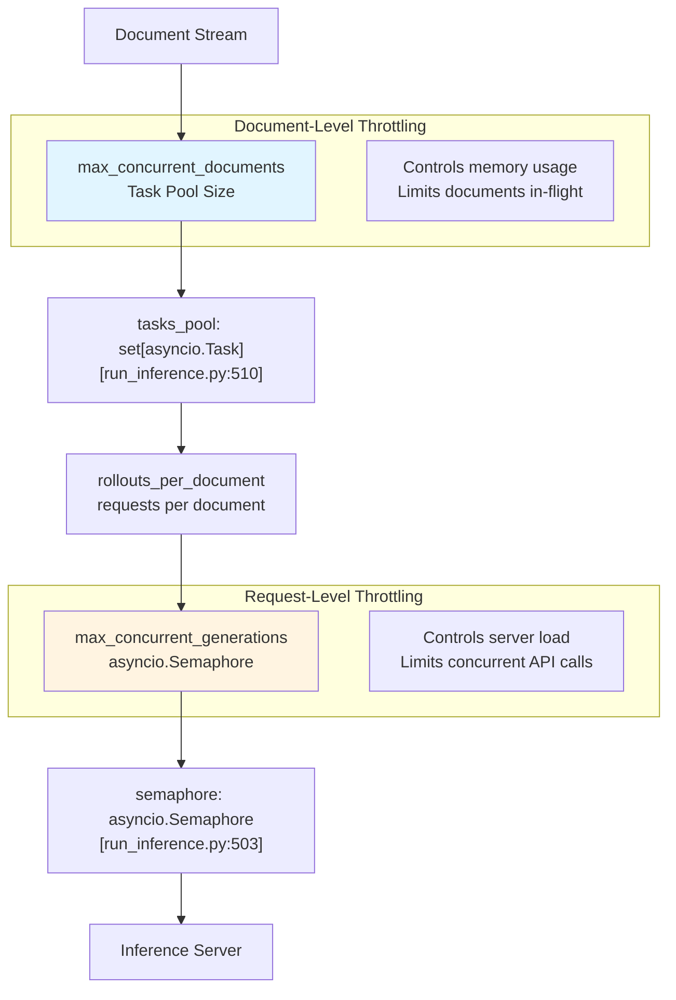

<!-- source: DeepWiki mcp.deepwiki.com · repo huggingface/datatrove · page 3.1 InferenceRunner Core · fetched 2026-10-26 -->

# InferenceRunner Core

<details>
<summary>Relevant source files</summary>

The following files were used as context for generating this wiki page:

- [src/datatrove/pipeline/inference/__init__.py](src/datatrove/pipeline/inference/__init__.py)
- [src/datatrove/pipeline/inference/checkpointing.py](src/datatrove/pipeline/inference/checkpointing.py)
- [src/datatrove/pipeline/inference/metrics.py](src/datatrove/pipeline/inference/metrics.py)
- [src/datatrove/pipeline/inference/run_inference.py](src/datatrove/pipeline/inference/run_inference.py)
- [src/datatrove/pipeline/inference/servers/base.py](src/datatrove/pipeline/inference/servers/base.py)
- [src/datatrove/pipeline/inference/servers/dummy_server.py](src/datatrove/pipeline/inference/servers/dummy_server.py)
- [src/datatrove/pipeline/inference/types.py](src/datatrove/pipeline/inference/types.py)
- [tests/pipeline/inference/test_inference.py](tests/pipeline/inference/test_inference.py)
- [tests/pipeline/text/test_request_cache.py](tests/pipeline/text/test_request_cache.py)

</details>


## Purpose and Scope

This document covers the `InferenceRunner` class, which is the primary pipeline step for executing inference workloads on documents using large language models. `InferenceRunner` orchestrates asynchronous request processing, manages concurrency, handles checkpointing and request caching, and integrates with various inference server backends.

For information about inference server implementations (vLLM, SGLang, etc.), see [Server Backends and Configuration](#3.3). For experiment management and benchmarking infrastructure, see [Benchmark System and Experiment Management](#3.2). For progress tracking and dataset card generation, see [Progress Monitoring and Dataset Cards](#3.4).

---

## Architecture Overview

The `InferenceRunner` implements a multi-layered asynchronous processing pipeline that coordinates document ingestion, request generation, server communication, and result persistence.

### Component Interaction Diagram



**Sources:** [src/datatrove/pipeline/inference/run_inference.py:42-614](), [src/datatrove/pipeline/inference/checkpointing.py:38-333](), [src/datatrove/pipeline/inference/servers/base.py:121-364]()

---

## Configuration System

The `InferenceConfig` dataclass centralizes all inference-related configuration parameters.

### InferenceConfig Parameters

| Parameter | Type | Default | Description |
|-----------|------|---------|-------------|
| `server_type` | `Literal` | Required | Type of inference server: `"sglang"`, `"vllm"`, `"dummy"`, `"custom"`, `"endpoint"` |
| `model_name_or_path` | `str` | Required | Model identifier or path |
| `model_max_context` | `int` | `8192` | Maximum context length for the model |
| `use_chat` | `bool` | `True` | Use chat endpoint (`/v1/chat/completions`) vs completion endpoint |
| `endpoint_url` | `str \| None` | `None` | Required when `server_type="endpoint"` |
| `api_key` | `str \| None` | `None` | API key for endpoint authentication (Bearer token) |
| `metric_interval` | `int` | `120` | Metrics reporting interval in seconds |
| `tp` | `int` | `1` | Tensor parallelism size (GPUs per model replica) |
| `dp` | `int` | `1` | Data parallelism size (number of model replicas) |
| `pp` | `int` | `1` | Pipeline parallelism size |
| `default_generation_params` | `dict` | `{}` | Default parameters merged into all generation requests |
| `rollouts_per_document` | `int` | `1` | Number of rollouts to perform per document |
| `max_concurrent_generations` | `int` | `500` | Maximum concurrent requests to the inference server |
| `max_concurrent_documents` | `int \| None` | Auto-calculated | Maximum documents being processed concurrently |
| `request_timeout` | `float \| None` | `None` | HTTP request timeout in seconds |
| `model_kwargs` | `dict \| None` | `None` | Additional kwargs passed to server initialization |
| `server_log_folder` | `str \| None` | `None` | Directory for server logs (one per rank) |
| `master_port` | `int` | `9810` | Master node port for distributed settings |
| `server_start_timeout_sec` | `float` | `60.0` | Timeout for launching the server process |

**Auto-calculated values:**
- When `max_concurrent_documents` is `None`, it defaults to `max(1, self.max_concurrent_generations // self.rollouts_per_document)` [src/datatrove/pipeline/inference/run_inference.py:118-119]()

**Sources:** [src/datatrove/pipeline/inference/run_inference.py:42-121]()

---

## Rollout Functions

Rollout functions define the inference logic applied to each document. They are user-provided async functions that receive a document and a generation callback.

### Rollout Function Signature

The `RolloutFunction` protocol defines the interface for these functions [src/datatrove/pipeline/inference/types.py:68-85]().

```python
async def rollout_fn(
    document: Document,
    generate: GenerateFunction,
    **kwargs: Any,
) -> RolloutResult
```

### Execution Model



### Common Rollout Patterns

**Simple Rollout:**
```python
async def simple_rollout(document, generate):
    result = await generate({
        "messages": [{"role": "user", "content": document.text}],
        "max_tokens": 100
    })
    return {"text": result.text, "usage": result.usage}
```

**Returning None to Skip:**
When all rollouts for a document return `None`, the document is marked for removal and not written to output [src/datatrove/pipeline/inference/run_inference.py:467-468]().

**Sources:** [src/datatrove/pipeline/inference/run_inference.py:137-147](), [src/datatrove/pipeline/inference/types.py:68-85](), [tests/pipeline/inference/test_inference.py:46-73]()

---

## Asynchronous Processing Pipeline

### Document Flow Through the System



### Core Processing Loop

The main processing loop is implemented in `run_async` [src/datatrove/pipeline/inference/run_inference.py:483-571]():

1. **Initialization** [src/datatrove/pipeline/inference/run_inference.py:495-507]():
   - Initialize inference server.
   - Create semaphore with `max_concurrent_generations` limit.
   - Initialize request cache and metrics reporting task.

2. **Checkpoint Recovery** [src/datatrove/pipeline/inference/run_inference.py:519-526]():
   - Parse existing checkpoints using `CheckpointManager`.
   - Upload cached documents to output writer.

3. **Document Processing** [src/datatrove/pipeline/inference/run_inference.py:527-562]():
   - Convert synchronous data generator to async via `_async_data_gen`.
   - Throttle based on `max_concurrent_documents`.
   - Create task for each document via `_handle_record`.

4. **Cleanup** [src/datatrove/pipeline/inference/run_inference.py:571-595]():
   - Cancel pending tasks and close request cache.

**Sources:** [src/datatrove/pipeline/inference/run_inference.py:483-595]()

---

## Concurrency Control

`InferenceRunner` uses two levels of concurrency control:

### Two-Level Throttling



### Task Pool Management

**Throttling Logic** [src/datatrove/pipeline/inference/run_inference.py:544-548]():
```python
while len(tasks_pool) >= self.config.max_concurrent_documents:
    done, tasks_pool = await asyncio.wait(tasks_pool, return_when=asyncio.FIRST_COMPLETED)
    for task in done:
        await task  # Re-raises exceptions
```

**Sources:** [src/datatrove/pipeline/inference/run_inference.py:229-231](), [src/datatrove/pipeline/inference/run_inference.py:544-562]()

---

## Request Caching and Checkpointing

### RequestCache: Deduplication and Replay

The `RequestCache` class provides a lightweight `aiosqlite` backed cache to store individual request results [src/datatrove/pipeline/inference/checkpointing.py:38-204]().

**Key Features:**
- **Payload Hashing**: Uses `xxhash` to generate unique keys for request payloads [src/datatrove/pipeline/inference/checkpointing.py:105-109]().
- **Persistence**: Results and errors are stored in `replay.sqlite3` within the checkpoint directory [src/datatrove/pipeline/inference/checkpointing.py:59-60]().
- **Async Writer**: Uses a background queue and task to write to SQLite without blocking the main loop [src/datatrove/pipeline/inference/checkpointing.py:111-140]().

### CheckpointManager

The `CheckpointManager` handles high-level document-level checkpointing [src/datatrove/pipeline/inference/checkpointing.py:207-333](). It saves documents to local JSONL files in chunks to ensure progress is not lost if a job is interrupted.

**Sources:** [src/datatrove/pipeline/inference/checkpointing.py:38-333](), [src/datatrove/pipeline/inference/run_inference.py:289-341]()

---

## Shared Context Feature

The `shared_context` parameter allows injection of resources into rollout functions.

### Supported Types

`InferenceRunner` resolves the context via `get_shared_context_cm` [src/datatrove/pipeline/inference/run_inference.py:393-414]():

1. **`dict`**: Static values.
2. **`Callable[[], dict]`**: Factory function.
3. **`ContextManager[dict]`**: Resource manager (e.g., `multiprocessing.Pool`).

**Sources:** [src/datatrove/pipeline/inference/run_inference.py:393-414]()

---

## Metrics and Monitoring

### Tracked Metrics

- **Request Metrics**: `tokens_input`, `tokens_output`, `requests`, `successful_requests`, `failed_requests` [src/datatrove/pipeline/inference/run_inference.py:161]().
- **Queue Metrics**: `waiting_requests`, `running_requests` [src/datatrove/pipeline/inference/run_inference.py:162]().

The `metrics_reporter` task logs these values at regular intervals [src/datatrove/pipeline/inference/run_inference.py:164-176]().

**Sources:** [src/datatrove/pipeline/inference/run_inference.py:161-176](), [src/datatrove/pipeline/inference/metrics.py:6-132]()

---

## Error Handling and Retry Logic

### Request-Level Backoff

The `_send_request` method implements exponential backoff for transient errors like `ConnectionError` or `TimeoutError` [src/datatrove/pipeline/inference/run_inference.py:206-287]().

**Retry Flow:**
1. **Transient Errors**: Retries up to 6 times with `5 * (2**attempt)` seconds delay [src/datatrove/pipeline/inference/run_inference.py:264]().
2. **Unrecoverable Errors**: `ServerError` or `asyncio.CancelledError` stop the pipeline immediately [src/datatrove/pipeline/inference/run_inference.py:249-255]().

**Sources:** [src/datatrove/pipeline/inference/run_inference.py:206-287](), [src/datatrove/pipeline/inference/types.py:25-56]()

---

