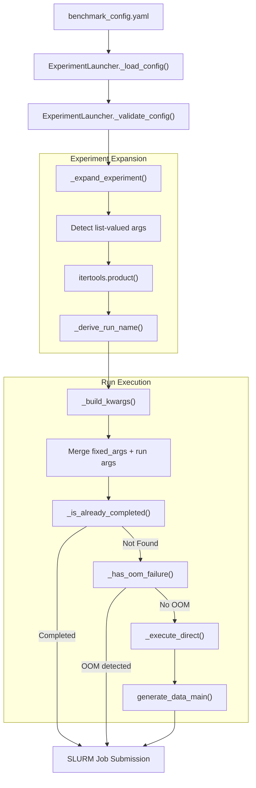
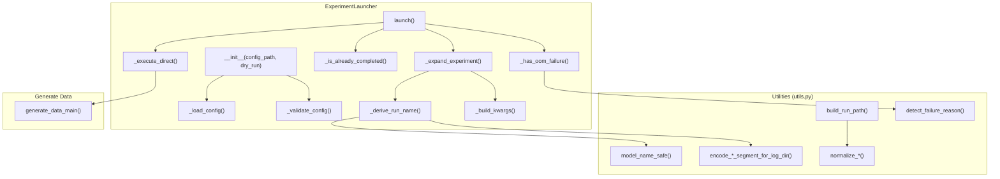

<!-- source: DeepWiki mcp.deepwiki.com · repo huggingface/datatrove · page 3.2 Benchmark System and Experiment Management · fetched 2026-10-26 -->

# Benchmark System and Experiment Management

Relevant source files

The following files were used as context for generating this wiki page:

- [examples/inference/benchmark/README.md](examples/inference/benchmark/README.md)
- [examples/inference/benchmark/analyze_results.py](examples/inference/benchmark/analyze_results.py)
- [examples/inference/benchmark/launch_experiments.py](examples/inference/benchmark/launch_experiments.py)
- [examples/inference/benchmark/sample_benchmark_config.yaml](examples/inference/benchmark/sample_benchmark_config.yaml)
- [examples/inference/generate_data.py](examples/inference/generate_data.py)
- [examples/inference/utils.py](examples/inference/utils.py)

## Purpose and Scope

This document describes DataTrove's benchmark system for systematically evaluating inference configurations across models, parallelization strategies, and optimization techniques. The system automates the process of defining parameter sweeps, launching experiments as SLURM jobs, and analyzing throughput metrics to identify optimal configurations.

For information about the core inference execution logic, see [InferenceRunner Core](3.1). For details on server backends and configuration, see [Server Backends and Configuration](3.3). For progress monitoring during execution, see [Progress Monitoring and Dataset Cards](3.4).

Sources: [examples/inference/benchmark/README.md:1-23]()

## Overview

The benchmark system consists of three main components:

1.  **Configuration System**: YAML-based experiment definitions with support for parameter sweeps [examples/inference/benchmark/sample_benchmark_config.yaml:1-55]().
2.  **Experiment Launcher**: Expands configurations and submits SLURM jobs with automatic retry and failure detection [examples/inference/benchmark/launch_experiments.py:62-95]().
3.  **Results Analyzer**: Parses logs, computes throughput metrics, and generates CSV summaries [examples/inference/benchmark/analyze_results.py:2-10]().

The system is designed around a **tiered optimization strategy** where experiments are run sequentially, with each tier building on optimal settings from previous tiers to efficiently explore the configuration space [examples/inference/benchmark/sample_benchmark_config.yaml:1-8]().

Sources: [examples/inference/benchmark/README.md:1-12](), [examples/inference/benchmark/launch_experiments.py:1-27]()

## Configuration System

### YAML Structure

Benchmark experiments are defined in YAML configuration files with the following top-level structure:

| Key | Type | Description |
| :--- | :--- | :--- |
| `script` | string | Path to the inference script (typically `examples/inference/generate_data.py`) [examples/inference/benchmark/sample_benchmark_config.yaml:22-22]() |
| `continue_on_failure` | boolean | Whether to continue launching jobs if one fails [examples/inference/benchmark/sample_benchmark_config.yaml:23-23]() |
| `fixed_args` | dict | Arguments applied to all experiments [examples/inference/benchmark/sample_benchmark_config.yaml:26-54]() |
| `experiments` | list | List of experiment configurations [examples/inference/benchmark/sample_benchmark_config.yaml:66-66]() |

Each experiment in the `experiments` list contains a `name` and an `args` dictionary where list values trigger cartesian product expansion [examples/inference/benchmark/launch_experiments.py:117-134]().

Sources: [examples/inference/benchmark/launch_experiments.py:89-134](), [examples/inference/benchmark/sample_benchmark_config.yaml:22-66]()

### Parameter Sweep Expansion

When an argument value is a list, the launcher generates the cartesian product of all list-valued arguments, creating multiple runs [examples/inference/benchmark/launch_experiments.py:387-404]().

**Configuration Flow from YAML to Job Submission**

Sources: [examples/inference/benchmark/launch_experiments.py:314-404](), [examples/inference/benchmark/launch_experiments.py:152-193]()

### Run Name Derivation

Run names are automatically derived from non-default configuration values following the canonical output path order. The `ExperimentLauncher._derive_run_name()` method constructs names by concatenating configuration segments that differ from defaults [examples/inference/benchmark/launch_experiments.py:152-193]():

1.  `prompt_template_name` (if specified as `[name, template]`)
2.  `model_name_or_path` (organization prefix stripped via `model_name_safe`)
3.  Parallelism: `tp`, `pp`, `dp` (if not 1)
4.  Batching: `mns` (if not 256), `mnbt` (if not 8192)
5.  Memory: `gmu` (if not 0.9)
6.  KV cache: `bs` (if not 16), `kvc` (if not auto)
7.  Optimizations: `spec` (if specified), `quant` (if specified)

Sources: [examples/inference/benchmark/launch_experiments.py:152-193](), [examples/inference/utils.py:127-156]()

## Experiment Launcher

The `ExperimentLauncher` class orchestrates the entire benchmark workflow:

**ExperimentLauncher Class Structure**

Sources: [examples/inference/benchmark/launch_experiments.py:62-404](), [examples/inference/utils.py:15-64]()

### Skip Logic

The launcher implements smart skip logic to avoid rerunning experiments based on their status:

1.  **Completion Check**: `_is_already_completed()` checks for `stats.json` existence at the run path [examples/inference/benchmark/launch_experiments.py:343-355]().
2.  **Failure Detection**: `detect_failure_reason()` scans log files for patterns like `OOM`, `timeout`, or `server_fail` [examples/inference/utils.py:32-64]().
3.  **Configurable Skipping**: Users can control which failure reasons trigger a skip via `--skip-failure-reasons` [examples/inference/benchmark/launch_experiments.py:85-87]().

Sources: [examples/inference/benchmark/launch_experiments.py:343-366](), [examples/inference/utils.py:15-29]()

## Tiered Optimization Strategy

The benchmark system implements a **sequential tiered approach** where each tier optimizes a different aspect of inference performance [examples/inference/benchmark/sample_benchmark_config.yaml:3-8]().

| Tier | Parameters | Goal |
| :--- | :--- | :--- |
| **0** | `tp`, `mns`, `mnbt` | **Parallelism & Batching** - Find optimal parallelism and batch sizes [examples/inference/benchmark/sample_benchmark_config.yaml:57-65](). |
| **1** | `spec`, `gmu` | **SpecDec & GMU** - Lossless speedup via speculative decoding and memory tuning [examples/inference/benchmark/sample_benchmark_config.yaml:118-129](). |

Sources: [examples/inference/benchmark/sample_benchmark_config.yaml:1-129](), [examples/inference/benchmark/README.md:107-116]()

## Output Directory Structure

The launcher creates a hierarchical output directory structure that encodes configuration parameters in the path [examples/inference/benchmark/README.md:89-92]().

**Output Path Construction**

```mermaid
graph LR
    ROOT["output_dir"]
    EXP["{experiment}"]
    PROMPT["{prompt}"]
    MODEL["{model}"]
    PARALLEL["tp{TP}-pp{PP}-dp{DP}"]
    MNS["mns_{N}"]
    MNBT["mnbt_{M}"]
    GMU["gmu_{P}"]
    BS["bs_{B}"]
    KVC["kvc_{...}"]
    SPEC["spec_{...}"]
    QUANT["quant_{...}"]
    LOGS["inference_logs/"]
    
    ROOT --> EXP
    EXP --> PROMPT
    PROMPT --> MODEL
    MODEL --> PARALLEL
    PARALLEL --> MNS
    MNS --> MNBT
    MNBT --> GMU
    GMU --> BS
    BS --> KVC
    KVC --> SPEC
    SPEC --> QUANT
    QUANT --> LOGS
```

Sources: [examples/inference/benchmark/README.md:89-92](), [examples/inference/utils.py:391-427]()

## Results Analysis System

The `analyze_results.py` script processes completed benchmark runs to extract metrics and generate comprehensive CSV summaries [examples/inference/benchmark/analyze_results.py:2-10]().

### Data Sources

The analyzer extracts data from:
1.  **Path Fields**: Configuration parameters parsed from the directory structure via `parse_path_fields()` [examples/inference/benchmark/analyze_results.py:137-219]().
2.  **stats.json**: End-to-end metrics (token counts, request counts, total time) via `parse_stats_json()` [examples/inference/benchmark/analyze_results.py:221-266]().
3.  **Server Logs**: Steady-state throughput metrics (prompt/generation throughput, KV cache usage) via `parse_server_logs()` [examples/inference/benchmark/analyze_results.py:68-135]().

Sources: [examples/inference/benchmark/analyze_results.py:63-266]()

### Metrics Computation

The analyzer computes several derived metrics to evaluate hardware efficiency:

*   **Throughput**: `avg_generation_throughput` (engine total) and `output_tps_per_gpu` [examples/inference/benchmark/analyze_results.py:73-75]().
*   **Efficiency**: `gpu_days_to_process_1b_tokens` and `gpus_for_1b_tokens_per_hour` [examples/inference/benchmark/analyze_results.py:373-381]().
*   **Memory**: `avg_gpu_kvc_usage` and `avg_prefix_cache_hit_rate` [examples/inference/benchmark/analyze_results.py:127-134]().

Sources: [examples/inference/benchmark/analyze_results.py:355-381](), [examples/inference/benchmark/README.md:118-134]()

### Failure Detection

The analyzer uses `detect_failure_reason` to identify why specific configurations failed, allowing researchers to see the "OOM boundary" for different models [examples/inference/benchmark/analyze_results.py:330-342]().

Sources: [examples/inference/utils.py:15-64](), [examples/inference/benchmark/analyze_results.py:43-44]()

---

